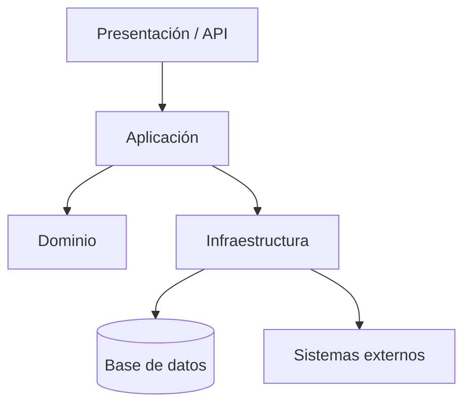

# Arquitectura por capas / N-tier

## Concepto

La arquitectura por capas separa responsabilidades en niveles lógicos, como presentación, aplicación, dominio y persistencia. N-tier suele referirse a una separación física de esos niveles en procesos, servidores o redes. Las capas describen organización lógica; los tiers, ubicación de ejecución. Pueden combinarse, pero no son sinónimos.

## Organización frecuente

| Capa | Responsabilidad típica |
|---|---|
| Presentación | Interacción con usuarios o consumidores de API |
| Aplicación | Casos de uso, coordinación y transacciones |
| Dominio | Reglas y conceptos de negocio |
| Infraestructura | Persistencia, mensajería y adaptadores externos |

En una arquitectura cerrada, una capa solo llama a la inmediatamente inferior; en una abierta puede usar cualquier capa inferior. Las reglas deben explicitarse para evitar saltos que generen acoplamiento.

La aplicación puede desplegar todas las capas en un único proceso o distribuirlas en tiers separados. Separar físicamente niveles agrega fronteras de red y operación; no es obligatorio para tener separación lógica.

## Cuándo considerarla

- Aplicaciones empresariales tradicionales con responsabilidades relativamente estables.
- Sistemas existentes que ya siguen capas y deben migrarse con cambios acotados.
- Equipos que necesitan límites fáciles de entender entre interfaz, lógica y acceso a datos.
- Soluciones donde los requisitos no justifican todavía una descomposición por servicios.

## Beneficios y costos

**Beneficios:** estructura conocida; responsabilidades visibles; posible separación de despliegue, seguridad y escalado cuando se necesitan tiers físicos; puede facilitar migraciones graduales.

**Costos y riesgos:** una capa de negocio genérica puede convertirse en un intermediario CRUD; el flujo obligatorio por capas puede añadir latencia; cambios verticales pueden requerir coordinación de muchas capas; dividir tiers físicamente añade redes, fallas remotas y operación.

## Reglas de diseño

- Definir si las capas son lógicas, físicas o ambas.
- Establecer reglas de dependencias y evitar que el dominio dependa de infraestructura concreta.
- Separar interfaces de modelos internos cuando haya razones de contrato o seguridad.
- No crear capas vacías que solo reenvían llamadas.
- Distribuir una capa en otro tier solo si hay necesidades justificadas de aislamiento, escalado, seguridad o despliegue.

## Referencias

- [Microsoft: N-tier architecture style](https://learn.microsoft.com/en-us/azure/architecture/guide/architecture-styles/n-tier)
- [Microsoft: estilos de arquitectura](https://learn.microsoft.com/azure/architecture/guide/architecture-styles)
