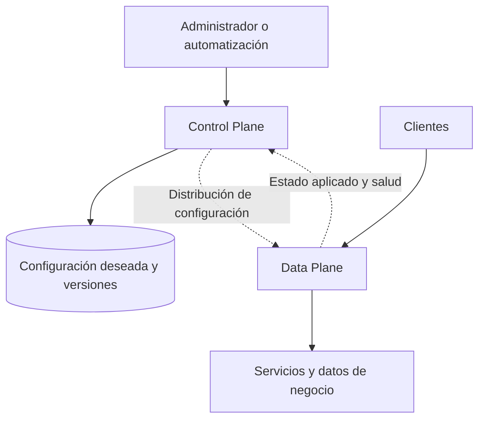

# Separación del plano de control y del plano de datos

## Concepto y alcance

La separación **Control Plane / Data Plane** organiza un sistema en dos responsabilidades: administrar cómo debe funcionar y ejecutar su trabajo principal. Es un enfoque arquitectónico originado en redes y aplicado también a infraestructura, plataformas SaaS, proxies y sistemas distribuidos. Puede describirse como un patrón de separación de responsabilidades, aunque no existe una única plantilla universal para implementarlo.

- **Control Plane (plano de control):** administra configuración, políticas, recursos y su ciclo de vida.
- **Data Plane (plano de datos):** atiende solicitudes o procesa trabajo aplicando la configuración y las políticas vigentes.

El plano de datos no es simplemente la base de datos: incluye los componentes que ejecutan la función principal del sistema. Tampoco toda escritura pertenece al plano de control: registrar un pago puede ser una operación del plano de datos; cambiar la política de enrutamiento de pagos puede pertenecer al plano de control.

La separación puede ser lógica dentro de una aplicación o física entre procesos, redes y despliegues. No exige microservicios ni un producto específico.

## Características y responsabilidades

| Aspecto | Control Plane | Data Plane |
|---|---|---|
| Propósito | Administrar el comportamiento y los recursos | Ejecutar las operaciones del servicio |
| Operaciones | Aprovisionar, configurar, publicar políticas, retirar recursos | Recibir, validar, enrutar, transformar o ejecutar solicitudes |
| Estado típico | Configuración deseada, catálogo de recursos y versiones | Datos de negocio, estado de ejecución y configuración aplicada |
| Usuarios habituales | Administradores, operadores y automatizaciones | Clientes, aplicaciones y consumidores del servicio |
| Prioridades | Corrección de cambios, trazabilidad y convergencia | Disponibilidad, latencia, capacidad y aislamiento |
| Escalado | Según cambios, recursos y tareas de administración | Según tráfico o volumen de trabajo |
| Seguridad | Autorizar cambios y limitar su alcance | Autorizar cada operación y aplicar las políticas |

Son tendencias, no garantías: un plano de control puede tener gran volumen de operaciones y requisitos estrictos de disponibilidad. Cada plano necesita objetivos de servicio propios.

## Interacción entre planos

Un flujo habitual es:

1. El plano de control autentica y autoriza un cambio, valida su contenido y guarda una versión.
2. La configuración se distribuye a las instancias correspondientes.
3. Cada instancia valida la compatibilidad y aplica el cambio de forma segura.
4. La instancia informa qué versión está activa y qué errores encontró.
5. El sistema identifica instancias pendientes o divergentes y reintenta o revierte según su política.

**Aceptar un cambio no equivale a haberlo aplicado en todas las instancias.** La interfaz de administración debe distinguir esos estados y permitir consultar el avance.

### Estado deseado y reconciliación

Un controlador puede comparar el estado observado con el deseado y ejecutar acciones correctivas hasta hacerlos converger. Las acciones deben tolerar reintentos y evitar efectos duplicados; los errores persistentes necesitan límites y escalamiento operativo.

La reconciliación es un mecanismo frecuente del plano de control, pero **no define por sí sola la separación de planos**. Un sistema también puede distribuir configuración mediante publicaciones explícitas sin ejecutar un ciclo continuo de reconciliación.

## Decisiones de diseño

Las siguientes son preguntas de diseño para una solución concreta, no requisitos universales del patrón.

| Decisión | Opciones y criterio |
|---|---|
| Separación lógica o física | Empezar con límites de módulos puede bastar. Separar procesos cuando lo justifiquen seguridad, disponibilidad, escalado o autonomía de despliegue. |
| Alcance del control | Un plano global simplifica la administración, pero amplía el impacto de un error. Planos por región, celda o grupo de clientes reducen el alcance y agregan coordinación. |
| Distribución | Push reduce el retraso de propagación; pull facilita el control local de consultas y recuperación. Un esquema híbrido puede combinar notificaciones y lectura de versiones. |
| Unidad de actualización | Aplicar una instantánea coherente o grupos transaccionales evita combinaciones incompatibles de rutas, destinos y políticas. Los cambios parciales requieren reglas explícitas. |
| Consistencia | Definir cuánto retraso se tolera y qué operaciones necesitan confirmación de aplicación. La consistencia eventual puede servir para rutas, pero una revocación puede exigir un plazo mucho más estricto. |
| Versionado | Separar versión del esquema y revisión de configuración. Detectar cambios fuera de orden, duplicados y versiones incompatibles. |
| Persistencia | Identificar la fuente de verdad y quién puede escribirla. El plano de datos puede conservar una copia local; compartir una base introduce dependencias y permisos que deben evaluarse. |
| Compatibilidad | Definir qué versiones de ambos planos interoperan y en qué orden se actualizan. Evitar exigir despliegues simultáneos sin necesidad. |
| Publicación y reversión | Validar antes de publicar, distribuir por etapas y conservar versiones recuperables. Una reversión también debe respetar compatibilidad y orden. |
| Dependencias durante solicitudes | Decidir qué consultas remotas son inevitables y presupuestar latencia y fallos. Consultar el plano de control por cada solicitud reduce la autonomía del plano de datos. |

## Disponibilidad y comportamiento ante fallos

Un objetivo habitual es que el plano de datos continúe con la **última configuración válida** cuando el plano de control no está disponible. Esta propiedad requiere diseño explícito; no aparece automáticamente por separar servicios. AWS la relaciona con la estabilidad estática: seguir operando sin necesitar cambios en una dependencia afectada.

| Situación | Comportamiento que debe definirse |
|---|---|
| Plano de control caído | Qué operaciones existentes continúan y qué cambios administrativos quedan pendientes. |
| Instancia nueva sin conexión | Si puede arrancar desde una copia persistida y validada o debe esperar por configuración inicial. Continuidad y arranque son problemas diferentes. |
| Configuración inválida | Rechazar el cambio, mantener la versión anterior e informar el error. |
| Pérdida de conectividad parcial | Identificar versiones divergentes y aplicar la política de antigüedad máxima. |
| Certificados o permisos vencidos | Respetar vigencias; una configuración anterior no autoriza a ignorar expiraciones o revocaciones. |
| Recuperación del control | Resincronizar con reintentos espaciados y variación aleatoria para evitar una avalancha de conexiones. |

La decisión **fail-open / fail-closed** debe tomarse por operación y política: continuar puede preservar disponibilidad y permitir accesos que ya debían revocarse; rechazar protege ciertas restricciones y puede interrumpir operaciones legítimas. Documentar el plazo máximo sin actualización y quién acepta ese riesgo.

La autonomía también depende de otras piezas: identidad, DNS, almacenamiento, secretos y servicios de autorización pueden seguir siendo dependencias críticas aunque el plano de control esté aislado.

## Seguridad

- Separar identidades y permisos de administración de los utilizados para ejecutar solicitudes.
- Autenticar los canales entre planos y proteger la integridad de la configuración distribuida.
- Aplicar mínimo privilegio por recurso, región y cliente; un compromiso del control puede afectar muchas instancias.
- Auditar autor, motivo, alcance, versión y resultado de cada cambio administrativo.
- Proteger secretos durante almacenamiento y distribución; preferir referencias y entrega restringida cuando sea viable.
- Mantener la autorización de operaciones en el plano de datos, aunque el plano de control administre las políticas.
- Evaluar la revocación urgente y su plazo de aplicación: conservar configuración anterior tiene consecuencias de seguridad.

## Escalabilidad y operación

Escalar el plano de control según recursos administrados, frecuencia de cambios y trabajo de reconciliación; escalar el plano de datos según tráfico, concurrencia y consumo. Evitar que una tormenta de cambios o telemetría agote la capacidad de atender solicitudes.

Medir por separado:

- **Control:** disponibilidad de administración, duración de aprovisionamiento, fallos de publicación y tareas pendientes.
- **Propagación:** tiempo hasta aplicar una versión, antigüedad de configuración y porcentaje de instancias convergentes.
- **Datos:** latencia, errores, capacidad y saturación por instancia y cliente.

Correlacionar incidentes con la versión aplicada. Una configuración válida sintácticamente puede degradar todo el servicio; limitar su alcance mediante validación semántica, despliegues progresivos y señales de salud antes de ampliar la publicación.

Verificar el comportamiento mediante pruebas de desconexión del control, arranque sin conexión, configuración inválida, actualizaciones duplicadas o desordenadas, versiones mixtas y expiración de credenciales. Los resultados deben contrastarse con los objetivos de disponibilidad y propagación definidos.

## Cuándo aplicarlo y sus costos

Conviene considerarlo cuando múltiples instancias deben compartir políticas, hay aprovisionamiento o administración frecuente, o se necesita aislar el tráfico de clientes de cambios y fallos administrativos. También permite organizar una plataforma SaaS con gestión central y ejecución distribuida.

Los beneficios posibles son aislamiento de fallos, escalado independiente y límites de seguridad más claros. Los costos incluyen protocolos de configuración, estados divergentes, compatibilidad entre versiones, infraestructura adicional y mayor complejidad operativa. En una aplicación pequeña, una separación lógica puede ofrecer suficiente claridad sin introducir servicios adicionales.

Errores frecuentes:

- Crear dos servicios que dependen sincrónicamente uno del otro para cada solicitud.
- Tratar una publicación aceptada como una actualización completada.
- No observar qué configuración está realmente activa.
- Permitir escrituras sin coordinación sobre la misma configuración desde ambos planos.
- Confundir cualquier consola administrativa con un plano de control independiente.
- Asumir que separar planos elimina la necesidad de alta disponibilidad del control.

## Ejemplos en esta base de conocimiento

| Ejemplo | Control Plane | Data Plane o ejecución | Documento |
|---|---|---|---|
| Kubernetes | Gestión del estado deseado, planificación y controladores | Nodos y componentes que ejecutan cargas; el plano de datos de red es un alcance más específico | [Arquitectura de Kubernetes](../../container/kubernetes/architecture.md) |
| Envoy y service mesh | Administración y distribución de configuración | Proxies que procesan el tráfico y aplican políticas | [Envoy](../../server/proxies/envoy.md#xds-y-control-plane) |
| RudderStack | Configuración de fuentes, destinos y conexiones | Recepción, transformación y entrega de eventos | [RudderStack en ETL](../../data/etl.md#rudderstack) |

En un gateway de pagos, el control podría publicar rutas y límites mientras el plano de datos procesa cada solicitud. El registro de una transacción sigue siendo una operación del plano de datos aunque modifique información persistente.

## Relación con otros conceptos

- **CQRS:** separa lectura y escritura; ambos tipos de operación pueden existir en cualquiera de los planos. Véase [CQRS](cqrs.md).
- **Consenso:** puede proteger configuración o coordinación crítica; no es obligatorio en toda implementación ni debe imponerse a cada solicitud. Véase [algoritmos de consenso](../datos/consistencia/algoritmos-de-consenso.md).
- **Capas y microservicios:** describen otras dimensiones de organización. Cada plano puede tener capas y estar implementado por uno o varios servicios.
- **Management Plane:** algunos sistemas distinguen administración y gobierno de las decisiones operativas de control. Si se usa un tercer plano, documentar sus límites; la terminología cambia según el contexto.

## Preguntas para una decisión de arquitectura

1. ¿Qué operaciones pertenecen a cada plano y quién es dueño de su estado?
2. ¿La separación será lógica o física y qué requisito la justifica?
3. ¿Cómo se publica, valida, aplica y revierte una configuración?
4. ¿Qué retraso de propagación y antigüedad máxima se aceptan por política?
5. ¿Qué puede seguir funcionando, reiniciarse o escalar sin el control disponible?
6. ¿Cómo se detecta la divergencia y se limita el impacto de un cambio incorrecto?
7. ¿Qué versiones interoperan y cómo se prueban los fallos entre planos?

Registrar las respuestas y sus consecuencias en una decisión de arquitectura de la solución.

## Referencias

- [AWS Builders’ Library: Static stability using Availability Zones](https://aws.amazon.com/builders-library/static-stability-using-availability-zones/): separación de planos y continuidad ante fallos de dependencias.
- [Azure Architecture Center: Considerations for multitenant control planes](https://learn.microsoft.com/en-us/azure/architecture/guide/multitenant/considerations/control-planes): responsabilidades y criterios de diseño en plataformas multitenant.
- [Azure Architecture Center: Architectural approaches for control planes](https://learn.microsoft.com/en-us/azure/architecture/guide/multitenant/approaches/control-planes): alternativas manuales, automatizadas y personalizadas para implementar el control.

Las decisiones y preguntas de este documento sintetizan criterios generales de arquitectura; deben ajustarse a los requisitos de cada solución.
