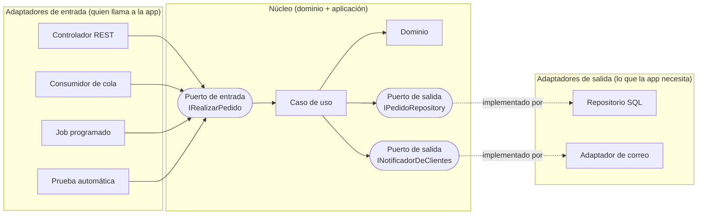
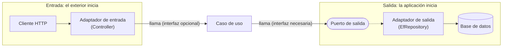
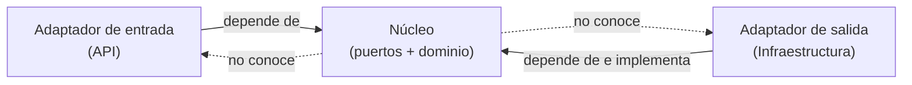
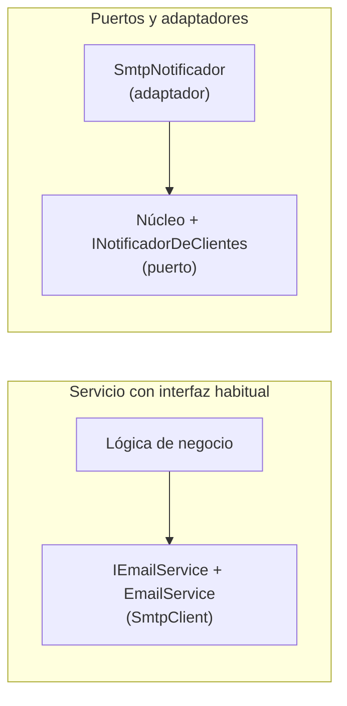
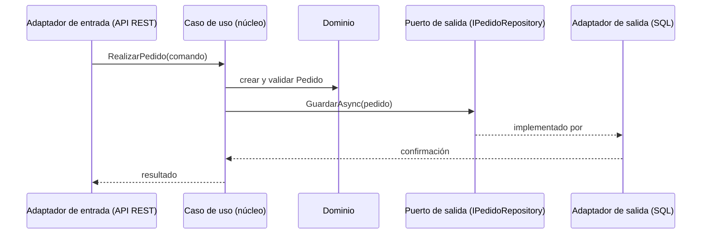
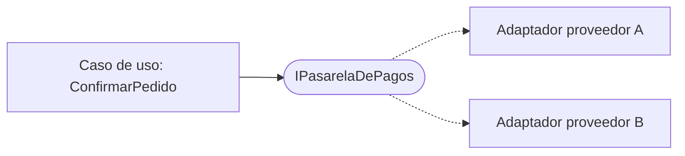
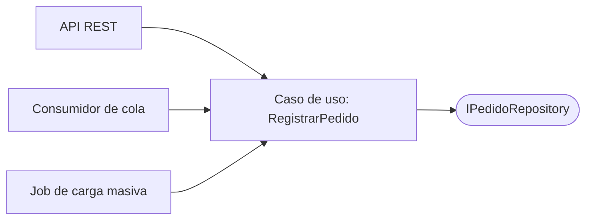

# Arquitectura Hexagonal (Puertos y Adaptadores)

La arquitectura hexagonal aísla la lógica de negocio de los detalles externos (interfaz de usuario, base de datos, colas, APIs de terceros) y la comunica con ellos mediante **puertos** y **adaptadores**. Alistair Cockburn la describió en 2005 con el nombre *Ports and Adapters*. Clean Architecture y Onion Architecture parten de la misma idea de inversión de dependencias, con variaciones en la organización interna del núcleo.

## Idea central

Cockburn plantea que la aplicación pueda ser usada por personas, programas, pruebas automatizadas o procesos batch, y que se pueda desarrollar y probar sin su interfaz ni su base de datos reales. Para lograrlo, el núcleo no conoce la tecnología de quien lo invoca ni de lo que invoca.

El problema que resuelve tiene dos lados:

- **Lado de entrada:** la lógica de negocio se filtra hacia el código de interfaz de usuario, lo que impide probarla de forma automática o invocarla desde otro programa.
- **Lado de salida:** la lógica queda atada a la base de datos o a un servicio externo, y el equipo no puede trabajar si ese recurso no está disponible o cambia.

El hexágono es solo una figura que deja espacio para varios lados. No implica que haya seis puertos.



## Conceptos clave

| Concepto | Qué es | Ejemplo |
|---|---|---|
| **Núcleo** | Dominio y casos de uso. No referencia tecnologías externas. | `Pedido`, `RealizarPedidoService` |
| **Puerto de entrada** (*driving*) | Contrato que el núcleo ofrece para ser usado. | `IRealizarPedido` |
| **Puerto de salida** (*driven*) | Contrato que el núcleo necesita del exterior. | `IPedidoRepository`, `INotificadorDeClientes` |
| **Adaptador de entrada** | Traduce una petición externa a una llamada al puerto de entrada. | Controlador REST, consumidor de mensajes |
| **Adaptador de salida** | Implementa un puerto de salida con una tecnología concreta. | `SqlPedidoRepository`, `SmtpNotificadorDeClientes` |

Los puertos de entrada son opcionales en la práctica. Muchos equipos invocan directamente la clase del caso de uso desde el adaptador de entrada y reservan las interfaces para los puertos de salida, que son los que más aportan al aislamiento y a las pruebas.
La diferencia entre entrada y salida es **quién inicia la conversación**. En la entrada, un actor externo llama a la aplicación. En la salida, la aplicación llama a un recurso externo.



| | Interfaz (puerto) | Adaptador |
|---|---|---|
| Salida | Necesaria casi siempre: el núcleo no puede conocer la implementación | Sí |
| Entrada | Opcional: el adaptador ya depende del núcleo | Sí |

## Regla de dependencia

Las dependencias de código apuntan siempre hacia el núcleo.

- El núcleo **define** las interfaces de salida con el lenguaje del negocio.
- La infraestructura **referencia** al núcleo e implementa esas interfaces.
- El núcleo no referencia a la infraestructura ni a la interfaz de usuario.



Las flechas continuas son dependencias de código. Las punteadas son dependencias que **no** deben existir.
Esto es lo que distingue al patrón de una interfaz con su implementación en una capa de servicios. Mecánicamente es lo mismo (interfaz, clase e inyección de dependencias). Cambia quién define la interfaz y hacia dónde apunta la dependencia.

Comparación de la dirección de dependencia:


| | Servicio con interfaz habitual | Puertos y adaptadores |
|---|---|---|
| Quién define la interfaz | La capa que implementa | El núcleo, según lo que el negocio necesita |
| Forma de la interfaz | Refleja la tecnología (`SendSmtp(to, subject, body)`) | Refleja la intención (`NotificarPedidoEnviado(pedido)`) |
| Dirección de la dependencia | El negocio depende de la capa de servicios | La infraestructura depende del núcleo |
| Alcance | Solo lo que el negocio llama | Entradas y salidas |

## Flujo de una petición



1. El adaptador de entrada recibe la petición, la valida en su formato (HTTP, mensaje) y la convierte en un comando del núcleo.
2. El caso de uso orquesta el dominio y llama a los puertos de salida.
3. El adaptador de salida ejecuta la operación con la tecnología concreta y devuelve el resultado en tipos del núcleo.
4. El adaptador de entrada convierte el resultado a la respuesta del protocolo.

## Organización del código

Una forma frecuente de reflejar el patrón es separar proyectos o módulos según el sentido de la dependencia:

```text
src/
├─ Core/                         (sin referencias a tecnologías)
│  ├─ Dominio/                   Entidades, objetos de valor, eventos de dominio
│  └─ Aplicacion/
│     ├─ Puertos/                Interfaces de entrada y de salida
│     └─ CasosDeUso/             Implementación de los puertos de entrada
├─ Adaptadores.Entrada/
│  ├─ Api/                       Controladores o endpoints
│  └─ Mensajeria/                Consumidores de eventos
├─ Adaptadores.Salida/
│  ├─ Persistencia/              Repositorios, ORM, migraciones
│  └─ Notificaciones/            Correo, SMS, push
└─ Host/                         Punto de composición: registra adaptadores en los puertos
```

La estructura de carpetas es una convención. Lo que define el patrón es la regla de dependencia, y conviene verificarla de forma automática (por ejemplo con pruebas de arquitectura).

## Cómo implementarlo

1. **Identificar las interacciones del núcleo.** Listar qué necesita del exterior (persistir, notificar, cobrar, consultar) y quién lo invoca (API, cola, proceso programado).
2. **Definir los puertos con lenguaje del negocio.** Nombrar la intención, no la tecnología. Evitar tipos de frameworks en las firmas.
3. **Escribir el núcleo contra los puertos.** Los casos de uso reciben los puertos de salida por constructor.
4. **Implementar los adaptadores de salida.** Cada uno traduce entre los tipos del núcleo y los de la tecnología (por ejemplo, entidad de dominio a modelo de persistencia).
5. **Implementar los adaptadores de entrada.** Se limitan a deserializar, autenticar, invocar el caso de uso y serializar la respuesta.
6. **Componer en un único lugar.** El punto de arranque registra qué adaptador atiende cada puerto.
7. **Proteger la regla de dependencia.** Validar referencias entre proyectos en la integración continua.

## Pruebas

- **Núcleo:** pruebas unitarias con adaptadores de salida en memoria o dobles de prueba, sin base de datos ni red.
- **Adaptadores de salida:** pruebas de integración contra la tecnología real (o un contenedor equivalente). Una misma batería de pruebas de contrato puede ejecutarse contra el adaptador real y el de memoria para confirmar que se comportan igual.
- **Adaptadores de entrada:** pruebas de que traducen correctamente peticiones y errores hacia y desde el caso de uso.
- **De extremo a extremo:** pocas pruebas que recorran el sistema completo.

## Beneficios y costos

| Beneficios | Costos |
|---|---|
| Núcleo probable sin infraestructura | Más interfaces y clases |
| Tecnología reemplazable con impacto acotado | Código de mapeo entre modelos |
| Misma lógica disponible desde varios canales (API, cola, batch) | Curva de aprendizaje y disciplina del equipo |
| Límites claros entre negocio e infraestructura | Puede ser excesivo en CRUD simple |

## Errores comunes

- **Puertos con forma de tecnología.** Una interfaz que expone `IQueryable`, `DbSet` o tipos HTTP traslada el acoplamiento al núcleo.
- **Entidades del ORM como modelo de dominio.** Los atributos y restricciones del ORM contaminan el dominio. Si se acepta ese costo por simplicidad, debe ser una decisión explícita.
- **Un puerto por cada clase.** Crear interfaces sin un motivo (segunda implementación, aislamiento de una dependencia externa, pruebas) añade ruido.
- **Lógica de negocio en los adaptadores.** Reaparece el problema original que el patrón busca evitar.
- **Puertos demasiado grandes.** Un repositorio genérico con decenas de métodos dificulta sustituirlo y probarlo. Es preferible segregar por necesidad del caso de uso.
- **Fuga de excepciones de infraestructura.** El adaptador debe traducir los errores técnicos a errores que el núcleo entienda.

## Cuándo usarlo y cuándo no

**Considerarlo cuando:**

- La lógica de negocio es compleja o cambia con frecuencia.
- El sistema vivirá años y la tecnología externa probablemente cambie.
- La misma lógica se expone por varios canales.
- Se necesitan pruebas rápidas de la lógica sin infraestructura.

**Evitarlo o simplificarlo cuando:**

- La aplicación es un CRUD con poca lógica.
- Es un prototipo o una herramienta de vida corta.
- El equipo no puede sostener la disciplina de dependencias.

## Escenarios y casos de uso

### 1. Cambiar de proveedor de pagos

Una tienda cobra con el proveedor A y debe migrar al proveedor B. El núcleo define el puerto `IPasarelaDePagos` con operaciones del negocio (`Cobrar`, `Reembolsar`). Cada proveedor es un adaptador.



- **Qué cambia:** se escribe el adaptador B y se cambia el registro en DI. Se puede activar por configuración, por país o por porcentaje de tráfico.
- **Qué no cambia:** el caso de uso, el dominio y sus pruebas.
- **Riesgo:** si el puerto expone conceptos propios del proveedor A (por ejemplo, su identificador de sesión), el adaptador B no podrá implementarlo limpiamente.

### 2. Una misma operación desde varios canales

Registrar un pedido llega por API REST desde la web, por un mensaje de una cola desde un sistema aliado y por un archivo de carga masiva nocturna.



- **Qué cambia:** cada canal tiene su adaptador, que traduce su formato (JSON, mensaje, CSV) al mismo comando.
- **Qué no cambia:** las validaciones y reglas se ejecutan una sola vez, en el núcleo, sin importar el canal.
- **Riesgo:** duplicar reglas en los adaptadores "porque es más rápido". Cada canal solo valida el formato de su entrada.

### 3. Pruebas de la lógica sin infraestructura

Se quiere verificar que un pedido de un cliente moroso se rechace, sin levantar base de datos ni red.

- Se instancia el caso de uso con repositorios en memoria y un notificador falso que registra las llamadas.
- La prueba se ejecuta en milisegundos y no depende de datos ni de conexiones.
- Un conjunto reducido de pruebas de integración confirma que el adaptador real (SQL) se comporta igual que el de memoria.

### 4. Migrar de motor de base de datos

Se pasa de SQL Server a PostgreSQL, o de una base relacional a un almacén de documentos para un módulo concreto.

- **Qué cambia:** un nuevo adaptador de `IPedidoRepository` y sus pruebas de integración.
- **Qué no cambia:** casos de uso y dominio.
- **Límite:** si el núcleo dependía de transacciones, consultas o consistencia propias del motor anterior, esas suposiciones deben revisarse. El patrón aísla el código, no las diferencias de comportamiento entre motores.

### 5. Integrar un sistema legado (capa anticorrupción)

El negocio debe consultar un ERP antiguo con un modelo de datos poco claro (códigos crípticos, estructuras planas).

- El núcleo define un puerto `ICatalogoDeProductos` con el modelo que el negocio entiende.
- El adaptador de salida llama al ERP y traduce su modelo al del núcleo.
- Si el ERP se reemplaza, solo se reescribe el adaptador.

Este uso del adaptador como traductor equivale a la capa anticorrupción de DDD.

### 6. Entornos con servicios distintos

En desarrollo y pruebas no se debe enviar correo real ni cobrar a tarjetas reales.

- En desarrollo se registra un adaptador que escribe el mensaje en un archivo o consola.
- En un entorno de pruebas integradas se usa el sandbox del proveedor.
- En producción se registra el adaptador real.
- El cambio se hace en el punto de composición, sin condicionales en el núcleo.

### 7. Reemplazar la interfaz de usuario

Una aplicación con interfaz web debe exponer también una API para móviles, o migrar de MVC a una aplicación de una sola página.

- El caso de uso ya existe y es independiente de cómo se presente.
- Se añade un adaptador de entrada nuevo (API) que invoca el mismo caso de uso.
- La interfaz anterior puede convivir durante la migración.

### 8. Caso donde no conviene

Un mantenedor de catálogos (CRUD de tablas auxiliares) sin reglas de negocio relevantes.

- Cada operación guarda o lee datos sin decisiones.
- Aplicar puertos y adaptadores añadiría interfaces, mapeos y clases que no aportan aislamiento útil.
- Es preferible un acceso directo a datos, aislado dentro del módulo, y reservar el patrón para los módulos con lógica compleja.
## Relación con otros estilos

- **[Capas / N-tier](capas-n-tier.md):** en capas clásicas la lógica de negocio depende de la capa de datos. Hexagonal invierte esa dependencia.
- **Clean Architecture y Onion:** variantes con el mismo principio. Añaden anillos dentro del núcleo (entidades, casos de uso). Microsoft usa el nombre *Clean Architecture* en su guía de aplicaciones web modernas y menciona Hexagonal y Ports-and-Adapters como nombres anteriores.
- **[DDD](../dominios/DDD.md):** aporta el modelo del dominio que vive en el núcleo.
- **[Vertical Slice](vertical-slice.md):** organiza por funcionalidad y reduce la ceremonia. Puede combinarse con un núcleo de dominio protegido por puertos.
- **[Monolito modular](monolito-modular.md):** cada módulo puede aplicar puertos y adaptadores internamente.
- **[CQRS](cqrs.md):** los comandos y consultas pueden ser los puertos de entrada.

## Ejemplo mínimo en C#

```csharp
// Núcleo: define el puerto con lenguaje del negocio
public interface INotificadorDeClientes
{
    Task NotificarPedidoEnviadoAsync(Pedido pedido, CancellationToken ct);
}

public class EnviarPedidoService
{
    private readonly IPedidoRepository _pedidos;
    private readonly INotificadorDeClientes _notificador;

    public EnviarPedidoService(IPedidoRepository pedidos, INotificadorDeClientes notificador)
        => (_pedidos, _notificador) = (pedidos, notificador);

    public async Task HandleAsync(Guid pedidoId, CancellationToken ct)
    {
        var pedido = await _pedidos.ObtenerAsync(pedidoId, ct);
        pedido.MarcarComoEnviado();
        await _pedidos.GuardarAsync(pedido, ct);
        await _notificador.NotificarPedidoEnviadoAsync(pedido, ct);
    }
}

// Infraestructura: adaptador de salida
public class SmtpNotificadorDeClientes : INotificadorDeClientes
{
    public Task NotificarPedidoEnviadoAsync(Pedido pedido, CancellationToken ct)
    {
        // Construir el mensaje y enviarlo por SMTP
        return Task.CompletedTask;
    }
}
```

Para estructura de soluciones, registro de dependencias y pruebas de arquitectura en .NET, ver [Puertos y adaptadores en .NET](../../dotnet/net/arquitectura/hexagonal-puertos-y-adaptadores-dotnet.md).

## Referencias

- Alistair Cockburn, *Hexagonal Architecture* (2005): https://alistair.cockburn.us/hexagonal-architecture/
- Microsoft Learn, *Common web application architectures* (sección Clean Architecture): https://learn.microsoft.com/en-us/dotnet/architecture/modern-web-apps-azure/common-web-application-architectures
- Jeffrey Palermo, *The Onion Architecture*: https://jeffreypalermo.com/blog/the-onion-architecture-part-1/
- Robert C. Martin, *The Clean Architecture*: https://blog.cleancoder.com/uncle-bob/2012/08/13/the-clean-architecture.html
