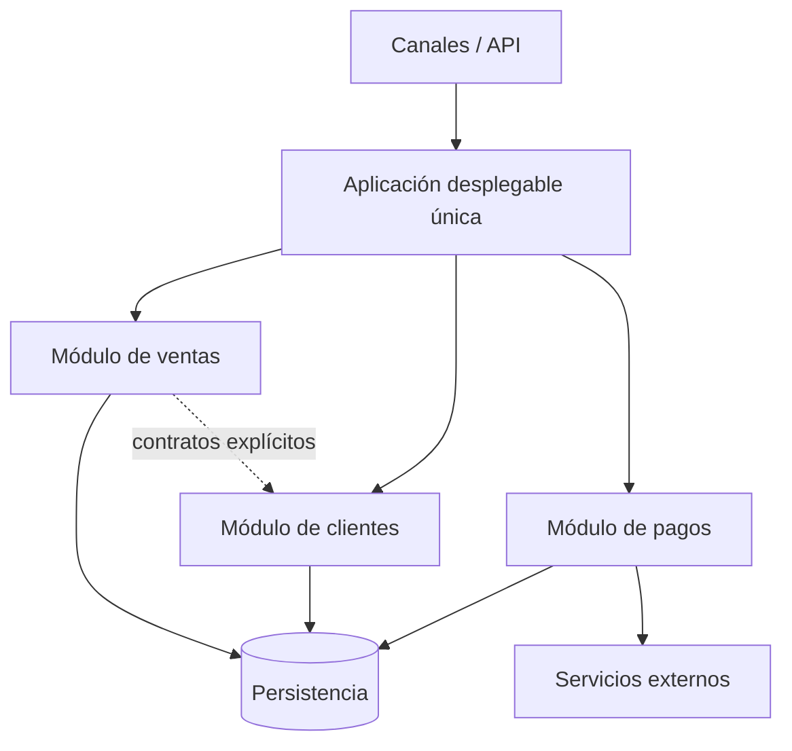

# Monolito modular

## Concepto

Un monolito modular se despliega como una aplicación única, pero su código se organiza en módulos con responsabilidades y límites explícitos. Los módulos colaboran dentro del mismo proceso y, a menudo, comparten infraestructura de ejecución. El objetivo es mantener la sencillez operativa de un despliegue unificado y mejorar la cohesión y el aislamiento interno.

## Estructura habitual

- **Módulos de negocio:** agrupan casos de uso y reglas de una capacidad o dominio.
- **Interfaces entre módulos:** contratos explícitos que limitan dependencias; evitar acceso directo a detalles internos.
- **Persistencia:** puede ser una base de datos común, idealmente con propiedad lógica y acceso controlado por módulo.
- **Adaptadores externos:** integraciones, interfaz de usuario, mensajería y proveedores.
- **Composición de aplicación:** configura módulos y coordina el arranque y el despliegue.

## Cuándo considerarlo

- El dominio y el equipo todavía no justifican servicios distribuidos.
- Se quiere acelerar la entrega manteniendo una sola unidad de despliegue.
- Se está modernizando un sistema existente por etapas, y primero se necesitan límites internos claros.
- La operación debe ser sencilla, pero el código necesita separación por capacidades.

## Beneficios y costos

**Beneficios:** menor complejidad de despliegue que una solución distribuida; llamadas internas rápidas; cambios locales a módulos bien delimitados; facilita extraer un módulo más adelante si existe una necesidad real.

**Costos y riesgos:** el despliegue y escalado suelen ser conjuntos; una base compartida puede generar acoplamiento; sin reglas de dependencia y revisión, los límites se degradan y el sistema vuelve a ser un monolito difícil de cambiar.

## Reglas de diseño

- Definir módulos por capacidades de negocio, no solo por capas técnicas.
- Exponer interfaces explícitas y controlar dependencias entre módulos.
- Asignar propiedad lógica de los datos; evitar que un módulo modifique directamente tablas ajenas.
- Mantener pruebas de arquitectura que hagan cumplir los límites.
- Extraer servicios solo cuando autonomía de despliegue, escalado, aislamiento o propiedad de equipo lo justifique.

## Riesgos a revisar

- ¿Se puede probar cada módulo con dependencias controladas?
- ¿Un cambio en un módulo obliga a desplegar toda la aplicación?
- ¿Los módulos comparten tablas o reglas sin contratos claros?
- ¿El escalado conjunto supone un costo o límite significativo?

## Referencias

- [Microsoft: estilos de arquitectura](https://learn.microsoft.com/azure/architecture/guide/architecture-styles)
- [Microsoft: aplicación monolítica y microservicios](https://learn.microsoft.com/dotnet/architecture/cloud-native/definition)
