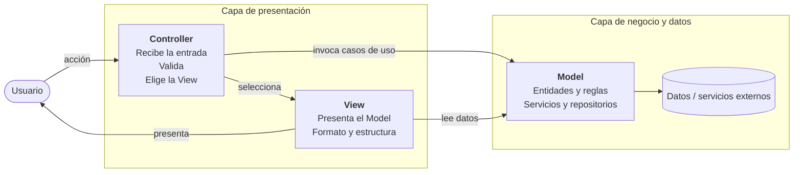
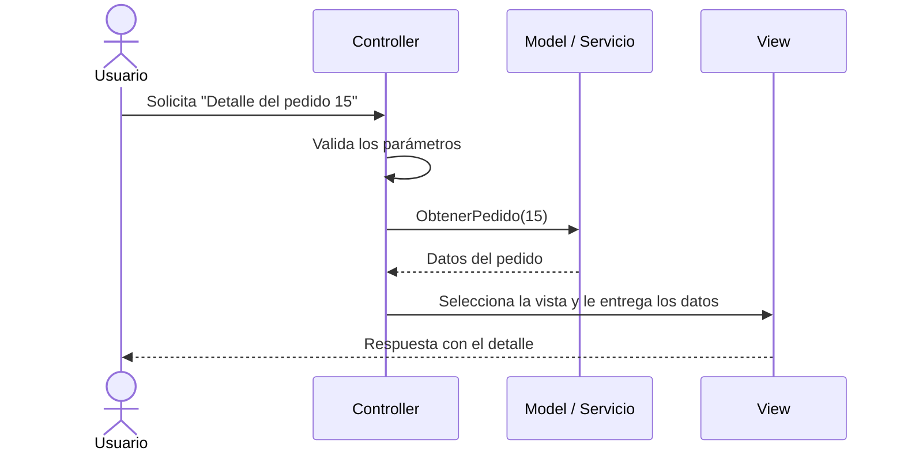
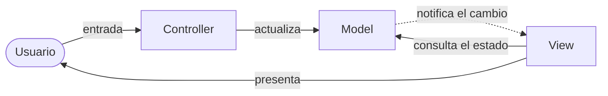
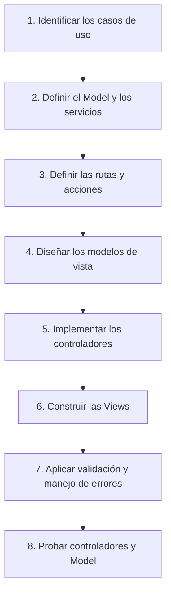
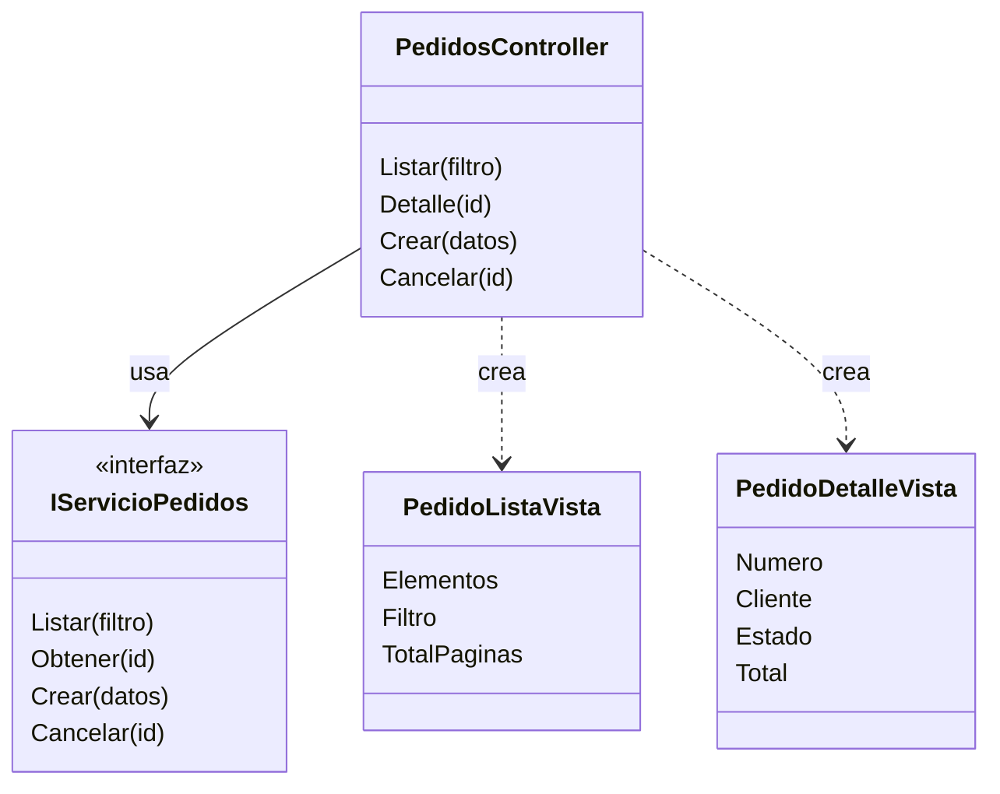

# Model-View-Controller (MVC)

MVC es un patrón de presentación que separa una aplicación interactiva en tres componentes: Model, View y Controller. El Model contiene los datos y las reglas de negocio, la View los muestra y el Controller recibe la entrada del usuario y la traduce en acciones sobre el Model.

No es un estilo arquitectónico. Organiza la capa de presentación, no el sistema completo. Puede convivir con estilos como capas, monolito modular o microservicios.

Este documento es independiente de tecnología. Para una variante que usa enlace de datos ver [MVVM](mvvm.md). Para una implementación concreta ver [MVC con Razor Pages en ABP](../../platform_campusoft/abp/mvc_razor_pages.md).

## Origen

Trygve Reenskaug lo describió a finales de los años 70 en Xerox PARC, para aplicaciones de escritorio en Smalltalk. En los años 90 y 2000 se adaptó a la web, donde el servidor recibe una petición HTTP, ejecuta un controlador y devuelve una vista. Esa adaptación se conoce como *Web MVC* o *Model 2*, y difiere del MVC original, en el que la View observa al Model.

## Componentes

| Componente | Responsabilidad | No debe |
|---|---|---|
| **Model** | Datos, reglas de negocio y acceso a servicios y persistencia. | Conocer la View ni el Controller. |
| **View** | Presentar el Model al usuario. Contiene la estructura visual y el formato. | Contener lógica de negocio ni procesar la entrada. |
| **Controller** | Recibir la entrada del usuario, validarla, invocar al Model y elegir la View que responde. | Contener reglas de negocio ni generar la presentación. |

Dirección de las dependencias:

```text
Controller ──> Model
Controller ──> View
View ──> Model   (solo lectura)
```

El Controller coordina. La View lee del Model para mostrar datos, pero no lo modifica.

## Diagramas conceptuales

### Estructura y responsabilidades



### Flujo de una petición (variante web)

Ejemplo: el usuario consulta el detalle de un pedido.



### Flujo del MVC original (View observa al Model)



## Características

- **Separación de responsabilidades:** la presentación, la entrada y los datos se mantienen en componentes distintos.
- **Controller como punto de entrada:** toda acción del usuario pasa por un controlador.
- **Varias Views para un mismo Model:** un pedido puede mostrarse como página, lista, informe o respuesta de API.
- **Model independiente de la UI:** se reutiliza y se prueba sin interfaz.
- **Enrutamiento:** una petición se asigna a un controlador y una acción mediante convenciones o reglas.
- **Flujo explícito:** el Controller decide qué View se muestra y con qué datos. No requiere motor de binding.

## Formas de implementar

### 1. Quién actualiza la View

| Forma | Descripción | Cuándo usarla |
|---|---|---|
| **Pull (View lee del Model)** | El Controller elige la View y esta lee los datos que necesita del Model. | Aplicaciones con generación de vistas en servidor. |
| **Push (Controller entrega los datos)** | El Controller prepara los datos y se los pasa a la View. | Es la forma más habitual en web. Reduce el acoplamiento de la View con el Model. |
| **Observador** | La View se suscribe al Model y se actualiza cuando este cambia. | Aplicaciones de escritorio con estado de larga duración. |

### 2. Datos que recibe la View

- **Entidades del Model:** simple, pero acopla la View a la estructura interna de los datos.
- **Modelos de vista (DTO de presentación):** objetos creados para la pantalla, con lo mínimo que esta necesita. Es la opción recomendada.

### 3. Controladores

- **Un controlador por recurso o área funcional,** con una acción por caso de uso.
- **Controlador delgado:** valida, delega y selecciona la respuesta. La lógica de negocio va en servicios o en el Model.
- **Controlador por pantalla:** adecuado en aplicaciones de escritorio con estado.
- **Controlador frontal:** un único punto de entrada recibe todas las peticiones y las reparte a los controladores. Es la base de los frameworks web.

### 4. Modelo pasivo y modelo activo

- **Modelo pasivo:** no notifica a nadie. El Controller indica a la View cuándo refrescarse.
- **Modelo activo:** emite notificaciones al cambiar y las Views se actualizan solas.

### 5. Respuesta del Controller

- **Vista renderizada en servidor:** el resultado es una página.
- **Datos estructurados:** el resultado es JSON u otro formato. La "View" es la serialización de los datos.
- **Redirección:** tras una operación de escritura se redirige a otra acción para evitar reenvíos duplicados.

### 6. Servicios de apoyo

Validación, autorización, manejo de errores y registro se aplican de forma transversal, por ejemplo con filtros o interceptores antes y después del controlador. No se repiten en cada acción.

## Guía conceptual de implementación

Pasos para aplicar MVC en cualquier tecnología.



**1. Identificar los casos de uso.** Lista qué puede hacer el usuario. Ejemplo: listar pedidos, ver detalle, crear y cancelar.

**2. Definir el Model y los servicios.** Declara las entidades y los servicios (`ServicioPedidos.Listar`, `ServicioPedidos.Cancelar`). Se exponen como abstracciones para poder sustituirlos en pruebas.

**3. Definir las rutas y acciones.** Asigna cada caso de uso a una acción de un controlador y a una ruta.

| Acción de usuario | Ruta | Acción del controlador |
|---|---|---|
| Listar pedidos | `GET /pedidos` | `Listar` |
| Ver detalle | `GET /pedidos/{id}` | `Detalle` |
| Crear pedido | `POST /pedidos` | `Crear` |
| Cancelar pedido | `POST /pedidos/{id}/cancelar` | `Cancelar` |

**4. Diseñar los modelos de vista.** Para cada pantalla, define los datos que necesita, ya formateados y sin campos innecesarios.

**5. Implementar los controladores.** Cada acción valida la entrada, invoca al servicio, y devuelve una View, una redirección o un error.

**6. Construir las Views.** Cada View recibe un modelo de vista y lo presenta. No consulta datos ni toma decisiones de negocio.

**7. Aplicar validación y manejo de errores.** Valida en el controlador la forma de la entrada y deja las reglas de negocio al Model. Define cómo se muestran los errores al usuario.

**8. Probar controladores y Model.** Con servicios simulados, verifica que cada acción devuelve la respuesta esperada y que el Model aplica sus reglas.

### Ejemplo conceptual: módulo de pedidos



## Organización recomendada

- Un controlador por área funcional. Las acciones agrupan casos de uso relacionados.
- La lógica de negocio permanece en el Model o en servicios de aplicación, no en el controlador.
- Los controladores dependen de abstracciones (servicios, repositorios).
- Las Views se limitan a presentar. Pueden formatear y recorrer datos, pero no decidir reglas.
- Una carpeta o módulo por funcionalidad si el sistema crece, en lugar de agrupar todos los controladores, modelos y vistas por tipo.

## Comparación con MVVM y MVP

| Aspecto | MVC | MVP | MVVM |
|---|---|---|---|
| Intermediario | Controller | Presenter | ViewModel |
| Quién recibe la entrada | El Controller. | La View, que la reenvía al Presenter. | La View, mediante comandos. |
| Quién actualiza la View | El Controller, o la View observando al Model. | El Presenter, mediante una interfaz de la View. | El motor de binding. |
| Referencia a la View | El Controller selecciona la View. | El Presenter conoce la interfaz de la View. | El ViewModel no la conoce. |
| Estado de la pantalla | En el Controller o en la View. | En el Presenter. | En el ViewModel. |
| Dependencia del binding | No necesaria. | No necesaria. | Casi imprescindible. |
| Entorno típico | Web con vistas en servidor. | Escritorio y móvil sin binding. | UI con binding o reactividad. |

Ver más en [MVVM](mvvm.md).

## Cuándo usarlo

- Aplicaciones web con vistas generadas en el servidor.
- APIs donde los controladores exponen casos de uso y la serialización actúa como View.
- Aplicaciones con navegación basada en peticiones y poco estado de pantalla.
- Equipos que prefieren un flujo explícito y fácil de seguir.
- Frameworks que ya están diseñados con convenciones MVC.

## Cuándo no

- Interfaces con mucho estado local y actualizaciones frecuentes, donde el control manual de la View se vuelve costoso. MVVM o un flujo unidireccional encajan mejor.
- Aplicaciones de una sola página con lógica de presentación en el cliente, si el servidor solo ofrece datos.
- Pantallas muy simples, donde separar tres componentes añade más estructura que valor.

## Casos de uso

| Caso | Por qué encaja MVC | Qué hace el Controller |
|---|---|---|
| **Sitio web de contenidos** (portal, catálogo) | Cada petición produce una página. El flujo es sencillo. | Obtiene los datos y elige la plantilla. |
| **Formularios de gestión** (altas, ediciones) | El ciclo mostrar, enviar, validar y redirigir se mapea a acciones. | Valida, invoca al servicio y redirige o vuelve a mostrar errores. |
| **API REST** | El controlador expone los casos de uso y la serialización es la View. | Traduce la petición a una llamada al servicio y devuelve el código y el cuerpo adecuados. |
| **Panel administrativo** | Muchas pantallas CRUD con una estructura repetida. | Una acción por operación, con filtros y autorización comunes. |
| **Aplicación con varias presentaciones** (web y exportes) | El mismo Model se muestra como página, PDF o JSON. | Elige la View según el formato solicitado. |
| **Migración de aplicaciones heredadas** | Permite separar gradualmente la lógica mezclada con la presentación. | Absorbe el flujo que estaba en las páginas. |

## Recomendaciones

- **Controladores delgados.** Si una acción tiene reglas de negocio, muévelas al Model o a un servicio.
- **Modelos de vista dedicados.** Evita enviar entidades de dominio directamente a la View.
- **Validación en dos niveles.** El controlador valida la forma de la entrada; el Model valida las reglas de negocio.
- **Redirigir tras escribir.** Después de un `POST` exitoso, redirige para evitar reenvíos duplicados.
- **Autorización explícita.** Aplícala por filtros o atributos y no la dejes a cargo de la View.
- **Rutas coherentes.** Usa nombres de recursos y verbos consistentes.
- **Manejo de errores centralizado.** Traduce excepciones a respuestas en un solo lugar.
- **Dependencias por abstracciones.** Facilita sustituirlas en pruebas.
- **No dividas por obligación.** Si el sistema es pequeño, no crees capas vacías.
- **Documenta las decisiones.** Registra convenciones de rutas, modelos de vista y manejo de errores.

## Errores comunes

- **Lógica de negocio en el controlador:** lo convierte en una clase grande, difícil de probar.
- **Lógica en la View:** consultas, reglas o decisiones dentro de la plantilla.
- **Entidades expuestas a la View o a la API:** acopla la presentación al modelo de datos y puede filtrar campos internos.
- **Controladores que se llaman entre sí:** comparte la lógica en un servicio.
- **Controlador gigante:** una sola clase con decenas de acciones. Dividir por área funcional.
- **Falta de validación en el servidor:** confiar solo en la validación del cliente.
- **Ignorar la protección de formularios:** falta de defensa contra falsificación de peticiones (CSRF) en operaciones de escritura.
- **Vista que modifica el Model:** rompe la separación y dificulta seguir los cambios.

## Pruebas

- **Controlador:** pruebas unitarias con los servicios simulados. Se verifica la respuesta (View, redirección, código de estado) y el modelo de vista entregado.
- **Model y servicios:** pruebas unitarias o de integración, independientes del controlador.
- **View:** pruebas de renderizado o de UI para los casos críticos.
- **Ruta completa:** pruebas de integración que recorren petición, controlador, servicio y respuesta.

Ejemplo de caso de prueba para un controlador:

```text
Dado un servicio de pedidos simulado que devuelve el pedido 15
Cuando se invoca la acción Detalle con id 15
Entonces la respuesta es una View
  Y el modelo de vista contiene el número y el total del pedido 15
```

## Referencias

- [GUI Architectures (Martin Fowler)](https://martinfowler.com/eaaDev/uiArchs.html)
- [Model View Controller (Martin Fowler)](https://martinfowler.com/eaaCatalog/modelViewController.html)
- [MVVM](mvvm.md)
- [MVC con Razor Pages en ABP](../../platform_campusoft/abp/mvc_razor_pages.md)
