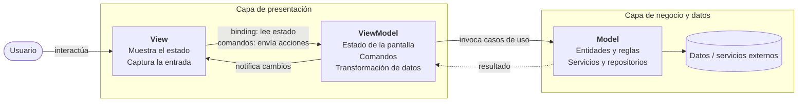
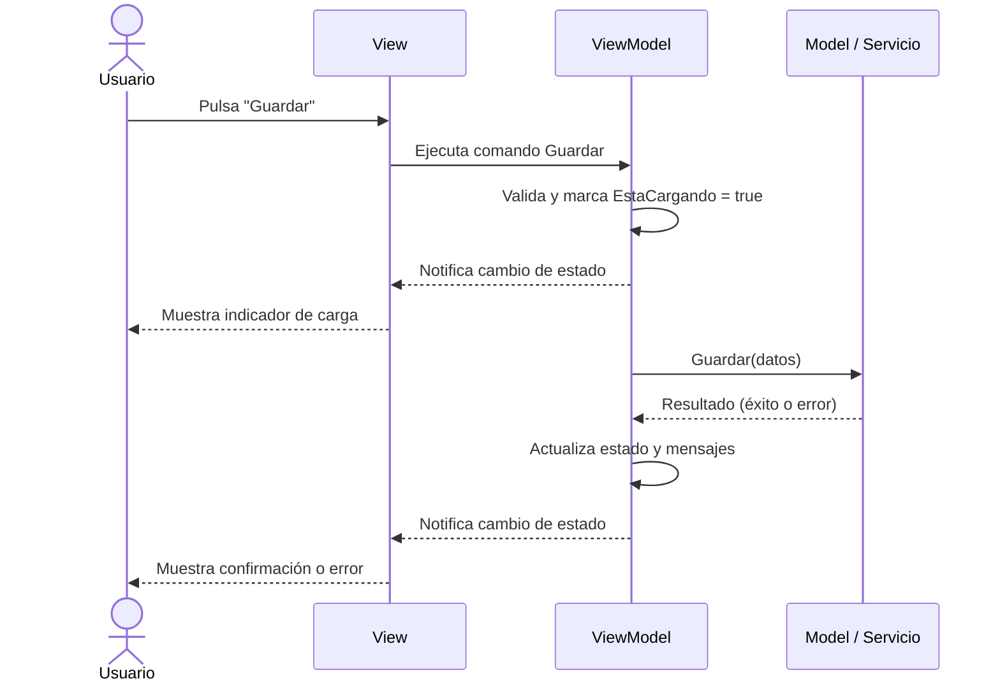
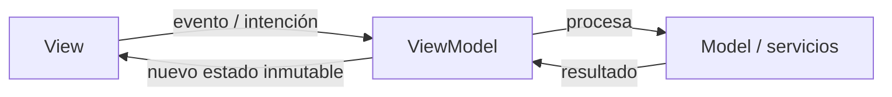
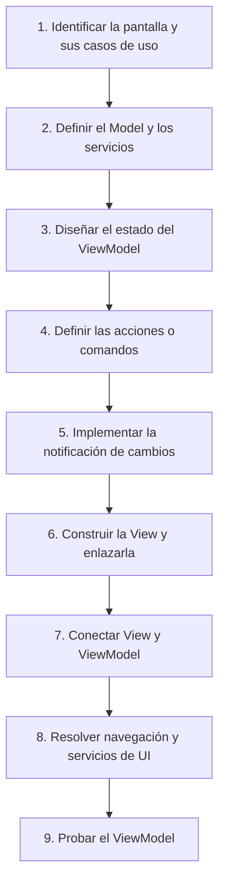
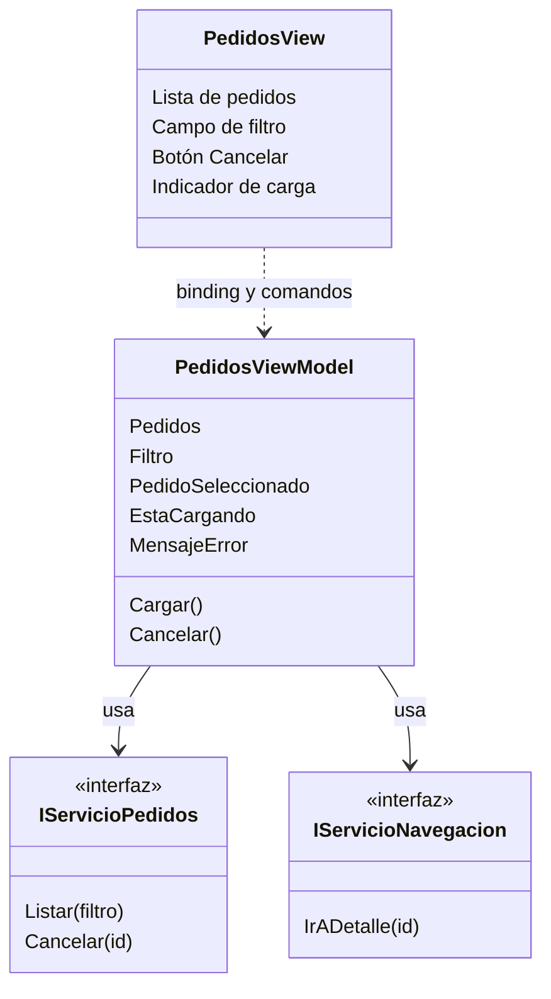

# Model-View-ViewModel (MVVM)

MVVM es un patrón de presentación que separa la interfaz de usuario de la lógica de negocio mediante tres componentes: Model, View y ViewModel. Su objetivo es que la lógica de presentación se pueda probar y evolucionar sin depender de la interfaz gráfica.

Este documento es independiente de tecnología. Para una implementación concreta ver [.NET MAUI](../../dotnet/net/aplicaciones-cliente/.NET_MAUI.md#model-view-viewmodel-mvvm).

## Origen

John Gossman (Microsoft) lo formalizó en 2005 para WPF y Silverlight, como especialización del patrón *Presentation Model* de Martin Fowler. Hoy se usa en aplicaciones de escritorio, móviles y web.

## Componentes

| Componente | Responsabilidad | No debe |
|---|---|---|
| **Model** | Datos, reglas de negocio, acceso a servicios y persistencia. | Conocer la View ni el ViewModel. |
| **View** | Mostrar el estado y capturar la entrada del usuario. Contiene estructura visual, estilos y animaciones. | Contener lógica de negocio ni decidir flujos. |
| **ViewModel** | Exponer el estado de la pantalla y las acciones que el usuario puede ejecutar. Adapta los datos del Model a lo que la View necesita mostrar. | Referenciar la View ni sus controles. |

Dirección de las dependencias:

```text
View ──> ViewModel ──> Model
```

La View conoce al ViewModel, y el ViewModel conoce al Model. Ninguno conoce al componente de su izquierda. La View se actualiza porque observa al ViewModel, no porque este la invoque.

## Diagramas conceptuales

### Estructura y responsabilidades



Lectura del diagrama: la View solo habla con el ViewModel. El ViewModel no tiene referencia a la View; la actualiza únicamente al notificar cambios de estado.

### Flujo de una interacción

Ejemplo: el usuario guarda un formulario.



### Variante de flujo unidireccional



## Características

- **Enlace de datos (data binding):** conecta propiedades de la View con propiedades del ViewModel. Puede ser de una vía (ViewModel a View) o de dos vías (el usuario también modifica el estado).
- **Notificación de cambios:** el ViewModel avisa cuando una propiedad cambia, y los enlaces actualizan la View.
- **Comandos:** representan las acciones del usuario (guardar, buscar, eliminar) como objetos o funciones del ViewModel. Pueden indicar si están habilitados.
- **Estado de presentación:** el ViewModel conserva lo que la pantalla necesita, como campos del formulario, selección actual, indicador de carga y mensajes de error.
- **Transformación de datos:** formatea o combina datos del Model para la View (por ejemplo, nombre completo, fecha formateada, estado como texto).
- **Desacoplamiento:** el ViewModel no depende de controles ni de la plataforma de UI.
- **Capacidad de prueba:** el ViewModel se prueba como una clase normal, sin UI.

## Formas de implementar

Los mecanismos son los mismos en cualquier tecnología. Cambia quién los provee: el framework, una biblioteca o código propio.

### 1. Enlace entre View y ViewModel

| Forma | Descripción | Cuándo usarla |
|---|---|---|
| **Declarativo** | La View declara el enlace (por ejemplo, en un lenguaje de marcado) y el framework lo mantiene. | Cuando el framework lo ofrece. Es la forma más habitual. |
| **Por código (manual)** | Un código de enlace suscribe la View a los cambios del ViewModel y reenvía los eventos de la View al ViewModel. | Cuando no hay motor de binding. Requiere más código y disciplina. |
| **Reactivo** | El estado se expone como flujos de datos observables y la View se suscribe a ellos. | Estado con mucha actividad asíncrona o derivada. |

### 2. Notificación de cambios

- **Patrón observador:** el ViewModel emite un evento cuando cambia una propiedad y la View, o el motor de binding, se suscribe.
- **Propiedades observables:** cada propiedad es un contenedor que notifica al cambiar su valor.
- **Flujo de estado:** el ViewModel expone un único objeto de estado. Cada cambio emite un nuevo estado y la View lo vuelve a pintar.

### 3. Entrada del usuario

- **Comandos:** objeto con una acción de ejecución y, opcionalmente, una condición de habilitado.
- **Métodos del ViewModel invocados por la View:** más simple, pero hay que gestionar el habilitado por separado.
- **Intenciones o eventos:** la View envía eventos al ViewModel (`BotonGuardarPulsado`) y este los procesa. Es la base de la variante unidireccional.

### 4. Variante de flujo unidireccional

El ViewModel mantiene un estado inmutable. La View envía eventos, el ViewModel calcula un nuevo estado y la View lo pinta. Hay un único sentido de datos, lo que facilita el seguimiento de cambios y las pruebas. Es el enfoque habitual en interfaces declarativas modernas.

```text
View ──evento──> ViewModel ──> nuevo estado ──> View
```

### 5. Asociación de View y ViewModel

- **View primero:** la View crea o recibe su ViewModel.
- **ViewModel primero:** el ViewModel se crea primero y un mecanismo (plantillas o un registro) elige la View correspondiente.
- **Inyección de dependencias:** un contenedor construye el ViewModel con sus dependencias. Facilita sustituirlas en pruebas.
- **Localizador de ViewModels:** un componente central entrega el ViewModel a cada View. Es más simple, pero oculta las dependencias.

### 6. Navegación y comunicación entre ViewModels

- **Servicio de navegación:** el ViewModel pide navegar mediante una abstracción, sin conocer la View destino.
- **Mensajería (bus en memoria):** los ViewModels se comunican por mensajes sin referenciarse entre sí.
- **Estado compartido:** un servicio o almacén compartido que varios ViewModels observan.
- **Parámetros de navegación:** datos que se pasan al abrir otra pantalla.

### 7. Servicios de interacción con la UI

Para diálogos, notificaciones o selección de archivos, el ViewModel usa una interfaz (`IServicioDialogo`) cuya implementación pertenece a la capa de UI. Así el ViewModel no depende de la plataforma.

## Guía conceptual de implementación

Pasos para aplicar MVVM en cualquier tecnología. Cada paso es independiente del lenguaje.



**1. Identificar la pantalla y sus casos de uso.** Lista qué muestra la pantalla y qué puede hacer el usuario. Ejemplo: una pantalla de pedidos muestra una lista, permite filtrar, abrir el detalle y cancelar un pedido.

**2. Definir el Model y los servicios.** Declara las entidades y los servicios que el ViewModel va a usar (`ServicioPedidos.Listar`, `ServicioPedidos.Cancelar`). Se exponen como abstracciones para poder sustituirlos en pruebas.

**3. Diseñar el estado del ViewModel.** Define todo lo que la View necesita pintar:
- datos: lista de pedidos, pedido seleccionado, texto del filtro;
- estado de la operación: `EstaCargando`, `MensajeError`, `HayResultados`;
- valores derivados: total, texto formateado.

El estado debe bastar para pintar la pantalla sin consultar nada más.

**4. Definir las acciones o comandos.** Una acción por intención del usuario: `Cargar`, `Filtrar`, `Cancelar`, `Seleccionar`. Cada una indica cuándo está habilitada (por ejemplo, `Cancelar` solo con un pedido seleccionado).

**5. Implementar la notificación de cambios.** Elige el mecanismo (evento por propiedad, propiedades observables o flujo de estado) y úsalo en todo el ViewModel. Cada cambio de estado visible debe notificarse.

**6. Construir la View y enlazarla.** Cada control se enlaza a una propiedad del estado y cada acción de usuario a un comando. La View no contiene reglas ni decide flujos.

**7. Conectar View y ViewModel.** Decide quién crea el ViewModel (View primero, ViewModel primero o inyección de dependencias) y aplícalo de forma uniforme.

**8. Resolver navegación y servicios de UI.** Define abstracciones para navegar, mostrar diálogos y notificar. El ViewModel las usa sin conocer la plataforma.

**9. Probar el ViewModel.** Con servicios simulados, verifica que cada comando produce el estado esperado y que se notifican los cambios.

### Ejemplo conceptual: pantalla de pedidos



## Organización recomendada

- Un ViewModel por pantalla o por componente visual con estado propio.
- La lógica de negocio permanece en el Model o en servicios de aplicación, no en el ViewModel.
- Los ViewModels dependen de abstracciones (repositorios, servicios).
- El código detrás de la View (code-behind) se limita a lo estrictamente visual: animaciones, foco o gestos que no se pueden expresar por binding.

## Comparación con MVC y MVP

| Aspecto | MVC | MVP | MVVM |
|---|---|---|---|
| Intermediario | Controller | Presenter | ViewModel |
| Quién actualiza la View | El Controller, o la View observando al Model. | El Presenter, mediante una interfaz de la View. | El motor de binding, al cambiar el ViewModel. |
| Referencia a la View | El Controller selecciona la View. | El Presenter conoce la interfaz de la View. | El ViewModel no la conoce. |
| Dependencia del binding | No necesaria. | No necesaria. | Casi imprescindible. |
| Prueba de la lógica | Posible. | Muy buena (View simulada). | Muy buena (sin View). |

MVC y MVP suelen usarse en aplicaciones donde el servidor genera las vistas o cuando no hay motor de binding. MVVM encaja cuando el framework ofrece binding. Ver también [MVC](mvc.md).

## Cuándo usarlo

- Aplicaciones con estado de pantalla relevante (formularios, listas con filtros, paneles).
- Frameworks con binding o reactividad integrada.
- Equipos que quieren probar la lógica de presentación sin UI.
- Una misma lógica con varias Views (por ejemplo, móvil y escritorio).

## Cuándo no

- Pantallas muy simples, donde el ViewModel solo reenvía datos.
- Interfaces sin estado propio, como páginas estáticas.
- Entornos sin binding en los que el código manual supera el beneficio.

## Casos de uso

| Caso | Por qué encaja MVVM | Qué expone el ViewModel |
|---|---|---|
| **Formulario con validación** (alta de cliente, registro) | El estado del formulario y sus errores se enlazan a la View. La validación se prueba sin UI. | Campos, errores por campo, comando `Guardar` habilitado solo si el formulario es válido. |
| **Lista con búsqueda y filtros** (catálogo, pedidos) | Filtros, orden y paginación son estado de presentación. | Elementos, filtro, orden, página, `EstaCargando`, `HayResultados`. |
| **Panel de control en tiempo real** (monitoreo, métricas) | El Model emite datos y el ViewModel los transforma; la View se actualiza al cambiar el estado. | Indicadores formateados, estado de conexión, alertas. |
| **Asistente por pasos** (wizard, onboarding) | El paso actual y las reglas de avance viven en el ViewModel. | Paso actual, datos acumulados, comandos `Siguiente` y `Anterior`. |
| **Misma lógica en varias plataformas** (móvil y escritorio) | El ViewModel no depende de la UI y se comparte. Cada plataforma aporta su View. | Mismo estado y comandos para todas las Views. |
| **Pantalla offline** (sincronización diferida) | El ViewModel refleja el estado de sincronización sin que la View conozca la persistencia. | Datos locales, pendientes de sincronizar, estado de red. |

## Recomendaciones

- **Un solo sentido por defecto.** Usa enlaces de una vía y flujo unidireccional salvo que el control necesite edición directa.
- **Estado explícito.** Modela los estados de la pantalla (cargando, con datos, vacío, error) en lugar de combinar varios indicadores sueltos.
- **ViewModel sin dependencias de plataforma.** Si requiere algo de la UI, créale una interfaz.
- **Lógica de presentación en el ViewModel, lógica de negocio en el Model.** Regla práctica: si otra pantalla necesita la misma regla, no pertenece al ViewModel.
- **Convención de nombres.** Una vista `PedidosView` tiene un `PedidosViewModel`. Facilita encontrar y asociar los archivos.
- **Operaciones asíncronas controladas.** Cancela las operaciones obsoletas, evita ejecuciones dobles y expón el estado de carga y de error.
- **Libera recursos.** Cancela suscripciones y mensajes cuando la pantalla se cierra.
- **Prueba primero lo que tiene lógica.** Prioriza ViewModels con validaciones, transformaciones o flujos condicionales.
- **No dividas por obligación.** Si una pantalla es trivial, un ViewModel mínimo es suficiente.
- **Documenta las decisiones.** Registra qué mecanismo de binding, navegación y mensajería usa el equipo, para mantener uniformidad.

## Errores comunes

- **Lógica de negocio en el ViewModel:** debe estar en el Model o en servicios.
- **ViewModel que referencia controles o la View:** rompe el desacoplamiento y las pruebas.
- **ViewModels demasiado grandes:** dividirlos por componente o responsabilidad.
- **Code-behind con lógica:** mueve a la View la lógica que debería estar en el ViewModel.
- **Binding bidireccional en todo:** dificulta seguir quién cambió qué. Usar una vía por defecto.
- **Fugas de memoria por suscripciones:** liberar eventos, mensajes y observables cuando la View se destruye.
- **Actualizar la UI desde hilos que no son el de interfaz:** respetar las reglas de la plataforma.
- **Mensajería sobreutilizada:** un exceso de mensajes oculta el flujo de la aplicación.

## Pruebas

- **ViewModel:** pruebas unitarias con el Model y los servicios simulados. Se verifican el estado resultante, la ejecución de comandos y las notificaciones de cambio.
- **Model y servicios:** pruebas unitarias o de integración, independientes del ViewModel.
- **View:** pruebas de UI limitadas a lo visual y a los enlaces críticos.

Ejemplo de caso de prueba para un ViewModel:

```text
Dado un ViewModel con un servicio de pedidos simulado que devuelve 3 pedidos
Cuando se ejecuta el comando Cargar
Entonces Pedidos contiene 3 elementos
  Y EstaCargando vuelve a false
```

## Referencias

- [Presentation Model (Martin Fowler)](https://martinfowler.com/eaaDev/PresentationModel.html)
- [GUI Architectures (Martin Fowler)](https://martinfowler.com/eaaDev/uiArchs.html)
- [.NET MAUI: MVVM](../../dotnet/net/aplicaciones-cliente/.NET_MAUI.md#model-view-viewmodel-mvvm)
- Implementaciones en .NET: [MVVM en .NET](../../dotnet/net/aplicaciones-cliente/mvvm-dotnet.md), [WPF](../../dotnet/net/aplicaciones-cliente/wpf-mvvm.md), [WinUI 3](../../dotnet/net/aplicaciones-cliente/winui-mvvm.md) y [.NET MAUI](../../dotnet/net/aplicaciones-cliente/maui-mvvm.md)
