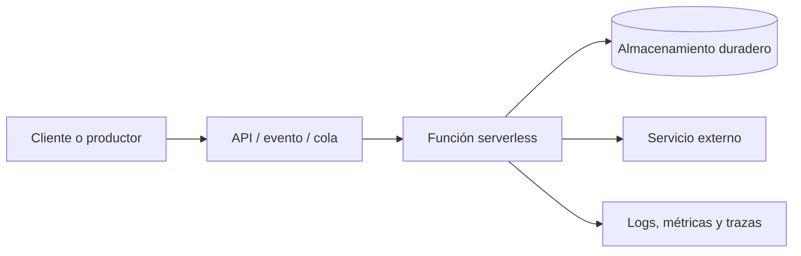

# Serverless y funciones como servicio (FaaS)

## Concepto

Serverless describe soluciones donde el proveedor administra gran parte de la infraestructura de ejecución y el equipo aprovisiona servicios según el uso. No significa que no existan servidores ni que la aplicación sea automáticamente escalable, económica o libre de operación. FaaS es un modelo de cómputo serverless en el que funciones se ejecutan en respuesta a solicitudes, temporizadores o eventos.

Las soluciones suelen combinar cómputo administrado con APIs, colas, eventos, almacenamiento, identidad y observabilidad. Serverless se relaciona a menudo con EDA, pero no son equivalentes: una arquitectura orientada a eventos puede ejecutarse sobre servidores propios, y una solución serverless también puede responder a solicitudes síncronas.

## Componentes y flujo típico

- **Entrada:** API HTTP, evento, cola, programación o cambio de almacenamiento.
- **Cómputo:** función o servicio administrado que procesa una unidad acotada de trabajo.
- **Persistencia:** base de datos, objetos, clave-valor u otro almacenamiento duradero.
- **Integración/orquestación:** eventos, colas, workflows y reintentos.
- **Operación:** identidad, configuración, secretos, métricas, logs, trazas y alertas.

## Cuándo considerarlo

- Cargas variables, intermitentes o basadas en eventos.
- APIs y trabajos cortos que pueden escalar independientemente.
- Procesamiento asíncrono, automatización y tareas programadas.
- Equipos que prefieren delegar aprovisionamiento y mantenimiento de servidores.

Considerar otras opciones cuando se requieren procesos de larga duración, control detallado del entorno, latencia extremadamente predecible, dependencias de red persistentes o cargas estables para las que el costo por invocación no resulte favorable.

## Principios de implementación

- Diseñar funciones sin estado durable en memoria; guardar estado en almacenamiento apropiado.
- Hacer operaciones idempotentes y definir deduplicación, reintentos y manejo de mensajes fallidos.
- Mantener funciones acotadas y con dependencias explícitas.
- Usar workflows administrados para procesos de varios pasos, compensaciones y estados durables.
- Definir límites de concurrencia, cuotas, timeouts, tamaño de mensajes y estrategia de backpressure.
- Instrumentar trazabilidad distribuida y correlación de invocaciones.
- Gestionar secretos fuera del código y aplicar permisos mínimos por función.
- Definir infraestructura como código, entornos, despliegues progresivos y reversa.
- Estimar costo completo: invocaciones, duración, red, almacenamiento, logs, colas y servicios auxiliares.
- Revisar portabilidad, límites del runtime y dependencia de proveedor.

## Riesgos y controles

| Riesgo | Control a definir |
|---|---|
| Reintentos que duplican efectos | Idempotencia, claves de deduplicación y pruebas |
| Tormentas de eventos o costo inesperado | Límites, cuotas, alertas y control de concurrencia |
| Cadena de funciones difícil de entender | Orquestación explícita, correlación y diagramas de flujo |
| Dependencia de servicios del proveedor | Evaluación deliberada de portabilidad y plan de salida |
| Falta de visibilidad | Logs estructurados, métricas de negocio, trazas y alarmas |
| Arranque en frío o límites de ejecución | Medición bajo carga y selección del runtime/configuración adecuados |

## Guías concretas de implementación

### AWS

- [Diseño de aplicaciones AWS Lambda](https://docs.aws.amazon.com/lambda/latest/dg/concepts-application-design.html): principios como funciones sin estado, bajo acoplamiento e idempotencia.
- [AWS Serverless Application Model (SAM)](https://docs.aws.amazon.com/serverless-application-model/latest/developerguide/): definición de recursos como código y ciclo de desarrollo, prueba y despliegue.
- [Crear una aplicación con AWS SAM](https://docs.aws.amazon.com/serverless-application-model/latest/developerguide/chapter-create-application.html): flujo práctico para iniciar y construir aplicaciones.

### Cloudflare Workers

- [Primer Worker con la CLI actual](https://developers.cloudflare.com/cf/get-started/first-worker/): creación con `cf init`, desarrollo local con `cf dev` y despliegue con `cf deploy`.
- [Inicio rápido con Wrangler](https://developers.cloudflare.com/workers/get-started/guide/): alternativa documentada para proyectos Wrangler, desarrollo local y despliegue con `wrangler`.
- [Tutoriales de Workers](https://developers.cloudflare.com/workers/tutorials/): ejemplos para APIs, bases de datos y aplicaciones.

Las herramientas y comandos cambian con el tiempo. Antes de iniciar un proyecto, revisar la guía oficial vigente y verificar si el repositorio usa el flujo moderno `cf` o el flujo existente de Wrangler; no mezclar ambos sin seguir la guía de migración de Cloudflare.

## Referencias relacionadas

- [Arquitectura orientada a eventos](Event-Driven.md)
- [AWS: diseño de aplicaciones Lambda](https://docs.aws.amazon.com/lambda/latest/dg/concepts-application-design.html)
- [Cloudflare Workers: primeros pasos](https://developers.cloudflare.com/workers/get-started/)
