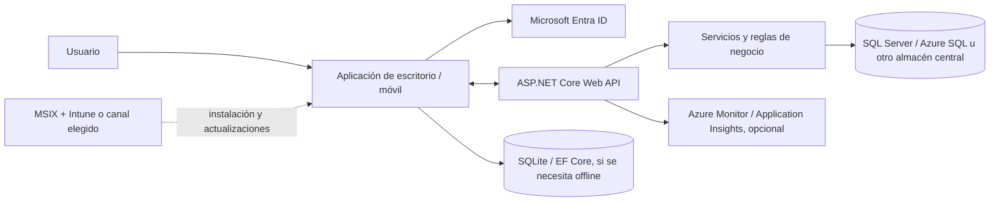

# Smart Client con tecnologías Microsoft

Este documento presenta una forma de aplicar el patrón Smart Client con tecnologías Microsoft actuales. Es una referencia de arquitectura que debe adaptarse al sistema operativo, dispositivos, conectividad, seguridad, ciclo de vida y capacidades del equipo. Smart Client es un estilo de solución; WinUI, WPF, Windows Forms, .NET MAUI y Azure son productos o tecnologías que pueden implementarlo.

## Arquitectura de referencia

La aplicación cliente es un **cliente público**: no puede guardar de forma segura un secreto de aplicación embebido. Autentica al usuario y llama a la API con los permisos otorgados; la API vuelve a validar acceso y aplica las reglas de negocio. Microsoft describe explícitamente que las aplicaciones desktop y móviles son public clients y no pueden guardar secretos de forma segura. [Tipos de aplicaciones cliente de MSAL](https://learn.microsoft.com/en-us/entra/identity-platform/msal-client-applications)

## Selección de tecnología de interfaz

| Escenario | Opción Microsoft a evaluar | Orientación |
|---|---|---|
| Nueva aplicación nativa solo para Windows | **WinUI 3 + Windows App SDK** | Microsoft la recomienda para nuevas aplicaciones desktop nativas de Windows que buscan una interfaz moderna y acceso a las capacidades actuales de Windows. |
| Aplicación empresarial existente o equipo con una base WPF consolidada | **WPF sobre .NET** | Sigue soportada y no está obsoleta. Mantener WPF puede ser más conveniente que reescribir una aplicación que ya resuelve sus necesidades. |
| Formularios de escritorio y flujos internos tradicionales, especialmente código existente | **Windows Forms (WinForms) sobre .NET** | Alternativa soportada para formularios y aplicaciones de escritorio existentes; evaluar capacidades de interfaz requeridas antes de adoptarla en un proyecto nuevo. |
| Una base de código compartida entre Windows y Android/iOS/macOS | **.NET MAUI** | Permite construir aplicaciones nativas multiplataforma con C# y XAML. Validar por separado la experiencia y capacidades específicas de cada plataforma; no se debe asumir UI idéntica sin ajustes. |
| Aplicación web existente que necesita integración con Windows | **WebView2 o alojamiento web controlado** | Considerarla si se busca reutilizar una experiencia web; validar integración con sistema operativo, instalación, autenticación y modo offline. |

La guía actual de Microsoft recomienda WinUI 3 para nuevas aplicaciones Windows generales, pero indica que WPF y Windows Forms continúan soportadas. Para código existente, recomienda modernizar gradualmente en lugar de reescribir sin una necesidad clara. [Elegir ruta de desarrollo Windows](https://learn.microsoft.com/en-us/windows/apps/get-started) · [Preguntas frecuentes para desarrolladores Windows](https://learn.microsoft.com/en-us/windows/apps/get-started/windows-developer-faq)

## Componentes Microsoft posibles

### Cliente

- **C# y .NET:** lenguaje y plataforma para lógica de presentación y servicios locales.
- **WinUI 3 + Windows App SDK, WPF o Windows Forms:** elegir una tecnología de interfaz según plataforma, experiencia requerida y código que ya existe.
- **.NET MAUI:** evaluar cuando se requieren versiones para escritorio y móvil y tiene sentido compartir lógica, pruebas e interfaz. Consultar la tabla de plataformas y versiones soportadas de la versión elegida. [Plataformas soportadas por .NET MAUI](https://learn.microsoft.com/en-us/dotnet/maui/supported-platforms)
- **SQLite con EF Core (opcional):** almacenamiento local para caché o trabajo offline. La sincronización con el servidor y la resolución de conflictos deben diseñarse por separado; EF Core y SQLite no las resuelven automáticamente. [Proveedor SQLite de EF Core](https://learn.microsoft.com/en-us/ef/core/providers/sqlite/)

### Servicios

- **ASP.NET Core Web API:** frontera para las operaciones remotas del cliente. Expone contratos versionados y mantiene reglas autoritativas, autorización y acceso a datos. [Documentación de ASP.NET Core](https://learn.microsoft.com/en-us/aspnet/core/)
- **SQL Server o Azure SQL:** opciones para persistencia central relacional cuando el dominio lo requiere. El cliente no debería conectarse directamente a la base de datos central.
- **Microsoft Entra ID y MSAL:** autenticación de usuarios y adquisición de tokens para llamar a APIs protegidas. Para aplicaciones de escritorio, configurar la aplicación como public client y no incluir client secrets. [Configurar aplicaciones de escritorio que llaman APIs](https://learn.microsoft.com/en-us/entra/identity-platform/scenario-desktop-app-registration)
- **Azure Service Bus (opcional):** podría recibir comandos o eventos del backend para procesos asíncronos; normalmente el cliente habla con una API, no directamente con el broker central.
- **Azure Monitor / Application Insights (opcional):** observabilidad del backend y, con instrumentación adecuada, diagnóstico del producto. Definir qué datos del usuario se registran y enmascarar información sensible.

Las opciones de Azure son alternativas de alojamiento e integración, no requisitos del estilo. La misma API puede ejecutarse en otras plataformas y conectarse a tecnologías existentes.

## Estrategia de datos y operación offline

Elegir una de estas estrategias por flujo, sin convertir toda la aplicación en offline-first si no lo necesita:

1. **Online con caché:** consultar la API, conservar copias temporales para mejorar rendimiento y definir caducidad e invalidación.
2. **Lectura offline:** sincronizar un subconjunto de datos que el usuario puede consultar sin conexión. Marcar fecha de actualización y limitar acciones que dependen de información vigente.
3. **Captura offline y envío posterior:** guardar comandos pendientes localmente en una cola/outbox duradera; al reconectar, enviarlos con identificadores idempotentes y exponer su estado.
4. **Edición de datos sincronizados:** definir propiedad de campos, versiones, estrategia de conflictos y mecanismo de revisión humana para cambios no combinables.

En una composición típica, el cliente usa una API HTTP autenticada; una base SQLite local con EF Core es opcional; la API procesa operaciones y persiste estado autoritativo en SQL Server/Azure SQL. Si hay sincronización por lotes, considerar un endpoint específico de sincronización, no compartir el acceso de base de datos.

Para información financiera, cupos, inventario escaso o pagos, preferir confirmar la transacción con el backend. Si el negocio permite registrar operaciones desconectado, definir límites, numeración, antifraude, expiración y conciliación antes de implementarlo.

## Autenticación y seguridad

- Usar Microsoft Entra ID/MSAL u otro proveedor de identidad corporativo mediante un flujo apropiado para cliente nativo.
- Tratar el cliente como no confiable: cualquier valor local, validación de UI o regla de negocio puede modificarse en el dispositivo.
- No incorporar client secrets, claves de API compartidas ni credenciales de base de datos central en el binario o archivos de configuración del cliente.
- La API valida firma y audiencia del token, identidad, permisos, estado del usuario y reglas de negocio en cada operación.
- Guardar tokens usando mecanismos seguros del sistema/plataforma; aplicar expiración y cierre de sesión, y evitar escribir tokens en logs.
- Cifrar y minimizar datos locales; definir borrado remoto o revocación de acceso cuando aplique a dispositivos administrados.
- Firmar artefactos de distribución, proteger el pipeline de publicación y permitir actualización/remediación de clientes vulnerables.

## Instalación y actualizaciones

| Tecnología de interfaz | Opciones a evaluar | Notas |
|---|---|---|
| WinUI 3 | MSIX, Microsoft Store o `.appinstaller` según el canal | ClickOnce no está soportado para WinUI 3; confirmar el modo de empaquetado compatible con funciones de Windows requeridas. |
| WPF / WinForms | MSIX, ClickOnce, MSI u otro instalador | ClickOnce sigue siendo una opción de publicación y actualización para ciertos escenarios; MSI puede convenir si se requieren acciones de instalación complejas. |
| .NET MAUI | Paquete por plataforma (por ejemplo, MSIX en Windows y canales de las tiendas/plataformas móviles) | Alinear firma, actualización, distribución y administración con cada sistema operativo. |

Para aplicaciones internas Windows en dispositivos administrados por Intune o Configuration Manager, Microsoft recomienda considerar MSIX sideloading. La guía de distribución de Windows diferencia MSIX y ClickOnce según tecnología y escenario; ClickOnce no aplica a WinUI 3. [Elegir ruta de distribución](https://learn.microsoft.com/en-us/windows/apps/package-and-deploy/choose-distribution-path) · [Desplegar MSIX con Intune](https://learn.microsoft.com/en-us/windows/msix/desktop/managing-your-msix-deployment-mem-adminconsole)

## Recomendaciones de implementación

1. Definir si el producto es exclusivamente Windows o necesita escritorio y móvil antes de elegir interfaz.
2. Separar la UI de lógica de aplicación y acceso a datos para poder probar reglas sin iniciar ventanas.
3. Mantener la API como contrato de servicio y propietario de decisiones autoritativas.
4. Comenzar con autenticación delegada de usuario; no colocar credenciales de aplicación en cliente.
5. Añadir almacenamiento local solo para necesidades demostrables; documentar sincronización, conflictos y retención.
6. Versionar API y soportar clientes anteriores durante la ventana de actualización definida.
7. Automatizar compilación, firma, publicación, pruebas de instalación y despliegue gradual.
8. Medir errores y versiones desde cliente, evitando datos personales o secretos en telemetría.
9. Definir un canal de soporte para instalaciones bloqueadas, certificados caducados y fallos de actualización.

## Cuándo elegir cada alternativa

- **WinUI 3:** aplicación nueva Windows-first con una experiencia nativa actual.
- **WPF:** aplicación de negocio Windows con necesidades y componentes que encajan con WPF, o evolución de una aplicación instalada.
- **WinForms:** mantener o ampliar una aplicación empresarial simple que ya opera correctamente con esta tecnología.
- **.NET MAUI:** producto que realmente necesita experiencias para Windows y plataformas móviles, y donde compartir código compensa mantener diferencias de UX y operación.
- **Web:** acceso amplio desde navegadores, administración central sencilla y ninguna dependencia fuerte de hardware local u offline.

## Fuentes oficiales

- [Smart Client Architecture and Design Guide de Microsoft](https://www.microsoft.com/en-us/download/details.aspx?id=10463) — fuente histórica para los conceptos Smart Client; emplea tecnología de su época.
- [Elegir una ruta de desarrollo Windows](https://learn.microsoft.com/en-us/windows/apps/get-started)
- [WinUI 3](https://learn.microsoft.com/en-us/windows/apps/winui)
- [Windows App SDK](https://learn.microsoft.com/en-us/windows/apps/windows-app-sdk/)
- [FAQ de desarrollo de aplicaciones Windows: WinUI 3, WPF y WinForms](https://learn.microsoft.com/en-us/windows/apps/get-started/windows-developer-faq)
- [.NET MAUI: qué es](https://learn.microsoft.com/en-us/dotnet/maui/what-is-maui)
- [.NET MAUI: plataformas soportadas](https://learn.microsoft.com/en-us/dotnet/maui/supported-platforms)
- [ASP.NET Core](https://learn.microsoft.com/en-us/aspnet/core/)
- [Microsoft Entra: aplicaciones cliente públicas y confidenciales](https://learn.microsoft.com/en-us/entra/identity-platform/msal-client-applications)
- [MSAL: configuración de aplicaciones de escritorio](https://learn.microsoft.com/en-us/entra/identity-platform/scenario-desktop-app-registration)
- [EF Core SQLite](https://learn.microsoft.com/en-us/ef/core/providers/sqlite/)
- [Azure Monitor Application Insights y OpenTelemetry](https://learn.microsoft.com/en-us/azure/azure-monitor/app/opentelemetry-enable)
- [Distribución de aplicaciones Windows](https://learn.microsoft.com/en-us/windows/apps/package-and-deploy/choose-distribution-path)
- [Desplegar aplicaciones MSIX con Intune](https://learn.microsoft.com/en-us/windows/msix/desktop/managing-your-msix-deployment-mem-adminconsole)
