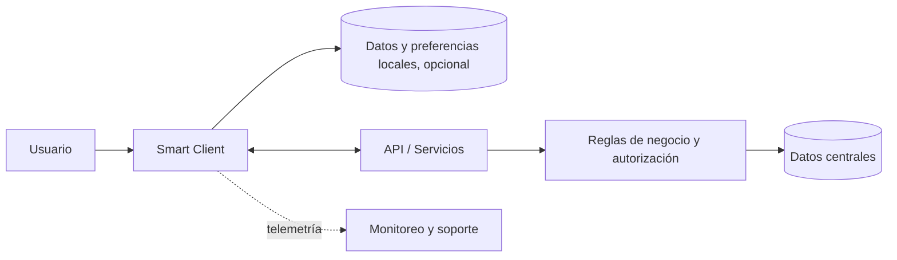

# Smart Client

## Concepto

Un **Smart Client** es una aplicación cliente que ofrece una experiencia rica y responde usando capacidades locales del dispositivo, mientras se integra con datos o servicios remotos. En comparación con un cliente delgado, puede ejecutar más lógica en el dispositivo, aprovechar hardware local y conservar datos o trabajo localmente.

El término describe un estilo de solución, no un producto, protocolo ni estándar formal. Se popularizó en guías de Microsoft, pero el patrón no pertenece exclusivamente a Microsoft. Tampoco implica que todas las aplicaciones Smart Client deban operar sin conexión: la capacidad offline es una opción de diseño según la necesidad del negocio.

## Características

- **Interfaz local enriquecida:** puede aprovechar teclado, ventanas, periféricos, notificaciones y capacidades del sistema operativo.
- **Ejecución en el dispositivo:** parte de la presentación y del comportamiento se ejecuta localmente; no toda interacción requiere una ida y vuelta al servidor.
- **Integración con servicios remotos:** se conecta con APIs, servicios de identidad y repositorios centrales para obtener o actualizar información.
- **Uso opcional de datos locales:** puede mantener preferencias, caché, archivos de trabajo o una base de datos local.
- **Conectividad consciente:** la aplicación comunica el estado de conexión y define qué acciones funcionan online, con conexión limitada o sin conexión.
- **Instalación y actualización del cliente:** el equipo de desarrollo u operaciones debe distribuir, actualizar y soportar versiones en los dispositivos.
- **Administración de seguridad en dos lados:** los datos y credenciales locales requieren protección, mientras que el servidor debe validar identidad, permisos y reglas críticas.

## Componentes habituales

1. **Aplicación cliente:** interfaz, navegación, validación de entrada, preferencias y coordinación de tareas.
2. **Lógica local:** cálculos o reglas que deben ejecutarse cerca del usuario. Las reglas críticas del negocio siguen siendo validadas por el servidor.
3. **Almacenamiento local (opcional):** caché o persistencia para datos disponibles sin conexión.
4. **Mecanismo de comunicación:** APIs y protocolos para autenticar al usuario, consultar información y enviar comandos.
5. **Servicios backend:** fuentes autoritativas de datos, permisos y reglas transaccionales.
6. **Sincronización (opcional):** recuperación de cambios pendientes, envío de operaciones y gestión de conflictos al reconectarse.
7. **Distribución y telemetría:** instalación, actualización, configuración, diagnóstico y soporte de versiones.

## Modos de conectividad

| Modo | Comportamiento | Diseño requerido |
|---|---|---|
| Siempre conectado | El cliente consulta o modifica datos mediante el backend; puede usar caché temporal. | Manejar latencia, tiempos de espera, reintentos limitados y errores del servicio. |
| Conectividad intermitente | Algunas lecturas o tareas continúan localmente; los cambios se envían al recuperar conexión. | Definir datos disponibles, duración del almacenamiento, colas/outbox, reintentos e idempotencia. |
| Operación offline amplia | El usuario consulta y registra trabajo durante periodos sin conexión, con sincronización posterior. | Diseñar conflictos, frescura, duplicados, orden de operaciones, revocación de acceso y límites funcionales offline. |

Un modo offline no es simplemente guardar una copia de la base central. Requiere decidir qué datos se descargan, cuánto tiempo son válidos, qué acciones se permiten, cómo se resuelven actualizaciones simultáneas y qué ocurre si el backend rechaza una operación al sincronizar.

## Casos de uso

- **Herramientas de campo:** técnicos que consultan manuales, órdenes de trabajo o registran visitas en lugares con conectividad irregular.
- **Puntos de venta e inventario:** captura local rápida y posterior conciliación, siempre que el negocio defina reglas claras para ventas, existencias y duplicados.
- **Aplicaciones internas de escritorio:** flujos de trabajo intensivos, grandes formularios, atajos de teclado o integración con periféricos.
- **Creación o revisión de contenido:** trabajo local con archivos o información que se sincroniza con un repositorio central.
- **Operaciones en instalaciones remotas:** estaciones que deben mantener algunas funciones aunque el enlace con el centro de datos falle.

Para transacciones financieras, reservas, cupos o inventario escaso, permitir comprometer transacciones offline puede crear sobreventa, riesgo de fraude o conflictos. En esos casos se debe justificar explícitamente el comportamiento y establecer controles de conciliación.

## Ventajas y costos

### Ventajas

- Respuesta rápida para tareas que pueden ejecutarse localmente.
- Experiencia de usuario rica e integración con hardware y funciones del dispositivo.
- Continuidad parcial del trabajo cuando la conexión es lenta o intermitente, si se diseña esa capacidad.
- Menos llamadas al backend para datos de lectura cacheados.

### Costos y riesgos

- Distribuir, actualizar y dar soporte a la aplicación instalada en múltiples dispositivos.
- Gestionar versiones del cliente y compatibilidad con APIs mientras los usuarios actualizan.
- Proteger datos, archivos y tokens que pueden permanecer en equipos perdidos o compartidos.
- Complejidad adicional de sincronización, conflictos y datos desactualizados.
- Posible inconsistencia si la lógica se duplica entre cliente y servidor.
- Una aplicación cliente distribuida puede inspeccionarse; no es un lugar seguro para secretos de aplicación.

## Recomendaciones de arquitectura

1. **Partir de las necesidades del usuario:** justificar instalación local, integración con dispositivo, rendimiento o conectividad; no elegir este estilo solo por familiaridad tecnológica.
2. **Definir límites de autoridad:** permitir que el cliente facilite el flujo, pero mantener las decisiones de autorización, integridad y transacción en servicios confiables.
3. **Hacer explícitas las funciones offline:** listar qué puede consultar y qué puede modificar el usuario en cada estado de conectividad.
4. **Separar caché de fuente de verdad:** indicar quién es dueño de cada dato, cuándo caduca y cómo se invalida.
5. **Diseñar sincronización como un flujo de negocio:** incluir identificadores de operación, idempotencia, reintentos, estados pendientes, conflictos, errores permanentes y conciliación.
6. **Limitar datos locales:** guardar solo lo necesario, protegerlos con controles del sistema operativo y definir borrado/retención para equipos compartidos o no administrados.
7. **No incrustar secretos:** el cliente no puede proteger de forma confiable un secreto compartido; usar autenticación de usuario o mecanismo seguro apropiado para dispositivos.
8. **Mantener contratos estables:** versionar APIs, definir compatibilidad y no asumir que todos los clientes se actualizan al mismo tiempo.
9. **Planificar distribución y soporte:** definir firma, canales de actualización, políticas de despliegue, telemetría, inventario de versiones y rollback.
10. **Probar escenarios de red y conflicto:** latencia, pérdida de conexión, doble envío, token expirado, cliente antiguo y cambios concurrentes.
11. **Considerar accesibilidad y administración:** diseñar teclado, lectores de pantalla, escalado de interfaz y políticas del dispositivo desde el inicio.

## Cuándo no conviene

- La aplicación solo necesita formularios o consultas simples y puede ser atendida adecuadamente por una web.
- No existe una necesidad concreta de capacidades locales y el equipo no quiere mantener un ciclo de instalación y actualización.
- La operación offline tendría consecuencias que el negocio no puede conciliar o controlar.
- La aplicación dependería de acceso directo del cliente a una base de datos central, acoplando cada instalación al esquema y a la red.

## Smart Client, cliente delgado y cliente web

| Aspecto | Smart Client | Cliente delgado web |
|---|---|---|
| Ejecución | Aplicación instalada o ejecutada localmente. | Principalmente navegador; la lógica central suele residir en servicios. |
| Experiencia | Puede integrar profundamente el sistema operativo y el hardware. | Despliegue centralizado y acceso desde navegador; capacidades limitadas al entorno web. |
| Actualización | Debe distribuirse y mantenerse compatible en los dispositivos. | Se actualiza principalmente en el servidor. |
| Offline | Posible si se implementa; no es automático. | Posible en algunas aplicaciones web, pero requiere diseño y soporte explícito del navegador. |
| Adecuado cuando | Hace falta experiencia local avanzada, periféricos o trabajo desconectado. | Se prioriza acceso amplio y despliegue centralizado para flujos web. |

## Referencias

- [Microsoft: Smart Client Architecture and Design Guide](https://www.microsoft.com/en-us/download/details.aspx?id=10463). Es una guía histórica de Microsoft; se usa como referencia conceptual del patrón, no como recomendación tecnológica actual.
- [Guía de arquitectura de aplicaciones: aplicaciones cliente enriquecidas](https://learn.microsoft.com/en-us/previous-versions/msp-n-p/ff647343(v=pandp.10)).
- [Microsoft: arquitectura Smart Client (archivo PDF)](https://download.microsoft.com/download/9/a/1/9a1115fd-8ba8-4aa0-a82e-07044bd12ac0/scag.pdf).

Para ver una aplicación del patrón con tecnologías Microsoft actuales, consulta [Smart Client con tecnologías Microsoft](smart-client-microsoft.md).
