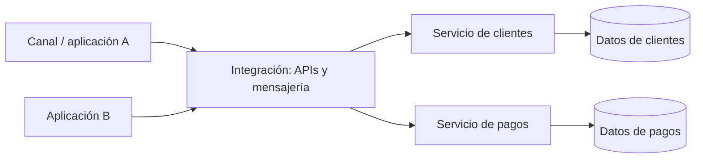

# Arquitectura orientada a servicios (SOA)

## Concepto

SOA organiza capacidades de negocio como servicios accesibles mediante contratos e interfaces. Los servicios pueden ser compartidos por varios procesos y sistemas, con integración a través de mensajes, APIs u otros mecanismos. SOA es un enfoque amplio; no prescribe una única tecnología ni implica necesariamente microservicios.

## Elementos habituales

- **Servicios de negocio:** exponen capacidades reutilizables mediante contratos estables.
- **Consumidores:** aplicaciones, procesos u otros servicios que usan esas capacidades.
- **Mecanismos de integración:** APIs, mensajería, eventos o adaptadores.
- **Gobierno:** propiedad, versiones, políticas de seguridad, niveles de servicio y ciclo de vida de contratos.
- **Transformación/adaptación:** traduce protocolos o modelos cuando sistemas heterogéneos deben colaborar.

## Cuándo considerarla

- Hay múltiples sistemas heterogéneos que deben reutilizar capacidades de negocio.
- Se requiere integrar aplicaciones heredadas y nuevas con contratos explícitos.
- La organización necesita gobierno y gestión de servicios compartidos a escala empresarial.

## Beneficios y costos

**Beneficios:** interoperabilidad; reutilización de capacidades; contratos que desacoplan consumidores de implementaciones; integración gradual de tecnologías distintas.

**Costos y riesgos:** gobierno central excesivo puede ralentizar equipos; servicios demasiado genéricos crean acoplamiento; intermediarios empresariales pueden volverse puntos únicos de fallo o cuello de botella; contratos y transformaciones requieren versionado y operación.

## SOA y microservicios

Ambos organizan sistemas en servicios. SOA suele abordar integración y reutilización a nivel de empresa, con gobierno y servicios compartidos; microservicios enfatizan servicios pequeños alineados a dominios, autonomía de equipos, datos y despliegue. Son tendencias, no definiciones rígidas: evaluar límites, propiedad de datos y autonomía concretos en cada sistema.

## Reglas de diseño

- Modelar contratos alrededor de capacidades de negocio y documentar semántica, errores y versiones.
- Evitar interfaces genéricas que filtren detalles internos o compartan esquemas de base de datos.
- Definir propietario, consumidor, criticidad, SLO y ciclo de vida para cada servicio.
- Elegir comunicación síncrona o asíncrona según el flujo y los requisitos de consistencia.
- Revisar seguridad, trazabilidad, resiliencia y compatibilidad de contratos.

## Referencias

- [Microsoft: estilos de arquitectura](https://learn.microsoft.com/azure/architecture/guide/architecture-styles)
- [Microsoft: servicios web](https://learn.microsoft.com/en-us/azure/architecture/best-practices/api-design)
