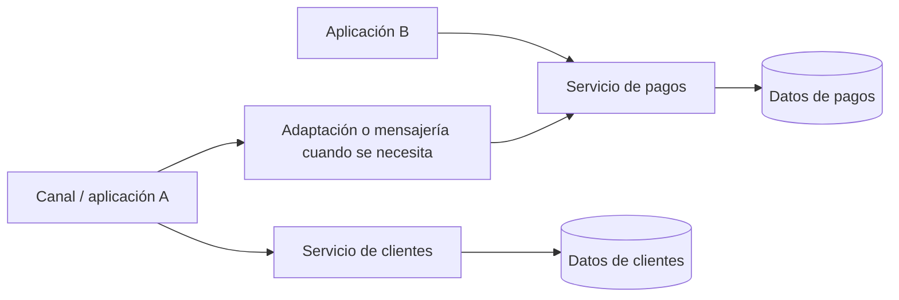

# Arquitectura orientada a servicios (SOA)

## Concepto

SOA organiza capacidades de negocio como servicios accesibles mediante contratos e interfaces. Los servicios pueden ser compartidos por varios procesos y sistemas, con integración a través de mensajes, APIs u otros mecanismos. SOA es un enfoque amplio; no prescribe una única tecnología ni implica necesariamente microservicios.

## Conceptos fundamentales

| Concepto | Significado y consecuencia de diseño |
|---|---|
| Capacidad | Aptitud para producir un resultado de negocio; el servicio ofrece acceso a ella. |
| Servicio | Mecanismo para acceder a una capacidad mediante una interfaz y condiciones explícitas. No equivale necesariamente a un proceso o aplicación desplegada. |
| Proveedor y consumidor | Participantes responsables de ofrecer y utilizar una capacidad. Sus dependencias deben quedar identificadas. |
| Contrato | Acuerdo sobre operaciones, mensajes, semántica, condiciones y comportamiento observable. Incluye más que el esquema del mensaje. |
| Descripción del servicio | Información que permite conocer cómo usarlo, sus restricciones y condiciones de interacción. |
| Política | Restricción o condición aplicable al servicio, como permisos, límites de consumo o protección de información. |
| Contexto de ejecución | Condiciones técnicas y organizacionales necesarias para que la interacción ocurra. |

El [modelo de referencia de OASIS](https://docs.oasis-open.org/soa-rm/v1.0/soa-rm.html) destaca tres conceptos dinámicos: **visibilidad** entre participantes, **interacción** y **efecto en el mundo real**. Conocer un servicio no basta: debe ser alcanzable y existir disposición para interactuar. El efecto puede ser obtener información o cambiar un estado; una respuesta técnica exitosa no garantiza por sí sola el resultado de negocio esperado.

## Características

- **Orientación a capacidades de negocio:** los límites expresan responsabilidades reconocibles por la organización.
- **Contratos explícitos:** consumidores y proveedores comparten acuerdos sin necesitar conocer toda la implementación.
- **Acoplamiento controlado:** reducir dependencias internas y temporales; una llamada remota conserva dependencias de contrato, disponibilidad y semántica.
- **Interoperabilidad:** permitir colaboración entre tecnologías y organizaciones mediante acuerdos técnicos y semánticos.
- **Autonomía con responsabilidad:** definir qué decisiones, datos y cambios controla el proveedor y qué compromisos mantiene con los consumidores.
- **Composición:** combinar servicios para ejecutar procesos mayores, con manejo explícito de errores y resultados parciales.
- **Reutilización selectiva:** compartir capacidades cuando sus significados y requisitos coinciden; evitar imponer un servicio universal a dominios distintos.
- **Descubrimiento y gobierno:** disponer de información sobre servicios, propietarios, condiciones de uso y ciclo de vida. Un registro dinámico no es obligatorio.

SOA no exige SOAP, XML, un ESB, una base compartida ni un modelo empresarial único. Puede usar distintos transportes y estilos de interacción. Tampoco requiere que todos los servicios sean totalmente sin estado: el estado conversacional debe tener propietario, persistencia y reglas de recuperación.

## Elementos habituales

- **Servicios de negocio:** exponen capacidades reutilizables mediante contratos estables.
- **Consumidores:** aplicaciones, procesos u otros servicios que usan esas capacidades.
- **Mecanismos de integración:** APIs, mensajería, eventos o adaptadores.
- **Gobierno:** propiedad, versiones, políticas de seguridad, niveles de servicio y ciclo de vida de contratos.
- **Transformación/adaptación:** traduce protocolos o modelos cuando sistemas heterogéneos deben colaborar.

El diagrama representa una alternativa: puede haber acceso directo, gateway, mensajería o adaptadores según la interacción. La integración centralizada no es un requisito de SOA. Los servicios pueden envolver sistemas existentes; definir su propiedad lógica no obliga a crear inmediatamente una base física por servicio.

## Cuándo considerarla

- Hay múltiples sistemas heterogéneos que deben reutilizar capacidades de negocio.
- Se requiere integrar aplicaciones heredadas y nuevas con contratos explícitos.
- La organización necesita gobierno y gestión de servicios compartidos a escala empresarial.

## Beneficios y costos

**Beneficios:** interoperabilidad; reutilización de capacidades; contratos que desacoplan consumidores de implementaciones; integración gradual de tecnologías distintas.

**Costos y riesgos:** gobierno central excesivo puede ralentizar equipos; servicios demasiado genéricos crean acoplamiento; intermediarios empresariales pueden volverse puntos únicos de fallo o cuello de botella; contratos y transformaciones requieren versionado y operación.

## SOA y microservicios

Ambos organizan sistemas en servicios. SOA suele abordar integración y reutilización a nivel de empresa, con gobierno y servicios compartidos; microservicios enfatizan servicios pequeños alineados a dominios, autonomía de equipos, datos y despliegue. Son tendencias, no definiciones rígidas: evaluar límites, propiedad de datos y autonomía concretos en cada sistema.

## Reglas de diseño

- Modelar contratos alrededor de capacidades de negocio y documentar semántica, errores y versiones.
- Evitar interfaces genéricas que filtren detalles internos o compartan esquemas de base de datos.
- Definir propietario, consumidor, criticidad, SLO y ciclo de vida para cada servicio.
- Elegir comunicación síncrona o asíncrona según el flujo y los requisitos de consistencia.
- Revisar seguridad, trazabilidad, resiliencia y compatibilidad de contratos.

## Decisiones de diseño

| Decisión | Criterios y consecuencias |
|---|---|
| Límites y granularidad | Agrupar operaciones que comparten significado, reglas y propietario. Servicios demasiado finos generan conversaciones remotas; los demasiado amplios concentran cambios y dependencias. |
| Servicio compartido o específico | Reutilizar cuando exista una semántica común y compromisos compatibles. Permitir servicios distintos cuando políticas o ritmos de evolución difieran. |
| Sincronía o asincronía | Usar respuesta inmediata cuando el consumidor necesita un resultado dentro de su operación; mensajería para desacoplar tiempos, absorber carga o ejecutar trabajo diferido. La asincronía añade seguimiento y estados intermedios. |
| Orquestación o coreografía | La orquestación explicita el proceso y su coordinador. La coreografía distribuye reacciones y exige visibilidad sobre causalidad y resultados globales. Pueden combinarse. |
| Integración directa o intermediada | Un gateway gestiona acceso; un broker transporta mensajes; un ESB puede mediar y transformar. Introducirlos por necesidades concretas y dimensionar su impacto en disponibilidad y latencia. |
| Modelo de información | Acordar vocabulario, identificadores y unidades. Un modelo canónico puede ayudar dentro de un alcance delimitado, pero uno universal puede bloquear la evolución de dominios. |
| Propiedad de datos | Definir quién valida y modifica cada dato y cómo se consulta o replica. Evitar que consumidores escriban tablas internas del proveedor. |
| Consistencia y transacciones | Mantener invariantes dentro de límites transaccionales claros. Entre servicios, decidir si se necesita coordinación distribuida o si son aceptables pasos locales y compensaciones. |
| Disponibilidad y capacidad | Establecer presupuestos de latencia, dependencias críticas, cuotas y aislamiento entre consumidores. Un servicio compartido necesita capacidad y soporte acordes con sus dependientes. |
| Evolución | Evaluar compatibilidad de estructura, significado y comportamiento, además de la versión técnica. Planificar convivencia, migración y retiro. |

### Contratos y semántica

Un contrato útil documenta:

- Propósito, operaciones, precondiciones, resultados y cambios de estado permitidos.
- Campos obligatorios, unidades, moneda, zona horaria, identificadores y significado de valores ausentes.
- Errores de negocio y técnicos, códigos estables y condiciones en las que se permite reintentar.
- Idempotencia, correlación, orden, duplicados y límites de tamaño o frecuencia.
- Identidades admitidas, permisos, clasificación de datos y compromisos operativos.
- Compatibilidad, versiones, soporte y procedimiento de retiro.

Un cambio aparentemente aditivo puede romper un consumidor estricto; cambiar un valor predeterminado o la interpretación de un estado puede ser incompatible sin alterar el esquema. Verificar con consumidores representativos y pruebas de contrato.

### Consistencia y fallos parciales

En una interacción distribuida, un timeout puede ocurrir después de que el proveedor confirmó internamente el trabajo. No asumir que timeout significa operación no ejecutada. Para operaciones con efectos, definir clave de idempotencia, alcance y plazo de deduplicación, consulta de estado y reconciliación.

Los procesos de varios pasos necesitan estados persistidos y una estrategia para fallos parciales. Una compensación es una nueva acción de negocio, no un rollback universal: puede fallar y requerir intervención. No prometer entrega o procesamiento exactamente una vez sin delimitar el alcance y el mecanismo que lo garantiza.

## Seguridad

La seguridad debe cubrir toda la interacción y sus intermediarios. Un gateway no sustituye la autorización dentro del servicio ni la protección del sistema de destino.

| Área | Decisiones y controles |
|---|---|
| Identidad | Diferenciar identidad del usuario, aplicación consumidora y carga de trabajo. Establecer confianza entre dominios y validar credenciales en cada frontera pertinente. |
| Autorización | Aplicar mínimo privilegio por operación, recurso y cliente. Si existe delegación, conservar el contexto autorizado sin aceptar identidades enviadas sin verificación. |
| Transporte y mensajes | Proteger comunicaciones y verificar dónde termina el cifrado. Evaluar firma o cifrado del mensaje cuando se necesite protección a través de intermediarios o almacenamiento. |
| Información sensible | Minimizar datos, clasificar campos, limitar retención y proteger registros, colas, respaldos y trazas. No registrar secretos ni credenciales. |
| Entradas y recursos | Validar estructura y semántica, limitar tamaños, consumo y concurrencia, y controlar accesos a destinos externos. |
| Secretos y certificados | Definir almacenamiento, distribución, rotación, vencimiento y respuesta ante compromiso. |
| Auditoría | Registrar actor, aplicación, acción, objeto, resultado y correlación con acceso restringido y protección frente a modificaciones. |
| Administración | Separar permisos de publicación, configuración, ejecución y consulta de auditoría según el riesgo. |

Modelar amenazas como suplantación, acceso entre clientes, repetición de mensajes, manipulación, fuga de datos y abuso de un intermediario. La autenticación mutua del transporte no equivale a autorizar la acción de negocio. En mensajería, controlar también quién publica, consume y reproduce mensajes.

Véanse [seguridad aplicativa](../seguridad/seguridad-aplicativa/README.md), [autorización](../seguridad/seguridad-aplicativa/authorization.md) y [gestión de secretos](../seguridad/seguridad-aplicativa/gestor.secretos.md).

## Gobierno de servicios

El gobierno establece **quién decide, con qué políticas y cómo se verifica su cumplimiento**. La gestión ejecuta esas decisiones: publicar, operar, medir y corregir. Un catálogo o una herramienta de integración apoya el gobierno, pero no lo reemplaza.

### Responsabilidades

| Rol | Responsabilidad |
|---|---|
| Propietario de negocio | Definir propósito, reglas, prioridad y resultado esperado. |
| Equipo proveedor | Diseñar, implementar, operar y evolucionar el servicio; responder por sus compromisos. |
| Equipos consumidores | Respetar contratos y cuotas, informar dependencias y realizar migraciones acordadas. |
| Arquitectura y plataforma | Mantener criterios comunes y mecanismos reutilizables; revisar decisiones transversales. |
| Seguridad y datos | Definir controles según riesgo y clasificación, y revisar excepciones relevantes. |
| Operación | Coordinar alertas, incidentes y recuperación con los equipos responsables. |

Una persona o equipo puede asumir varios roles; la responsabilidad no debe quedar implícita entre áreas.

### Ciclo de vida

1. **Proponer:** identificar capacidad, consumidores, propietario y necesidad; revisar servicios existentes sin imponer reutilización artificial.
2. **Diseñar:** acordar contrato, dependencias, datos, seguridad, niveles de servicio y compatibilidad.
3. **Verificar:** validar contratos, permisos, capacidad y recuperación; registrar riesgos y excepciones.
4. **Publicar:** incorporar descripción, documentación y acceso al catálogo con una versión identificable.
5. **Operar y evolucionar:** medir resultados, gestionar incidentes y revisar cambios con sus consumidores.
6. **Deprecar y retirar:** avisar con plazo acordado, ofrecer migración, comprobar uso real y retirar accesos, rutas y datos según su política de conservación.

El catálogo debería registrar como mínimo propietario, propósito, contrato y versión, consumidores conocidos, ambientes, clasificación de datos, dependencias, SLO, soporte y estado del ciclo de vida. Un catálogo de diseño y un mecanismo de descubrimiento en ejecución resuelven necesidades diferentes.

### Gobierno proporcional al riesgo

Establecer reglas comunes para identidad, contratos, observabilidad y compatibilidad; automatizar comprobaciones repetibles. Reservar revisiones manuales para decisiones con impacto transversal o riesgo significativo. Las excepciones necesitan responsable, justificación, controles compensatorios y fecha de revisión.

Un modelo federado permite que los dominios decidan su implementación dentro de políticas compartidas. Centralizar todas las decisiones puede ralentizar cambios; delegarlas sin acuerdos produce contratos y controles inconsistentes. La elección depende de la organización, no de una exigencia de SOA.

Medir cobertura de propietarios y contratos, cambios incompatibles, consumidores en versiones obsoletas, cumplimiento de SLO e incidentes por dependencias. La cantidad de servicios o de reutilizaciones, por sí sola, no mide valor de negocio.

Existe un marco formal de gobierno: [ISO/IEC 17998:2012 — SOA Governance Framework](https://www.iso.org/standard/61240.html). Las recomendaciones prácticas de esta sección son una síntesis de diseño; no constituyen una evaluación de conformidad con ese estándar.

## Operación y resiliencia

- Definir indicadores y objetivos de servicio (SLI/SLO); diferenciar esos objetivos de los acuerdos de nivel de servicio (SLA).
- Presupuestar la latencia del flujo completo; establecer timeouts coherentes en consumidores e intermediarios.
- Limitar reintentos, usar espera progresiva y variación aleatoria, y reintentar solo cuando la operación lo permita.
- Aislar fallos con límites de concurrencia, circuit breakers y separación de recursos cuando corresponda.
- En mensajería, definir retención, orden, presión de carga, mensajes no procesables y reproducción controlada.
- Correlacionar solicitudes, mensajes y operaciones de negocio mediante métricas, registros y trazas, preservando la confidencialidad.
- Probar indisponibilidad, lentitud, duplicados, pérdida de respuesta, recuperación y restauración de datos.

## Ejemplo: proceso de pagos

Un canal solicita un pago al servicio de pagos. Este conserva el estado de la operación y coordina validación, ejecución contra el sistema financiero y notificación. El sistema financiero mantiene la autoridad sobre el asiento contable; el servicio no debe declarar un pago completado solo porque aceptó la solicitud.

| Situación | Decisión explícita |
|---|---|
| El canal repite la solicitud | Recuperar el resultado mediante la identidad de operación y la política de idempotencia. |
| El sistema financiero no responde | Mantener estado pendiente o desconocido y consultar o reconciliar antes de repetir un débito. |
| Falla la notificación | Reintentar la notificación sin ejecutar de nuevo el pago confirmado. |
| Se solicita una reversión | Aplicar una operación autorizada con sus propias reglas, trazabilidad y posibles fallos. |
| Cambia el contrato | Evaluar consumidores, convivir con versiones cuando sea necesario y verificar la migración. |

El gateway puede validar acceso y cuotas; el servicio conserva la autorización de negocio y la coordinación del pago. Un intermediario de integración adapta el protocolo del sistema financiero si hace falta, sin convertirse automáticamente en propietario de sus reglas.

## Antipatrones y señales de alerta

- **SOA como compra de un ESB:** introducir tecnología sin capacidades, contratos ni responsables claros.
- **Servicio universal:** concentrar dominios distintos en una interfaz genérica con reglas condicionales por consumidor.
- **Monolito distribuido:** requerir despliegues coordinados y cadenas de llamadas para cada operación pequeña.
- **Base compartida como contrato:** permitir acceso directo que evita validaciones y rompe la evolución del proveedor.
- **Lógica de negocio oculta en integración:** acumular reglas sin propietario en transformaciones y rutas.
- **Reintentos ciegos:** duplicar efectos financieros o administrativos ante una respuesta perdida.
- **Gobierno solo documental:** publicar políticas sin comprobarlas ni asignar responsables.
- **Servicio compartido sin financiación ni soporte:** exigir reutilización sin capacidad para atender a los consumidores.

## Adopción gradual y decisiones a registrar

Comenzar por una capacidad concreta con consumidores identificados y valor medible. Documentar el contrato, envolver el sistema existente cuando convenga y establecer operación y seguridad antes de ampliar la adopción. Evaluar el costo de coordinación y soporte junto con el ahorro por reutilización.

Para cada servicio o iniciativa, registrar:

1. Capacidad, límites, propietario y consumidores previstos.
2. Autoridad sobre datos y reglas de negocio.
3. Contratos, semántica, compatibilidad y política de retiro.
4. Comunicación, intermediarios y justificación de su uso.
5. Consistencia, idempotencia, fallos parciales y recuperación.
6. Identidad, permisos, privacidad y auditoría.
7. SLO, capacidad, soporte, costos y dependencias críticas.
8. Gobierno, excepciones y mecanismo para verificar los acuerdos.

## Documentación relacionada

- [Comunicación e integración](../comunicacion-e-integracion/README.md).
- [Estándares de API](../comunicacion-e-integracion/estandares-api.md).
- [Workflows](../comunicacion-e-integracion/workflows.md).
- [Microservicios](microservicios/README.md).
- [Arquitectura orientada a eventos](Event-Driven.md).
- [Control Plane / Data Plane](control-plane-data-plane.md): separación de administración y ejecución; es una dimensión distinta de la orientación a servicios.

## Referencias

- [OASIS: Reference Model for Service Oriented Architecture 1.0](https://docs.oasis-open.org/soa-rm/v1.0/soa-rm.html): modelo conceptual, aprobado como estándar OASIS en 2006; no prescribe una tecnología de implementación.
- [OASIS: Reference Architecture Foundation for SOA 1.0](https://docs.oasis-open.org/soa-rm/soa-ra/v1.0/cs01/soa-ra-v1.0-cs01.html): desarrollo arquitectónico del modelo; documento Committee Specification de 2012.
- [ISO/IEC 17998:2012: SOA Governance Framework](https://www.iso.org/standard/61240.html): alcance y descripción pública del marco de gobierno.
- [Microsoft: estilos de arquitectura](https://learn.microsoft.com/azure/architecture/guide/architecture-styles)
- [Microsoft: diseño de API web](https://learn.microsoft.com/en-us/azure/architecture/best-practices/api-design): guía complementaria para interfaces; no es una definición de SOA.
