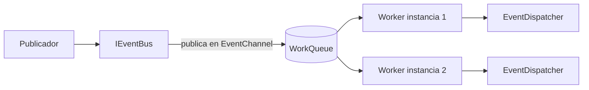
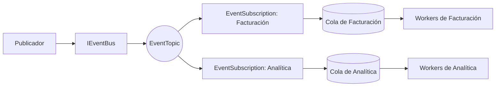
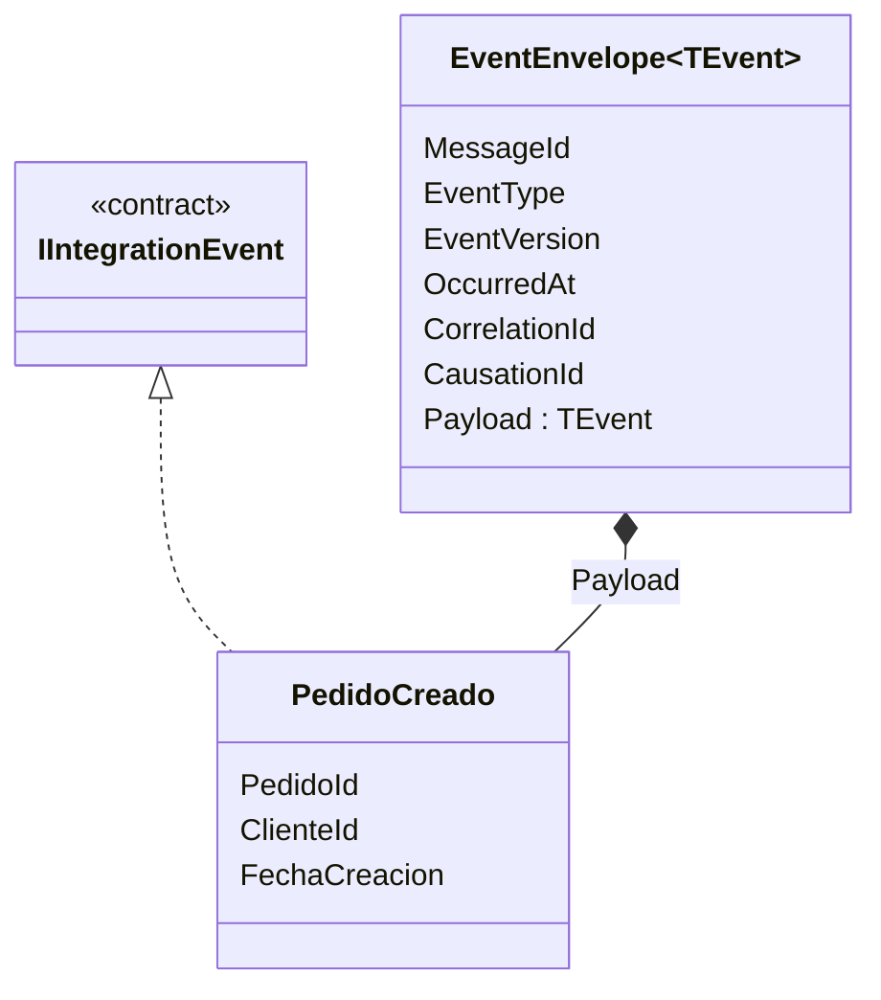
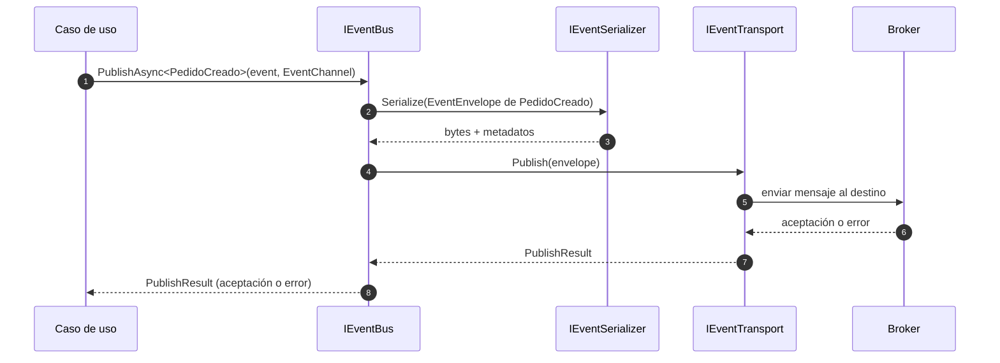
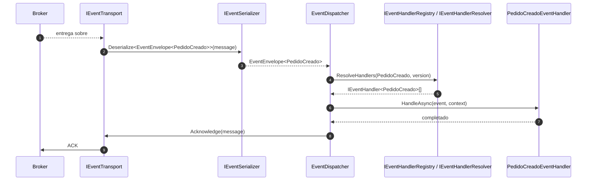
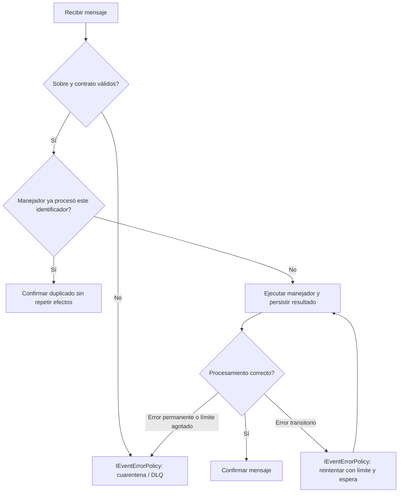

# Implementar un bus de eventos asíncrono

Esta guía describe cómo diseñar e implementar conceptualmente un `IEventBus` para publicar eventos y procesarlos de forma asíncrona. Usa nombres técnicos convencionales para que las piezas puedan reconocerse con precisión. Son nombres de referencia, no una API lista para compilar ni una dependencia de un lenguaje, framework o producto.

## Propósito y alcance

Un bus de eventos desacopla al componente que anuncia un hecho del código que reacciona a ese hecho. El publicador entrega un evento al bus sin invocar directamente a sus consumidores. El transporte permite que los consumidores reciban el evento más adelante, incluso si están en otro proceso.

El bus coordina publicación, transporte y despacho. No debe convertirse en el dueño de las reglas de negocio ni reemplazar contratos HTTP para consultas que necesitan una respuesta inmediata. Esta guía cubre eventos de integración asíncronos; un bus en memoria dentro de un único proceso es una variante con garantías y límites distintos.

## Conceptos y nombres técnicos

Conviene distinguir estos términos:

- **Contrato de evento (`IIntegrationEvent`):** interfaz conceptual o convención que identifica un evento de integración. El evento concreto puede llamarse `PedidoCreado` y contener solo los datos publicados para sus consumidores.
- **Sobre del evento (`EventEnvelope<TEvent>`):** envoltura de transporte con el evento tipado y metadatos como `MessageId`, `EventType`, `EventVersion`, `OccurredAt`, `CorrelationId` y `CausationId`.
- **Bus (`IEventBus`):** abstracción que ofrece `PublishAsync<TEvent>(event, channel)` para publicar un evento en un canal lógico. El nombre `Async` expresa que la operación puede esperar E/S; no significa que el consumidor ya haya procesado el evento.
- **Topología de entrega (`DeliveryTopology`):** forma lógica en que se distribuye un evento: una cola de trabajo compartida (`WorkQueue`) o un topic con una suscripción independiente por consumidor lógico (`FanOutSubscription`).
- **Canal lógico (`EventChannel`):** nombre estable de publicación, como `ventas.pedidos`; no es necesariamente el nombre físico de una cola o topic del broker.
- **Suscripción (`EventSubscription<TEvent>`):** declaración de que un consumidor lógico recibe un tipo o canal de eventos, con una topología y un destino configurados.
- **Cola de trabajo (`WorkQueue`):** destino compartido por las instancias de un mismo consumidor lógico. Cada mensaje se entrega para que lo procese una instancia del grupo.
- **Topic y suscripción (`Topic`, `EventSubscription<TEvent>`):** canal de publicación que distribuye una copia del mensaje a cada suscripción independiente interesada. Cada suscripción procesa su copia sin depender del avance de las demás.
- **Manejador (`IEventHandler<TEvent>`):** contrato de una reacción, normalmente con una operación conceptual `HandleAsync(event, context)`. Usar el patrón de nombre `<Nombre>EventHandler<TEvent>` para la implementación; por ejemplo, `PedidoCreadoEventHandler : IEventHandler<PedidoCreado>`.
- **Registro (`IEventHandlerRegistry`):** catálogo local que relaciona tipo/versión de evento con sus manejadores y configuración de suscripción.
- **Resolutor (`IEventHandlerResolver`):** obtiene una instancia de manejador para la entrega actual según el ciclo de vida y las dependencias del consumidor.
- **Transporte (`IEventTransport`):** abstracción interna del adaptador que publica y recibe sobres, y expone confirmación, rechazo y capacidades del broker.
- **Despachador (`EventDispatcher`):** componente consumidor cuyo punto de entrada conceptual puede llamarse `DispatchEvents`; valida, resuelve y ejecuta los manejadores, y devuelve el resultado a la política de entrega.
- **Serializador (`IEventSerializer`):** convierte contratos y sobres entre sus representaciones de aplicación y transporte.
- **Broker o plataforma de transporte:** acepta, conserva, enruta y entrega mensajes según las garantías configuradas.

Los nombres con `I` expresan contratos o abstracciones; los nombres sin `I` suelen identificar implementaciones o tipos concretos en ejemplos. Esta convención es familiar en varios ecosistemas, pero no es universal. Un suscriptor y un manejador pueden corresponder uno a uno, pero no son sinónimos: `EventSubscription<TEvent>` describe interés y entrega; `IEventHandler<TEvent>` ejecuta una reacción. Un evento de integración no debe ser una referencia a una entidad interna ni depender de objetos de dominio del servicio que lo publica.

## Componentes y responsabilidades

| Componente y nombre de referencia | Responsabilidad | No debería hacer |
|---|---|---|
| Contrato `IIntegrationEvent`; evento concreto `PedidoCreado` | Definir un hecho estable: tipo, versión y datos públicos del evento. | Exponer entidades internas, comportamiento ejecutable o detalles privados del publicador. |
| Sobre `EventEnvelope<TEvent>` | Transportar el evento con identidad, tipo/versión, fecha, correlación, causalidad y metadatos necesarios. | Convertirse en una bolsa de datos sin convenciones ni límites. |
| Abstracción `IEventBus` | Ofrecer `PublishAsync<TEvent>(event, channel)` sin acoplar la aplicación a un broker ni a sus destinos físicos. | Garantizar por sí sola que todos los consumidores terminaron. |
| Topología `DeliveryTopology` | Expresar si el consumidor participa en una cola compartida (`WorkQueue`) o recibe una copia independiente mediante topic/suscripción (`FanOutSubscription`). | Incluir semánticas que pertenecen a otras políticas o asumir que todo broker ofrece ambas topologías con las mismas garantías. |
| Canal `EventChannel` y publicador | Dar al publicador un destino lógico estable para publicar sin conocer suscriptores ni nombres físicos del broker. | Resolver directamente las colas de cada consumidor o acoplar el caso de uso a recursos del proveedor. |
| Topic `EventTopic` | Recibir una publicación y distribuirla a las suscripciones registradas para ese canal. | Ejecutar manejadores de negocio directamente o esperar que terminen. |
| Suscripción `EventSubscription<TEvent>` y registro `IEventHandlerRegistry` | Declarar qué canal/tipos consume cada consumidor lógico, su topología y sus manejadores locales. | Confundirse con una instancia de worker o con el manejador que procesa el mensaje. |
| Cola `IEventQueue` / destino de suscripción | Mantener mensajes pendientes para un consumidor o grupo de instancias y permitir su recepción y confirmación. | Servir como registro global de suscriptores cuando se busca difusión independiente. |
| Resolutor `IEventHandlerResolver` | Crear u obtener una instancia `IEventHandler<TEvent>` para la entrega actual. | Compartir manejadores concurrentes si su ciclo de vida no lo permite. |
| Adaptador `IEventTransport` | Traducir publicación/recepción, confirmaciones y errores a las operaciones del broker elegido. | Filtrar conceptos específicos del producto hacia `IEventBus` o el dominio. |
| Despachador `EventDispatcher` / `DispatchEvents` | Validar, deserializar, resolver y ejecutar manejadores; aplicar la política de entrega. | Confirmar antes de que el manejador complete su trabajo durable. |
| Serializador `IEventSerializer` | Convertir contratos y sobres, y validar formato y compatibilidad. | Deserializar tipos arbitrarios indicados por datos no confiables. |
| Política `IEventErrorPolicy` | Definir timeouts, reintentos, espera, descarte, cuarentena/DLQ y observabilidad. | Reintentar sin límite o sin distinguir errores transitorios de permanentes. |

## Relaciones entre piezas

```mermaid
flowchart LR
    subgraph Productor[Aplicación publicadora]
        P[Publicador / caso de uso]
        C[IIntegrationEvent: PedidoCreado]
        B[IEventBus]
        S1[IEventSerializer]
        TA[IEventTransport: productor]
        P --> C --> B --> S1 --> TA
    end

    TA -->|sobre del mensaje| BR[(Broker / transporte)]

    subgraph Consumidor[Aplicación suscriptora]
        TB[IEventTransport: consumidor]
        S2[IEventSerializer]
        D[EventDispatcher / DispatchEvents]
        R[IEventHandlerRegistry + IEventHandlerResolver]
        H["PedidoCreadoEventHandler<br/>IEventHandler&lt;PedidoCreado&gt;"]
        TB --> S2 --> D --> R --> H
    end

    BR -->|entrega según suscripción| TB
    D -. confirma o rechaza .-> TB
```



La aplicación no llama a los manejadores remotos. El broker conecta publicadores y consumidores. Dentro del proceso consumidor, el despachador conecta el mensaje recibido con los manejadores registrados.

## Topologías de entrega: cola de trabajo y topic con suscripciones

`DeliveryTopology` debe describir la necesidad de entrega del consumidor, no una operación del despachador local. La topología se configura por suscripción: varios consumidores pueden interesarse en el mismo `EventType`, pero requerir destinos y garantías diferentes.

```text
DeliveryTopology
  WorkQueue
  FanOutSubscription
```

### `WorkQueue`: una cola compartida por un grupo de instancias

En `WorkQueue`, un consumidor lógico configura una cola y una o más instancias de su servicio reciben mensajes de esa misma cola. Las instancias son consumidoras competidoras: cada mensaje se asigna a una instancia para que el grupo reparta la carga. Agregar instancias aumenta la capacidad del mismo consumidor lógico; no crea copias para otros servicios.



El flujo conceptual es:

1. El caso de uso publica un `EventEnvelope<TEvent>` en el `EventChannel` lógico.
2. El adaptador traduce el canal al destino de cola configurado.
3. Una instancia del grupo recibe el mensaje y lo entrega a `EventDispatcher`.
4. El dispatcher resuelve y ejecuta los manejadores locales registrados.
5. El consumidor confirma el mensaje solo cuando el procesamiento requerido terminó de forma durable; ante fallo, aplica la política de reintento o de mensajes fallidos.

Una cola estilo Amazon SQS implementa esta topología. SQS estándar puede entregar un mensaje más de una vez, por lo que los manejadores deben ser idempotentes; si no se confirma antes de expirar la visibilidad, el mensaje vuelve a estar disponible. En el adaptador, la confirmación conceptual se traduce a eliminar el mensaje de la cola después del procesamiento. Las colas FIFO añaden capacidades propias del servicio; esas capacidades no se deben presumir en `IEventBus`.

### `FanOutSubscription`: una copia por consumidor lógico

En `FanOutSubscription`, el publicador escribe en un `EventTopic` lógico. El topic distribuye una copia a cada `EventSubscription<TEvent>` coincidente. Cada suscripción representa un consumidor lógico independiente y puede mantener su propio destino durable; varias instancias de ese mismo consumidor pueden competir por los mensajes en dicho destino.



El flujo conceptual es:

1. El publicador envía el evento al canal/topic lógico, sin enumerar consumidores.
2. El broker evalúa las suscripciones configuradas para ese topic y, si existen filtros, determina cuáles coinciden.
3. Se entrega una copia independiente a cada destino de suscripción.
4. Cada suscriptor procesa y confirma su copia con su propio ritmo y política de fallos.

Por ejemplo, una suscripción de Facturación y otra de Analítica reciben el mismo `PedidoCreado`, pero sus reintentos, disponibilidad y progreso son independientes. Una falla de procesamiento de una suscripción no debe impedir que la otra procese su copia.

SQS por sí sola es una cola, no un topic de difusión. En AWS, SNS puede actuar como topic y distribuir a colas SQS suscritas; normalmente se configura una cola por consumidor lógico cuando cada uno necesita procesar de forma independiente. Las políticas de filtro pueden limitar qué publicaciones llegan a una suscripción. El adaptador de infraestructura puede combinar esos recursos, mientras `IEventBus` y `EventSubscription<TEvent>` mantienen el modelo conceptual sin nombres específicos de AWS.

### Configuración conceptual

La suscripción debe separar el interés del consumidor de la implementación física:

```text
EventSubscription<TEvent>
  SubscriberId: "billing"
  EventChannel: "sales.orders"
  EventType: "ventas.pedido-creado"
  DeliveryTopology: FanOutSubscription
  Destination: "logical destination owned by billing"
  Handler: PedidoCreadoEventHandler
```

Para un grupo que procesa trabajo, la topología cambiaría a `WorkQueue` y las réplicas de ese mismo suscriptor compartirían el destino lógico. El publicador usa `IEventBus.PublishAsync<TEvent>(event, channel)` y conoce el canal lógico, pero no los suscriptores ni los nombres físicos de recursos. La configuración de transporte traduce el canal y las suscripciones a colas o topics. `EventType` identifica el contrato; `EventChannel` identifica el canal lógico. No deben confundirse.

| Elemento | Responsabilidad | Ejemplo lógico |
|---|---|---|
| `IEventBus` | Aceptar la publicación de un evento en un canal lógico sin conocer consumidores concretos. | `PublishAsync<PedidoCreado>(event, "sales.orders")` |
| `EventChannel` | Representar el canal lógico al que se publica. | `sales.orders` |
| `EventTopic` | Distribuir una publicación entre suscripciones independientes. | Topic para eventos de pedidos |
| `EventSubscription<TEvent>` | Declarar el interés de un consumidor y su topología/destino. | Suscripción de Facturación a `PedidoCreado` |
| `WorkQueue` | Repartir mensajes entre instancias de un único consumidor lógico. | Cola compartida por réplicas de Facturación |
| Cola de una suscripción | Aislar la acumulación, recepción y confirmación de cada consumidor fan-out. | Cola propia de Analítica |
| `IEventTransport` | Adaptar topic, cola, publicación, recepción y confirmación al broker concreto. | SNS/SQS, RabbitMQ u otro adaptador |

La topología elegida establece quién recibe una publicación; no define el resultado de `PublishAsync` como “todos los consumidores terminaron”. El resultado de publicación debe seguir indicando únicamente la aceptación definida por el transporte, y cada suscripción administra la recepción, despacho, confirmación y fallos de su copia.

## Contrato `IIntegrationEvent` y sobre `EventEnvelope<TEvent>`

`EventEnvelope<TEvent>` es la envoltura común que acompaña al evento cuando se publica y se transporta. `TEvent` es el payload del hecho de negocio (por ejemplo, `PedidoCreado`); el sobre agrega identidad y contexto técnico necesarios para mover ese hecho entre procesos y despacharlo al consumidor correcto.

Su propósito es que productores, transportes y consumidores puedan manejar mensajes de forma consistente sin agregar metadatos de transporte al payload de negocio. Permite identificar la versión del contrato, correlacionar una cadena de mensajes, reconocer una entrega repetida y conservar el contexto de procesamiento. El sobre es un modelo lógico: el serializador puede representarlo dentro del cuerpo del mensaje, en encabezados del transporte o en una combinación de ambos, siempre que el adaptador reconstruya el mismo sobre.

Un ejemplo ilustrativo —no un formato de serialización obligatorio— sería:

```json
{
  "messageId": "e4db0f0d-3fd6-4f93-9931-0e7291c8d7e2",
  "eventType": "ventas.pedido-creado",
  "eventVersion": 1,
  "occurredAt": "2026-11-15T10:30:00Z",
  "correlationId": "proceso-checkout-781",
  "causationId": "solicitud-crear-pedido-781",
  "payload": {
    "pedidoId": "9cf7f21b-85e4-4bf1-9cb2-87ba2766f2a6",
    "clienteId": "8a4ed59d-9014-4e49-94da-86a07d096147"
  }
}
```

| Campo | Propósito |
|---|---|
| `MessageId` | Identifica esta instancia del mensaje. El consumidor puede usarlo para detectar reprocesamientos y aplicar idempotencia. |
| `EventType` | Identifica el contrato de evento con un nombre estable, independiente del nombre de una clase interna. Puede usarse para enrutar o buscar el registro de manejadores. |
| `EventVersion` | Indica la versión del contrato del payload que produjo el publicador. Ayuda al consumidor a elegir un manejador/deserializador compatible o a rechazar la versión explícitamente. |
| `OccurredAt` | Indica cuándo ocurrió el hecho de negocio; no necesariamente cuándo se publicó o recibió. |
| `CorrelationId` | Agrupa mensajes de un mismo flujo o solicitud distribuida para diagnóstico y trazabilidad. |
| `CausationId` | Relaciona este evento con el comando o mensaje que lo provocó, cuando ese vínculo existe. |
| `Payload` | Contiene los datos del evento de integración. No debe incluir dependencias, comportamiento ni objetos internos del productor. |

No se deben confundir `EventType` y `MessageId`: muchos mensajes pueden compartir un tipo, pero cada instancia publicada necesita su propia identidad. Tampoco se debe usar `CorrelationId` como clave de deduplicación; un flujo puede producir varios mensajes correlacionados.

Diseñar el contrato antes de elegir el broker. Para cada evento, definir:

1. **Identidad y tipo:** nombre estable del hecho, como `PedidoCreado`.
2. **Versión de contrato:** versión explícita o una política compatible de evolución.
3. **Datos del hecho:** identificadores y valores necesarios para la reacción, evitando incluir datos sensibles o campos innecesarios.
4. **Semántica:** qué significa que el evento ocurrió, cuándo se considera publicado y si puede repetirse.
5. **Metadatos de transporte:** identificador único del mensaje, instante del evento, correlación y causalidad cuando sean necesarios.

El diagrama separa el evento de integración (`PedidoCreado`) de su contexto de transporte (`EventEnvelope<PedidoCreado>`). El sobre no es necesariamente parte del objeto de dominio ni debe exponerse tal cual a todas las interfaces del producto:



No todos los metadatos son obligatorios para todo dominio. Acordar nombres, formato, privacidad, retención y compatibilidad antes de publicar el contrato. Mantener fuera del payload y del sobre las credenciales, secretos y datos personales que el consumidor no necesita. La política de transporte puede añadir metadatos propios, pero no debe sustituir la identidad y versión estables del contrato.

## Contrato conceptual de `IEventBus`

La abstracción pública mínima necesita una operación equivalente a:

```text
IEventBus.PublishAsync<TEvent>(event, EventChannel, metadata?) -> PublishResult
```

`PublishResult` debe tener una semántica definida, como transporte aceptado, rechazo o fallo temporal. La notación es pseudoconceptual; cada lenguaje expresa genéricos, asincronía y resultados con su sintaxis propia.

El resultado debe dejar claro qué confirma: normalmente que el adaptador obtuvo aceptación del transporte, no que todos los manejadores completaron su trabajo. La aplicación no debería publicar métodos de registro de manejadores remotos como si fueran llamadas locales; la suscripción durable y el enrutamiento pertenecen a la configuración del consumidor y del transporte.

El evento debe representar un hecho ocurrido. Si se requiere solicitar que otro componente haga algo, eso es un comando o mensaje de solicitud, no un evento. En muchos sistemas ambos viajan por la misma infraestructura, pero conservan semánticas diferentes.

### Transacción de negocio y publicación

Si el evento anuncia un cambio persistido, definir cómo evitar que la base de datos confirme el cambio y el envío al broker falle (o viceversa). Una solución conceptual habitual es guardar el cambio de negocio y una entrada de publicación pendiente en una misma transacción local; un publicador de salida envía esa entrada al transporte y registra su avance. Esta solución es el patrón **Transactional Outbox**; no forma parte automática de `IEventBus` y requiere sus propias decisiones de duplicados e idempotencia.

## Registro y resolución de manejadores

El **registro** responde qué manejador corresponde a un tipo y versión de evento; el **resolutor** responde cómo obtener una instancia ejecutable de ese manejador y cuánto debe vivir. Son responsabilidades relacionadas, pero distintas: `IEventHandlerRegistry` selecciona una entrada; `IEventHandlerResolver` crea u obtiene el manejador respetando sus dependencias y ciclo de vida.

Cada aplicación consumidora declara qué eventos acepta y qué manejadores ejecutará. El arranque debe validar que:

- cada tipo y versión conocidos tienen un destino definido;
- las dependencias y ciclos de vida de los manejadores pueden resolverse;
- los nombres de suscripción y rutas coinciden con el contrato de despliegue;
- una versión desconocida se trata según una política explícita, no como éxito silencioso.

### Formas de implementar `IEventHandlerResolver`

| Enfoque | Cómo funciona | Cuándo conviene y qué cuidar |
|---|---|---|
| **Fábrica explícita** | El registro conserva una función por clave, por ejemplo `EventContractKey -> HandlerFactory`. La fábrica recibe el contexto de dependencias y crea el manejador concreto. | Adecuado para pocos tipos, aplicaciones pequeñas o entornos sin contenedor de dependencias. Es visible y fácil de validar, pero requiere mantener el mapeo manual. |
| **Contenedor de inyección de dependencias** | El registro obtiene el tipo de manejador permitido; el resolutor lo solicita al contenedor dentro de un ámbito de ejecución. | Conveniente cuando los manejadores dependen de repositorios, clientes u otros servicios administrados. Crear y disponer el ámbito alrededor de `HandleAsync`; no retener el manejador una vez cerrado el ámbito. |
| **Registro compilado o generado** | Las asociaciones evento/manejador se generan o declaran estáticamente durante la composición de la aplicación. | Útil cuando se quiere evitar reflexión durante el arranque o se requiere una lista explícita de tipos para compilación anticipada (*AOT*) y análisis estático. |
| **Descubrimiento por reflexión** | El arranque busca clases que implementan `IEventHandler<TEvent>` y las registra automáticamente. | Reduce registro manual en soluciones grandes, pero requiere una lista de ensamblados permitidos y validación de duplicados, versiones, dependencias y constructores. No resolver tipos usando nombres arbitrarios recibidos en el mensaje. |

La elección no cambia la responsabilidad del dispatcher: primero consulta `IEventHandlerRegistry` usando `EventType` y `EventVersion`, después pide el manejador registrado al resolutor y lo ejecuta. Evitar un *service locator* global escondido dentro de cada manejador; la composición y resolución deben quedar visibles en el borde del consumidor.

### Ejemplo con inyección de dependencias en .NET

En un `BackgroundService`, el servicio alojado suele ser singleton y no recibe un ámbito scoped automáticamente. El dispatcher o una clase de registro puede abrir un ámbito por ejecución, resolver el manejador y mantener vivo ese ámbito hasta que `HandleAsync` termine:

```csharp
await using var scope = scopeFactory.CreateAsyncScope();

var handler = scope.ServiceProvider
    .GetRequiredService<PedidoCreadoEventHandler>();

await handler.HandleAsync(
    pedidoCreado,
    handlerContext,
    cancellationToken);
```

El `IEventHandlerResolver` puede ser una envoltura pequeña sobre el proveedor scoped, por ejemplo `Resolve<THandler>(scopedProvider)`. La decisión importante es quién posee y dispone el ámbito: debe abarcar la ejecución completa, no solo la llamada a `GetRequiredService`. No inyectar un manejador scoped directamente en el constructor de un consumidor singleton, porque su estado y dependencias quedarían retenidos entre mensajes.

En lenguajes o aplicaciones sin contenedor DI, la misma función se implementa con un mapa de fábricas explícitas (`Map<EventKey, HandlerFactory>`). En plataformas con contenedor, usar su ámbito de vida útil equivalente; el nombre de la API depende del framework. La [implementación propia para .NET 8/10](../../dotnet/net/integracion/event-bus/implementacion-base.md) muestra `IEventHandlerResolver`, `IServiceScopeFactory` y el registro tipado en contexto.

Un evento puede tener varios suscriptores independientes. Si todos deben recibir una copia, el broker debe modelar difusión/pub-sub con una suscripción o cola independiente por consumidor lógico. Si varias instancias deben repartirse trabajo, se configuran como consumidores competidores de la misma cola o partición. No confundir “varios manejadores del mismo proceso” con “varios servicios deben recibir el evento”.

## Transporte y adaptador de broker

El adaptador traduce las operaciones conceptuales al transporte elegido. Debe encapsular, según corresponda:

- publicación y recepción;
- destino (canal, tópico, cola, stream u otro concepto del producto);
- suscripciones, filtros y destinos;
- confirmación, rechazo y visibilidad del mensaje;
- autenticación, conexión, límites, tamaños y timeouts;
- errores específicos y capacidades del proveedor.

La abstracción no debe prometer semánticas que todos los transportes no pueden cumplir. Orden, retención, replay, confirmaciones, tamaño máximo, reintentos y garantías de entrega dependen de la tecnología y configuración. Documentar la garantía observable por cada operación.

Opciones de infraestructura ya documentadas en el repositorio:

- [RabbitMQ](../../integracion/mensajeria/RabbitMQ.md): broker de mensajería.
- [Azure Service Bus](../../integracion/mensajeria/azure%20service%20bus.md): servicio de mensajería administrado.
- [Apache Kafka](../../integracion/mensajeria/kafka.md): plataforma de eventos y streaming con tópicos y particiones.
- [Apache Pulsar](../../integracion/mensajeria/apache_pulsar.md): plataforma de mensajería pub-sub y streaming.
- [Amazon SQS Developer Guide](https://docs.aws.amazon.com/AWSSimpleQueueService/latest/SQSDeveloperGuide/welcome.html): colas estándar/FIFO, recepción, visibilidad y confirmación/eliminación de mensajes.
- [Amazon SNS Developer Guide](https://docs.aws.amazon.com/sns/latest/dg/welcome.html): topics y distribución fan-out a múltiples endpoints, incluidas colas SQS.
- [AMQP](../../integracion/mensajeria/AMQP.md): protocolo de mensajería; no es un broker por sí mismo.
- [Wolverine](../../integracion/mensajeria/wolverine.md): framework de mensajería para .NET; es una opción de implementación, no un broker.
- [Mensajería en .NET](../../dotnet/net/integracion/eventos-y-mensajeria.md): referencias y opciones de implementación para ese ecosistema.
- [Implementación propia en C# para .NET 8/10](../../dotnet/net/integracion/event-bus/implementacion-base.md): clases e interfaces del núcleo sin framework de mensajería, con puntos de extensión para adaptadores.

## Serialización y evolución

El serializador de salida convierte el contrato de evento en una representación aceptada por el transporte. El de entrada valida metadatos y reconstruye el contrato antes de ejecutar el manejador. Pueden ser dos adaptadores del mismo componente serializador.

Definir la serialización junto con el versionado del contrato:

- identificar el tipo sin depender de nombres internos de clases;
- validar la versión y el esquema antes del despacho;
- preferir cambios compatibles cuando sea posible;
- definir cómo se despliegan productores y consumidores con versiones distintas;
- rechazar o poner en cuarentena mensajes desconocidos o inválidos sin perder su contenido de diagnóstico;
- limitar tamaño, profundidad y formatos aceptados; no instanciar tipos arbitrarios desde el payload.

La codificación (por ejemplo JSON, Avro o Protobuf) y el registro de esquemas son decisiones de implementación que dependen del ecosistema y del transporte.

## Ciclo de publicación



La respuesta del publicador normalmente no espera a que terminen los suscriptores. Si el caso de uso necesita conocer el resultado final de un proceso asíncrono, debe modelarse una respuesta/correlación explícita, consultar su estado o usar un flujo de trabajo; no mantener abierta la llamada de publicación esperando todas las reacciones.

## Ciclo de consumo y despacho



El orden importa: recibir, validar, resolver, ejecutar y persistir el resultado del manejador; solo después confirmar el mensaje. Si el procesamiento termina en error, el despachador devuelve el control a una política definida:



Muchos brokers y redes pueden entregar un mensaje más de una vez. Diseñar el consumidor como **al menos una vez** salvo que se haya demostrado y documentado otra garantía extremo a extremo. La idempotencia se implementa en el consumidor, por ejemplo registrando de forma durable el identificador del mensaje junto con los efectos de negocio en una misma transacción local.

## Orden de implementación

1. Definir los eventos de integración, su significado, datos mínimos y política de versiones.
2. Establecer el sobre común y los metadatos de correlación, causalidad e identidad necesarios.
3. Definir `IEventBus.PublishAsync<TEvent>(event, EventChannel, ...)` y el alcance de `PublishResult`; declarar qué garantías no ofrece.
4. Diseñar `EventSubscription<TEvent>`, `IEventHandlerRegistry` e `IEventHandlerResolver` para el consumidor.
5. Implementar adaptadores `IEventTransport` de publicación y recepción; evitar que el código de negocio use APIs del broker.
6. Implementar `IEventSerializer`, validación de tipo/versión y límites de payload.
7. Implementar `EventDispatcher.DispatchEvents`: resolver `IEventHandler<TEvent>`, ejecutar `HandleAsync` y confirmar solo después del procesamiento durable.
8. Definir idempotencia, reintentos limitados, política para errores permanentes y cola de mensajes fallidos/cuarentena.
9. Resolver publicación confiable junto con persistencia de negocio (por ejemplo, Outbox) si el evento deriva de una transacción local.
10. Añadir métricas, logs y trazas con identificadores de mensaje/correlación, y procedimientos para inspeccionar/reprocesar mensajes fallidos.
11. Verificar el flujo con un transporte real o un adaptador de prueba que reproduzca duplicados, fallas, reintentos, contratos inválidos y consumidores temporalmente desconectados.

## Decisiones que deben documentarse

- ¿El evento es de dominio interno o un contrato de integración publicado a otros servicios?
- ¿La entrega esperada es a todos los suscriptores o a un grupo de consumidores competidores?
- ¿Qué confirma el método de publicación y cuándo se confirma el mensaje recibido?
- ¿Cómo se manejan duplicados, orden, reintentos, mensajes venenosos y replay?
- ¿Cómo se versionan los contratos y se despliegan productores y consumidores de forma compatible?
- ¿Qué datos personales o secretos se excluyen, y cuánto tiempo se retienen mensajes y diagnósticos?
- ¿Qué necesidades justifican broker, almacenamiento durable, particionado o garantías adicionales?

## Referencias

- [Arquitectura orientada a eventos](../estilos-y-patrones/Event-Driven.md): conceptos, pub/sub, event streaming, APIs de eventos, patrones Outbox y Saga.
- [Integración y mensajería](../../integracion/README.md): inventario de tecnologías de mensajería del repositorio.
- [Transactional Outbox](../estilos-y-patrones/Event-Driven.md#outbox-pattern): referencia al patrón y a su motivación.
- [Wolverine: flujo, durabilidad e integración](../../integracion/mensajeria/wolverine.md): ejemplo concreto de framework .NET que separa mensajería de la aplicación y documenta inbox/outbox.
