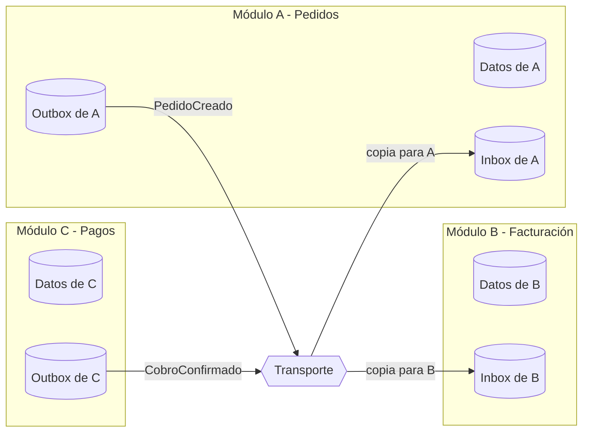
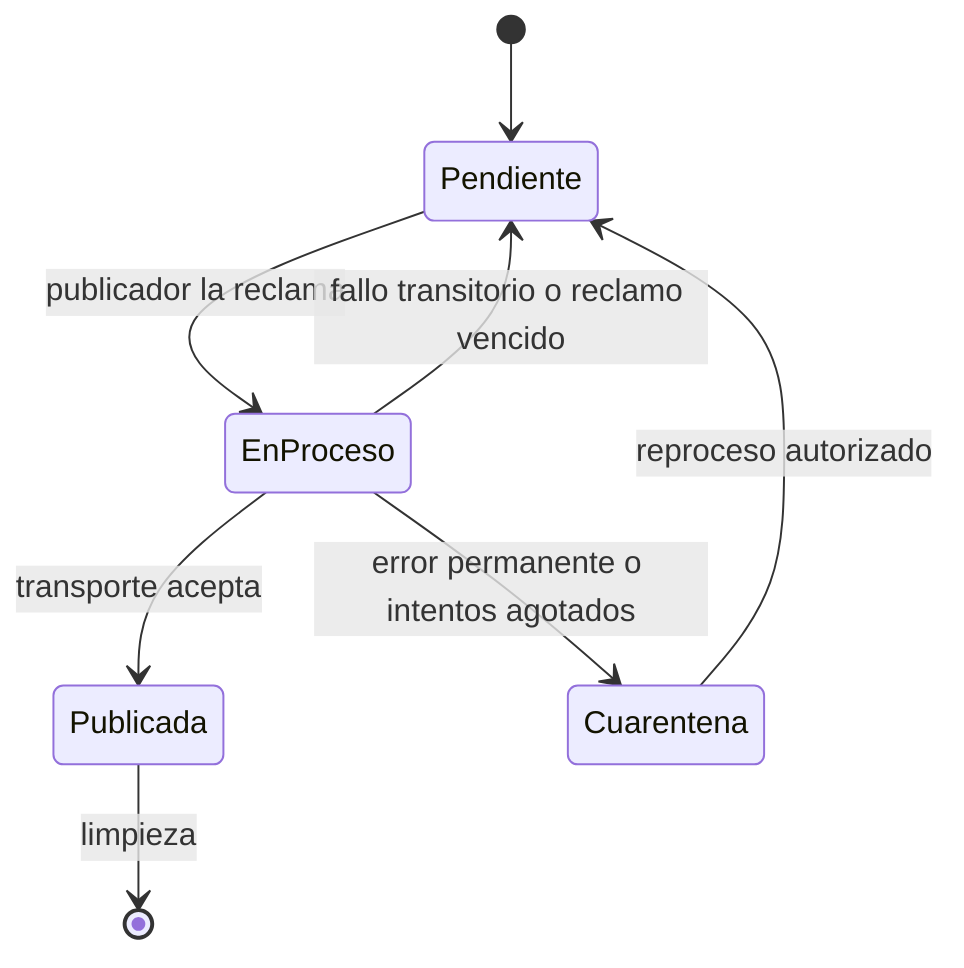
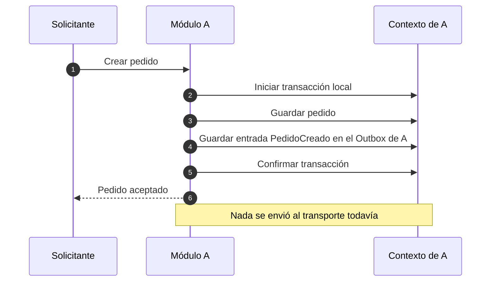
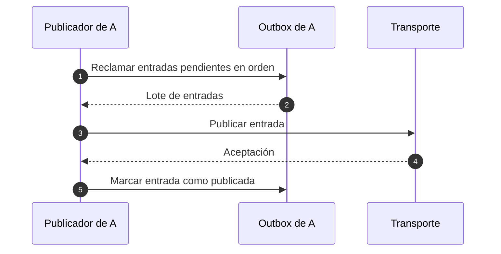
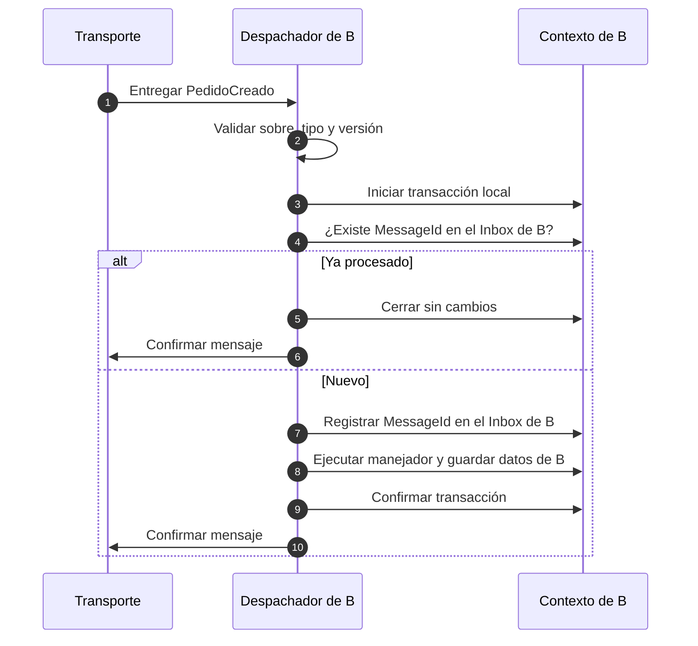
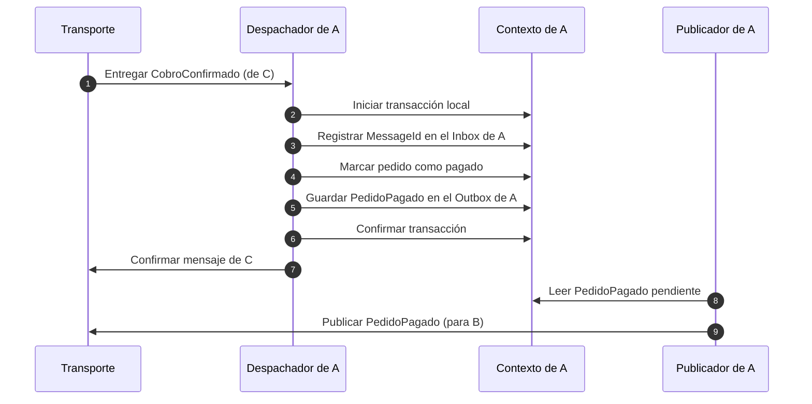

# Implementar Transactional Outbox en una solución con varios módulos

Esta guía explica cómo publicar mensajes de forma confiable desde varios módulos o servicios, donde cada uno posee su propio contexto de persistencia. Describe el almacén de Outbox, el publicador, el consumidor idempotente y el diseño cuando un módulo es a la vez publicador y consumidor. No depende de un lenguaje, framework, broker o base de datos.

En esta guía, **módulo** es una unidad con límites propios de datos y responsabilidades: puede ser un módulo de un monolito modular o un servicio independiente. **Contexto de persistencia** es el conjunto de datos y la unidad de trabajo transaccional que pertenece a un único módulo (por ejemplo, un `DbContext` en .NET). Los nombres son referencias conceptuales, no APIs obligatorias.

## Propósito y alcance

Un módulo que cambia sus datos y debe avisar a otros enfrenta una escritura dual: confirmar el cambio en su almacén y enviar el mensaje al transporte. No existe una transacción que cubra ambos. Si el módulo confirma y falla antes de enviar, el cambio ocurre sin aviso. Si envía y falla antes de confirmar, otros módulos reaccionan a un hecho que no existió.

Transactional Outbox resuelve esa brecha: el módulo guarda el cambio de negocio y el mensaje pendiente en **la misma transacción local**. Un publicador independiente lee los mensajes pendientes y los entrega al transporte.

Garantiza que todo cambio confirmado deja un mensaje pendiente que se intentará entregar. Entrega **al menos una vez**, por lo que puede haber duplicados. No garantiza entrega exactamente una vez, orden global entre módulos, ni aislamiento entre procesos que dependen de varios módulos.

Considerar Outbox cuando el mensaje anuncia un cambio persistido y perderlo o enviarlo sin cambio rompe una regla de negocio. No es necesario si el mensaje no deriva de una transacción local o si perderlo es aceptable.

Esta guía complementa el [bus de eventos asíncrono](bus-de-eventos-asincrono.md), que define publicación, transporte y despacho, y la [Saga](saga.md), que usa Outbox para que cada paso deje su siguiente mensaje. El contexto del patrón está en [Arquitectura orientada a eventos](../estilos-y-patrones/Event-Driven.md#outbox-pattern).

## Escenario conductor: tres módulos

Se usan tres módulos, cada uno con su propio contexto de persistencia:

| Módulo | Rol | Ejemplo |
|---|---|---|
| A | Publica a B y consume de C | Pedidos |
| B | Consume de A | Facturación |
| C | Publica a A | Pagos |

Flujos:

- **A → B:** Pedidos crea un pedido y publica `PedidoCreado`; Facturación lo consume y genera una factura.
- **C → A:** Pagos confirma un cobro y publica `CobroConfirmado`; Pedidos lo consume y marca el pedido como pagado.

El módulo A es el caso crítico: recibe un mensaje de C, cambia sus datos y, como consecuencia, publica otro mensaje para B. Necesita Outbox para publicar e Inbox para recibir, y ambos deben participar en la misma transacción local de A.

Cada módulo guarda su Outbox e Inbox dentro de su propio contexto. Ningún módulo escribe en el almacén de otro.

## Conceptos y participantes

| Concepto | Significado |
|---|---|
| Outbox | Tabla o colección del módulo publicador que conserva los mensajes pendientes de entregar |
| Entrada de Outbox | Un mensaje pendiente con su contenido, destino lógico y estado |
| Publicador (relay) | Proceso que lee entradas pendientes, las entrega al transporte y registra su avance |
| Inbox | Registro del módulo consumidor de los mensajes ya procesados, usado para detectar duplicados |
| Contexto de persistencia | Unidad transaccional de un módulo; contiene datos de negocio, Outbox e Inbox |
| Contrato público | Evento o comando que un módulo expone a otros; no es una entidad interna |
| Propietario del contrato | Módulo que publica el mensaje y decide su evolución |
| Transporte | Broker o canal que lleva el mensaje entre módulos |

Un evento de dominio interno, un mensaje de Outbox y un evento de integración son cosas distintas. El evento de dominio ocurre dentro del módulo. El mensaje de Outbox es su forma persistida para entregarse. El evento de integración es el contrato público que otros módulos consumen. Convertir el primero en el último es una decisión del módulo publicador.

## Principio de diseño: un Outbox por módulo

Cada módulo posee su Outbox, dentro de su contexto de persistencia y de su transacción local. Se comparan tres alternativas:

| Alternativa | Descripción | Evaluación |
|---|---|---|
| Un Outbox por módulo | Cada contexto contiene su propia tabla de Outbox | Recomendada. Mantiene la atomicidad local, la autonomía y el aislamiento de fallos |
| Un Outbox compartido | Una tabla única que escriben todos los módulos | Evitar. Si los módulos usan contextos o bases distintas, la escritura deja de ser atómica con sus datos. Además acopla esquemas, despliegues y permisos |
| Un servicio central de Outbox | Los módulos envían sus mensajes a un servicio que los guarda | Evitar. Reintroduce la escritura dual entre el módulo y el servicio |

La razón de fondo es que la atomicidad solo existe dentro de un almacén. El Outbox debe estar en el mismo almacén y en la misma transacción que los datos que cambian. Si los módulos comparten físicamente una base de datos, mantener separados el esquema, los permisos y los contextos: compartir la base no autoriza a un módulo a escribir en las tablas de otro ni a mezclar su transacción con la de otro.

### Qué escribe cada módulo en su transacción local

| Situación | Dentro de una misma transacción local del módulo |
|---|---|
| A inicia un cambio por solicitud externa | Datos de A y entrada en el Outbox de A |
| A procesa un mensaje de C | Registro en el Inbox de A, datos de A y, si corresponde, entrada en el Outbox de A |
| B procesa un mensaje de A | Registro en el Inbox de B y datos de B |
| B responde o publica otro evento | Además, entrada en el Outbox de B |

Un manejador nunca modifica el almacén de otro módulo. Si A necesita que B cambie algo, publica un mensaje y B decide, dentro de su propia transacción.

## Componentes y responsabilidades

| Componente | Responsabilidad | Límite |
|---|---|---|
| Escritor de Outbox | Guardar la entrada en la misma unidad de trabajo que el cambio de negocio | No publicar al transporte durante la transacción |
| Almacén de Outbox | Conservar entradas, estado, intentos y plazos del módulo | No contener datos de negocio de otros módulos |
| Publicador | Reclamar entradas, enviarlas, registrar el resultado y reintentar | No decidir reglas de negocio ni modificar el contenido |
| Planificador | Activar el publicador por sondeo, notificación o ambos | No sustituir el sondeo de respaldo |
| Inbox | Registrar mensajes procesados con su resultado | No eliminar historial antes de que puedan llegar duplicados |
| Despachador del consumidor | Abrir la transacción local, comprobar el Inbox, ejecutar el manejador y confirmar | Confirmar al transporte solo después de persistir |
| Transporte | Entregar mensajes a cada módulo suscrito | Su aceptación no demuestra que el consumidor terminó |
| Limpieza | Archivar o eliminar entradas publicadas y registros antiguos | No borrar entradas pendientes ni en cuarentena |
| Monitoreo | Medir antigüedad, pendientes, reintentos y cuarentena por módulo | No alterar estados sin comprobar efectos |

## Diseño de la entrada de Outbox

Cada entrada conserva lo necesario para entregar el mensaje sin consultar los datos de negocio.

| Dato | Uso |
|---|---|
| `MessageId` | Identidad estable del mensaje; se conserva en cualquier reentrega |
| Módulo propietario | Identifica qué módulo publica el mensaje |
| Canal lógico | Destino lógico, como `ventas.pedidos`; no es el nombre físico del broker |
| Tipo y versión del contrato | Permite a los consumidores validar y evolucionar |
| Contenido serializado | Datos públicos del hecho, sin entidades internas ni secretos |
| `CorrelationId` / `CausationId` | Seguimiento del flujo y del mensaje que originó este |
| Clave de orden | Agrupa mensajes que deben conservar su orden, normalmente el identificador del agregado |
| Fecha de creación | Calcula antigüedad y plazos |
| Estado | Pendiente, en proceso, publicada o en cuarentena |
| Intentos y próximo intento | Controlan reintentos con espera |
| Fecha de publicación | Auditoría y limpieza |

El `MessageId` se asigna al crear la entrada, no al enviarla. Si se asignara al enviar, una reentrega parecería un mensaje nuevo y el consumidor no podría deduplicarla.

El contenido se serializa al guardar la entrada. Así representa el hecho tal como ocurrió, aunque los datos cambien antes de publicarse.

Estados de la entrada:

## Flujo de escritura

Si la transacción falla, no queda ni el cambio ni la entrada. Si se confirma, ambos existen. La respuesta al solicitante no espera la entrega a B.

La entrada puede crearse de dos maneras. En la primera, el caso de uso la guarda explícitamente. En la segunda, el módulo recoge los eventos de dominio generados durante la unidad de trabajo y los convierte en entradas justo antes de confirmar. La segunda reduce olvidos, pero exige decidir qué eventos internos se convierten en eventos de integración. En ambos casos, la conversión ocurre dentro de la transacción.

`PublishAsync` de un bus de eventos, cuando se usa con Outbox, debe indicar que la aceptación significa "entrada guardada en el Outbox", no "entregada al broker". Documentar esa semántica en el contrato.

## Flujo de publicación

Entre la aceptación del transporte y el registro de la publicación existe una ventana de fallo. Si el publicador se interrumpe ahí, la entrada sigue pendiente y se envía de nuevo con el mismo `MessageId`. Esta es la causa de los duplicados, y el consumidor debe tolerarlos.

Reglas de publicación:

- Publicar en lotes acotados para limitar memoria y duración de reclamos.
- Reintentar con espera progresiva y variación para evitar ráfagas.
- Definir un límite de intentos o de tiempo, y un destino claro al agotarlos: la cuarentena.
- Registrar el resultado de cada entrada de forma individual; un fallo en una no debe marcar las demás.
- No modificar el contenido ni el `MessageId` en un reintento.

### Estrategias para activar el publicador

| Estrategia | Funcionamiento | Ventajas | Cuidados |
|---|---|---|---|
| Sondeo periódico | El publicador consulta pendientes cada cierto intervalo | Simple y portable | Latencia igual al intervalo; consultas constantes |
| Notificación tras confirmar | El módulo avisa al publicador local cuando confirma una entrada | Baja latencia | La notificación puede perderse; mantener el sondeo como respaldo |
| Captura de cambios (CDC) | Un componente lee el registro de transacciones de la base | No consulta la tabla; baja latencia | Depende del producto de base de datos y de su operación |

La opción más sencilla y portable combina sondeo con notificación. CDC conviene cuando el volumen o la latencia lo justifican y la base lo soporta.

## Varios módulos publicando de forma independiente

Cada módulo tiene su propio publicador y su propio estado de pendientes. Un publicador puede ejecutarse en el mismo proceso que el módulo o en un proceso separado. En un monolito modular es habitual un único proceso anfitrión que ejecuta un publicador por módulo.

Reglas para el publicador de cada módulo:

- **Aislamiento de fallos.** Si el transporte hacia B está lento, el publicador de C no debe detenerse. Usar publicadores o ciclos independientes por módulo, con sus propios plazos y reintentos.
- **Un solo tipo de acceso.** Cada publicador lee únicamente el Outbox de su módulo, con las credenciales de ese módulo.
- **Recursos acotados.** Evitar que un módulo con mucho volumen consuma todos los hilos o conexiones del anfitrión.
- **Configuración por módulo.** Intervalo de sondeo, tamaño de lote y política de reintentos se ajustan a cada módulo.

Un publicador compartido que recorre los Outbox de todos los módulos es aceptable solo si mantiene aislamiento de contexto, de errores y de recursos por módulo. Sin ese aislamiento, un módulo defectuoso degrada a los demás.

### Varias instancias del mismo módulo

Si el módulo A se ejecuta en varias instancias, varios publicadores competirán por las mismas entradas. Usar un reclamo explícito:

- Marcar la entrada como en proceso con un identificador de instancia y una fecha de vencimiento (arrendamiento), o usar un bloqueo que omita filas ya bloqueadas.
- Si una instancia cae, el vencimiento devuelve la entrada a pendiente.
- Un reclamo vencido puede coincidir con una instancia que sigue enviando; eso solo produce un duplicado, que el consumidor tolera.

Si el orden importa, solo un publicador debe procesar a la vez las entradas con la misma clave de orden. Sin esta restricción, dos instancias podrían publicar mensajes del mismo agregado en orden invertido.

## Consumo con Inbox

Cada módulo consumidor mantiene su propio Inbox. El flujo de B al recibir `PedidoCreado`:

Aspectos que determinan la corrección:

- **El registro del Inbox y los cambios de negocio van en la misma transacción.** Si se guardan por separado, un fallo entre ambos produce un duplicado o un mensaje perdido.
- **La confirmación al transporte ocurre después de confirmar la transacción.** Si el despachador cae entre ambos pasos, el mensaje se reentrega y el Inbox lo reconoce.
- **La clave de deduplicación incluye al módulo consumidor.** Un mismo `MessageId` llega a varios módulos suscritos; cada uno lo registra en su propio Inbox y lo procesa una vez. Si un módulo tiene varios manejadores para un mismo mensaje, la clave incluye también el manejador.
- **Retención.** Conservar los registros mientras puedan llegar duplicados. Eliminarlos antes permite reprocesar efectos.

Una restricción de unicidad sobre la clave de deduplicación resuelve la carrera entre dos instancias que procesan el mismo mensaje: una confirma y la otra falla y reintenta.

## Módulo que consume y publica

El módulo A recibe `CobroConfirmado` de C y, como resultado, publica `PedidoPagado` para B. Es el caso donde Inbox y Outbox se combinan.

La transacción de A contiene tres escrituras: Inbox, datos y Outbox. Si falla cualquiera, no queda ninguna, el mensaje de C no se confirma y se reentrega. Si se confirma, el mensaje de C está procesado y el de B queda garantizado en el Outbox, aunque A se reinicie justo después.

Cada salto es independiente. La entrega de C a A y la de A a B ocurren en tiempos distintos, con sus propios reintentos y duplicados. Un fallo en B no revierte lo que A ya confirmó; si el negocio exige deshacerlo, usar una [Saga](saga.md) con compensaciones.

## Contratos entre módulos

- **El publicador es dueño del contrato.** El evento `PedidoCreado` lo define y versiona A. B depende del contrato publicado, no de las entidades de A.
- **No compartir tipos internos.** Compartir un paquete con clases de dominio acopla los módulos. Publicar contratos mínimos, con identificadores y los valores que el consumidor necesita.
- **Un contrato por hecho, no por consumidor.** A no crea un mensaje distinto para cada consumidor. Si B y D necesitan el mismo hecho, ambos se suscriben al mismo evento.
- **Evolución compatible.** Los mensajes ya guardados en el Outbox pueden tener una versión anterior al desplegar un cambio. Mantener la compatibilidad o procesar las entradas antiguas antes de retirar su versión.
- **Evento o comando.** Un evento anuncia un hecho y A no sabe quién lo consume. Un comando pide a un módulo concreto que haga algo. Ambos pueden usar Outbox, pero conservan semánticas distintas y no deben mezclarse en un mismo contrato.

## Enrutamiento y suscripciones

El módulo publicador publica en un canal lógico; no conoce a sus consumidores ni los nombres físicos del broker.

| Elemento | Responsable |
|---|---|
| Canal lógico y contrato | Módulo publicador |
| Suscripción y destino propio | Cada módulo consumidor |
| Traducción a colas, topics y filtros | Configuración del transporte |

Para que A, B y otros módulos reciban copias independientes del mismo evento, usar la topología de suscripción independiente descrita en el [bus de eventos](bus-de-eventos-asincrono.md#topologías-de-entrega-cola-de-trabajo-y-topic-con-suscripciones). Si varias instancias de un módulo deben repartirse el trabajo, comparten el destino de ese módulo.

En un monolito modular sin broker externo, el transporte puede ser un canal en memoria dentro del proceso. Aun así, el publicador entrega desde el Outbox y el consumidor registra en su Inbox: el canal en memoria se pierde al reiniciarse, y el Outbox es lo que conserva los mensajes. Mantener el mismo diseño facilita extraer luego un módulo a un servicio independiente sin cambiar sus contratos.

## Ciclos y cadenas entre módulos

Cuando A publica para B, y B puede publicar para A, aparecen ciclos. Un ciclo no es un error por sí mismo, pero puede producir bucles infinitos si cada mensaje provoca otro.

- Documentar el mapa de quién publica y quién consume qué.
- Propagar `CorrelationId` y `CausationId` para reconstruir cadenas.
- Cada manejador debe producir un nuevo mensaje solo cuando su cambio de estado lo justifica; un manejador idempotente que no cambia nada no debe publicar.
- Si existe riesgo de bucle, agregar un contador de saltos o un límite de profundidad y alertar al superarlo.
- Un proceso con muchos saltos que necesita coordinación y compensación es candidato a una [Saga](saga.md).

## Orden

Outbox conserva el orden de creación dentro de un módulo, pero el transporte y los reintentos pueden alterarlo. No existe orden global entre módulos.

- Definir qué orden importa. Habitualmente basta con orden por agregado: los mensajes del mismo pedido.
- Usar una clave de orden por agregado y procesar en serie las entradas con la misma clave.
- Diseñar los consumidores para tolerar mensajes fuera de orden o tardíos cuando el negocio lo permita, por ejemplo comparando versiones del agregado.
- No depender del orden entre mensajes de módulos distintos. `CobroConfirmado` de C puede llegar a A antes o después de un mensaje de otro módulo sobre el mismo pedido.

## Fallos y compensaciones

| Situación | Tratamiento conceptual |
|---|---|
| Falla la transacción local | No queda cambio ni entrada. El solicitante recibe el error y puede reintentar |
| El módulo cae después de confirmar | La entrada sigue pendiente; el publicador la envía al reiniciar |
| El publicador cae tras enviar y antes de registrar | Se reenvía con el mismo `MessageId`; el Inbox del consumidor evita duplicar efectos |
| Transporte no disponible | Las entradas se acumulan; reintentos con espera; alertar por antigüedad |
| El módulo B no está disponible | Su cola acumula mensajes; A y C no se detienen |
| Mensaje inválido o venenoso | Aislarlo en cuarentena con diagnóstico; no bloquear los siguientes |
| Un manejador falla de forma transitoria | No confirmar, no registrar en el Inbox; el mensaje se reentrega |
| Un manejador falla de forma permanente | Cuarentena del consumidor; intervención y reproceso |
| Contrato con versión desconocida | Rechazar o aislar según política; no confirmar en silencio |
| Crecimiento sin límite del Outbox | Limpieza de publicadas y alerta por pendientes acumuladas |
| Efecto en un sistema externo | Fuera de la transacción local; usar idempotencia del proveedor y reconciliación |

Outbox no revierte cambios entre módulos. Si C confirmó un cobro y A no puede marcar el pedido, no existe una reversión automática. Resolverlo con reintentos, intervención o una compensación de negocio.

## Retención y limpieza

- Eliminar o archivar entradas publicadas después de un período definido por auditoría y por el tiempo en que pueden reaparecer duplicados.
- No eliminar entradas pendientes ni en cuarentena.
- Limpiar el Inbox con la misma lógica: conservar mientras puedan llegar reentregas.
- Ejecutar la limpieza por lotes para no bloquear las tablas ni afectar al publicador.
- Indexar por estado y fecha para que la lectura de pendientes no recorra el historial.
- Si se conservan mensajes para auditoría, evaluar archivarlos fuera del almacén transaccional.

## Límites y decisiones

- **Latencia adicional:** el mensaje sale después de confirmar y de que el publicador lo detecte.
- **Carga en la base de datos:** cada mensaje implica escrituras y lecturas adicionales, y el sondeo consume recursos.
- **Duplicados:** son parte del diseño; sin consumidores idempotentes, Outbox no es seguro.
- **Sin atomicidad entre módulos:** cada módulo es consistente por separado; el conjunto lo es de forma eventual.
- **Datos sensibles:** el Outbox conserva copia del contenido; excluir credenciales y datos innecesarios, y aplicar retención.
- **Un contexto por módulo, un contexto de Outbox:** si un módulo usa varios contextos de persistencia, guardar el Outbox en el contexto donde ocurre el cambio que origina el mensaje. Un mensaje que depende de cambios en dos contextos del mismo módulo requiere una decisión explícita sobre qué almacén es la fuente de verdad.
- **Alternativas:** publicar directamente aceptando la pérdida o los mensajes fantasma, transacciones distribuidas con sus costos de acoplamiento y disponibilidad, o Event Sourcing, donde el evento es el registro del cambio.

## Orden de implementación

1. Identificar qué mensajes deben salir de cada módulo y cuáles derivan de un cambio persistido.
2. Definir los contratos públicos y su propietario; separar eventos de comandos.
3. Dibujar el mapa de publicadores y consumidores entre módulos, incluidos los ciclos.
4. Crear el Outbox y el Inbox dentro del contexto de persistencia de cada módulo.
5. Definir el contrato de la entrada, los estados y los índices.
6. Escribir la entrada en la misma transacción local que el cambio de negocio.
7. Implementar un publicador por módulo con reclamo, lotes, reintentos y cuarentena.
8. Elegir la estrategia de activación: sondeo, notificación, CDC o una combinación.
9. Configurar canales lógicos y una suscripción independiente por módulo consumidor.
10. Implementar el despachador del consumidor con Inbox y transacción local, confirmando al transporte después de persistir.
11. Definir orden por agregado cuando el negocio lo requiera.
12. Implementar retención y limpieza del Outbox y del Inbox.
13. Agregar métricas, alertas y procedimientos de reproceso por módulo.
14. Verificar cada escenario de fallo antes de producción.

## Verificación

| Escenario | Resultado que debe comprobarse |
|---|---|
| Transacción de A se revierte | No existe pedido ni entrada en el Outbox de A |
| A confirma y cae antes de publicar | Al reiniciar, B recibe `PedidoCreado` |
| Publicador cae después de enviar | B recibe un duplicado y su efecto ocurre una vez |
| Transporte no disponible | Las entradas se conservan y se envían al recuperarse |
| C publica y A procesa dos veces el mismo mensaje | El Inbox de A evita el segundo efecto y una segunda entrada en su Outbox |
| A falla a mitad del manejo de un mensaje de C | No quedan Inbox, datos ni Outbox parciales; el mensaje se reentrega |
| B está caído | A y C continúan; los mensajes de B se acumulan y se procesan después |
| Dos instancias de A publican | Cada entrada se reclama una vez, o los duplicados son inofensivos |
| Mensajes del mismo agregado | Se entregan en orden según la clave de orden |
| Mismo evento para B y D | Cada módulo lo procesa una vez y su avance es independiente |
| Mensaje venenoso en B | Pasa a cuarentena sin detener los demás mensajes |
| Versión antigua en el Outbox tras un despliegue | Los consumidores la procesan o la aíslan según la política |
| Ciclo A → B → A | El flujo termina o se detiene por el límite definido |
| Limpieza | No elimina pendientes ni cuarentena; no permite reprocesar duplicados recientes |

Verificar también los estados de negocio de cada módulo, además del estado del Outbox: una entrada marcada como publicada no demuestra que el consumidor aplicó su efecto.

## Observabilidad y operación

Medir por módulo:

- Antigüedad de la entrada pendiente más vieja.
- Cantidad de entradas pendientes, en proceso y en cuarentena.
- Intentos y tasa de fallos de publicación.
- Latencia entre creación y publicación.
- Duplicados detectados por el Inbox.
- Antigüedad de los mensajes pendientes en la cola de cada consumidor.

Alertar según plazos de negocio: por ejemplo, si una entrada lleva más tiempo pendiente del que tolera el proceso. Correlacionar entrada, mensaje y manejador con `CorrelationId` y `CausationId`.

Ofrecer procedimientos para inspeccionar la cuarentena, reprocesar una entrada conservando su `MessageId`, y registrar quién decidió y qué se ejecutó. No borrar entradas fallidas para ocultar un bloqueo sin resolver su efecto.

## Implementaciones tecnológicas y material relacionado

- [Implementar un bus de eventos asíncrono](bus-de-eventos-asincrono.md): publicación, transporte, despacho y garantías de procesamiento.
- [Implementar una Saga para coordinar transacciones distribuidas](saga.md): uso de Outbox e Inbox en procesos entre servicios.
- [Arquitectura orientada a eventos](../estilos-y-patrones/Event-Driven.md#outbox-pattern): contexto del patrón y patrones relacionados.
- [Wolverine: flujo, durabilidad e integración](../../integracion/mensajeria/wolverine.md): framework .NET que documenta Inbox y Outbox.
- [Integración y mensajería](../../integracion/README.md): tecnologías de mensajería disponibles en el repositorio.

Las implementaciones con código, APIs, configuración o productos específicos deben documentarse en su área tecnológica y enlazarse desde aquí. Esta guía no presupone que un framework o broker ofrezca automáticamente las garantías descritas.

## Referencias

- [Chris Richardson - Pattern: Transactional outbox](https://microservices.io/patterns/data/transactional-outbox.html): problema de escritura dual, solución y consecuencias.
- [Chris Richardson - Pattern: Polling publisher](https://microservices.io/patterns/data/polling-publisher.html): publicación mediante sondeo del Outbox.
- [Chris Richardson - Pattern: Transaction log tailing](https://microservices.io/patterns/data/transaction-log-tailing.html): publicación mediante lectura del registro de transacciones.

Fuentes no consultadas durante la redacción de esta guía; verificar su contenido vigente antes de usarlas como referencia técnica. El escenario de tres módulos, los nombres y los estados son una propuesta de diseño ilustrativa; ajustarlos a las reglas del negocio.
