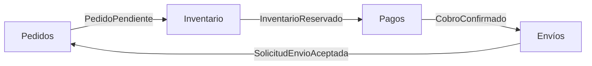
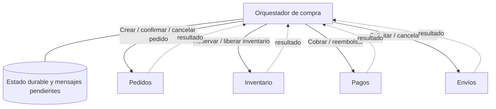
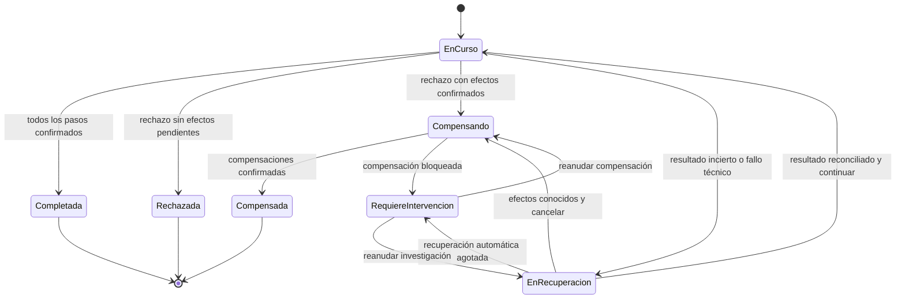
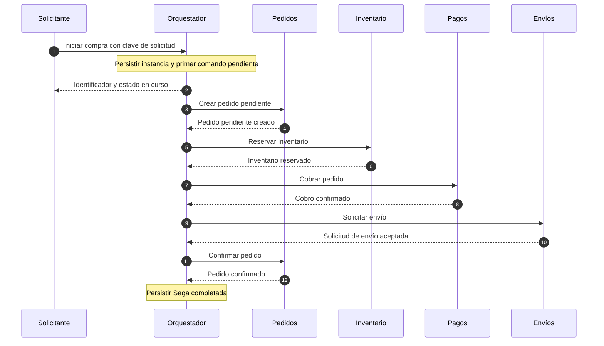
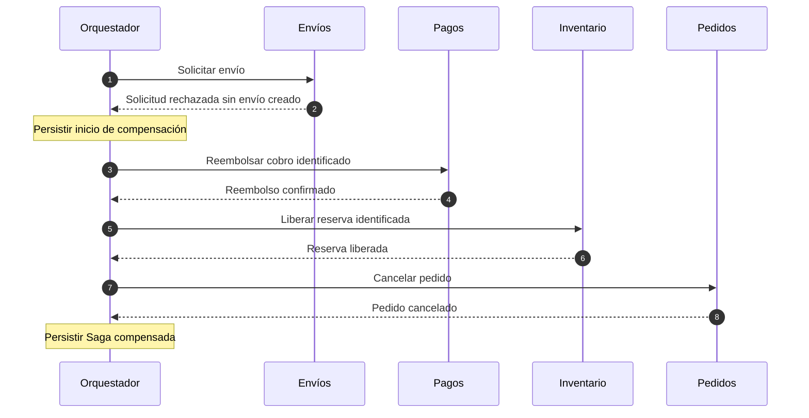

# Implementar una Saga para coordinar transacciones distribuidas

Esta guía explica cómo construir un proceso de negocio que modifica datos en varios servicios mediante transacciones locales, mensajes y acciones compensatorias. Describe contratos, estado, coordinación y recuperación sin depender de un lenguaje, framework, broker o plataforma.

## Propósito y alcance

Considerar una Saga cuando una operación necesita cambios en varios servicios autónomos y no puede resolverse mediante una única transacción local. Cada servicio confirma sus cambios en su propio almacenamiento; el proceso necesita coordinar el avance y tratar los resultados parciales.

Una Saga ofrece un modelo de coordinación con consistencia eventual. No proporciona por sí misma atomicidad ni aislamiento global: durante su ejecución otros procesos pueden observar cambios parciales. La descripción general y las variantes del patrón se encuentran en [Arquitectura orientada a eventos](../estilos-y-patrones/Event-Driven.md#saga) y en la [referencia del patrón Saga](https://microservices.io/patterns/data/saga.html).

Antes de adoptarla, comprobar si la operación puede permanecer dentro de un único límite transaccional. Si el negocio exige que ningún cambio parcial sea visible, revisar los límites de los servicios o las garantías requeridas antes de elegir una Saga.

## Ejemplo conductor: procesar una compra

Usaremos cuatro participantes: Pedidos, Inventario, Pagos y Envíos. Cada uno posee sus datos y valida sus propias reglas. El flujo elegido es secuencial para hacer explícitas las dependencias; no es un orden obligatorio para todos los negocios.

| Paso | Acción local | Resultado esperado | Compensación de negocio |
|---|---|---|---|
| 1 | Crear pedido pendiente | Pedido identificado y pendiente de confirmación | Marcar el pedido como cancelado; conservar historial |
| 2 | Reservar inventario | Unidades reservadas para ese pedido | Liberar esa reserva |
| 3 | Cobrar el pedido | Cobro confirmado con identificador externo | Solicitar y confirmar el reembolso según las reglas del proveedor |
| 4 | Solicitar envío | Solicitud aceptada con identificador | Cancelar la solicitud mientras el estado logístico lo permita |
| 5 | Confirmar pedido | Pedido confirmado tras la aceptación del envío | Una cancelación posterior se trata según el proceso posventa |

En este ejemplo, completar la Saga significa tener el pedido confirmado y la solicitud de envío aceptada. No significa que la mercancía ya fue entregada. La entrega física y las devoluciones pueden requerir procesos separados.

Si Envíos rechaza la solicitud después del cobro, el flujo compensa: reembolsar, liberar inventario y cancelar el pedido. Si el cobro fue rechazado de manera definitiva, no corresponde reembolsar; solo se compensan los efectos que realmente ocurrieron. Si el resultado es incierto, primero debe resolverse esa incertidumbre.

## Conceptos y participantes

| Concepto | Significado |
|---|---|
| Definición de Saga | Reglas del proceso, pasos, transiciones y políticas de recuperación |
| Instancia de Saga | Una ejecución identificable, por ejemplo la compra de un pedido |
| Paso | Acción del proceso con un resultado y, cuando corresponda, compensación |
| Transacción local | Cambio atómico dentro del almacenamiento de un participante |
| Comando | Solicitud dirigida a un responsable, como `ReservarInventario` |
| Evento | Hecho ocurrido, como `InventarioReservado` o `CobroRechazado` |
| Compensación | Nueva operación de negocio que contrarresta un efecto confirmado |
| Participante | Servicio responsable de ejecutar una acción y sus reglas locales |
| Orquestador | Componente que persiste el avance y decide qué acción solicitar después |
| Correlación | Asociación de mensajes y resultados con la instancia y el paso correctos |

**Compensar no es restaurar una copia anterior de los datos.** Un reembolso puede tener comisiones, una reserva puede haber expirado y otro proceso puede haber modificado el recurso. La compensación debe respetar el estado actual y las reglas de negocio. Puede requerir un orden diferente al inverso o intervención humana. Véase [Transacción compensatoria](https://learn.microsoft.com/en-us/azure/architecture/patterns/compensating-transaction).

## Elegir la coordinación

### Coreografía

Cada participante reacciona a eventos y publica el resultado de su transacción local. Las reglas del proceso quedan distribuidas entre los participantes, incluidas las reglas para iniciar y completar compensaciones.

La figura muestra el camino exitoso. Para implementarla, definir también quién reacciona a cada rechazo, quién solicita la compensación, cómo se reconoce su finalización y cómo se conoce el resultado global. El seguimiento puede usar una proyección de eventos; esa proyección observa el proceso, pero no decide el siguiente paso salvo que se le asigne explícitamente coordinación.

### Orquestación

Un orquestador conserva el estado de cada instancia y envía comandos a los participantes. Estos ejecutan transacciones locales y devuelven resultados. El orquestador decide el siguiente paso o la compensación.

El orquestador controla la secuencia; las reglas de stock, cobro o envío siguen perteneciendo a cada participante. No necesita ser un proceso único: varias instancias pueden coordinar ejecuciones distintas si se controla la concurrencia sobre cada Saga.

| Criterio | Coreografía | Orquestación |
|---|---|---|
| Ubicación del flujo | Distribuido en reacciones a eventos | Explícito en un coordinador |
| Evolución | Revisar las dependencias entre eventos y participantes | Revisar estados, comandos y transiciones |
| Seguimiento | Requiere reconstruir o proyectar el avance | El estado del coordinador facilita conocer el avance |
| Complejidad que debe controlarse | Cadenas implícitas, ciclos y compensaciones distribuidas | Disponibilidad del coordinador y crecimiento de su lógica |
| Orientación para elegir | Pocas reacciones independientes y límites claros | Dependencias, plazos y compensaciones que requieren seguimiento explícito |

El resto de la guía desarrolla una Saga orquestada. En coreografía permanecen las mismas necesidades de durabilidad, correlación, idempotencia y recuperación, distribuidas entre los participantes.

## Componentes y responsabilidades

| Componente | Responsabilidad | Límite |
|---|---|---|
| Entrada del proceso | Validar la solicitud, evitar inicios duplicados y entregar un identificador de seguimiento | Aceptar la solicitud no equivale a completar la compra |
| Definición del flujo | Determinar pasos, resultados válidos, plazos y compensaciones | No ejecutar directamente reglas internas de otros servicios |
| Orquestador | Aplicar transiciones a una instancia y solicitar acciones | No modificar las bases de datos de los participantes |
| Almacén de Saga | Persistir estado, versión, pasos, plazos y referencias de resultados | No sustituir los datos de negocio de cada servicio |
| Participantes | Ejecutar y compensar acciones mediante transacciones locales | No asumir una transacción global |
| Transporte | Llevar comandos y resultados entre componentes | La entrega no demuestra que el negocio terminó |
| Outbox | Conservar mensajes pendientes junto con el cambio local | Su publicador puede reenviar mensajes |
| Inbox o registro de operaciones | Reconocer operaciones ya ejecutadas y recuperar su resultado | La deduplicación debe cubrir el efecto de negocio |
| Temporizadores durables | Detectar vencimientos y programar recuperación | Un vencimiento no demuestra que la acción no ocurrió |
| Seguimiento y operación | Consultar avances, alertar y permitir recuperación controlada | No alterar estados sin comprobar sus efectos |

Un [bus de eventos asíncrono](bus-de-eventos-asincrono.md) aporta transporte y despacho. La Saga añade las reglas y el estado del proceso de negocio. Ambos tienen responsabilidades diferentes.

## Contratos e identificación

Definir contratos estables antes de conectar los participantes. Los siguientes nombres son referencias conceptuales, no interfaces ni APIs obligatorias.

| Dato | Uso |
|---|---|
| `SagaId` | Identificar una ejecución completa |
| `BusinessId` | Relacionarla con el pedido u otra entidad del negocio |
| `SagaDefinitionVersion` | Reconocer las reglas con las que inició esa ejecución |
| `StepId` | Identificar la acción dentro de la ejecución |
| `OperationId` | Identificar de forma estable la operación de negocio, incluso al reintentar |
| `Attempt` | Registrar el intento técnico sin crear un nuevo cobro o reserva |
| `MessageId` | Identificar un mensaje; una redelivery conserva su identidad |
| `CorrelationId` / `CausationId` | Seguir el flujo y el mensaje que provocó una reacción |
| Tipo y versión del contrato | Validar y evolucionar comandos y resultados |
| Referencia del resultado | Localizar la reserva, cobro, reembolso o envío realmente realizado |

Una compensación tiene su propio `OperationId` y referencia la operación original. No reutilizar la identidad del cobro para el reembolso como si fueran la misma acción. Tampoco deduplicar todos los mensajes por `SagaId`: una Saga necesita ejecutar varios pasos diferentes.

Por ejemplo, `CobrarPedido` incluye el identificador del pedido, importe, moneda, `SagaId`, `StepId` y `OperationId`. Su resultado distingue `CobroConfirmado` y `CobroRechazado`. Una indisponibilidad técnica se trata como recuperación o incertidumbre, sin convertirla automáticamente en rechazo de negocio.

## Estado y transiciones

Conservar al menos el estado global, versión de concurrencia, paso activo, operaciones confirmadas, referencias necesarias para compensar, intentos, plazos y último error. En procesos paralelos, almacenar el estado de cada rama y las condiciones de unión.

| Estado global | Significado |
|---|---|
| En curso | Ejecutando pasos o esperando resultados |
| En recuperación | Existe una operación incierta o una dificultad técnica pendiente |
| Compensando | Ejecutando las acciones de recuperación de negocio |
| Requiere intervención | La recuperación automática se detuvo y existe un responsable |
| Completada | Se confirmó el resultado exitoso definido por el negocio |
| Compensada | Se confirmó la finalización de todas las compensaciones requeridas |
| Rechazada | El proceso terminó sin efectos pendientes que compensar |

Los estados de cada paso pueden ser pendiente, solicitado, confirmado, rechazado, incierto, compensación pendiente y compensado. No marcar una Saga como compensada solo porque se enviaron las solicitudes de compensación.

Aplicar cada transición con una versión esperada o mecanismo equivalente. Si dos mensajes intentan avanzar la misma instancia, solo una actualización debe confirmar sobre esa versión; la otra recarga el estado y comprueba si su resultado sigue siendo aplicable. Evitar que el conflicto provoque la repetición de un efecto externo.

## Flujo exitoso

Para cada resultado recibido, el orquestador valida contrato y correlación, verifica que la transición sea válida y persiste el nuevo estado junto con el siguiente comando pendiente en una transacción local. Después confirma la recepción del mensaje. Un publicador independiente entrega los comandos pendientes.

Cada participante sigue un ciclo equivalente: reconocer la operación, validar reglas, ejecutar el cambio local y registrar el resultado y su mensaje de salida de forma atómica cuando comparten almacenamiento transaccional. Si el efecto está en un proveedor externo, se requiere además idempotencia o reconciliación con ese proveedor.

El solicitante consulta el estado o recibe una notificación de finalización. La aceptación inicial debe mostrar que el proceso continúa y no prometer una compra confirmada.

## Fallos y compensaciones

### Ejemplo: envío rechazado después de cobrar

El orden mostrado es una política del ejemplo. Si liberar inventario no depende del reembolso, el negocio puede permitir ambas compensaciones en paralelo. Definir las dependencias y conservar el avance de cada acción para reanudarlas sin repetir efectos.

### Clasificar antes de actuar

| Situación | Tratamiento conceptual |
|---|---|
| Rechazo de negocio confirmado | Detener el avance y compensar los efectos confirmados que corresponda |
| Fallo transitorio con operación repetible | Reintentar con la misma identidad de operación, espera y límites |
| Timeout o pérdida de respuesta | Registrar resultado incierto; consultar o reconciliar antes de decidir |
| Contrato inválido o resultado imposible | Aislar el mensaje, alertar y conservar diagnóstico |
| Compensación fallida | Persistir progreso, reintentar de forma segura y escalar según política |
| Resultado tardío | Comparar con el paso y estado actuales; reconciliar sus efectos |

**Un timeout no demuestra que la operación falló.** Si Pagos cobró pero su respuesta se perdió, iniciar un cobro con otra identidad puede cobrar dos veces. Consultar el resultado por la identidad estable o repetir de forma idempotente. Si no existe una forma segura de comprobarlo, mantener la instancia pendiente de reconciliación o intervención.

La cancelación también puede competir con una acción en curso. Si llega un cobro confirmado después de iniciar la cancelación, registrar el hecho y solicitar el reembolso que corresponda. No ignorar un efecto real únicamente porque su mensaje llegó tarde. El participante debe impedir que una operación cancelada pendiente se ejecute después cuando su contrato lo requiera, por ejemplo conservando una marca durable y aplicando control de concurrencia.

## Confiabilidad y recuperación

### Persistencia y Outbox

Guardar el avance y el siguiente mensaje en una misma transacción local evita que una instancia avance sin que quede registro de lo que debe enviarse. El publicador de Outbox reintenta los envíos pendientes; si se interrumpe después de enviar y antes de registrar el envío, puede repetirlos. El receptor debe tolerar esa repetición.

En el participante, aplicar el mismo principio para el cambio de negocio y su resultado. Outbox no hace atómico un cobro externo con la base de datos local: ese límite exige una operación idempotente del proveedor, consulta de estado y reconciliación.

### Idempotencia e Inbox

La misma operación debe conservar su identidad en los reintentos. Registrar el resultado durable para devolverlo sin repetir el efecto. Si la deduplicación se guarda separada del cambio de negocio sin atomicidad ni coordinación, un fallo entre ambos puede producir duplicados o perder trabajo.

Deduplicar mensajes por `MessageId` ayuda frente a redeliveries; deduplicar acciones por `OperationId` cubre reintentos representados por mensajes diferentes. Definir alcance, restricciones de unicidad y retención. No eliminar el historial antes del período en el que todavía puedan llegar mensajes o solicitudes repetidos.

### Temporizadores y reintentos

Persistir plazos para reconstruirlos tras reinicios. Vincular cada vencimiento al paso y generación correspondientes: un temporizador de un intento anterior no debe invalidar un paso ya confirmado. Los reintentos necesitan espera progresiva, variación para evitar ráfagas, límite temporal y un destino claro cuando no pueden continuar.

El timeout del proceso, el plazo de un paso y la expiración de una reserva son condiciones distintas. Si la reserva expira durante un cobro, no se debe confirmar la compra sin comprobar que aún puede cumplirse.

### Reinicios y evolución

Tras un reinicio, recuperar instancias no terminales, mensajes pendientes, operaciones inciertas y temporizadores vencidos. Continuar desde el estado persistido, sin reiniciar toda la secuencia.

Versionar la definición del flujo además de los mensajes. Las instancias que ya están en ejecución deben continuar con reglas compatibles o migrarse mediante un procedimiento explícito. Un despliegue no debe reinterpretar silenciosamente pasos confirmados.

## Límites y decisiones de negocio

- **Sin aislamiento global:** otra compra puede competir por las mismas unidades. Inventario debe reservar con restricciones locales que impidan vender más de lo disponible.
- **Reservas temporales:** definir propietario, vencimiento, renovación, confirmación y liberación. Evitar mantener bloqueos de base de datos abiertos durante toda la Saga.
- **Operaciones irreversibles:** entregar físicamente un paquete o enviar una notificación no tiene una inversión exacta. Ubicar esos efectos según las garantías del proceso y definir alternativas de negocio.
- **Punto de no retorno:** acordar qué paso cambia la estrategia desde compensar hacia completar con recuperación hacia adelante. Después de ese punto puede corresponder devolver mercancía o iniciar posventa.
- **Intervención manual:** asignar responsable, información de diagnóstico y acciones autorizadas. Registrar quién decidió, qué se ejecutó y cómo se confirmó el resultado.
- **Privacidad:** almacenar referencias y datos mínimos para recuperar el proceso; excluir credenciales y datos de pago sensibles del estado y los mensajes.

La Saga no garantiza que todo proceso termine automáticamente. Dependencias indisponibles, resultados desconocidos o compensaciones imposibles pueden requerir recuperación prolongada o una decisión humana. Estos casos deben permanecer visibles y tener un responsable.

## Orden de implementación

1. Definir el resultado de negocio y sus invariantes: qué significa aceptar, completar, rechazar y compensar.
2. Delimitar participantes y transacciones locales; revisar si la separación realmente exige coordinación distribuida.
3. Enumerar acciones, resultados, dependencias y efectos irreversibles. Diseñar cada compensación y la información que necesita.
4. Elegir coreografía u orquestación y asignar quién decide cada avance, timeout y recuperación.
5. Diseñar contratos, identidades estables y versiones. Definir también la clave que evita iniciar dos Sagas por la misma solicitud.
6. Dibujar la máquina de estados y enumerar transiciones válidas, duplicados y resultados tardíos.
7. Persistir instancias, historial necesario, versión de concurrencia y temporizadores.
8. Implementar las acciones locales y compensaciones con idempotencia, resultados durables y restricciones de negocio.
9. Resolver la atomicidad local entre cambios y mensajes mediante Outbox o un mecanismo equivalente; tratar por separado los efectos externos.
10. Conectar comandos y resultados, confirmando mensajes después de persistir el procesamiento requerido.
11. Incorporar reconciliación, reintentos, vencimientos y recuperación tras reinicios.
12. Exponer consulta de estado, alertas y acciones de operación auditables.
13. Verificar fallos en cada frontera y documentar las garantías observables antes de usar el flujo en producción.

## Verificación

| Escenario | Resultado que debe comprobarse |
|---|---|
| Camino exitoso | Cada efecto ocurre una vez desde el punto de vista del negocio y el pedido termina confirmado |
| Misma solicitud inicial repetida | Se devuelve la instancia existente según la política de idempotencia |
| Inventario insuficiente | El pedido se cancela sin cobrar ni crear envío |
| Cobro rechazado | Se libera la reserva y no se solicita un reembolso inexistente |
| Envío rechazado tras cobrar | Se confirman reembolso, liberación y cancelación antes de cerrar como compensada |
| Respuesta de cobro perdida | Se reconcilia el cobro sin generar otro con identidad diferente |
| Caída antes o después de publicar | Outbox retoma el envío y el receptor tolera duplicados |
| Caída después del efecto local | El participante recupera el resultado sin repetir el efecto |
| Dos resultados concurrentes | No se pierde estado ni se crean comandos contradictorios |
| Temporizador obsoleto | No cambia un paso que ya avanzó válidamente |
| Confirmación tardía durante cancelación | Se reconoce el efecto y se ejecuta la recuperación correspondiente |
| Fallo de compensación | El progreso queda persistido y la instancia no aparece como compensada |
| Reserva vencida | No se confirma una compra que ya no tiene inventario reservado |
| Cambio de versión del flujo | Las instancias existentes continúan con una definición compatible |

La verificación debe observar los estados de negocio de los participantes, además del estado del coordinador. Una Saga marcada como completada o compensada no demuestra por sí sola que sus efectos sean correctos.

## Observabilidad y operación

Registrar por instancia: estado, paso, tiempo transcurrido, próximo vencimiento, intentos, último error y referencias de operaciones. Correlacionar comandos, resultados y compensaciones con la misma ejecución, diferenciando cada acción.

Medir duración del proceso, antigüedad de instancias sin avance, operaciones inciertas, reintentos y compensaciones bloqueadas. Definir alertas según plazos de negocio, no solo por errores de transporte.

Ofrecer procedimientos para consultar la fuente autoritativa de un resultado, reenviar una operación conservando su identidad, reanudar una compensación y registrar una resolución manual. No cerrar instancias ni borrar mensajes fallidos para ocultar un bloqueo sin resolver sus efectos.

## Implementaciones tecnológicas y material relacionado

- [Implementar una Saga orquestada propia en .NET](../../dotnet/net/integracion/saga/implementacion-base.md): ejemplo ejecutable en C# con persistencia SQLite, participantes simulados e idempotencia, sin bibliotecas que implementen Sagas.
- [Implementar un bus de eventos asíncrono](bus-de-eventos-asincrono.md): publicación, transporte, despacho y garantías de procesamiento.
- [Arquitectura orientada a eventos](../estilos-y-patrones/Event-Driven.md): contexto del patrón Saga y patrones relacionados.
- [Integración y mensajería](../../integracion/README.md): tecnologías disponibles en el repositorio.

Las implementaciones con código, APIs, configuración o productos específicos deben documentarse en su área tecnológica y enlazarse desde aquí. Esta guía no presupone que un bus o framework implemente automáticamente las garantías de la Saga.

## Referencias

- [Chris Richardson — Pattern: Saga](https://microservices.io/patterns/data/saga.html): definición del patrón, coreografía, orquestación y límites transaccionales.
- [Microsoft Architecture Center — Compensating Transaction](https://learn.microsoft.com/en-us/azure/architecture/patterns/compensating-transaction): compensaciones de negocio, progreso durable y recuperación.

Fuentes consultadas el 2026-11-17. El proceso de compra, los contratos y los estados de esta guía son una propuesta de diseño ilustrativa; deben ajustarse a las reglas del negocio.
