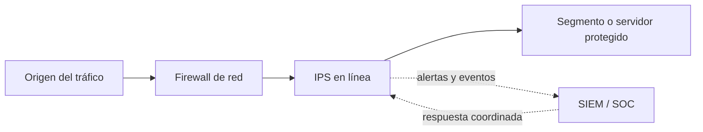

# IPS (Intrusion Prevention System)

**Categoría:** seguridad de redes y sistemas  
**Última revisión:** 27 de octubre de 2026

## Resumen

Un sistema de prevención de intrusiones (IPS) analiza actividad de red o de un sistema para identificar posibles intrusiones y tomar medidas para detenerlas, idealmente antes de que alcancen su objetivo. Puede registrar el evento, descartar paquetes o conexiones, bloquear una dirección, limitar tráfico o aplicar otra acción definida por la política.

La diferencia operativa habitual con un IDS es que un IDS observa y alerta, mientras que un IPS se coloca en una posición donde puede intervenir y bloquear. Algunos productos ofrecen ambos modos: observación/detección y prevención. NIST define un IPS como un sistema que detecta actividad intrusiva y también intenta detenerla. [NIST: IPS](https://csrc.nist.gov/glossary/term/intrusion_prevention_system)

## Qué busca detectar

Según la fuente de telemetría y las capacidades del producto, un IPS puede identificar:

- Firmas o patrones asociados a exploits, malware o protocolos malformados.
- Tráfico que viola reglas de protocolo o políticas de red.
- Intentos de escaneo, fuerza bruta, propagación o comunicación con destinos maliciosos.
- Secuencias o volúmenes anómalos que podrían indicar abuso o denegación de servicio.
- Actividad sospechosa en un host, como cambios en archivos, procesos o llamadas al sistema, si la solución también incluye capacidades locales.

Las técnicas comunes incluyen firmas, reputación, análisis de protocolo y detección de anomalías. Las técnicas basadas en comportamiento pueden hallar desviaciones sin una firma exacta, pero requieren buenas señales de referencia y pueden generar falsos positivos.

## Tipos y ubicaciones

| Tipo | Qué observa | Ubicación común | Casos de uso |
|---|---|---|---|
| NIPS (Network IPS) | Tráfico que atraviesa un segmento o punto de control de la red. | En línea entre redes, zonas o segmentos; a veces como función de un firewall de siguiente generación. | Bloquear ataques que cruzan el perímetro o segmentos internos importantes; proteger servicios compartidos. |
| HIPS (Host IPS) | Eventos de un equipo o servidor: actividad de procesos, archivos, sistema operativo y, según el agente, tráfico local. | Agente instalado en endpoints o servidores. | Proteger sistemas críticos, servidores con datos sensibles o equipos donde se necesita visibilidad local. |
| WIPS (Wireless IPS) | Actividad y dispositivos en redes inalámbricas. | Controladores, sensores o puntos de acceso con funciones de seguridad inalámbrica. | Detectar puntos de acceso no autorizados, suplantaciones o ataques dirigidos a WLAN. |
| Detección de comportamiento de red | Flujos, volúmenes y patrones entre activos, a menudo sin inspeccionar cada paquete en línea. | Sensores de red o análisis de telemetría, normalmente fuera de banda. | Detectar movimiento lateral, comunicaciones atípicas o actividad de comando y control. La respuesta puede depender de una integración adicional. |

Las categorías anteriores siguen una taxonomía clásica de tecnologías IDPS. En soluciones actuales los nombres comerciales y las capacidades se mezclan; verificar si una función detecta, bloquea o solo recomienda una acción. NIST describe categorías basadas en eventos observados y despliegue, y advierte que la guía SP 800-94 es de 2007. [NIST SP 800-94](https://csrc.nist.gov/pubs/sp/800/94/final)

## Cómo actúa un IPS en línea

Un NIPS normalmente recibe el tráfico, lo inspecciona y reenvía lo permitido. Si una regla considera maliciosa una sesión, puede descartarla o aplicar la acción configurada. Al estar en el camino de la comunicación, puede prevenir algunos ataques antes de que lleguen al servidor, pero también puede interrumpir tráfico legítimo si una regla está mal ajustada.

El diagrama es ilustrativo: varias funciones pueden estar integradas en un mismo firewall, y no toda integración SIEM/SOC permite enviar acciones automáticas de vuelta al IPS.

## Cuándo considerarlo

- Se requiere bloquear intentos conocidos de explotación o actividad de red maliciosa, además de generar alertas.
- Hay segmentos críticos, servicios expuestos o comunicaciones entre zonas que conviene inspeccionar.
- Se necesita una capa adicional de defensa para servidores o endpoints críticos.
- La organización tiene capacidad para revisar alertas, mantener reglas y responder ante bloqueos erróneos.
- Un requisito de seguridad exige prevención o evidencia de monitoreo y respuesta sobre el tráfico relevante.

Un IPS no debe desplegarse solo por instalar otra herramienta. Primero definir activos y flujos de alto riesgo, amenazas relevantes, latencia aceptable y quién atenderá los eventos. Si el equipo aún no puede gestionar bloqueos, empezar en modo de detección donde el producto lo permita puede ayudar a medir impacto antes de habilitar prevención.

## Recomendaciones de arquitectura y operación

1. **Definir alcance:** inventariar segmentos, sistemas críticos, protocolos, flujos permitidos y activos que requieren cobertura.
2. **Elegir ubicación según riesgo:** inspeccionar puntos de entrada, límites entre zonas o tráfico interno sensible. Evitar desplegar sensores sin confirmar que ven el tráfico que se quiere proteger.
3. **Acordar modo de respuesta:** distinguir alertar, registrar, descartar, resetear conexión, limitar y aislar. Documentar cuándo se permite respuesta automática.
4. **Medir antes de bloquear:** usar modo de detección o simulación inicialmente cuando esté disponible; registrar falsos positivos y ajustar firmas/políticas.
5. **Desplegar por etapas:** probar con flujos representativos, habilitar prevención en grupos controlados y mantener una forma segura de revertir políticas.
6. **Planificar alta disponibilidad y rendimiento:** considerar throughput con inspección activada, latencia, sesiones concurrentes, actualizaciones y comportamiento si el sensor o servicio falla.
7. **Decidir fail-open/fail-closed:** si falla el IPS, permitir el tráfico (priorizar disponibilidad) o bloquearlo (priorizar control). La decisión depende del servicio y debe probarse; ambas alternativas tienen riesgos.
8. **Considerar cifrado:** el tráfico cifrado limita la inspección de contenido si el IPS no recibe tráfico descifrado. La inspección TLS requiere diseño de certificados, privacidad, rendimiento y excepciones; evitar asumir que el IPS ve el contenido de toda conexión.
9. **Mantenerlo actualizado:** aplicar firmas, motores y parches; proteger y restringir la consola administrativa y respaldar las políticas.
10. **Integrar telemetría:** centralizar alertas y registros con hora sincronizada, contexto del activo y severidad; reducir datos sensibles y secretos en los eventos.
11. **Revisar excepciones y reglas:** asignar propietario, motivo y fecha de revisión; retirar excepciones temporales y validar reglas después de cambios de red o aplicaciones.
12. **Ejercitar la respuesta:** probar alertas, escalamiento, diagnóstico de falsos positivos, bloqueo de emergencia y recuperación del tráfico legítimo.

## Criterios para seleccionar una solución

- Tipo de tráfico y protocolos que debe inspeccionar, incluidos entornos virtuales, cloud y contenedores.
- Ubicación: sensor dedicado, función integrada al firewall, agente en host o servicio gestionado.
- Capacidad de prevención además de detección; acciones disponibles y granularidad de políticas.
- Rendimiento en condiciones reales, latencia, throughput, sesiones simultáneas y alta disponibilidad.
- Calidad y actualización de firmas, análisis de protocolos, inteligencia de amenazas y capacidad de afinamiento.
- Visibilidad del tráfico cifrado y límites que imponga el cifrado de extremo a extremo.
- Integración con firewall, EDR, SIEM/SOC, gestión de incidentes y automatización existente.
- Facilidad para observar, investigar alertas, versionar reglas, probar cambios y revertirlos.
- Costos de licencias, sensores, capacidad, soporte, operación y servicio gestionado.

Solicitar una prueba con tráfico y cargas representativas. Comparar cobertura, falsos positivos, impacto de rendimiento, facilidad de investigación y capacidad del equipo para operar la solución.

## Relación con otros controles

| Control | Función principal | Relación con el IPS |
|---|---|---|
| IDS | Detecta actividad sospechosa y genera alertas. | Puede observar el mismo tipo de actividad; normalmente no interrumpe el flujo. Un IPS puede ofrecer también modo IDS. |
| Firewall de red / NGFW | Permite o deniega conexiones según políticas de red y otras funciones del producto. | El IPS añade análisis de actividad y patrones de intrusión; con frecuencia ambos se integran en NGFW. |
| WAF | Inspecciona solicitudes HTTP/HTTPS para proteger aplicaciones web y APIs. | El WAF se enfoca en tráfico y semántica web; el IPS cubre actividad de red/sistema más amplia. Pueden coexistir. |
| EDR | Observa y responde a actividad en endpoints y servidores. | Complementa la detección de red con telemetría local del host y puede ofrecer aislamiento u otras respuestas. |
| SIEM | Centraliza y correlaciona logs y alertas de distintas fuentes. | Recibe eventos del IPS para correlación, investigación y seguimiento; no sustituye la función inline de prevención. |
| Protección DDoS | Mitiga tráfico volumétrico o ataques de denegación de servicio. | Puede operar en otras capas y a mayor escala; el IPS no debe asumirse como sustituto de un servicio anti-DDoS. |

## Alcance y limitaciones

- La detección depende de la visibilidad, calidad de reglas y capacidad del motor para analizar los protocolos relevantes.
- Falsos positivos pueden interrumpir procesos válidos; falsos negativos permiten que amenazas pasen sin bloqueo.
- Un IPS no garantiza que una aplicación sea segura ni reemplaza parches, hardening, controles de acceso o desarrollo seguro.
- La inspección de tráfico cifrado requiere una arquitectura que habilite el descifrado en un punto aprobado; si no, puede limitarse a metadatos.
- Una alerta solo ayuda si existe un proceso y un responsable que la evalúe; bloquear automáticamente requiere pruebas, umbrales y mecanismo de reversión.

## Referencias

- [NIST: definición de IPS](https://csrc.nist.gov/glossary/term/intrusion_prevention_system)
- [NIST: definición de IDS](https://csrc.nist.gov/glossary/term/intrusion_detection_system)
- [NIST SP 800-94: Guide to Intrusion Detection and Prevention Systems](https://csrc.nist.gov/pubs/sp/800/94/final) (publicación de 2007; consultar la nota de vigencia de NIST)
- [NIST: sistema de detección y prevención de intrusiones basado en red](https://csrc.nist.gov/glossary/term/network_based_intrusion_detection_and_prevention_system)
