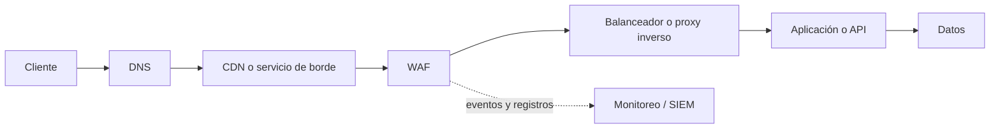

# WAF (Web Application Firewall)

**Categoría:** seguridad de aplicaciones y componente de entrada web  
**Última revisión:** 27 de octubre de 2026

## Resumen

Un Web Application Firewall (WAF) inspecciona solicitudes HTTP/HTTPS dirigidas a una aplicación web o API y aplica políticas para permitirlas, registrarlas, limitarlas, desafiarlas o bloquearlas. Se ubica en el camino del tráfico, habitualmente como proxy inverso en la nube, en un servicio de borde/CDN, como appliance o máquina virtual, o integrado al servidor o plataforma de entrega.

El WAF agrega una capa de defensa frente a patrones conocidos de ataque y permite aplicar controles de forma centralizada. No corrige errores de código ni reemplaza prácticas de desarrollo seguro, autenticación, autorización, gestión de parches, protección de red o monitoreo.

## Qué inspecciona y qué puede hacer

Según el producto y la configuración, un WAF puede evaluar atributos HTTP como dirección IP, geografía aproximada, método, ruta, encabezados, cookies, parámetros, tamaño y contenido del cuerpo de la solicitud. Puede combinar:

- **Reglas administradas:** firmas y detecciones para clases de ataques web comunes, actualizadas por el fabricante o una comunidad.
- **Reglas personalizadas:** condiciones específicas de la aplicación, como limitar rutas administrativas a redes conocidas.
- **Límites de frecuencia:** detectar o frenar ráfagas de solicitudes en rutas como inicio de sesión, búsqueda o pago.
- **Reputación y controles de bots:** clasificar o desafiar parte del tráfico automatizado. La eficacia y cobertura varían por producto.
- **Validación de protocolos o esquemas:** detectar solicitudes malformadas o que no cumplen contratos conocidos, especialmente en APIs.
- **Acciones de respuesta:** registrar, permitir, bloquear, devolver una respuesta personalizada, aplicar un desafío o limitar tráfico.

Las reglas pueden seguir un modelo de **lista de denegación** (bloquear patrones de ataque conocidos) o **lista de permiso** (permitir solo estructuras/operaciones esperadas), o combinar ambos. Los modelos positivos pueden ser precisos cuando se conocen los contratos y flujos de la aplicación, pero exigen mantener esos contratos actualizados.

## Amenazas y controles relacionados

Un WAF puede ayudar a detectar o reducir exposición a ataques web comunes, como inyección SQL, cross-site scripting (XSS), inclusión de archivos, algunos intentos de explotación de vulnerabilidades conocidas, abuso automatizado y ciertos patrones de denegación de servicio de capa de aplicación. Los conjuntos de reglas genéricos como OWASP Core Rule Set buscan cubrir una gama amplia de patrones HTTP, pero requieren afinamiento para cada aplicación.

La cobertura depende de la visibilidad del WAF, el protocolo, las reglas, el modo de despliegue y el comportamiento de la aplicación. Por sí solo, normalmente no puede decidir si una operación es legítima desde el punto de vista del negocio; por ejemplo, si un usuario autorizado puede modificar el precio de un pedido. Los problemas de lógica de negocio, controles de acceso defectuosos y fallas de autenticación deben tratarse en la aplicación y sus controles de identidad.

## Cuándo considerarlo

- Aplicaciones web o APIs expuestas a Internet que procesan información sensible o soportan procesos críticos.
- Necesidad de aplicar una política común a varias aplicaciones y observar solicitudes sospechosas de forma centralizada.
- Mitigación temporal mientras se desarrolla y despliega una corrección de seguridad, con seguimiento para retirar el parche virtual cuando corresponda.
- Protección de rutas con riesgo de abuso, complementando controles de identidad y límites aplicados en la aplicación.
- Requisitos contractuales, regulatorios o de gestión de riesgo que exijan una capa de inspección de tráfico web.
- Aplicaciones heredadas o de terceros donde es difícil modificar el código de inmediato, sin asumir que el WAF elimina la necesidad de corregirlas.

Un WAF puede no ser necesario para servicios internos aislados o de bajo riesgo si ya existen controles adecuados y la complejidad operativa supera el beneficio. La decisión debe documentar el riesgo y el camino de exposición.

## Ubicación en la arquitectura

Un flujo de referencia para una aplicación pública puede ser:

El WAF puede formar parte del servicio de borde o del balanceador y no necesariamente ser un producto separado. Si termina TLS, recibe el tráfico descifrado para inspeccionarlo y luego establece otra conexión protegida al origen cuando así se configure. Si el tráfico evita el WAF y llega directamente al origen, la protección puede eludirse. Restringir el origen para aceptar tráfico solo desde la ruta autorizada y validar cuidadosamente encabezados como `Forwarded` o `X-Forwarded-For`.

Para varias regiones, aplicaciones o proveedores, decidir si se necesita un WAF global en el borde, uno regional, uno en el centro de datos, o una combinación. Cada salto adicional agrega latencia, complejidad de certificados, reglas, registros y resolución de incidentes.

## Modos y formas de despliegue

| Forma | Uso común | Consideraciones |
|---|---|---|
| WAF en la nube / edge | Servicios SaaS o de borde que protegen uno o más dominios y puntos de presencia. | Revisar ruta del tráfico, DNS, protección del origen, residencia/transferencia de datos, costos y dependencia del proveedor. |
| WAF integrado a CDN, balanceador o gateway | Arquitecturas que ya usan un servicio administrado de entrega o entrada. | Puede simplificar operación; confirmar qué tipos de reglas, logs, límites y recursos están soportados por cada integración. |
| Appliance físico o virtual | Centros de datos propios, redes controladas, requisitos específicos de inspección o administración. | Dimensionar capacidad con TLS, concurrencia y reglas activadas; diseñar alta disponibilidad, actualizaciones y soporte. |
| WAF como módulo o sidecar de servidor/proxy | Instalaciones autogestionadas o protección cercana a una aplicación. | Da control granular, pero cada instancia requiere consistencia de políticas, capacidad y ciclo de vida. |
| WAF de código abierto | Entornos donde el equipo puede operar motor, reglas, actualizaciones y respuesta. | El costo de licencia puede ser bajo o nulo; el costo de mantenimiento, afinamiento, soporte y guardia sigue existiendo. |

## Recomendaciones de diseño e implementación

1. **Definir alcance y objetivos:** inventariar dominios, APIs, ambientes, datos y procesos críticos; identificar qué amenazas y riesgos debe reducir el WAF.
2. **Mapear el tráfico real:** protocolos, rutas, métodos, tipos de contenido, tamaños, cargas JSON/XML, WebSockets y clientes legítimos. Confirmar dónde termina TLS.
3. **Asegurar el origen:** evitar accesos públicos directos que omitan el WAF; limitar conexiones a los puntos de entrada autorizados y proteger administración con red y autenticación fuerte.
4. **Comenzar observando:** habilitar reglas en modo de detección, conteo o registro donde el producto lo permita. Analizar falsos positivos y tráfico antes de bloquear ampliamente.
5. **Activar por etapas:** iniciar con reglas administradas pertinentes y después reglas personalizadas para la aplicación. Separar políticas por aplicación o entorno cuando sus contratos sean distintos.
6. **Afinar excepciones con cuidado:** limitar exclusiones a una regla, parámetro, ruta y aplicación concretos; documentar propietario, razón, aprobación y fecha de revisión. Evitar desactivar un grupo entero para resolver una incidencia puntual.
7. **Probar casos legítimos y de ataque:** incluir autenticación, cargas grandes, integraciones, móviles, APIs, cargas de archivos y rutas críticas. Hacer pruebas en preproducción y validar después de cada cambio.
8. **Operar las reglas como configuración:** versionar políticas, revisar cambios, contar con aprobación y rollback, y evaluar automatización/IaC cuando el producto la soporte.
9. **Integrar los registros:** enviar eventos a una plataforma de monitoreo o SIEM; definir retención, sincronización de tiempo, alertas y responsables. Reducir o enmascarar datos personales, tokens y secretos en logs.
10. **Diseñar continuidad:** definir alta disponibilidad, comportamiento ante fallo o saturación, capacidad máxima, actualizaciones, soporte y responsables de atención. Decidir expresamente si cada escenario debe fallar abierto o cerrado.
11. **Revisar periódicamente:** inventario de aplicaciones protegidas, reglas obsoletas, cambios de rutas, excepciones, alertas, costos, versiones y capacidad.
12. **Mantener la seguridad de la plataforma WAF:** restringir el plano de administración, aplicar parches del fabricante, usar MFA, respaldar configuración y vigilar avisos de seguridad.

Un WAF mal afinado puede bloquear operaciones válidas, aumentar latencia o generar una falsa sensación de seguridad. La medición debe incluir tanto ataques detectados como impacto sobre solicitudes legítimas.

## Criterios para seleccionar una solución

- **Entorno y topología:** nube, centro de datos, híbrido o multi-cloud; recursos de origen soportados y exposición real del servicio.
- **Tipo de aplicación:** sitios web, APIs REST/GraphQL, cargas JSON/XML, WebSockets, aplicaciones móviles y protocolos requeridos.
- **Seguridad:** conjuntos de reglas, frecuencia de actualización, protección contra bots y abuso, reglas personalizadas, visibilidad de APIs, parches virtuales y soporte para los casos de riesgo identificados.
- **Operación:** facilidad para afinar, automatizar, hacer cambios seguros, investigar incidentes y exportar logs a SIEM/SOC.
- **Disponibilidad y rendimiento:** latencia, capacidad con inspección TLS, escalado, puntos de presencia, redundancia y SLA medibles.
- **Origen y prevención de bypass:** controles para asegurar que tráfico directo no pueda evitar la inspección.
- **Privacidad y contratación:** ubicación de procesamiento y registros, residencia de datos aplicable, subprocesadores, retención, respuesta a incidentes, soporte y condiciones contractuales.
- **Costo total:** suscripción/licencia, tráfico, reglas, recursos, soporte, servicios administrados y horas necesarias para afinar y operar.
- **Portabilidad y salida:** exportación de políticas, dependencias de DNS/CDN, costo de migración y capacidad de operar en forma híbrida.

Solicitar una prueba con tráfico representativo y criterios acordados. Comparar falsos positivos, detección, latencia, facilidad de operación, soporte y costo con el mismo conjunto de escenarios; no seleccionar solo por una lista de funciones del proveedor.

## Productos y proyectos representativos

La lista es un panorama de opciones conocidas y comercializadas a nivel internacional, no un ranking ni una afirmación de participación de mercado. Los nombres, empaquetamiento, capacidades y precios cambian; validar la documentación y oferta vigentes antes de decidir.

| Producto/proyecto | Modalidad habitual | Contexto donde evaluarlo |
|---|---|---|
| Cloudflare WAF | Servicio de borde / SaaS | Aplicaciones públicas que buscan combinar proxy de borde, reglas administradas/personalizadas y limitación de frecuencia. |
| AWS WAF | Servicio administrado de AWS | Recursos web asociados a servicios compatibles de AWS, con políticas y reglas integrables al ecosistema AWS. |
| Azure WAF | Servicio administrado con Azure Front Door, Application Gateway y otros servicios compatibles | Aplicaciones globales en el borde o aplicaciones regionales que requieren protección integrada con entrada de Azure. |
| Google Cloud Armor | Políticas de seguridad asociadas a balanceadores compatibles de Google Cloud | Aplicaciones que utilizan balanceadores de Google Cloud, incluidos escenarios híbridos y multi-cloud según el servicio. |
| Akamai App & API Protector | Servicio de edge y opciones híbridas | Organizaciones que requieren protección de aplicaciones y APIs con la red de entrega y controles administrados de Akamai. |
| Imperva WAF / Cloud WAF | Nube, híbrido y despliegue local según la oferta | Organizaciones que buscan protección de aplicaciones y APIs en distintos entornos con gestión especializada. |
| F5 BIG-IP Advanced WAF / F5 Distributed Cloud WAF | Appliance, software, nube o servicio según la línea | Centros de datos, entornos híbridos o arquitecturas que requieren controles de aplicación configurables e integración de entrega. |
| Fortinet FortiWeb / FortiWeb Cloud | Appliance, máquina virtual, contenedor y SaaS según la oferta | Organizaciones que necesitan opciones de despliegue locales o cloud y posible integración con el ecosistema Fortinet. |
| Radware Cloud WAF / Cloud Application Protection | Servicio cloud / gestionado según oferta | Aplicaciones expuestas que evalúan protección administrada contra ataques web y DDoS de aplicación. |
| ModSecurity + OWASP CRS | Motor autoalojado y conjunto comunitario de reglas | Equipos con capacidad para desplegar, actualizar, monitorear y afinar una solución autogestionada. |
| Coraza + OWASP CRS | Motor abierto integrable y conjunto comunitario de reglas | Arquitecturas cloud-native o equipos que buscan un motor compatible con reglas CRS y gestionan su operación. |

### Diferencias entre categorías de producto

- **Nativo del proveedor cloud:** suele integrarse directamente con balanceadores, CDN y logs de esa nube. Revisar compatibilidad si hay cargas fuera de esa plataforma.
- **SaaS/edge independiente:** puede proteger varios proveedores mediante un proxy en el borde. Revisar dependencia de DNS, rutas, control del origen y tratamiento de datos.
- **Appliance o software autogestionado:** ofrece control de red y despliegue, a cambio de dimensionamiento, redundancia, actualización y operación propios.
- **Motor abierto:** permite adaptar reglas y entorno, pero el equipo asume el ciclo de vida, afinamiento, monitoreo, guardias y respuesta.

## Evidencia pública sobre Ecuador

### Qué se puede afirmar

La revisión de fuentes públicas consultadas al **27 de octubre de 2026** confirma que hay oferta local y contrataciones públicas que mencionan WAF. No se encontró una estadística pública, independiente y comparable que mida cuántas organizaciones ecuatorianas usan cada fabricante. Por tanto, **no es posible afirmar un orden nacional confiable de los WAF más utilizados** a partir de la evidencia revisada.

Los siguientes hallazgos sirven para identificar productos con presencia o actividad pública en el país; no demuestran cuota de mercado ni que sean los únicos o los más instalados:

| Opción o evidencia | Hallazgo público en Ecuador | Alcance de lo que demuestra |
|---|---|---|
| Cloudflare WAF | Lynxsource publica un servicio gestionado sobre Cloudflare con equipo en Ecuador. El sitio firmar.ec declara públicamente usar Cloudflare WAF y rate limiting en su borde. | Oferta comercial local y al menos un caso publicado por su propio operador; no mide adopción nacional. |
| Fortinet FortiWeb | Telalca publica oferta de FortiWeb físico y virtual para organizaciones ecuatorianas. EcuCERT publicó una alerta de seguridad sobre versiones vulnerables de FortiWeb. | Disponibilidad comercial local e interés operacional del producto; la alerta no prueba cuántos despliegues existen. |
| Imperva | Un artículo de Canal News Ecuador reporta actividad comercial de Imperva y apoyo de mayorista para Ecuador; el directorio de socios de Imperva lista socios en Ecuador. | Presencia de canal y oferta local, no volumen de instalaciones. |
| Radware | Triolabs anuncia en Ecuador servicios de App & API Protector y protección cloud. | Oferta local anunciada por un proveedor; no mide adopción. |
| WAF como categoría | Un aviso del SERCOP/Banco Central describe una adquisición de plataforma WAF con appliance y servicios para Quito y Guayaquil. Una necesidad de contratación de EMAC-EP en Cuenca (2026) solicita suscripción de WAF. | Evidencia de adquisiciones/solicitudes institucionales de WAF; los avisos por sí solos no prueban adjudicación ni identifican siempre la marca elegida. |

### Lectura para una selección en Ecuador

Como candidatos iniciales para solicitar información y comparar localmente, se pueden evaluar **Cloudflare, FortiWeb, Imperva y Radware**, junto con los servicios nativos de la nube usada (AWS WAF, Azure WAF o Google Cloud Armor) y las opciones abiertas ModSecurity/Coraza. Esta lista se basa en documentación de producto y señales públicas de disponibilidad local, **no** en una medición de uso. La disponibilidad de soporte, canal, tiempos de respuesta, costos y residencia de datos debe confirmarse con el proveedor para cada contrato.

En procesos públicos o sectores regulados, evaluar requisitos de contratación, soporte local, SLA, actualización de firmas, gestión de incidentes, transferencia de conocimiento, retención de registros y mecanismos de salida. Las especificaciones deben describir resultados y requisitos medibles sin restringir innecesariamente la competencia a una marca, salvo que exista una justificación documentada.

## Relación con otros controles

| Control | Diferencia principal respecto al WAF |
|---|---|
| Firewall de red / NGFW | Controla tráfico por red, dirección, puerto y protocolo, además de otras funciones; no necesariamente interpreta con igual profundidad las reglas de una aplicación HTTP concreta. |
| IDS/IPS | Detecta o previene patrones de intrusión a nivel de red/sistema. Puede complementar al WAF, pero observa y aplica controles distintos. |
| API Gateway | Administra exposición, enrutamiento, autenticación, cuotas y ciclo de vida de APIs. Puede incluir WAF o integrarse con él, pero no todas sus funciones son equivalentes. |
| CDN y protección DDoS | Distribuye y acelera contenido, y ciertos servicios mitigan DDoS. Algunos incluyen WAF; confirmar capas y ataques cubiertos por cada servicio. |
| Seguridad en la aplicación | Validación de entradas, control de acceso, lógica de negocio, manejo seguro de sesiones y corrección de vulnerabilidades. Es necesaria aunque exista WAF. |

## Referencias

### Estándares y proyectos abiertos

- [OWASP: Web Application Firewall](https://owasp.org/www-community/Web_Application_Firewall)
- [OWASP Core Rule Set (CRS)](https://owasp.org/projects/crs)
- [OWASP ModSecurity](https://owasp.org/projects/modsecurity)
- [OWASP Coraza](https://www.coraza.io/)

### Documentación oficial de productos

- [Cloudflare WAF](https://developers.cloudflare.com/waf/)
- [AWS WAF: conceptos y funcionamiento](https://docs.aws.amazon.com/waf/latest/developerguide/what-is-aws-waf.html)
- [Azure WAF](https://learn.microsoft.com/azure/web-application-firewall/)
- [Google Cloud Armor](https://docs.cloud.google.com/armor/docs/cloud-armor-overview)
- [Akamai App & API Protector](https://www.akamai.com/products/app-and-api-protector)
- [Imperva WAF](https://www.imperva.com/products/web-application-firewall-waf/)
- [F5 Advanced WAF](https://www.f5.com/products/big-ip-services/advanced-waf)
- [FortiWeb](https://www.fortinet.com/products/web-application-firewall/fortiweb)
- [Radware Cloud WAF](https://www.radware.com/products/cloud-waf-service/)

### Fuentes consultadas sobre Ecuador

- [SERCOP/Banco Central del Ecuador: aviso de contratación de plataforma WAF](https://portal.compraspublicas.gob.ec/sercop/wp-content/uploads/2021/10/aviso_de_contratacion_publica_waf.pdf)
- [SERCOP: necesidad de contratación de suscripción WAF para EMAC-EP, Cuenca (2026)](https://www.compraspublicas.gob.ec/ProcesoContratacion/compras/NCO/NCORegistroDetalle.cpe?id=-SPjLv4kZWhHY8B713ezpPWgiqgNBuZdxMDNPoLeyIY%2C&op=0)
- [Lynxsource: servicio gestionado WAF sobre Cloudflare con presencia en Ecuador](https://lynxsource.com/servicios-gestionados/waf-gestionado/)
- [firmar.ec: controles de seguridad declarados, incluido Cloudflare WAF](https://firmar.ec/seguridad/)
- [Telalca: FortiWeb ofrecido en Ecuador](https://www.telalca.com/fortinet/)
- [EcuCERT: alerta de vulnerabilidades de FortiWeb (diciembre de 2025)](https://www.ecucert.gob.ec/wp-content/uploads/2022/02/Al-2025-063-Vulnerabilidades-en-Fortinet-de-FortiWeb-CVE-2025-64446-CVE-2025-58034.pdf)
- [Canal News Ecuador: actividad comercial de Imperva y su canal en Ecuador](https://canalnews.ec/2024/08/23/ebtel-e-imperva-actualizaron-soluciones-de-aseguramiento-de-datos/)
- [Imperva: directorio de socios](https://www.imperva.com/partners/find-a-partner/)
- [Triolabs: servicios de Radware Cloud Application Protection en Ecuador](https://triolabs.co/radware.html)
