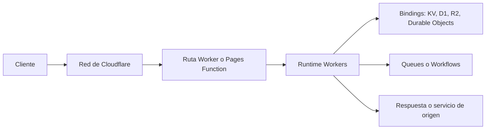

# Serverless Functions en Cloudflare

## Opciones de ejecución

Cloudflare ofrece varias formas de ejecutar lógica sin administrar servidores. La opción principal para cómputo general y APIs es **Cloudflare Workers**. Para sitios desplegados con Cloudflare Pages existe **Pages Functions**, que integra código del lado del servidor con el proyecto Pages y se ejecuta sobre la plataforma Workers.

| Opción | Uso habitual | Guía de esta base |
| --- | --- | --- |
| Workers | APIs, middleware, backend distribuido y procesamiento por eventos | [Cloudflare Workers](Workers.md) |
| Pages Functions | Rutas y endpoints dinámicos dentro de un sitio Pages | Esta guía y la documentación oficial enlazada abajo |
| Durable Objects, Queues y Workflows | Estado coordinado, procesamiento asíncrono y flujos de trabajo | Se describen en la guía de Workers |

## Arquitectura

En Workers, una solicitud o evento llega a la red de Cloudflare y activa un handler en el runtime. El código puede responder, reenviar la solicitud o comunicarse con servicios vinculados. Pages Functions aplica un modelo compatible con Workers, con rutas conectadas al ciclo de vida de un proyecto Pages.

El estado no debe depender de una instancia concreta del runtime. Se almacena mediante productos adecuados al patrón de acceso, como KV, D1, R2 o Durable Objects. Para trabajo asíncrono duradero, se consideran Queues o Workflows en lugar de depender únicamente del trabajo posterior a la respuesta.

## Características

- Ejecución distribuida en la red global de Cloudflare.
- Manejo de solicitudes web mediante APIs compatibles con Fetch y handlers de Workers.
- Bindings hacia servicios de almacenamiento, coordinación y mensajería.
- Despliegue y desarrollo local con Wrangler.
- Integración de Pages Functions con el enrutamiento de Pages.
- Límites de CPU, memoria, subsolicitudes y tamaño que dependen del producto y plan.
- APIs y compatibilidad de runtime distintas a un servidor Node.js tradicional; verificar dependencias antes de migrar.

## Casos de uso

- Middleware, redirecciones, validación y personalización de solicitudes.
- APIs ligeras y Backend for Frontend (BFF).
- Rutas dinámicas y endpoints asociados a un sitio de Cloudflare Pages.
- Caché, adaptación de contenido y llamadas a servicios de origen.
- Procesamiento distribuido con almacenamiento o coordinación mediante bindings.
- Encolado de trabajo y ejecución de workflows fuera del tiempo de respuesta HTTP.

## Ventajas

- Ejecuta lógica cerca de usuarios y orígenes dentro de la red de Cloudflare.
- Evita administrar servidores para funciones de corta duración y tráfico variable.
- Pages Functions permite añadir capacidades dinámicas a un sitio Pages.
- Los bindings integran código con productos de almacenamiento y procesamiento de Cloudflare.
- Wrangler ofrece un flujo de desarrollo y despliegue desde CLI.

## Recomendaciones

- Elegir Workers para lógica reutilizable o servicios independientes; usar Pages Functions cuando la lógica pertenezca a las rutas de un proyecto Pages.
- Validar compatibilidad de lenguaje, framework y dependencias en el runtime objetivo; no asumir equivalencia completa con Node.js.
- Mantener la función sin estado local durable y seleccionar almacenamiento según consistencia, latencia y tipo de dato.
- Usar Durable Objects si hace falta coordinar estado por entidad, y Queues o Workflows para procesamiento que debe continuar de forma duradera.
- Mantener secretos fuera del repositorio y definir bindings explícitos por entorno.
- Medir CPU, subsolicitudes, latencia, errores y volumen antes de establecer costos y capacidad.
- Revisar límites, precios y disponibilidad regional en la documentación oficial vigente.
- Configurar observabilidad y proteger rutas con autenticación, validación y controles de abuso apropiados.

## Documentación oficial

- [Cloudflare Workers](https://developers.cloudflare.com/workers/)
- [Cloudflare Pages Functions](https://developers.cloudflare.com/pages/functions/)
- [Bindings de Workers](https://developers.cloudflare.com/workers/runtime-apis/bindings/)
- [Límites de Workers](https://developers.cloudflare.com/workers/platform/limits/)
- [Precios de Workers](https://developers.cloudflare.com/workers/platform/pricing/)

## Más información

- [Serverless Functions (FaaS)](../Serverless.md)
- [Guía detallada de Cloudflare Workers](Workers.md)
