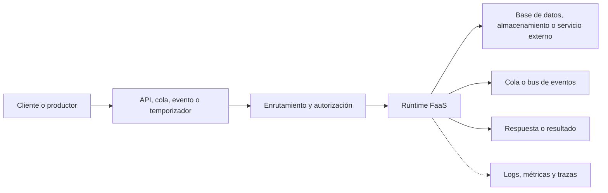

# Serverless Functions (FaaS)

## Introducción

**Function as a Service (FaaS)** es un modelo de computación en la nube donde se despliegan unidades de código que se ejecutan en respuesta a eventos. El proveedor aprovisiona y opera la infraestructura, administra la capacidad de ejecución y factura según el uso definido por el servicio.

El término *serverless* no significa que no existan servidores. Significa que el equipo de desarrollo no administra directamente esos servidores. Las funciones pueden ser activadas por solicitudes HTTP, mensajes, cambios en datos, archivos, eventos de una plataforma o un calendario.

## Arquitectura

Una arquitectura FaaS suele conectar productores de eventos, funciones y servicios administrados. La función procesa un evento y puede responder al emisor, publicar otro evento o guardar resultados en un servicio externo.

### Componentes

- **Productor:** aplicación o servicio que genera el evento.
- **Disparador:** mecanismo que inicia la ejecución, como HTTP, una cola, un cambio de objeto o una regla programada.
- **Plataforma FaaS:** recibe o sondea eventos, crea entornos de ejecución, escala la concurrencia y gestiona el ciclo de vida de las invocaciones.
- **Función:** código enfocado en una tarea, con configuración y permisos explícitos.
- **Servicios de estado:** bases de datos, almacenamiento, cachés, colas y otros sistemas externos. El entorno de ejecución no debe considerarse almacenamiento persistente.
- **Observabilidad y operación:** registros, métricas, trazas, alarmas, despliegue y control de versiones.

## Características

- **Orientación a eventos:** cada función responde a un tipo de evento o solicitud.
- **Infraestructura administrada:** no se mantienen servidores, sistemas operativos ni escalado de máquinas virtuales para la función.
- **Escalado automático:** la plataforma ajusta el número de ejecuciones concurrentes según la demanda y sus cuotas.
- **Ejecuciones acotadas:** existen límites de duración, memoria, CPU, tamaño del paquete, concurrencia y solicitudes; varían por plataforma y plan.
- **Entornos efímeros:** una invocación puede reutilizar un entorno, pero no se garantiza que la siguiente se ejecute en el mismo. El estado durable vive en servicios externos.
- **Facturación por consumo:** normalmente considera invocaciones y recursos consumidos; también pueden facturarse API, red, almacenamiento, registros y otros servicios asociados.
- **Integración con servicios gestionados:** conectores, bindings o mapeos de eventos reducen el código de integración, aunque pueden crear dependencia del proveedor.
- **Despliegue independiente:** funciones y servicios pueden cambiarse por separado cuando los contratos entre ellos están bien definidos.

## Casos de uso

1. **APIs y endpoints HTTP:** operaciones breves para aplicaciones web y móviles.
2. **Procesamiento asíncrono:** consumir mensajes, ejecutar validaciones o transformar datos en segundo plano.
3. **Automatización por eventos:** reaccionar a cargas de archivos, cambios en bases de datos o notificaciones de otros servicios.
4. **Tareas programadas:** generar reportes, sincronizar catálogos o limpiar datos según un calendario.
5. **Integración entre sistemas:** adaptar formatos, enrutar eventos y coordinar servicios mediante colas o buses.
6. **Procesamiento de medios y documentos:** validar, clasificar, redimensionar o extraer información de archivos, de acuerdo con los límites de ejecución.
7. **Middleware y lógica en el edge:** validar solicitudes, transformar respuestas o ejecutar código próximo a los usuarios, si el proveedor ofrece ese modelo.
8. **Automatización operativa:** ejecutar tareas bajo demanda como notificaciones, conciliaciones o mantenimiento de datos.

## Ventajas

- Reduce la carga de aprovisionar, parchear y escalar infraestructura de cómputo.
- Permite ajustar la capacidad a la demanda y pagar según el consumo del servicio.
- Facilita separar procesos por evento y desplegar componentes de forma independiente.
- Acelera la implementación de integraciones y automatizaciones pequeñas.
- Se integra con servicios administrados de mensajería, almacenamiento, identidad y observabilidad.
- Puede acercar el cómputo a los usuarios cuando se utiliza una plataforma distribuida en el edge.

## Consideraciones y límites

- **Arranque en frío:** una función sin entorno disponible puede tardar más en iniciar; el efecto depende del runtime, el paquete y el plan.
- **Duración limitada:** procesos largos o que esperan interacción humana suelen necesitar colas, orquestación o un servicio de ejecución continua.
- **Reintentos y duplicados:** muchos disparadores entregan eventos al menos una vez. El procesamiento debe tolerar reintentos y duplicados.
- **Concurrencia y cuotas:** picos de demanda pueden alcanzar cuotas, provocar throttling o sobrecargar dependencias externas.
- **Latencia acumulada:** varias funciones encadenadas añaden saltos de red y hacen más difícil entender el tiempo total de respuesta.
- **Costos distribuidos:** el precio de la función no representa el costo total. API Gateway, colas, bases de datos, transferencia y observabilidad también cuentan.
- **Dependencia del proveedor:** disparadores, bindings, permisos y formatos de eventos pueden requerir cambios para migrar de plataforma.
- **Depuración distribuida:** las solicitudes atraviesan servicios asíncronos y necesitan identificadores de correlación y trazas.
- **Seguridad por función:** permisos amplios, secretos expuestos o endpoints públicos sin controles pueden aumentar el impacto de un incidente.

## Recomendaciones de diseño y operación

### Diseño

- Mantener cada función enfocada en una responsabilidad clara y acotada.
- Separar el código de negocio del adaptador que interpreta el evento del proveedor.
- Usar contratos de eventos versionados y validar su estructura en la entrada.
- Hacer las operaciones idempotentes: repetir el mismo evento no debe producir efectos no deseados.
- Para trabajos asíncronos, usar colas o buses que permitan absorber picos y desacoplar al productor del consumidor.
- Elegir una orquestación para procesos largos o con múltiples pasos, compensaciones y esperas; no encadenar funciones sin límites.
- Guardar datos persistentes en bases de datos o almacenamiento duradero, no en memoria local del runtime.

### Confiabilidad y rendimiento

- Definir timeouts, concurrencia, tamaño de lote y política de reintentos según el trabajo y la capacidad de las dependencias.
- Enviar eventos fallidos a una cola de mensajes no procesables cuando el servicio lo permita, y establecer cómo se inspeccionan y reprocesan.
- Evitar reintentar indefinidamente errores permanentes o repetir efectos externos sin una clave de idempotencia.
- Mantener pequeños los paquetes y cargar solo dependencias necesarias.
- Medir latencia, errores, throttling, invocaciones, duración y edad de los mensajes en cola.
- Probar cargas pico, interrupciones de dependencias y reprocesamiento de mensajes antes de producción.

### Seguridad y costos

- Aplicar mínimo privilegio por función y separar identidades, secretos y permisos por entorno.
- Validar autenticación, autorización y datos de entrada en los puntos de exposición.
- No registrar secretos, tokens ni datos personales innecesarios; proteger los logs según las políticas aplicables.
- Configurar presupuestos, alertas y límites de concurrencia para controlar aumentos inesperados de uso.
- Estimar el costo integral con el volumen real de eventos, duración, memoria, red, almacenamiento y servicios relacionados.
- Revisar límites, regiones disponibles, residencia de datos y precios en la documentación vigente del proveedor.

## Cuándo elegir FaaS

FaaS suele ser adecuado para cargas con eventos claros, ejecución corta o intermitente, demanda variable y límites de operación que el proveedor puede administrar. Para procesos continuos, cargas de larga duración, uso intensivo de estado local, tráfico sostenido predecible o control detallado del runtime, comparar también contenedores, servicios de aplicaciones y máquinas virtuales.

## Opciones documentadas en esta base

- [AWS Lambda](amazon/AWS-Lambda.md)
- [Azure Functions](azure/Azure-Functions.md)
- [Cloudflare Workers](Cloudflare/Serverless-Functions.md) y su [guía de Workers](Cloudflare/Workers.md)

## Referencias

- [AWS Lambda Developer Guide](https://docs.aws.amazon.com/lambda/latest/dg/welcome.html)
- [Azure Functions documentation](https://learn.microsoft.com/azure/azure-functions/)
- [Cloudflare Workers documentation](https://developers.cloudflare.com/workers/)
- [Serverless Framework: What is Serverless?](https://www.serverless.com/learn/intro-to-serverless)
