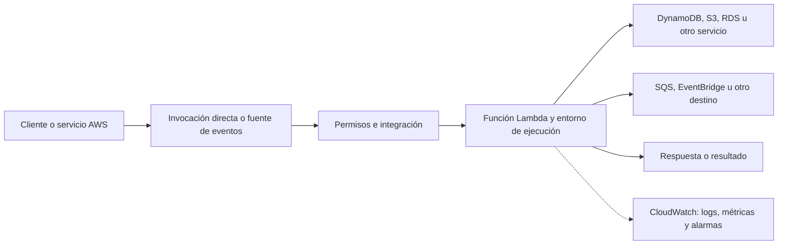

# AWS Lambda

## Descripción

**AWS Lambda** es el servicio FaaS de Amazon Web Services. Permite ejecutar código en respuesta a invocaciones directas o eventos de servicios de AWS y aplicaciones externas, sin administrar servidores. AWS prepara y escala los entornos de ejecución, sujetos a cuotas y límites de la cuenta, región y configuración.

## Arquitectura y flujo

Las funciones pueden invocarse de forma síncrona, donde quien llama espera la respuesta, o asíncrona, donde Lambda acepta el evento y lo procesa después. Para servicios de colas y flujos, los *event source mappings* leen eventos y los entregan a la función por lotes. El origen, el tipo de invocación y la configuración determinan el comportamiento de reintentos y errores.

Cada invocación se ejecuta en un entorno con runtime, memoria, configuración y rol de ejecución. Lambda puede reutilizar un entorno para invocaciones posteriores, pero no garantiza su permanencia. La concurrencia representa las invocaciones activas y determina cuántos entornos se necesitan; las cuotas regionales y los límites de escalado deben formar parte del diseño.

## Características

- Runtimes administrados para varios lenguajes y opción de imágenes de contenedor compatibles.
- Disparadores e integraciones con servicios AWS, además de invocación directa mediante API o SDK.
- Escalado automático por concurrencia, con cuotas configurables y opciones de concurrencia reservada o aprovisionada.
- Configuración de memoria, almacenamiento temporal, timeout, arquitectura y variables de entorno por función.
- Versiones y alias para publicar cambios y dirigir tráfico entre versiones.
- Integración con IAM, CloudWatch, X-Ray y servicios de seguridad de AWS.
- Procesamiento en lotes con mapeos de fuentes de eventos como SQS, Kinesis y DynamoDB Streams.
- Extensiones y capas para empaquetar dependencias o integrar herramientas.

## Casos de uso

- APIs HTTP mediante Amazon API Gateway o Lambda Function URLs.
- Consumidores de SQS y procesadores de eventos publicados en EventBridge.
- Procesamiento de objetos al cargarse en Amazon S3.
- Reacciones a cambios en DynamoDB Streams o flujos de Kinesis.
- Automatización programada con EventBridge Scheduler.
- Tareas de backend, notificaciones, validación y transformación de datos.
- Procesos de coordinación con AWS Step Functions cuando hay varios pasos o esperas.

## Ventajas

- Integración amplia con el ecosistema AWS y sus mecanismos de identidad y eventos.
- Escalado administrado y pago basado en invocaciones y recursos consumidos, junto con los costos de los servicios asociados.
- Diferentes modelos de invocación, incluidos eventos directos y consumo de fuentes mediante lotes.
- Versiones, alias, métricas y controles para despliegues graduales.
- No requiere operar hosts para funciones ni instalar actualizaciones del sistema operativo del host.

## Recomendaciones

- Diseñar los handlers para ser idempotentes, especialmente con entrega al menos una vez y reintentos.
- Asignar un rol IAM por función o grupo con límites claros; no reutilizar permisos administrativos.
- Elegir entre invocación síncrona, asíncrona y mapeo de fuente según la latencia, el volumen y las garantías del evento.
- Ajustar tamaño de lote, concurrencia, timeout y memoria midiendo la carga real y la capacidad de los servicios dependientes.
- Configurar destinos de fallo, DLQ o manejo de errores según el mecanismo de invocación; documentar cómo reprocesar eventos.
- Reutilizar conexiones y clientes fuera del handler cuando sea seguro, sin guardar estado de negocio en variables globales.
- Usar AWS Step Functions para procesos de varios pasos, compensaciones o esperas prolongadas.
- Observar errores, throttling, duración, concurrencia, edad de mensajes y costos mediante CloudWatch y trazas distribuidas.
- Gestionar infraestructura y permisos con IaC y separar cuentas o entornos para desarrollo, pruebas y producción.
- Consultar límites y precios por región antes de dimensionar la solución.

## Límites que revisar

La duración máxima, memoria, almacenamiento temporal, tamaño del despliegue, concurrencia, tasas de escalado y tamaño de evento dependen del tipo de función y la configuración vigente. También hay diferencias entre invocación directa y funciones conectadas a fuentes de eventos. Validar los valores actuales y las cuotas de la cuenta antes de asumir capacidad.

## Documentación oficial

- [AWS Lambda Developer Guide](https://docs.aws.amazon.com/lambda/latest/dg/welcome.html)
- [Modelo de invocación](https://docs.aws.amazon.com/lambda/latest/dg/lambda-invocation.html)
- [Concurrencia de Lambda](https://docs.aws.amazon.com/lambda/latest/dg/lambda-concurrency.html)
- [Mapeo de fuentes de eventos](https://docs.aws.amazon.com/lambda/latest/dg/invocation-eventsourcemapping.html)
- [Buenas prácticas](https://docs.aws.amazon.com/lambda/latest/dg/best-practices.html)
- [Precios de AWS Lambda](https://aws.amazon.com/lambda/pricing/)

## Más información

- [Serverless Functions (FaaS)](../Serverless.md)
