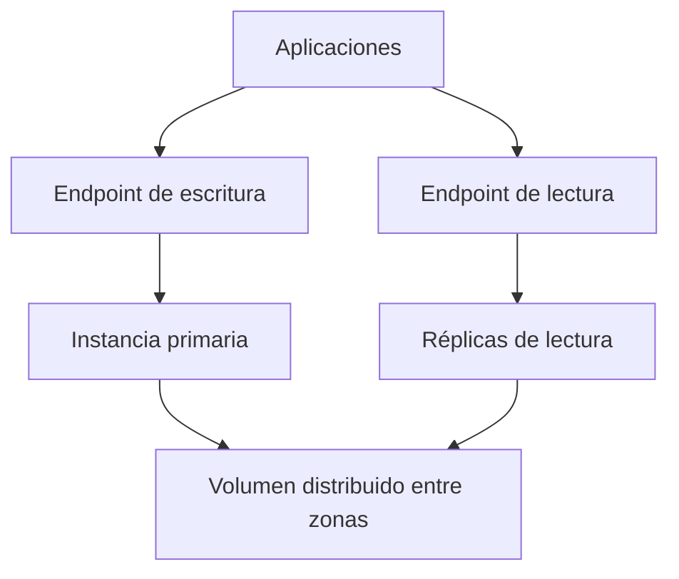

# Amazon Aurora

Fecha de revisión: 18 de noviembre de 2026.

## Descripción

Amazon Aurora es una base de datos relacional administrada de AWS, disponible en ediciones compatibles con MySQL y PostgreSQL. Permite reutilizar clientes y herramientas del motor correspondiente; la compatibilidad se debe validar para la versión y las funciones utilizadas. Este documento cubre Aurora con clúster regional; Aurora DSQL es otro servicio y requiere una evaluación independiente. Véase la [FAQ oficial](https://docs.aws.amazon.com/rds/latest/auroraextendedcontent/aurora-faq.html).

Ofrece instancias provisionadas y Aurora Serverless v2, cuyo cómputo se ajusta dentro del rango configurado. La disponibilidad de funciones depende del motor, versión y región: consultar la [matriz de funciones](https://docs.aws.amazon.com/AmazonRDS/latest/AuroraUserGuide/Concepts.AuroraFeaturesRegionsDBEngines.grids.html).

## Características

| Característica | Qué ofrece | Utilidad y alcance |
|---|---|---|
| Ediciones MySQL y PostgreSQL | Dos ediciones que implementan compatibilidad con sus respectivos motores, protocolos y herramientas. | Permite conservar parte del código y las herramientas existentes. Hay que elegir una edición y validar funciones y extensiones; no se mezclan ambos motores en un clúster. |
| Cómputo provisionado | Instancias cuyo tamaño se selecciona para el escritor y los lectores. | Facilita dimensionar una carga estable y asignar capacidad distinta a las lecturas. Los cambios de tamaño requieren planificación operativa. |
| Aurora Serverless v2 | Ajusta la capacidad de cómputo de las instancias serverless dentro de los límites configurados. | Atiende variaciones de demanda sin dimensionar siempre para el máximo. La capacidad mínima, máxima y las funciones disponibles dependen de la versión. |
| Almacenamiento distribuido | Mantiene seis copias de los datos en tres zonas de disponibilidad, separadas de las instancias. | Protege frente a fallas de almacenamiento y permite compartir el volumen entre escritor y lectores. La redundancia del volumen no garantiza que haya cómputo de reemplazo disponible. |
| Réplicas de lectura | Admite hasta 15 Aurora Replicas por clúster regional. | Descarga consultas del escritor y aporta destinos de failover. No aumenta el número de escritores ni garantiza lecturas sin retraso. |
| Endpoints por función | Proporciona endpoints de clúster y de lectura para dirigir conexiones al escritor o a los lectores. | Permite separar transacciones de reportes. El balanceo lector distribuye conexiones, no cada consulta dentro de una conexión. |
| Failover administrado | Puede promover automáticamente una réplica cuando el escritor deja de estar disponible. | Reduce la intervención manual durante una falla. La aplicación debe restablecer conexiones y manejar transacciones interrumpidas. |
| Respaldos y recuperación temporal | Ofrece respaldos automáticos, snapshots y recuperación a un punto dentro del período de retención. | Permite recuperar el estado previo a una eliminación o modificación accidental. La recuperación genera un clúster que debe validarse antes de reconectar la aplicación. |
| Aurora Global Database | Conecta clústeres de distintas regiones para lecturas regionales y recuperación ante desastres. | Permite diseñar continuidad regional; deben medirse retraso, pérdida potencial de datos y tiempo de promoción. No equivale a múltiples escritores independientes. |
| Protección de datos y acceso | Integra cifrado en reposo, TLS y controles de acceso de AWS y del motor SQL. | Permite proteger datos almacenados y conexiones. Los permisos sobre el recurso cloud y los permisos sobre tablas se administran por separado. |
| Integración con RDS Proxy | Puede utilizar un proxy administrado para compartir y administrar conexiones a la base de datos. | Resulta útil ante muchas conexiones breves. Hay que revisar compatibilidad, comportamiento de sesiones y costo adicional. |
| Modelos Standard e I/O-Optimized | Permite escoger una estructura de cobro con E/S facturada o una sin ese cargo específico. | Facilita ajustar el costo a cargas con diferente intensidad de acceso a almacenamiento; requiere comparar el costo total. |

Fuentes de las características:

- [Compatibilidad y ediciones](https://docs.aws.amazon.com/rds/latest/auroraextendedcontent/aurora-faq.html).
- [Clústeres y réplicas](https://docs.aws.amazon.com/AmazonRDS/latest/AuroraUserGuide/Aurora.Overview.html) y [replicación y endpoints](https://docs.aws.amazon.com/en_en/AmazonRDS/latest/AuroraUserGuide/Aurora.Replication.html).
- [Serverless y RDS Proxy](https://docs.aws.amazon.com/AmazonRDS/latest/AuroraUserGuide/aurora-serverless-v2.html).
- [Durabilidad y recuperación regional](https://docs.aws.amazon.com/rds/latest/auroraextendedcontent/aurora-faq-availability-and-durability.html).
- [Respaldos y restauración](https://docs.aws.amazon.com/us_en/AmazonRDS/latest/AuroraUserGuide/Aurora.Managing.Backups.html).
- [Seguridad](https://docs.aws.amazon.com/AmazonRDS/latest/AuroraUserGuide/UsingWithRDS.html) y [precios](https://aws.amazon.com/rds/aurora/pricing/).

## Arquitectura

El clúster regional tiene un escritor y admite hasta 15 réplicas de lectura que comparten el volumen. Una réplica puede promoverse si falla el escritor. El endpoint lector distribuye conexiones; una conexión persistente no se redistribuye consulta por consulta. Véase [clústeres](https://docs.aws.amazon.com/AmazonRDS/latest/AuroraUserGuide/Aurora.Overview.html) y [replicación](https://docs.aws.amazon.com/en_en/AmazonRDS/latest/AuroraUserGuide/Aurora.Replication.html).

El almacenamiento mantiene seis copias distribuidas entre tres zonas. Esta protección del volumen no sustituye la redundancia del cómputo: conviene disponer de una réplica en otra zona. Para recuperación regional existe Aurora Global Database; deben evaluarse su replicación, promoción y objetivos de recuperación. Fuente: [disponibilidad y durabilidad](https://docs.aws.amazon.com/rds/latest/auroraextendedcontent/aurora-faq-availability-and-durability.html).

## Compatibilidad y limitaciones

- Elegir explícitamente Aurora PostgreSQL o Aurora MySQL; son motores distintos.
- Validar extensiones, parámetros, procedimientos y herramientas de migración contra la versión elegida.
- Agregar lectores distribuye lecturas; no convierte el clúster regional en un sistema con múltiples escritores.
- Las lecturas en réplicas pueden ir por detrás del escritor. Una operación que necesita leer inmediatamente su propia escritura debe usar el escritor o una estrategia de consistencia verificada.
- Los límites y las funciones serverless no deben extrapolarse entre versiones o regiones.

Referencias: [versiones](https://docs.aws.amazon.com/AmazonRDS/latest/AuroraUserGuide/Aurora.VersionPolicy.html), [funciones por región y motor](https://docs.aws.amazon.com/AmazonRDS/latest/AuroraUserGuide/Concepts.AuroraFeaturesRegionsDBEngines.grids.html) y [replicación](https://docs.aws.amazon.com/en_en/AmazonRDS/latest/AuroraUserGuide/Aurora.Replication.html).

## Casos de uso

Como criterio de evaluación, encaja en comercio electrónico, sistemas administrativos y SaaS alojados en AWS que necesitan transacciones y muchas lecturas. Aurora MySQL permite evaluar continuidad con aplicaciones MySQL; Aurora PostgreSQL facilita una estrategia basada en ese ecosistema. Serverless v2 merece una prueba cuando la demanda varía durante el día.

## Recomendaciones

1. Probar consultas, transacciones y migraciones con datos representativos antes de dimensionar.
2. Separar tráfico de escritura y reportes; medir retraso de réplica y conexiones activas.
3. Distribuir instancias entre zonas y ensayar failover con reconexión, reintentos limitados e idempotencia.
4. Preferir red privada, TLS, mínimos privilegios y gestión centralizada de secretos.
5. Definir RPO —pérdida máxima de datos tolerable— y RTO —tiempo máximo de recuperación—, y comprobarlos restaurando respaldos.

Son recomendaciones de evaluación; la [guía de prueba de concepto de AWS](https://docs.aws.amazon.com/AmazonRDS/latest/AuroraUserGuide/aurora-poc.html) aporta escenarios de validación.

## Costos

Considerar cómputo de escritor y lectores, almacenamiento, respaldos y transferencias. Aurora Standard cobra operaciones de E/S; Aurora I/O-Optimized elimina ese cargo específico con tarifas diferentes de cómputo y almacenamiento. Comparar ambos con la carga real, incluyendo recursos de recuperación regional. No asumir que serverless siempre reduce el costo. Consultar [precios oficiales](https://aws.amazon.com/rds/aurora/pricing/).

## Documentos relacionados

- [Comparativa de bases de datos cloud](../../data_base/comparativa-bases-datos-cloud.md)
- [Índice Cloud](../README.md)
