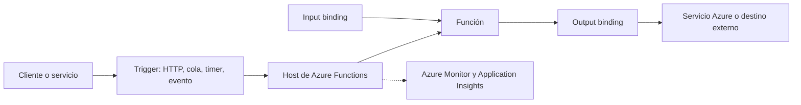

# Azure Functions

## Descripción

**Azure Functions** es el servicio de funciones administradas y orientadas a eventos de Microsoft Azure. Una aplicación de funciones agrupa funciones, configuración y recursos de despliegue. Cada función tiene un disparador que inicia su ejecución; puede declarar *bindings* de entrada o salida para integrarse declarativamente con otros servicios.

## Arquitectura y flujo

El **trigger** define el evento y los datos que inician la función; cada función debe tener uno. Los **bindings** conectan recursos y proporcionan datos de entrada o reciben resultados de salida. Se puede acceder directamente a servicios mediante sus SDK cuando se necesita más control que el ofrecido por un binding.

El plan de hospedaje determina el escalado, las instancias, la disponibilidad de red, las opciones de ejecución y el modelo de cobro. Los planes de consumo y Premium pueden escalar dinámicamente según eventos; en un plan dedicado, el escalado depende de la configuración de App Service. Evaluar el plan con base en latencia, duración, tráfico sostenido, red y requisitos de cómputo.

## Características

- Triggers para HTTP, temporizadores, colas, Event Grid, Event Hubs, Service Bus, almacenamiento y otros servicios.
- Bindings de entrada y salida para simplificar integraciones comunes.
- Soporte para lenguajes y modelos de programación que dependen de la versión del runtime y del sistema operativo.
- Varios planes de hospedaje con diferentes comportamientos de escalado y operación.
- Integración con identidad administrada, Key Vault, Azure Monitor y Application Insights.
- Desarrollo local, configuración por entorno y despliegue mediante herramientas de Azure o CI/CD.
- Durable Functions para orquestaciones con estado, tareas de larga duración, temporizadores y patrones de coordinación.

## Casos de uso

- APIs HTTP y adaptadores de backend.
- Procesamiento de mensajes desde Azure Service Bus, Storage Queues o Event Hubs.
- Automatización por cambios de blobs, documentos o registros.
- Tareas programadas de mantenimiento y sincronización.
- Integración de sistemas mediante transformaciones y publicación de eventos.
- Orquestaciones de varios pasos con Durable Functions.
- Procesamiento de datos y automatización dentro de soluciones existentes en Azure.

## Ventajas

- Integración directa con servicios de Azure, identidad y monitoreo.
- Modelo común de triggers y bindings para construir funciones orientadas a eventos.
- Opciones de hospedaje para cargas variables o más estables.
- Posibilidad de desarrollar y probar localmente y automatizar despliegues.
- Durable Functions ofrece patrones de orquestación sin administrar una plataforma separada de workflows.

## Recomendaciones

- Elegir primero el plan de hospedaje y revisar cómo afecta el escalado, los límites de ejecución, la red y el costo.
- Diseñar consumidores de colas para procesar lotes, gestionar reintentos e impedir efectos duplicados.
- Mantener triggers y bindings en configuración clara; usar SDK cuando se necesite control más fino de consultas, transacciones o errores.
- Usar identidad administrada en lugar de credenciales embebidas cuando el servicio de destino lo admita.
- Separar configuración local de la configuración desplegada y almacenar secretos en un almacén seguro como Key Vault.
- Configurar Application Insights o Azure Monitor, identificadores de correlación y alertas para errores y retrasos de cola.
- Ajustar concurrencia y escalado según el tipo de trigger y la capacidad de las dependencias.
- Usar Durable Functions para workflows con pasos, reintentos, estado o esperas prolongadas; mantener las actividades idempotentes.
- Desplegar con infraestructura como código y separar entornos, conexiones y permisos.
- Verificar las versiones de runtime, extensiones, bindings, cuotas y precios vigentes.

## Límites que revisar

Los tiempos máximos, escalado, instancias, disponibilidad de red, versiones de runtime y costos dependen del plan, sistema operativo, región y trigger. Los bindings también tienen diferencias de características entre extensiones. Confirmar esos detalles para la región y el plan elegido antes de producción.

## Documentación oficial

- [Documentación de Azure Functions](https://learn.microsoft.com/azure/azure-functions/)
- [Conceptos de triggers y bindings](https://learn.microsoft.com/azure/azure-functions/functions-triggers-bindings)
- [Opciones de hospedaje](https://learn.microsoft.com/azure/azure-functions/functions-scale)
- [Escalado y concurrencia](https://learn.microsoft.com/azure/azure-functions/functions-concurrency)
- [Buenas prácticas](https://learn.microsoft.com/azure/azure-functions/functions-best-practices)
- [Durable Functions](https://learn.microsoft.com/azure/azure-functions/durable/durable-functions-overview)

## Más información

- [Serverless Functions (FaaS)](../Serverless.md)
- [Apunte existente sobre Azure Functions](azure-functions.md)
