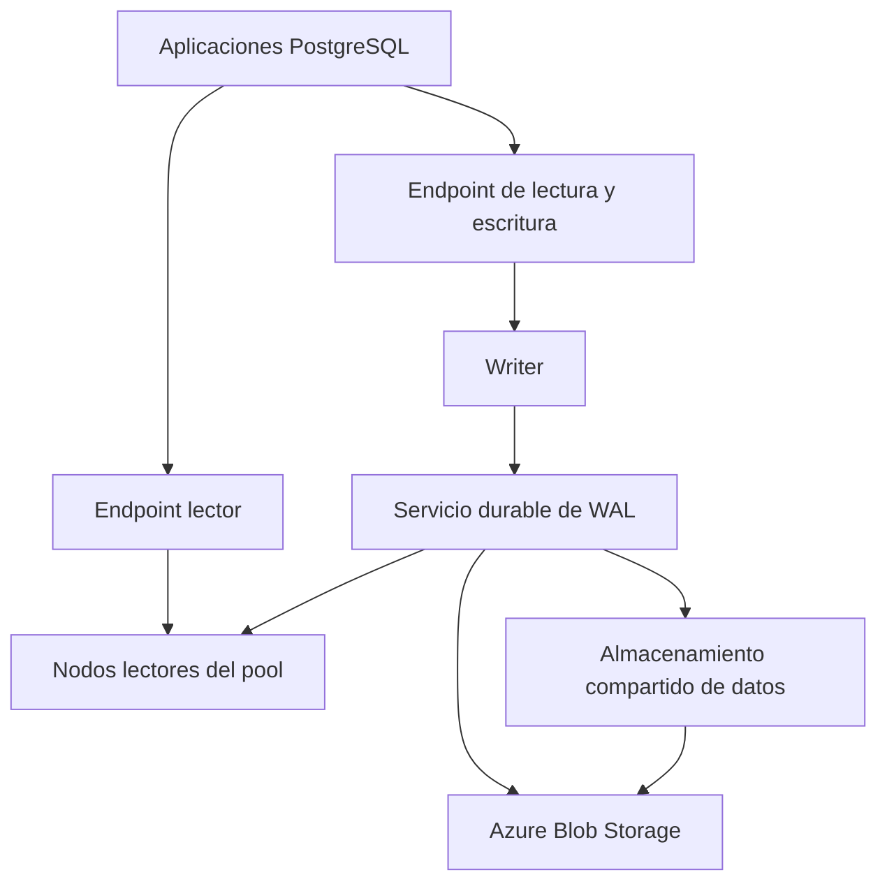

# Azure HorizonDB

Fecha de revisión: 18 de noviembre de 2026.

## Descripción

Azure HorizonDB es un servicio administrado basado en PostgreSQL que separa cómputo y almacenamiento. Su diseño usa el WAL —registro de cambios— como base de la persistencia. Está orientado a transacciones y aplicaciones de IA. La documentación actual presenta el servicio sin la etiqueta Preview; algunas páginas e índices todavía pueden conservar información anterior. Fuente: [descripción oficial actualizada el 17 de noviembre de 2026](https://learn.microsoft.com/en-us/azure/horizondb/overview/overview).

## Características

| Característica | Qué ofrece | Utilidad y alcance |
|---|---|---|
| Compatibilidad PostgreSQL | Ejecuta consultas y transacciones mediante el protocolo PostgreSQL. | Facilita conservar clientes y herramientas existentes; deben validarse extensiones y operaciones concretas de la aplicación. |
| Separación de cómputo y almacenamiento | Los nodos procesan consultas sobre una capa compartida y durable. | Permite ajustar cómputo sin copiar toda la base de datos a cada nodo. El almacenamiento crece independientemente del cómputo. |
| Persistencia basada en WAL | Confirma la escritura después de persistir su registro de cambios en el servicio durable de WAL. | Traslada trabajo de persistencia a servicios especializados; el almacenamiento de datos reconstruye las páginas aplicando esos registros. |
| Escala horizontal de lectura | Admite lectores que comparten el almacenamiento del clúster. | Permite distribuir consultas sin mantener volúmenes independientes. Los lectores pueden observar cambios con retraso. |
| Endpoints de escritura y lectura | Dirige conexiones al writer o distribuye conexiones entre lectores. | Permite enviar transacciones y consultas de lectura a destinos distintos. Las lecturas que exigen datos recién confirmados deben usar el writer. |
| Alta disponibilidad zonal | Utiliza varios nodos y redundancia entre zonas cuando se configura la HA correspondiente. | Proporciona destinos de promoción ante fallas del escritor. La redundancia del almacenamiento y la del cómputo deben evaluarse por separado. |
| Caché local de datos | Los nodos conservan datos frecuentes en memoria y en caché SSD local. | Reduce accesos al almacenamiento compartido. El rendimiento de una caché fría puede diferir del de un nodo que lleva tiempo atendiendo consultas. |
| Respaldos y restauración temporal | Mantiene respaldos y WAL para recuperar el clúster dentro de la retención configurada. | Permite volver al estado anterior a un error. El respaldo georredundante aporta otra vía de recuperación, con restricciones de cifrado. |
| Integración de identidad y red | Admite autenticación con Microsoft Entra y conectividad mediante endpoints privados. | Facilita centralizar identidad y restringir exposición de red. Los permisos SQL se configuran además de los permisos sobre Azure. |
| Búsqueda vectorial | Ofrece capacidades basadas en `pgvector` y DiskANN para búsqueda por similitud. | Permite combinar datos relacionales con recuperación semántica. Hay que evaluar calidad de resultados, filtros y consumo de recursos. |
| Funciones de IA | La extensión `azure_ai` permite integrar funciones respaldadas por modelos y servicios de IA. | Facilita procesamiento de texto y flujos RAG desde datos de la aplicación. Las llamadas a modelos tienen latencia, costos y permisos propios. |
| Integración analítica con Fabric | Contempla mirroring de datos hacia Microsoft Fabric OneLake. | Permite evaluar analítica fuera del cómputo transaccional. Su disponibilidad y restricciones se deben comprobar para el entorno elegido. |

Fuentes de las características:

- [Arquitectura, nodos, endpoints, respaldo e integración con Fabric](https://learn.microsoft.com/en-us/azure/horizondb/overview/overview).
- [Seguridad](https://learn.microsoft.com/en-us/azure/horizondb/security/security-overview) y [TLS](https://learn.microsoft.com/en-us/azure/horizondb/security/security-tls).
- [Búsqueda vectorial y funciones de IA](https://learn.microsoft.com/en-us/azure/horizondb/ai/ai-samples).
- [Respaldos y restauración](https://learn.microsoft.com/en-us/azure/horizondb/backup-restore/concepts-backup-restore).

Los read pools independientes aparecen como parte del modelo arquitectónico, pero la documentación actual todavía los declara no disponibles. Los lectores descritos aquí pertenecen al pool de lectura y escritura. Esta distinción también se recoge en las limitaciones.

## Arquitectura

El escritor envía WAL al servicio durable antes de confirmar la transacción. La capa de datos aplica esos registros y comparte páginas entre nodos. Hay un escritor y hasta 15 lectores; la alta disponibilidad necesita varios nodos. Los lectores pueden presentar retraso. Fuente: [arquitectura y endpoints](https://learn.microsoft.com/en-us/azure/horizondb/overview/overview).

## Compatibilidad y seguridad

Aunque utiliza PostgreSQL, conviene comprobar versión, extensiones, parámetros y operaciones administrativas de cada aplicación. Comparar también Azure Database for PostgreSQL cuando sus capacidades cubran la necesidad.

Para seguridad, evaluar identidad de Microsoft Entra, permisos SQL mínimos y endpoints privados. Configurar TLS con validación del servidor y preparar la rotación de certificados. La identidad de administración del recurso y los permisos sobre tablas requieren controles propios. Fuentes: [seguridad](https://learn.microsoft.com/en-us/azure/horizondb/security/security-overview) y [TLS](https://learn.microsoft.com/en-us/azure/horizondb/security/security-tls).

## Limitaciones actuales

La documentación consultada indica estas restricciones:

- No hay lectores entre regiones ni read pools independientes disponibles.
- No hay actualización mayor in situ ni ventana de mantenimiento personalizable.
- No hay PgBouncer integrado; puede usarse un pooler externo.
- No pueden combinarse claves administradas por el cliente con respaldo georredundante.
- La retención llega a 35 días; no hay retención de largo plazo integrada.

Fuente: [limitaciones actuales](https://learn.microsoft.com/en-us/azure/horizondb/overview/overview#limitations). Revisarlas antes de aprobar el diseño: están sujetas a cambios.

## Casos de uso

Como criterio de evaluación, puede encajar en sistemas transaccionales de Azure con alta demanda lectora y aplicaciones que combinan datos relacionales con búsqueda semántica. Para un SaaS, conviene probar separación de usuarios, conexiones, consultas y restauración antes de elegir el modelo multitenant.

## Recomendaciones

1. Probar compatibilidad funcional y consultas críticas con la versión seleccionada.
2. Configurar redundancia zonal del cómputo para cargas críticas y ensayar la reconexión tras failover.
3. Enviar al escritor las lecturas que necesitan observar inmediatamente una escritura.
4. Resolver el plan regional antes del despliegue: restaurar un respaldo georredundante tiene tiempos distintos de promover una réplica.
5. Decidir cifrado y respaldo georredundante al crear el clúster; validar sus restricciones en el entorno de destino.
6. Definir una estrategia de migración entre versiones mayores y conservar capacidad para ejecutarla.

Son recomendaciones de evaluación. La evidencia de aceptación debe incluir carga representativa, restauración y cumplimiento de RPO y RTO.

## Respaldos y costos

La configuración de respaldos admite hasta 35 días y el API restringe el respaldo georredundante cuando se usa Azure Key Vault para cifrado. Verificar estas decisiones en la configuración real: [referencia del API](https://learn.microsoft.com/en-us/rest/api/horizondb/clusters/list-by-subscription?view=rest-horizondb-2026-10-01-preview).

Presupuestar todos los nodos, almacenamiento y respaldo, además de red y servicios conectados que correspondan. Cotizar con la región y configuración definitivas en los [precios oficiales](https://azure.microsoft.com/en-us/pricing/details/horizondb/).

## Documentos relacionados

- [Comparativa de bases de datos cloud](../../data_base/comparativa-bases-datos-cloud.md)
- [Índice Cloud](../README.md)
