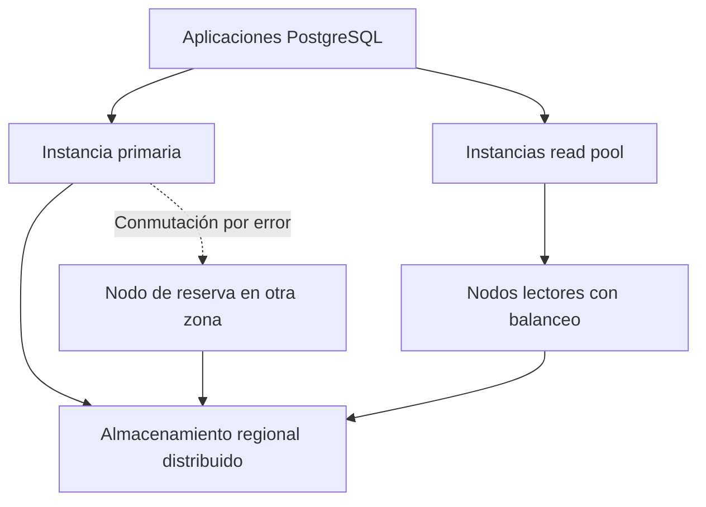

# Google Cloud AlloyDB for PostgreSQL

Fecha de revisión: 18 de noviembre de 2026.

## Descripción

AlloyDB es un servicio administrado compatible con PostgreSQL. Separa cómputo y almacenamiento e incorpora optimizaciones del motor, respaldo continuo y capacidades de IA. El alcance aquí es el servicio administrado en Google Cloud; AlloyDB Omni tiene otro modelo de despliegue y operación. Fuente: [descripción oficial](https://docs.cloud.google.com/alloydb/docs/overview).

## Características

| Característica | Qué ofrece | Utilidad y alcance |
|---|---|---|
| Compatibilidad PostgreSQL | Usa el protocolo y el ecosistema de clientes PostgreSQL, con un motor optimizado por Google. | Facilita reutilizar aplicaciones y herramientas. Las versiones, extensiones y operaciones administrativas se validan contra lo que admite el servicio. |
| Cómputo y almacenamiento separados | Los nodos de consultas acceden a almacenamiento regional distribuido, que crece con los datos. | Permite ajustar recursos de consultas sin mantener una copia completa de la base de datos por nodo. |
| Primaria con alta disponibilidad | Una primaria HA utiliza un nodo activo y otro de reserva en zonas distintas, con failover automático. | Protege ante fallas del nodo o de una zona. La configuración básica de un solo nodo no ofrece esa misma protección. |
| Read pools | Agrupa nodos de lectura detrás de un punto de acceso con balanceo de carga. | Permite aumentar capacidad lectora y destinar instancias a reportes. Las escrituras siguen entrando por la primaria. |
| Motor columnar | Mantiene columnas seleccionadas en formato columnar y dispone de ejecución especializada para consultas compatibles. | Acelera ciertos escaneos, agregaciones y uniones sobre muchos registros. Consume memoria y debe verificarse su uso en el plan de ejecución. |
| Asesor de índices | Analiza consultas habituales y recomienda índices que podrían mejorar su ejecución. | Ayuda a identificar oportunidades de optimización. Las recomendaciones deben revisarse por su impacto en escrituras y almacenamiento. |
| Autovacuum adaptativo | Ajusta automáticamente el trabajo de limpieza de versiones de filas y mantenimiento asociado según la carga. | Ayuda a controlar acumulación de filas muertas y riesgos por antigüedad de transacciones. No elimina la necesidad de observar tablas y transacciones largas. |
| Respaldos y recuperación temporal | Ofrece respaldos bajo demanda o programados y recuperación continua a un punto del período retenido. | Permite recuperar datos ante errores lógicos mediante la restauración a un nuevo clúster. |
| Replicación entre regiones | Envía cambios de forma asíncrona a clústeres secundarios que pueden promoverse. | Permite diseñar recuperación regional y lecturas remotas. El retraso de replicación debe formar parte del RPO. |
| Búsqueda vectorial y AlloyDB AI | Incorpora extensiones para vectores, índices como ScaNN e integración con modelos. | Permite combinar filtros SQL con búsqueda semántica o construir RAG. Cada extensión y función debe verificarse según su versión y estado de disponibilidad. |
| Identidad y cifrado | Integra IAM y ofrece cifrado con claves administradas por Google o por el cliente. | Facilita centralizar acceso y control de claves. Los roles de PostgreSQL siguen determinando el acceso a los datos. |
| Administración integrada | Ofrece AlloyDB Studio y conexión desde clientes PostgreSQL, como `psql` y pgAdmin. | Permite explorar datos y ejecutar SQL sin adoptar un protocolo propietario de acceso. La administración del esquema sigue siendo responsabilidad del equipo. |

Fuentes de las características:

- [Descripción, administración, seguridad y AlloyDB AI](https://docs.cloud.google.com/alloydb/docs/overview).
- [Alta disponibilidad](https://docs.cloud.google.com/alloydb/docs/high-availability) y [replicación regional](https://docs.cloud.google.com/alloydb/docs/cross-region-replication/about-cross-region-replication).
- [Motor columnar](https://docs.cloud.google.com/alloydb/docs/columnar-engine/about).
- [Asesor de índices](https://docs.cloud.google.com/alloydb/docs/index-advisor-overview) y [autovacuum adaptativo](https://docs.cloud.google.com/alloydb/docs/adaptive-autovacuum).
- [Extensiones disponibles](https://docs.cloud.google.com/alloydb/docs/reference/extensions).

## Arquitectura

El clúster agrupa instancias y almacenamiento. La primaria procesa escrituras; con alta disponibilidad dispone de un nodo activo y otro de reserva en zonas distintas. Los read pools agregan capacidad de lectura. La durabilidad usa servicios regionales de WAL —registro de cambios— y bloques, separados del cómputo. Fuente: [alta disponibilidad](https://docs.cloud.google.com/alloydb/docs/high-availability).

Para recuperación regional, los clústeres secundarios reciben cambios de forma asíncrona y pueden promoverse. Esta replicación exige evaluar el retraso y el procedimiento de recuperación; no equivale a escritura activa simultánea en varias regiones. Fuente: [replicación entre regiones](https://docs.cloud.google.com/alloydb/docs/cross-region-replication/about-cross-region-replication).

## Motor columnar y analítica

El motor columnar conserva columnas seleccionadas en un formato que acelera determinados escaneos, agregaciones y uniones. Puede utilizarse en la primaria o en read pools. Su beneficio depende de las columnas presentes, los tipos admitidos, el plan de ejecución y la memoria asignada; se debe comprobar con `EXPLAIN`. No todas las consultas utilizan esta ruta. Fuente: [motor columnar](https://docs.cloud.google.com/alloydb/docs/columnar-engine/about).

## Compatibilidad y limitaciones

- Revisar versión de PostgreSQL, extensiones y flags antes de migrar. Utilizar PostgreSQL como protocolo no garantiza que toda extensión esté disponible.
- Los privilegios administrativos se gestionan con roles del servicio, como `alloydbsuperuser`; revisar las operaciones exigidas por herramientas y scripts.
- Read pools aumentan la capacidad lectora; las escrituras siguen entrando por la primaria.
- Las cuotas pueden impedir crear o restaurar recursos, aunque el diseño sea técnicamente válido.
- Una instancia básica sin reserva no tiene la misma protección que una primaria con alta disponibilidad.

Fuentes: [extensiones admitidas](https://docs.cloud.google.com/alloydb/docs/reference/extensions), [usuarios y roles](https://docs.cloud.google.com/alloydb/docs/database-users/overview), [cuotas](https://docs.cloud.google.com/alloydb/quotas) y [descripción del servicio](https://docs.cloud.google.com/alloydb/docs/overview).

## Casos de uso

Como criterio de evaluación, resulta atractivo para SaaS y sistemas transaccionales en Google Cloud que necesitan reportes sobre datos recientes. Un read pool con motor columnar permite probar la separación de reportes pesados del tráfico transaccional. Para búsqueda semántica o RAG, evaluar las capacidades de AlloyDB AI con datos, índices y filtros reales; la calidad de recuperación es tan importante como la latencia.

## Recomendaciones

1. Dimensionar primaria y lectores por separado y habilitar alta disponibilidad para las cargas críticas.
2. Medir la competencia por CPU, memoria y E/S entre reportes y transacciones antes de decidir dónde ejecutar la analítica.
3. Verificar qué consultas aprovechan el motor columnar y su costo de memoria.
4. Usar conectividad privada, TLS, permisos mínimos y autenticación centralizada cuando corresponda.
5. Ensayar restauración y promoción regional, midiendo RPO y RTO.
6. Comparar también Cloud SQL cuando los requisitos sean modestos; elegir según costo y prueba de carga, no por una expectativa genérica de mayor velocidad.

Estas recomendaciones son criterios de diseño, no garantías de rendimiento del proveedor.

## Costos

Presupuestar recursos de primaria y read pools, almacenamiento, respaldos y red. Incluir clústeres secundarios y memoria destinada a analítica. El servicio ofrece configuraciones para necesidades distintas; no trasladar supuestos de costo o disponibilidad de entornos de prueba a producción. Consultar [precios oficiales](https://cloud.google.com/alloydb/pricing).

## Documentos relacionados

- [Comparativa de bases de datos cloud](../../data_base/comparativa-bases-datos-cloud.md)
- [Índice Cloud](../README.md)
