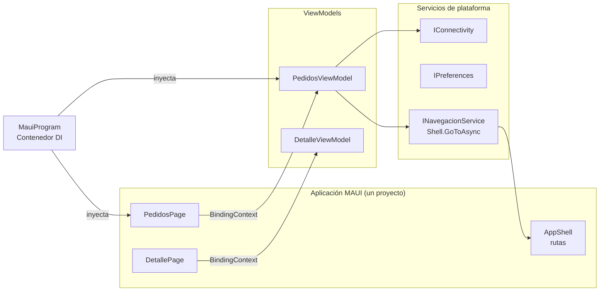

# .NET MAUI y MVVM

.NET MAUI (Multi-platform App UI) permite construir aplicaciones nativas para Windows, Android, iOS y macOS con una sola base de código en C# y XAML. MVVM es el patrón recomendado por su integración con el binding, Shell y la inyección de dependencias.

Este documento cubre cómo implementar MVVM en MAUI. La base compartida con WPF y WinUI está en [MVVM en .NET](mvvm-dotnet.md). El concepto está en [MVVM (concepto)](../../../architecture/estilos-y-patrones/mvvm.md). Las notas generales de MAUI están en [.NET MAUI](.NET_MAUI.md). Los criterios de elección están en [Smart Client con tecnologías Microsoft](../../../architecture/estilos-y-patrones/smart-client-microsoft.md).

## Cuándo elegir .NET MAUI

- Una aplicación que debe existir en Windows y en móvil con lógica compartida.
- Equipos .NET que quieren reutilizar ViewModels, servicios y pruebas entre plataformas.
- Aplicaciones donde se aceptan diferencias de experiencia por plataforma, resueltas con código específico.

Valida las plataformas y versiones soportadas de la versión de MAUI que uses. Una interfaz idéntica en todas las plataformas no se debe dar por supuesta.

## MVVM en MAUI

| Concepto | Elemento de MAUI |
|---|---|
| View | `ContentPage`, `ContentView` (XAML) |
| ViewModel | Clase C# con `INotifyPropertyChanged` |
| Enlace | `{Binding}`, compilable con `x:DataType` |
| Contexto de datos | `BindingContext` |
| Comandos | `ICommand` en propiedades `Command` |
| Navegación | `Shell` (rutas) o `NavigationPage` |
| Parámetros de navegación | `IQueryAttributable` o `[QueryProperty]` |
| Hilo de UI | `MainThread` |
| Servicios de plataforma | Interfaces como `IConnectivity`, `IPreferences`, `IFileSystem` y `IGeolocation`, o propias |



## Configuración inicial

1. Crea un proyecto .NET MAUI y agrega `CommunityToolkit.Mvvm` y, si lo necesitas, `CommunityToolkit.Maui`.
2. Registra servicios, ViewModels y páginas en `MauiProgram`.
3. Las páginas reciben su ViewModel por constructor. MAUI las crea con el contenedor cuando se navega con `Shell` y se resuelven por tipo.

```csharp
public static class MauiProgram
{
    public static MauiApp CreateMauiApp()
    {
        var builder = MauiApp.CreateBuilder();
        builder
            .UseMauiApp<App>()
            .UseMauiCommunityToolkit(); // opcional: CommunityToolkit.Maui

        // Servicios de plataforma
        builder.Services.AddSingleton(Connectivity.Current);
        builder.Services.AddSingleton(Preferences.Default);

        // Servicios de la aplicación
        builder.Services.AddSingleton<IServicioPedidos, ServicioPedidos>();
        builder.Services.AddSingleton<INavegacionService, NavegacionService>();
        builder.Services.AddSingleton<IDialogoService, DialogoService>();

        // ViewModels y páginas
        builder.Services.AddTransient<PedidosViewModel>();
        builder.Services.AddTransient<PedidosPage>();
        builder.Services.AddTransient<DetalleViewModel>();
        builder.Services.AddTransient<DetallePage>();

        return builder.Build();
    }
}
```

Registro de rutas de páginas secundarias:

```csharp
public partial class AppShell : Shell
{
    public AppShell()
    {
        InitializeComponent();
        Routing.RegisterRoute(nameof(DetallePage), typeof(DetallePage));
    }
}
```

## Implementación paso a paso

### 1. ViewModel

Ver el ejemplo de `PedidosViewModel` en [MVVM en .NET](mvvm-dotnet.md#con-communitytoolkitmvvm). Es el mismo código que en WPF y WinUI.

### 2. Page

```csharp
public partial class PedidosPage : ContentPage
{
    public PedidosPage(PedidosViewModel viewModel)
    {
        InitializeComponent();
        BindingContext = viewModel;
    }
}
```

```xml
<ContentPage xmlns="http://schemas.microsoft.com/dotnet/2021/maui"
             xmlns:x="http://schemas.microsoft.com/winfx/2009/xaml"
             xmlns:vm="clr-namespace:MiApp.ViewModels"
             xmlns:model="clr-namespace:MiApp.Core.Models"
             x:Class="MiApp.Views.PedidosPage"
             x:DataType="vm:PedidosViewModel"
             Title="Pedidos">

    <Grid RowDefinitions="Auto,*,Auto" Padding="12" RowSpacing="8">

        <Button Text="Cancelar pedido" Command="{Binding CancelarCommand}" />

        <RefreshView Grid.Row="1"
                     IsRefreshing="{Binding EstaCargando}"
                     Command="{Binding CargarCommand}">
            <CollectionView ItemsSource="{Binding Pedidos}"
                            SelectionMode="Single"
                            SelectedItem="{Binding PedidoSeleccionado}">
                <CollectionView.ItemTemplate>
                    <DataTemplate x:DataType="model:PedidoDto">
                        <VerticalStackLayout Padding="8">
                            <Label Text="{Binding Cliente}" FontAttributes="Bold" />
                            <Label Text="{Binding Total, StringFormat='{0:C}'}" />
                        </VerticalStackLayout>
                    </DataTemplate>
                </CollectionView.ItemTemplate>
            </CollectionView>
        </RefreshView>

        <Label Grid.Row="2" Text="{Binding MensajeError}" TextColor="Red" />
    </Grid>
</ContentPage>
```

`x:DataType` activa los *bindings compilados*. Detectan nombres incorrectos al compilar y reducen el costo en ejecución. Declara `x:DataType` en la página y en cada `DataTemplate`.

### 3. Cargar datos al abrir la página

La forma más simple es un comportamiento de `CommunityToolkit.Maui` que enlaza el evento a un comando.

```xml
<!-- Requiere xmlns:toolkit="http://schemas.microsoft.com/dotnet/2022/maui/toolkit" -->
<ContentPage.Behaviors>
    <toolkit:EventToCommandBehavior EventName="Appearing"
                                    Command="{Binding CargarCommand}" />
</ContentPage.Behaviors>
```

Si no usas el toolkit, sobrescribe `OnAppearing` en la página e invoca el comando. Es la única lógica aceptable en el código detrás de la página.

## Escenarios detallados

### Escenario 1: lista con refresco y selección

Cubierto por el ejemplo anterior. Puntos a revisar:

- `RefreshView` actualiza `IsRefreshing` en dos vías. El ViewModel debe terminar siempre en `EstaCargando = false` (bloque `finally`), porque de lo contrario el indicador queda activo.
- `CollectionView` es el control recomendado para listas. Soporta virtualización y plantillas por tipo.
- Con `SelectionMode="Single"`, usa `SelectedItem` o `SelectionChangedCommand`. Para navegar al seleccionar, limpia la selección después para que el usuario pueda tocar el mismo elemento otra vez.

### Escenario 2: navegación con Shell y parámetros

```csharp
public class NavegacionService : INavegacionService
{
    public Task IrAAsync<TViewModel>(object? parametro = null) where TViewModel : class
    {
        var ruta = typeof(TViewModel).Name.Replace("ViewModel", "Page");
        var parametros = new Dictionary<string, object>();
        if (parametro is not null)
            parametros["Parametro"] = parametro;

        return Shell.Current.GoToAsync(ruta, parametros);
    }

    public Task VolverAsync() => Shell.Current.GoToAsync("..");
}
```

Este servicio asume la convención `DetalleViewModel` con `DetallePage` y la ruta registrada con `nameof(DetallePage)`. Si no quieres depender de nombres, usa un diccionario de ViewModel a ruta.

El ViewModel de destino recibe el parámetro:

```csharp
public partial class DetalleViewModel : ObservableObject, IQueryAttributable
{
    [ObservableProperty]
    private PedidoDto? _pedido;

    public void ApplyQueryAttributes(IDictionary<string, object> query)
    {
        if (query.TryGetValue("Parametro", out var valor) && valor is PedidoDto pedido)
            Pedido = pedido;
    }
}
```

Para objetos complejos, el parámetro se pasa por referencia y no se serializa. Para identificadores, pasa solo el `id` y carga los datos en el destino. Esto evita mostrar datos desactualizados.

### Escenario 3: formulario con validación

`ObservableValidator` funciona igual que en WPF (ver [WPF y MVVM](wpf-mvvm.md#escenario-3-formulario-con-validación)). MAUI no muestra errores de `INotifyDataErrorInfo` por sí mismo. Expón el mensaje y enlázalo a una etiqueta:

```csharp
public partial class ClienteViewModel : ObservableValidator
{
    [ObservableProperty]
    [NotifyDataErrorInfo]
    [NotifyPropertyChangedFor(nameof(ErrorNombre))]
    [Required(ErrorMessage = "El nombre es obligatorio")]
    private string _nombre = "";

    public string? ErrorNombre => GetErrors(nameof(Nombre)).FirstOrDefault()?.ErrorMessage;
}
```

```xml
<Entry Text="{Binding Nombre}" Placeholder="Nombre" />
<Label Text="{Binding ErrorNombre}" TextColor="Red"
       IsVisible="{Binding ErrorNombre, Converter={StaticResource EsNoVacio}}" />
```

`EsNoVacio` es un `IsStringNotNullOrEmptyConverter` de `CommunityToolkit.Maui`, declarado en los recursos de la página. Ese paquete también incluye comportamientos de validación que pueden simplificar este caso. Valida siempre en el servidor o en el servicio, porque la validación del cliente no es una garantía.

### Escenario 4: aplicación con conectividad variable (offline)

Se inyecta `IConnectivity` y se expone el estado a la pantalla.

```csharp
public partial class PedidosViewModel : ObservableObject
{
    private readonly IServicioPedidos _servicio;
    private readonly IConnectivity _conectividad;

    public PedidosViewModel(IServicioPedidos servicio, IConnectivity conectividad)
    {
        _servicio = servicio;
        _conectividad = conectividad;
        _conectividad.ConnectivityChanged += AlCambiarConectividad;
        HayConexion = _conectividad.NetworkAccess == NetworkAccess.Internet;
    }

    [ObservableProperty]
    private bool _hayConexion;

    private void AlCambiarConectividad(object? sender, ConnectivityChangedEventArgs e)
        => MainThread.BeginInvokeOnMainThread(() =>
            HayConexion = e.NetworkAccess == NetworkAccess.Internet);
}
```

El evento de un servicio singleton mantiene vivo al ViewModel mientras no se libere la suscripción. Cancela la suscripción cuando la página desaparece (`Disappearing`) o implementa `IDisposable` y libéralo al salir. La estrategia de datos offline y sincronización está en [Smart Client con tecnologías Microsoft](../../../architecture/estilos-y-patrones/smart-client-microsoft.md).

### Escenario 5: diálogos y alertas

```csharp
public class DialogoService : IDialogoService
{
    public Task<bool> ConfirmarAsync(string titulo, string mensaje)
        => Shell.Current.DisplayAlert(titulo, mensaje, "Aceptar", "Cancelar");

    public Task AvisarAsync(string titulo, string mensaje)
        => Shell.Current.DisplayAlert(titulo, mensaje, "Cerrar");
}
```

Las alertas aparecen sobre la página actual. Para ventanas más complejas, usa un popup del toolkit o una página modal con su ViewModel.

### Escenario 6: actualizar la UI desde otros hilos

```csharp
await MainThread.InvokeOnMainThreadAsync(() => Pedidos.Add(nuevo));
```

Después de un `await` en un comando invocado desde la UI, el código continúa en el hilo de UI. No hace falta `MainThread` en ese caso. Para mantener el ViewModel libre de dependencias de plataforma, encapsula la llamada en `IHiloUiService`.

### Escenario 7: comportamiento específico por plataforma

Si una función solo existe en una plataforma, define una interfaz en el proyecto de ViewModels y regístrala según la plataforma.

```csharp
#if ANDROID
builder.Services.AddSingleton<INotificacionService, NotificacionAndroidService>();
#elif IOS || MACCATALYST
builder.Services.AddSingleton<INotificacionService, NotificacionAppleService>();
#elif WINDOWS
builder.Services.AddSingleton<INotificacionService, NotificacionWindowsService>();
#endif
```

El ViewModel usa `INotificacionService` y no conoce la plataforma.

## Buenas prácticas

- **`x:DataType` en páginas y plantillas.** Activa los bindings compilados y detecta errores al compilar.
- **Páginas y ViewModels `Transient`.** Cada apertura empieza con estado limpio.
- **Evita `Singleton` para páginas** que se muestren varias veces.
- **Servicios de plataforma por interfaz.** MAUI ofrece interfaces inyectables para conectividad, preferencias, archivos y geolocalización. Úsalas en vez de las clases estáticas.
- **Permisos fuera del ViewModel.** Encapsula la solicitud de permisos en un servicio. Cada plataforma exige declaraciones en su manifiesto.
- **Controles adaptables.** Usa `OnPlatform` y `OnIdiom` para ajustes de interfaz. Evita bifurcar el ViewModel.
- **Comandos asíncronos con control de reentrada.** `AsyncRelayCommand` impide ejecuciones simultáneas por defecto. No lo desactives sin motivo.
- **Rutas de Shell centralizadas.** Mantén un solo lugar donde se registran y nombran.
- **Pruebas en dispositivos reales.** Verifica rendimiento y ciclo de vida en cada plataforma objetivo, no solo en el emulador.
- **Recursos y estilos compartidos.** `ResourceDictionary` para colores, fuentes y estilos.
- **Prueba la rotación y el cambio de tamaño** si la aplicación se ejecuta en escritorio y tablet.

## Errores comunes

- **Olvidar registrar la página o el ViewModel en el contenedor.** La navegación falla al construir la página.
- **Olvidar registrar la ruta** de una página secundaria. `GoToAsync` lanza una excepción.
- **Sin `x:DataType`.** Los errores de binding aparecen solo en la salida de depuración.
- **Instanciar páginas con `new`.** No se inyecta el ViewModel.
- **Tareas largas en el hilo de UI.** La interfaz se congela. Delega a servicios asíncronos.
- **Modificar colecciones o propiedades desde otro hilo** sin pasar por `MainThread`.
- **`CollectionView` dentro de `ScrollView` o de `StackLayout` sin altura.** Pierde la virtualización y rinde mal.
- **Suscripciones sin liberar** a eventos de servicios singleton (conectividad, mensajería, temporizadores).
- **ViewModels con `Shell.Current` o `Application.Current` directos.** Rompe el desacoplamiento y las pruebas. Usa servicios.
- **Pasar objetos pesados entre páginas** y asumir que se mantienen vigentes.
- **Suponer que todo funciona igual en todas las plataformas.** Hay diferencias de ciclo de vida, permisos y controles.
- **Ignorar el ciclo de vida de la aplicación.** En móvil, el sistema puede suspender o cerrar la aplicación. Guarda el estado crítico.

## Pruebas

- **ViewModels:** pruebas unitarias en un proyecto sin referencias de MAUI. Ver [MVVM en .NET](mvvm-dotnet.md#pruebas-de-viewmodels). Si el ViewModel depende de `IConnectivity` u otras interfaces, sustitúyelas por falsos.
- **Servicios de plataforma:** pruebas en dispositivo o emulador.
- **Páginas y navegación:** pruebas de UI automatizadas (Appium u otras) para flujos críticos.
- **Compatibilidad:** repite los flujos críticos en cada plataforma objetivo.

## Referencias

- [Documentación de .NET MAUI](https://learn.microsoft.com/en-us/dotnet/maui/)
- [Plataformas soportadas por .NET MAUI](https://learn.microsoft.com/en-us/dotnet/maui/supported-platforms)
- [Enlace de datos en .NET MAUI](https://learn.microsoft.com/en-us/dotnet/maui/fundamentals/data-binding/)
- [Navegación con Shell](https://learn.microsoft.com/en-us/dotnet/maui/fundamentals/shell/navigation)
- [CommunityToolkit.Mvvm](https://learn.microsoft.com/en-us/dotnet/communitytoolkit/mvvm/)
- [.NET MAUI Community Toolkit](https://learn.microsoft.com/en-us/dotnet/communitytoolkit/maui/)
- [.NET MAUI](.NET_MAUI.md)
- [MVVM en .NET](mvvm-dotnet.md)
- [MVVM (concepto)](../../../architecture/estilos-y-patrones/mvvm.md)
