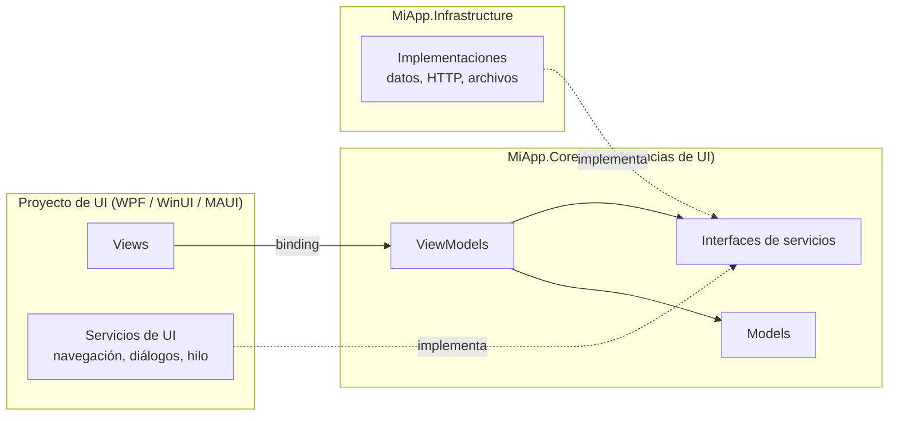

# MVVM en .NET: base común

Este documento reúne lo que comparten WPF, WinUI 3 y .NET MAUI al implementar MVVM. Los documentos por tecnología solo describen sus diferencias y escenarios:

- [WPF y MVVM](wpf-mvvm.md)
- [WinUI 3 y MVVM](winui-mvvm.md)
- [.NET MAUI y MVVM](maui-mvvm.md)

El concepto, las variantes y la comparación con otros patrones están en [MVVM (concepto)](../../../architecture/estilos-y-patrones/mvvm.md). La selección de tecnología de interfaz está en [Smart Client con tecnologías Microsoft](../../../architecture/estilos-y-patrones/smart-client-microsoft.md).

## Mapeo del patrón a .NET

| Concepto MVVM | Mecanismo en .NET |
|---|---|
| Notificación de cambios | `INotifyPropertyChanged` |
| Colecciones observables | `ObservableCollection<T>` (`INotifyCollectionChanged`) |
| Comandos | `ICommand` (`RelayCommand`, `AsyncRelayCommand`) |
| Validación | `INotifyDataErrorInfo` (`ObservableValidator`) |
| Enlace de datos | `Binding` (y `x:Bind` en WinUI) |
| Contexto de datos | `DataContext` (WPF, WinUI) o `BindingContext` (MAUI) |
| Mensajería entre ViewModels | `WeakReferenceMessenger` |
| Creación de ViewModels | Inyección de dependencias (`Microsoft.Extensions.DependencyInjection`) |

## Diferencias entre tecnologías

| Aspecto | WPF | WinUI 3 | .NET MAUI |
|---|---|---|---|
| Contexto de datos | `DataContext` | `DataContext` y propiedad tipada en la página (`x:Bind`) | `BindingContext` |
| Binding por defecto | `Binding`, resuelto en ejecución | `Binding` en ejecución o `x:Bind` compilado | `Binding`; se puede compilar con `x:DataType` |
| Modo por defecto de `x:Bind` | No aplica | `OneTime` | No aplica |
| Acceso al hilo de UI | `Dispatcher` | `DispatcherQueue` | `MainThread` |
| Navegación | Propia (`ContentControl` con `DataTemplate`, `Frame`) | `Frame` y `NavigationView` | `Shell` o `NavigationPage` |
| Plataformas | Windows | Windows 10 y 11 | Windows, Android, iOS y macOS |

## Biblioteca recomendada para empezar

**CommunityToolkit.Mvvm** (paquete NuGet) es ligera, no impone un framework y funciona igual en las tres tecnologías. Incluye:

- `ObservableObject`: implementa `INotifyPropertyChanged`.
- `[ObservableProperty]`: genera la propiedad a partir de un campo.
- `[RelayCommand]`: genera el comando a partir de un método, con soporte asíncrono.
- `ObservableValidator`: validación con anotaciones de datos.
- `WeakReferenceMessenger`: mensajería sin referencias fuertes.

| Alternativa | Cuándo considerarla |
|---|---|
| **ReactiveUI** | Estado basado en flujos reactivos y mucha lógica asíncrona derivada. |
| **Prism** | Aplicaciones modulares grandes con navegación y regiones. |
| **Caliburn.Micro** | Convenciones sobre configuración. Proyectos existentes. |

## Estructura de proyecto recomendada

```text
MiApp.sln
├── MiApp.Core            (sin dependencias de UI)
│   ├── Models/
│   ├── Services/         (interfaces y reglas de negocio)
│   └── ViewModels/       (opcional: si se comparten entre tecnologías)
├── MiApp.Infrastructure  (acceso a datos, HTTP, almacenamiento)
├── MiApp.Wpf | MiApp.WinUI | MiApp.Maui
│   ├── Views/
│   ├── Services/         (navegación, diálogos, hilo de UI)
│   └── App / MauiProgram (registro de dependencias)
└── MiApp.Tests
```

Si los ViewModels viven en un proyecto sin referencias de UI (por ejemplo, `net8.0` o posterior), el compilador impide que dependan de controles. Es la forma más simple de proteger el desacoplamiento.



## Implementación básica de un ViewModel

### Sin bibliotecas

```csharp
public class PersonaViewModel : INotifyPropertyChanged
{
    private string _nombre = "";

    public string Nombre
    {
        get => _nombre;
        set
        {
            if (_nombre == value) return;
            _nombre = value;
            OnPropertyChanged();
        }
    }

    public event PropertyChangedEventHandler? PropertyChanged;

    protected void OnPropertyChanged([CallerMemberName] string? propiedad = null)
        => PropertyChanged?.Invoke(this, new PropertyChangedEventArgs(propiedad));
}
```

### Con CommunityToolkit.Mvvm

Los ejemplos de este documento usan estas definiciones de servicio y modelo:

```csharp
public class PedidoDto
{
    public int Id { get; set; }
    public string Cliente { get; set; } = "";
    public decimal Total { get; set; }
}

public interface IServicioPedidos
{
    Task<IReadOnlyList<PedidoDto>> ListarAsync(CancellationToken ct);
    Task CancelarAsync(int id);
}
```

```csharp
public partial class PedidosViewModel : ObservableObject
{
    private readonly IServicioPedidos _servicio;

    public PedidosViewModel(IServicioPedidos servicio) => _servicio = servicio;

    public ObservableCollection<PedidoDto> Pedidos { get; } = new();

    [ObservableProperty]
    [NotifyCanExecuteChangedFor(nameof(CancelarCommand))]
    private PedidoDto? _pedidoSeleccionado;

    [ObservableProperty]
    private bool _estaCargando;

    [ObservableProperty]
    private string? _mensajeError;

    [RelayCommand]
    private async Task CargarAsync(CancellationToken ct)
    {
        EstaCargando = true;
        MensajeError = null;
        try
        {
            var datos = await _servicio.ListarAsync(ct);
            Pedidos.Clear();
            foreach (var pedido in datos)
                Pedidos.Add(pedido);
        }
        catch (OperationCanceledException)
        {
            // Operación cancelada: no es un error para el usuario.
        }
        catch (Exception ex)
        {
            MensajeError = ex.Message;
        }
        finally
        {
            EstaCargando = false;
        }
    }

    private bool PuedeCancelar() => PedidoSeleccionado is not null;

    [RelayCommand(CanExecute = nameof(PuedeCancelar))]
    private async Task CancelarAsync()
    {
        if (PedidoSeleccionado is null) return;
        await _servicio.CancelarAsync(PedidoSeleccionado.Id);
        await CargarCommand.ExecuteAsync(null);
    }
}
```

El generador produce `Nombre`, `EstaCargando`, `CargarCommand` (sin el sufijo `Async`) y `CancelarCommand`. La clase debe ser `partial`.

## Servicios de apoyo comunes

Cada servicio se define como interfaz en el proyecto de ViewModels y se implementa en el proyecto de UI.

```csharp
public interface INavegacionService
{
    Task IrAAsync<TViewModel>(object? parametro = null) where TViewModel : class;
    Task VolverAsync();
}

public interface IDialogoService
{
    Task<bool> ConfirmarAsync(string titulo, string mensaje);
    Task AvisarAsync(string titulo, string mensaje);
}

public interface IHiloUiService
{
    Task EjecutarAsync(Action accion);
}
```

## Registro de dependencias

Todas las tecnologías usan `Microsoft.Extensions.DependencyInjection`. Reglas generales:

| Componente | Vida útil | Motivo |
|---|---|---|
| Servicios sin estado (HTTP, repositorios) | `Singleton` o `Transient` | No guardan estado de pantalla. |
| Servicios de UI (navegación, diálogos) | `Singleton` | Representan la aplicación. |
| ViewModel de pantalla | `Transient` | Cada apertura debe tener estado limpio. |
| ViewModel de shell o principal | `Singleton` | Existe durante toda la sesión. |

## Pruebas de ViewModels

El ViewModel se prueba sin interfaz y con servicios simulados.

```csharp
public class PedidosViewModelTests
{
    private sealed class ServicioFalso : IServicioPedidos
    {
        public List<PedidoDto> Datos { get; } = new();
        public Task<IReadOnlyList<PedidoDto>> ListarAsync(CancellationToken ct)
            => Task.FromResult<IReadOnlyList<PedidoDto>>(Datos);
        public Task CancelarAsync(int id) => Task.CompletedTask;
    }

    [Fact]
    public async Task Cargar_llena_la_lista_y_apaga_el_indicador()
    {
        var servicio = new ServicioFalso();
        servicio.Datos.Add(new PedidoDto { Id = 1 });
        servicio.Datos.Add(new PedidoDto { Id = 2 });
        var vm = new PedidosViewModel(servicio);

        await vm.CargarCommand.ExecuteAsync(null);

        Assert.Equal(2, vm.Pedidos.Count);
        Assert.False(vm.EstaCargando);
    }

    [Fact]
    public void Cancelar_solo_se_habilita_con_un_pedido_seleccionado()
    {
        var vm = new PedidosViewModel(new ServicioFalso());
        Assert.False(vm.CancelarCommand.CanExecute(null));

        vm.PedidoSeleccionado = new PedidoDto { Id = 1 };

        Assert.True(vm.CancelarCommand.CanExecute(null));
    }
}
```

## Buenas prácticas comunes

- **ViewModels en un proyecto sin referencias de UI.** El compilador protege el desacoplamiento.
- **Una propiedad por cada estado visible.** `EstaCargando`, `MensajeError` y `HayResultados` evitan lógica de visibilidad en la View.
- **Comandos asíncronos con `CancellationToken`.** Permiten cancelar y evitan ejecuciones dobles.
- **Actualiza `ObservableCollection` en el hilo de UI.** Modificarla desde otro hilo produce excepciones o fallos intermitentes.
- **Abstrae lo que depende de la plataforma.** Navegación, diálogos, archivos y hilo de UI van detrás de interfaces.
- **Usa DTOs o modelos de vista.** No enlaces entidades de persistencia directamente a la pantalla.
- **Convención de nombres.** `PedidosView` con `PedidosViewModel`.
- **Libera suscripciones.** Cancela eventos y mensajes cuando la pantalla se cierra.
- **Reemplaza la colección solo si es necesario.** Si cambias la referencia de una colección, notifica la propiedad. Si la modificas, usa `Clear` y `Add` sobre la misma instancia.

## Errores comunes

- **Olvidar `partial` en la clase** al usar generadores de código.
- **Acceder a controles desde el ViewModel.** Rompe el patrón y las pruebas.
- **Hacer `async void` en métodos propios.** Las excepciones no se pueden capturar. Usa `async Task` o `[RelayCommand]`.
- **Bloquear el hilo de UI** con `.Result` o `.Wait()` sobre tareas asíncronas.
- **Fugas de memoria** por eventos estáticos, mensajes con referencias fuertes o ViewModels singleton que referencian pantallas.
- **Usar `Singleton` para ViewModels de pantalla.** El estado de una visita persiste en la siguiente.
- **Disparar `PropertyChanged` con un nombre incorrecto.** El binding falla sin error visible. Usa `[CallerMemberName]` o `nameof`.
- **Ignorar las advertencias de binding** del panel de salida de depuración.
- **Lógica de negocio en el ViewModel.** Debe estar en servicios o en el Model.

## Referencias

- [CommunityToolkit.Mvvm](https://learn.microsoft.com/en-us/dotnet/communitytoolkit/mvvm/)
- [MVVM (concepto)](../../../architecture/estilos-y-patrones/mvvm.md)
- [Smart Client con tecnologías Microsoft](../../../architecture/estilos-y-patrones/smart-client-microsoft.md)
