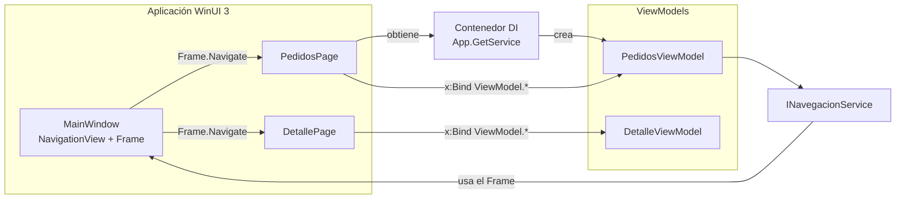

# WinUI 3 y MVVM

WinUI 3 es la biblioteca de interfaz nativa de Windows incluida en Windows App SDK. Usa XAML, igual que WPF, pero con controles modernos de Windows 10 y 11 y un motor de binding adicional compilado (`x:Bind`).

Este documento cubre cómo implementar MVVM en WinUI 3. La base compartida con WPF y MAUI está en [MVVM en .NET](mvvm-dotnet.md). El concepto está en [MVVM (concepto)](../../../architecture/estilos-y-patrones/mvvm.md). Los criterios de elección y de distribución están en [Smart Client con tecnologías Microsoft](../../../architecture/estilos-y-patrones/smart-client-microsoft.md).

## Cuándo elegir WinUI 3

- Aplicaciones nuevas solo para Windows 10 y 11 con apariencia y comportamiento actuales.
- Integración con funciones recientes de Windows (notificaciones, widgets, ciclo de vida de aplicaciones empaquetadas).
- Equipos que parten de XAML y quieren una base moderna.

Antes de decidir, revisa la disponibilidad de controles de terceros que necesites. Su ecosistema es menor que el de WPF. WinUI 3 no es multiplataforma.

## MVVM en WinUI 3

| Concepto | Elemento de WinUI 3 |
|---|---|
| View | `Page`, `UserControl` (XAML) |
| ViewModel | Clase C# con `INotifyPropertyChanged` |
| Enlace | `{x:Bind}` (compilado) o `{Binding}` (en ejecución) |
| Contexto de datos | Propiedad `ViewModel` de la página (`x:Bind`) o `DataContext` (`Binding`) |
| Comandos | `ICommand` en la propiedad `Command` |
| Navegación | `Frame` y `NavigationView` |
| Hilo de UI | `DispatcherQueue` |

### Diferencias importantes con WPF

| Aspecto | WPF | WinUI 3 |
|---|---|---|
| Binding preferido | `{Binding}` | `{x:Bind}` |
| Origen de `x:Bind` | No existe | La propia clase de la página, no el `DataContext` |
| Modo por defecto de `x:Bind` | No aplica | `OneTime`. Para ver cambios hay que indicar `Mode=OneWay` o `TwoWay`. |
| Verificación de bindings | En ejecución | En compilación |
| `Window` y `DataContext` | `Window` tiene `DataContext` | `Window` no es un elemento visual y no tiene `DataContext`. Se asigna a su contenido. |
| Selección de View por tipo | `DataTemplate` con `DataType` | Se usa navegación por `Frame` o un selector propio |
| Hilo de UI | `Dispatcher` | `DispatcherQueue` |
| Bool a visibilidad | `BooleanToVisibilityConverter` | `x:Bind` convierte `bool` a `Visibility` sin convertidor |
| Creación de páginas con DI | Por contenedor | `Frame` crea la página con un constructor sin parámetros |



## Configuración inicial

1. Crea un proyecto *Blank App, Packaged (WinUI 3 in Desktop)* y agrega `CommunityToolkit.Mvvm` y `Microsoft.Extensions.Hosting`.
2. Configura el contenedor en `App.xaml.cs` y expón un acceso estático para resolver servicios.
3. Cada página obtiene su ViewModel del contenedor.

`Frame` crea las páginas con un constructor sin parámetros. Por eso las páginas no reciben el ViewModel por constructor y lo obtienen del contenedor con un localizador.

```csharp
public partial class App : Application
{
    private static readonly IHost _host = Host.CreateDefaultBuilder()
        .ConfigureServices(servicios =>
        {
            servicios.AddSingleton<IServicioPedidos, ServicioPedidos>();
            servicios.AddSingleton<INavegacionService, NavegacionService>();
            servicios.AddSingleton<IDialogoService, DialogoService>();
            servicios.AddSingleton<IHiloUiService, HiloUiService>();

            servicios.AddTransient<PedidosViewModel>();
            servicios.AddTransient<DetalleViewModel>();
        })
        .Build();

    public static MainWindow? VentanaPrincipal { get; private set; }

    public static T GetService<T>() where T : class
        => _host.Services.GetRequiredService<T>();

    public App() => InitializeComponent();

    protected override void OnLaunched(LaunchActivatedEventArgs args)
    {
        VentanaPrincipal = new MainWindow();
        VentanaPrincipal.Activate();
    }
}
```

`HiloUiService` captura la cola del hilo de UI al crearse. Se debe resolver por primera vez desde el hilo de UI (por ejemplo, dentro de `MainWindow`).

## Implementación paso a paso

### 1. ViewModel

Ver el ejemplo de `PedidosViewModel` en [MVVM en .NET](mvvm-dotnet.md#con-communitytoolkitmvvm). No cambia entre tecnologías.

### 2. Page

La página expone el ViewModel como propiedad pública, que es el origen de `x:Bind`.

```csharp
public sealed partial class PedidosPage : Page
{
    public PedidosViewModel ViewModel { get; }

    public PedidosPage()
    {
        ViewModel = App.GetService<PedidosViewModel>();
        InitializeComponent();
        Loaded += async (_, _) => await ViewModel.CargarCommand.ExecuteAsync(null);
    }
}
```

```xml
<Page x:Class="MiApp.Views.PedidosPage"
      xmlns="http://schemas.microsoft.com/winfx/2006/xaml/presentation"
      xmlns:x="http://schemas.microsoft.com/winfx/2006/xaml"
      xmlns:models="using:MiApp.Core.Models">

    <Grid Padding="12" RowSpacing="8">
        <Grid.RowDefinitions>
            <RowDefinition Height="Auto" />
            <RowDefinition Height="*" />
            <RowDefinition Height="Auto" />
        </Grid.RowDefinitions>

        <StackPanel Orientation="Horizontal" Spacing="8">
            <Button Content="Actualizar" Command="{x:Bind ViewModel.CargarCommand}" />
            <Button Content="Cancelar pedido" Command="{x:Bind ViewModel.CancelarCommand}" />
        </StackPanel>

        <ListView Grid.Row="1"
                  ItemsSource="{x:Bind ViewModel.Pedidos}"
                  SelectedItem="{x:Bind ViewModel.PedidoSeleccionado, Mode=TwoWay}">
            <ListView.ItemTemplate>
                <DataTemplate x:DataType="models:PedidoDto">
                    <StackPanel Padding="4">
                        <TextBlock Text="{x:Bind Cliente}" />
                        <TextBlock Text="{x:Bind Total}" Opacity="0.7" />
                    </StackPanel>
                </DataTemplate>
            </ListView.ItemTemplate>
        </ListView>

        <StackPanel Grid.Row="2" Spacing="4">
            <ProgressRing IsActive="{x:Bind ViewModel.EstaCargando, Mode=OneWay}" />
            <TextBlock Text="{x:Bind ViewModel.MensajeError, Mode=OneWay}"
                       Foreground="Firebrick" />
        </StackPanel>
    </Grid>
</Page>
```

Puntos clave:
- `Command` y `ItemsSource` usan el modo por defecto (`OneTime`) porque la instancia no cambia. La colección notifica sus propios cambios.
- Las propiedades que cambian (`EstaCargando`, `MensajeError`, `PedidoSeleccionado`) requieren `OneWay` o `TwoWay`.
- Dentro de un `DataTemplate`, `x:Bind` exige `x:DataType`.
- Los errores de nombres se detectan al compilar.

## Escenarios detallados

### Escenario 1: lista con carga asíncrona

Cubierto por el ejemplo anterior. Para cargar al abrir la página, el evento `Loaded` invoca el comando. Esta es la única línea de código detrás de la página. Como alternativa, usa `Microsoft.Xaml.Interactivity` (Behaviors SDK) para enlazar el evento a un comando.

### Escenario 2: navegación con `NavigationView` y `Frame`

El servicio de navegación asocia ViewModels con páginas y usa el `Frame` de la ventana.

```csharp
public class NavegacionService : INavegacionService
{
    private readonly Dictionary<Type, Type> _paginas = new()
    {
        [typeof(PedidosViewModel)] = typeof(PedidosPage),
        [typeof(DetalleViewModel)] = typeof(DetallePage),
    };

    public Frame? Frame { get; set; }

    public Task IrAAsync<TViewModel>(object? parametro = null) where TViewModel : class
    {
        if (Frame is null)
            throw new InvalidOperationException("El Frame no está configurado.");

        Frame.Navigate(_paginas[typeof(TViewModel)], parametro);
        return Task.CompletedTask;
    }

    public Task VolverAsync()
    {
        if (Frame?.CanGoBack == true)
            Frame.GoBack();
        return Task.CompletedTask;
    }
}
```

La ventana principal asigna el `Frame` al servicio:

```csharp
public sealed partial class MainWindow : Window
{
    public MainWindow()
    {
        InitializeComponent();
        var navegacion = (NavegacionService)App.GetService<INavegacionService>();
        navegacion.Frame = ContenidoFrame;
        navegacion.IrAAsync<PedidosViewModel>();
    }
}
```

La página de destino recibe el parámetro y lo pasa al ViewModel:

```csharp
protected override void OnNavigatedTo(NavigationEventArgs e)
{
    base.OnNavigatedTo(e);
    if (e.Parameter is int id)
        ViewModel.Inicializar(id);
}
```

Por defecto, `Frame` crea una página nueva en cada navegación. Si activas `NavigationCacheMode`, la página y su ViewModel se conservan y deben limpiarse o actualizarse al volver.

### Escenario 3: diálogos de confirmación

`ContentDialog` exige un `XamlRoot`. El ViewModel no lo conoce: lo guarda el servicio de diálogos, y la ventana principal se lo asigna al cargar.

```csharp
public class DialogoService : IDialogoService
{
    public XamlRoot? XamlRoot { get; set; }

    public async Task<bool> ConfirmarAsync(string titulo, string mensaje)
    {
        var dialogo = new ContentDialog
        {
            Title = titulo,
            Content = mensaje,
            PrimaryButtonText = "Aceptar",
            CloseButtonText = "Cancelar",
            DefaultButton = ContentDialogButton.Primary,
            XamlRoot = XamlRoot
        };
        return await dialogo.ShowAsync() == ContentDialogResult.Primary;
    }

    public async Task AvisarAsync(string titulo, string mensaje)
    {
        var dialogo = new ContentDialog
        {
            Title = titulo,
            Content = mensaje,
            CloseButtonText = "Cerrar",
            XamlRoot = XamlRoot
        };
        await dialogo.ShowAsync();
    }
}
```

```csharp
// En MainWindow, cuando el contenido esté cargado:
((FrameworkElement)Content).Loaded += (_, _) =>
    ((DialogoService)App.GetService<IDialogoService>()).XamlRoot = ((FrameworkElement)Content).XamlRoot;
```

Solo puede haber un `ContentDialog` abierto a la vez por `XamlRoot`. Si dos operaciones lo piden a la vez, serialízalas.

### Escenario 4: actualizar datos desde otros hilos

En WinUI 3 no existe un equivalente a `BindingOperations.EnableCollectionSynchronization`. Toda modificación de la colección debe ocurrir en el hilo de UI.

```csharp
public class HiloUiService : IHiloUiService
{
    private readonly DispatcherQueue _cola = DispatcherQueue.GetForCurrentThread();

    public Task EjecutarAsync(Action accion)
    {
        if (_cola.HasThreadAccess)
        {
            accion();
            return Task.CompletedTask;
        }

        var tcs = new TaskCompletionSource();
        var encolado = _cola.TryEnqueue(() =>
        {
            try { accion(); tcs.SetResult(); }
            catch (Exception ex) { tcs.SetException(ex); }
        });

        if (!encolado)
            tcs.SetException(new InvalidOperationException("No se pudo encolar en el hilo de UI."));

        return tcs.Task;
    }
}
```

Uso en el ViewModel:

```csharp
await _hiloUi.EjecutarAsync(() => Pedidos.Add(nuevo));
```

### Escenario 5: formulario con validación

`ObservableValidator` funciona igual que en WPF (ver [WPF y MVVM](wpf-mvvm.md#escenario-3-formulario-con-validación)). WinUI 3 no tiene una plantilla de errores equivalente a `Validation.ErrorTemplate` de WPF, y el soporte de `INotifyDataErrorInfo` en los controles ha variado entre versiones. Verifica el comportamiento con tu versión de Windows App SDK. Para no depender de ello, expón los mensajes como propiedades y muéstralos de forma explícita:

```csharp
public string? ErrorNombre => GetErrors(nameof(Nombre)).FirstOrDefault()?.ErrorMessage;
```

```xml
<TextBox Text="{x:Bind ViewModel.Nombre, Mode=TwoWay, UpdateSourceTrigger=PropertyChanged}" />
<TextBlock Text="{x:Bind ViewModel.ErrorNombre, Mode=OneWay}" Foreground="Firebrick" />
```

Para que `ErrorNombre` se actualice, notifica su cambio cuando cambie `Nombre` o `ErrorsChanged` (por ejemplo, con `[NotifyPropertyChangedFor(nameof(ErrorNombre))]`).

### Escenario 6: temas, estilos y recursos

Los estilos y plantillas van en `ResourceDictionary` combinados en `App.xaml`. Usa los recursos de tema (`ThemeResource`) para que la aplicación respete el modo claro, oscuro y el contraste alto. Evita colores fijos en las Views.

## Buenas prácticas

- **`x:Bind` por defecto.** Detecta errores al compilar y es más rápido. Usa `Binding` solo cuando necesites un `DataContext` dinámico.
- **Modo explícito.** Indica `OneWay` o `TwoWay` en cada propiedad que cambia. Es el error más frecuente al empezar.
- **ViewModel como propiedad de solo lectura de la página.** `x:Bind` necesita una propiedad pública.
- **ViewModels `Transient` y páginas sin caché.** Las pantallas arrancan limpias. Activa la caché solo cuando haya un motivo.
- **Servicios de UI detrás de interfaces.** Navegación, diálogos e hilo de UI.
- **Archivos y selectores con `WinRT.Interop`.** En aplicaciones de escritorio, algunos selectores requieren asociar el identificador de la ventana. Encapsúlalo en un servicio.
- **`ThemeResource` y recursos del sistema.** Mantiene la apariencia coherente con Windows.
- **Revisa la plantilla.** Template Studio para WinUI genera una estructura con MVVM Toolkit, navegación e inyección de dependencias. Se puede usar como referencia y adaptar.
- **Acceso a APIs de Windows.** Verifica si tu aplicación está empaquetada o no, porque algunas APIs dependen de la identidad de paquete.

## Errores comunes

- **Olvidar `Mode=OneWay`.** La pantalla muestra el primer valor y no cambia.
- **Usar `DataContext` con `x:Bind`.** `x:Bind` no lo usa. El origen es la propia página.
- **Asignar `DataContext` a `Window`.** `Window` no lo tiene. Se asigna a su contenido o se usa `x:Bind`.
- **Inyectar el ViewModel por el constructor de la página.** `Frame` necesita un constructor sin parámetros.
- **Olvidar `x:DataType` en las plantillas.** El proyecto no compila.
- **Modificar colecciones desde otro hilo.** Genera excepciones de acceso entre hilos.
- **`ContentDialog` sin `XamlRoot`.** Lanza una excepción al mostrarse.
- **ViewModels singleton con estado de pantalla.** Conserva datos de visitas anteriores.
- **`async void` propio.** Usa comandos asíncronos.
- **Eventos de ciclo de vida sin liberar.** Suscripciones a servicios singleton mantienen vivas las páginas.
- **Esperar paridad total con WPF.** Algunos controles, plantillas o comportamientos de WPF no existen o difieren.

## Pruebas

- **ViewModels:** pruebas unitarias sin WinUI. Ver [MVVM en .NET](mvvm-dotnet.md#pruebas-de-viewmodels). Conviene que vivan en un proyecto sin referencias de Windows App SDK.
- **Servicios de UI:** pruebas limitadas, por su dependencia del entorno visual.
- **Páginas:** pruebas de UI con herramientas de automatización para flujos críticos.
- **Bindings:** `x:Bind` ya valida nombres y tipos al compilar, lo que reduce las pruebas de enlace.

## Referencias

- [Documentación de WinUI 3](https://learn.microsoft.com/en-us/windows/apps/winui/winui3/)
- [Extensión de marcado x:Bind](https://learn.microsoft.com/en-us/windows/uwp/xaml-platform/x-bind-markup-extension)
- [CommunityToolkit.Mvvm](https://learn.microsoft.com/en-us/dotnet/communitytoolkit/mvvm/)
- [MVVM en .NET](mvvm-dotnet.md)
- [MVVM (concepto)](../../../architecture/estilos-y-patrones/mvvm.md)
- [Smart Client con tecnologías Microsoft](../../../architecture/estilos-y-patrones/smart-client-microsoft.md)
