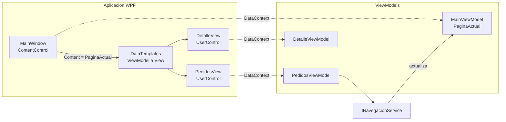

# WPF y MVVM

WPF (Windows Presentation Foundation) es la tecnología de escritorio para Windows basada en XAML con la que nació MVVM. Su motor de binding, las plantillas de datos y los comandos están diseñados para este patrón.

Este documento cubre cómo implementar MVVM en WPF. La base compartida con WinUI y MAUI está en [MVVM en .NET](mvvm-dotnet.md). El concepto está en [MVVM (concepto)](../../../architecture/estilos-y-patrones/mvvm.md). Los criterios para elegir WPF frente a otras tecnologías están en [Smart Client con tecnologías Microsoft](../../../architecture/estilos-y-patrones/smart-client-microsoft.md).

## Cuándo elegir WPF

- Aplicaciones de negocio solo para Windows con interfaces ricas (rejillas, gráficos, formularios complejos).
- Equipos con experiencia en WPF o aplicaciones existentes que se quieren mantener y evolucionar.
- Necesidad de bibliotecas de controles maduras de terceros.

WPF sigue soportado sobre .NET moderno. No es multiplataforma.

## MVVM en WPF

| Concepto | Elemento de WPF |
|---|---|
| View | `Window`, `UserControl`, `Page` (XAML) |
| ViewModel | Clase C# con `INotifyPropertyChanged` |
| Enlace | `{Binding}` contra el `DataContext` |
| Contexto de datos | `DataContext`, heredado por los elementos hijos |
| Comandos | `ICommand` en propiedades `Command` de botones, menús y otros |
| Selección de View por ViewModel | `DataTemplate` con `DataType` |
| Conversión de valores | `IValueConverter` |
| Validación | `INotifyDataErrorInfo` y `Validation.ErrorTemplate` |



## Configuración inicial

1. Crea el proyecto WPF y agrega los paquetes `CommunityToolkit.Mvvm` y `Microsoft.Extensions.Hosting`.
2. Elimina `StartupUri` de `App.xaml`. El arranque lo controla `App.xaml.cs`.
3. Registra los servicios, los ViewModels y las Views en el contenedor.

```csharp
public partial class App : Application
{
    private readonly IHost _host;

    public App()
    {
        _host = Host.CreateDefaultBuilder()
            .ConfigureServices(servicios =>
            {
                servicios.AddSingleton<IServicioPedidos, ServicioPedidos>();
                servicios.AddSingleton<INavegacionService, NavegacionService>();
                servicios.AddSingleton<IDialogoService, DialogoService>();

                servicios.AddSingleton<MainViewModel>();
                servicios.AddTransient<PedidosViewModel>();
                servicios.AddTransient<DetalleViewModel>();

                servicios.AddSingleton<MainWindow>();
            })
            .Build();
    }

    protected override async void OnStartup(StartupEventArgs e)
    {
        await _host.StartAsync();
        _host.Services.GetRequiredService<MainWindow>().Show();
        base.OnStartup(e);
    }

    protected override async void OnExit(ExitEventArgs e)
    {
        await _host.StopAsync();
        _host.Dispose();
        base.OnExit(e);
    }
}
```

```csharp
public partial class MainWindow : Window
{
    public MainWindow(MainViewModel viewModel)
    {
        InitializeComponent();
        DataContext = viewModel;
    }
}
```

Asignar el `DataContext` en el constructor es lo único que el código detrás de la ventana debe hacer.

## Implementación paso a paso

### 1. ViewModel

Ver el ejemplo de `PedidosViewModel` en [MVVM en .NET](mvvm-dotnet.md#con-communitytoolkitmvvm).

### 2. View

```xml
<UserControl x:Class="MiApp.Views.PedidosView"
             xmlns="http://schemas.microsoft.com/winfx/2006/xaml/presentation"
             xmlns:x="http://schemas.microsoft.com/winfx/2006/xaml"
             xmlns:d="http://schemas.microsoft.com/expression/blend/2008"
             xmlns:mc="http://schemas.openxmlformats.org/markup-compatibility/2006"
             xmlns:vm="clr-namespace:MiApp.ViewModels"
             mc:Ignorable="d"
             d:DataContext="{d:DesignInstance Type=vm:PedidosViewModel}">
    <UserControl.Resources>
        <BooleanToVisibilityConverter x:Key="BoolAVisibilidad" />
    </UserControl.Resources>

    <Grid Margin="12">
        <Grid.RowDefinitions>
            <RowDefinition Height="Auto" />
            <RowDefinition Height="*" />
            <RowDefinition Height="Auto" />
        </Grid.RowDefinitions>

        <StackPanel Orientation="Horizontal">
            <Button Content="Actualizar" Command="{Binding CargarCommand}" />
            <Button Content="Cancelar pedido" Margin="8,0,0,0"
                    Command="{Binding CancelarCommand}" />
        </StackPanel>

        <DataGrid Grid.Row="1" Margin="0,8"
                  ItemsSource="{Binding Pedidos}"
                  SelectedItem="{Binding PedidoSeleccionado, Mode=TwoWay}"
                  AutoGenerateColumns="False" IsReadOnly="True">
            <DataGrid.Columns>
                <DataGridTextColumn Header="Número" Binding="{Binding Id}" />
                <DataGridTextColumn Header="Cliente" Binding="{Binding Cliente}" Width="*" />
                <DataGridTextColumn Header="Total"
                                    Binding="{Binding Total, StringFormat=C}" />
            </DataGrid.Columns>
        </DataGrid>

        <StackPanel Grid.Row="2">
            <ProgressBar IsIndeterminate="True"
                         Visibility="{Binding EstaCargando,
                                      Converter={StaticResource BoolAVisibilidad}}" />
            <TextBlock Text="{Binding MensajeError}" Foreground="Firebrick" />
        </StackPanel>
    </Grid>
</UserControl>
```

`d:DataContext` solo afecta al diseñador: da IntelliSense y verifica los nombres de propiedades en tiempo de diseño. En ejecución, el `DataContext` lo asigna la plantilla de datos o el contenedor.

### 3. Asociar View y ViewModel

La forma más habitual en WPF es *ViewModel primero* con `DataTemplate`:

```xml
<!-- App.xaml -->
<Application.Resources>
    <DataTemplate DataType="{x:Type vm:PedidosViewModel}">
        <views:PedidosView />
    </DataTemplate>
    <DataTemplate DataType="{x:Type vm:DetalleViewModel}">
        <views:DetalleView />
    </DataTemplate>
</Application.Resources>
```

```xml
<!-- MainWindow.xaml -->
<ContentControl Content="{Binding PaginaActual}" />
```

WPF elige la View según el tipo del ViewModel. Al cambiar `PaginaActual`, cambia la pantalla.

## Escenarios detallados

### Escenario 1: lista con carga asíncrona y selección

Cubierto por los ejemplos anteriores. Puntos a revisar:

- Cargar al abrir la pantalla: llama al comando después de crear el ViewModel o desde un evento `Loaded` enlazado a un comando mediante `Microsoft.Xaml.Behaviors.Wpf`.
- Mostrar estado vacío con una propiedad `HayResultados` y un `TextBlock` visible solo cuando sea `true`.
- Para listas largas, activa la virtualización (`VirtualizingStackPanel.IsVirtualizing="True"`, que es el valor por defecto en `ListBox`, `ListView` y `DataGrid`) y evita colocarlas dentro de un `ScrollViewer` que la desactive.

### Escenario 2: navegación entre pantallas

El ViewModel principal conserva la pantalla actual. El servicio de navegación crea el ViewModel de destino mediante el contenedor.

```csharp
public partial class MainViewModel : ObservableObject
{
    [ObservableProperty]
    private ObservableObject? _paginaActual;
}

public interface IParametrizable
{
    void Inicializar(object? parametro);
}

public class NavegacionService : INavegacionService
{
    private readonly IServiceProvider _servicios;
    private readonly MainViewModel _principal;
    private readonly Stack<ObservableObject> _historial = new();

    public NavegacionService(IServiceProvider servicios, MainViewModel principal)
    {
        _servicios = servicios;
        _principal = principal;
    }

    public Task IrAAsync<TViewModel>(object? parametro = null) where TViewModel : class
    {
        if (_principal.PaginaActual is { } actual)
            _historial.Push(actual);

        var destino = (ObservableObject)(object)_servicios.GetRequiredService<TViewModel>();
        if (destino is IParametrizable p)
            p.Inicializar(parametro);

        _principal.PaginaActual = destino;
        return Task.CompletedTask;
    }

    public Task VolverAsync()
    {
        if (_historial.Count > 0)
            _principal.PaginaActual = _historial.Pop();
        return Task.CompletedTask;
    }
}
```

Uso desde un ViewModel:

```csharp
[RelayCommand]
private Task VerDetalleAsync(PedidoDto pedido)
    => _navegacion.IrAAsync<DetalleViewModel>(pedido.Id);
```

Los ViewModels que se registran como `Transient` se crean limpios en cada navegación.

### Escenario 3: formulario con validación

`ObservableValidator` implementa `INotifyDataErrorInfo` y usa anotaciones de datos.

```csharp
public partial class ClienteViewModel : ObservableValidator
{
    [ObservableProperty]
    [NotifyDataErrorInfo]
    [Required(ErrorMessage = "El nombre es obligatorio")]
    [MinLength(3, ErrorMessage = "Mínimo 3 caracteres")]
    private string _nombre = "";

    [ObservableProperty]
    [NotifyDataErrorInfo]
    [EmailAddress(ErrorMessage = "Correo no válido")]
    private string _correo = "";

    private bool PuedeGuardar() => !HasErrors;

    [RelayCommand(CanExecute = nameof(PuedeGuardar))]
    private async Task GuardarAsync()
    {
        ValidateAllProperties();
        if (HasErrors) return;
        // Invocar al servicio.
        await Task.CompletedTask;
    }

    public ClienteViewModel()
    {
        ErrorsChanged += (_, _) => GuardarCommand.NotifyCanExecuteChanged();
    }
}
```

```xml
<TextBox Text="{Binding Nombre, UpdateSourceTrigger=PropertyChanged,
                        ValidatesOnNotifyDataErrors=True}" />
```

WPF marca el control con un borde rojo cuando hay errores. Para mostrar el mensaje, personaliza `Validation.ErrorTemplate` en un estilo compartido. Valida de nuevo en el servicio, porque la validación del cliente no es una garantía.

### Escenario 4: diálogos de confirmación

El ViewModel no debe llamar a `MessageBox`. Usa una interfaz.

```csharp
public class DialogoService : IDialogoService
{
    public Task<bool> ConfirmarAsync(string titulo, string mensaje)
    {
        var resultado = MessageBox.Show(mensaje, titulo,
            MessageBoxButton.YesNo, MessageBoxImage.Question);
        return Task.FromResult(resultado == MessageBoxResult.Yes);
    }

    public Task AvisarAsync(string titulo, string mensaje)
    {
        MessageBox.Show(mensaje, titulo, MessageBoxButton.OK, MessageBoxImage.Information);
        return Task.CompletedTask;
    }
}
```

En las pruebas, se sustituye por un servicio que devuelve el valor deseado. Para diálogos con formulario, crea una ventana propia con su ViewModel y ábrela desde el servicio.

### Escenario 5: datos desde hilos de segundo plano

Una `ObservableCollection` solo debe modificarse desde el hilo de UI.

```csharp
// Opción 1: volver al hilo de UI al actualizar
await Application.Current.Dispatcher.InvokeAsync(() => Pedidos.Add(nuevo));

// Opción 2: habilitar sincronización de la colección con un candado
private readonly object _candado = new();

public PedidosViewModel(...)
{
    BindingOperations.EnableCollectionSynchronization(Pedidos, _candado);
}
```

Después de un `await` en un método asíncrono invocado desde la UI, el código continúa en el hilo de UI. No hace falta `Dispatcher` en ese caso. Para ocultar `Application.Current` al ViewModel, usa `IHiloUiService`.

### Escenario 6: comunicación entre ViewModels

Cuando un ViewModel debe avisar a otro sin referenciarlo, usa mensajería.

```csharp
public record PedidoCanceladoMessage(int PedidoId);

// Emisor
WeakReferenceMessenger.Default.Send(new PedidoCanceladoMessage(id));

// Receptor
public partial class ResumenViewModel : ObservableRecipient, IRecipient<PedidoCanceladoMessage>
{
    public ResumenViewModel() => IsActive = true;

    public void Receive(PedidoCanceladoMessage mensaje)
    {
        // Actualizar el resumen.
    }
}
```

Usa mensajes para eventos de aplicación (sesión cerrada, dato actualizado). Para flujos de datos entre pantallas contiguas, prefiere parámetros de navegación o un servicio compartido.

## Buenas prácticas

- **Ventanas sin lógica.** El único código habitual detrás de una ventana es `InitializeComponent` y la asignación del `DataContext`.
- **`d:DataContext` en cada View.** Detecta errores de binding en diseño.
- **Estilos y plantillas en `ResourceDictionary`.** Centraliza la apariencia y evita duplicar XAML.
- **`UpdateSourceTrigger`.** Usa `PropertyChanged` en campos de validación inmediata y el valor por defecto en el resto.
- **Convertidores reutilizables.** Escribe un `IValueConverter` por transformación, no uno por pantalla.
- **Comportamientos en vez de código detrás.** `Microsoft.Xaml.Behaviors.Wpf` permite enlazar eventos a comandos.
- **Carga diferida en pantallas pesadas.** Crea los ViewModels al navegar, no al arrancar.
- **Depura los bindings.** Revisa la ventana de salida de Visual Studio y `PresentationTraceSources.TraceLevel=High` cuando un enlace no funciona.
- **Valores `Freezable` y recursos compartidos.** Congela pinceles y recursos que no cambian.

## Errores comunes

- **`DataContext` sin asignar o con otro tipo.** El binding falla en silencio.
- **Propiedad sin `public` o sin notificación.** El binding solo funciona con propiedades públicas, no con campos.
- **Reemplazar la colección sin notificar.** Si cambias la instancia de `Pedidos`, la View no se entera salvo que la propiedad notifique.
- **Modificar colecciones desde otro hilo.** Provoca `NotSupportedException`.
- **`async void` en manejadores propios.** Pierdes las excepciones. Usa comandos asíncronos.
- **Modo de binding inadecuado.** Los controles de texto y selección enlazan en dos vías por defecto, y muchas otras propiedades solo en una. Si un valor no llega al ViewModel, revisa `Mode` y `UpdateSourceTrigger`.
- **Fugas por eventos y `x:Static`.** Un evento estático o un ViewModel suscrito a un servicio singleton mantiene vivas las pantallas cerradas.
- **`Window` por cada pantalla.** Abrir ventanas desde el ViewModel acopla a la UI. Usa un servicio de ventanas o navegación por contenido.
- **Código de negocio en convertidores.** Los convertidores solo transforman formato.
- **Usar `Singleton` en ViewModels de pantalla.** El estado se conserva entre visitas.

## Pruebas

- **ViewModels:** pruebas unitarias sin WPF, con servicios falsos. Ver [MVVM en .NET](mvvm-dotnet.md#pruebas-de-viewmodels).
- **Servicios de UI (`DialogoService`, `NavegacionService`):** pruebas con el contenedor y pocas dependencias de UI.
- **Views:** pruebas de UI con herramientas de automatización (FlaUI, UI Automation) para flujos críticos.
- **Bindings:** una prueba que cree la View y compruebe que no hay errores de binding es costosa. Es preferible vigilar los avisos de la ventana de salida durante el desarrollo.

## Referencias

- [Documentación de WPF](https://learn.microsoft.com/en-us/dotnet/desktop/wpf/)
- [Data binding en WPF](https://learn.microsoft.com/en-us/dotnet/desktop/wpf/data/)
- [CommunityToolkit.Mvvm](https://learn.microsoft.com/en-us/dotnet/communitytoolkit/mvvm/)
- [MVVM en .NET](mvvm-dotnet.md)
- [MVVM (concepto)](../../../architecture/estilos-y-patrones/mvvm.md)
