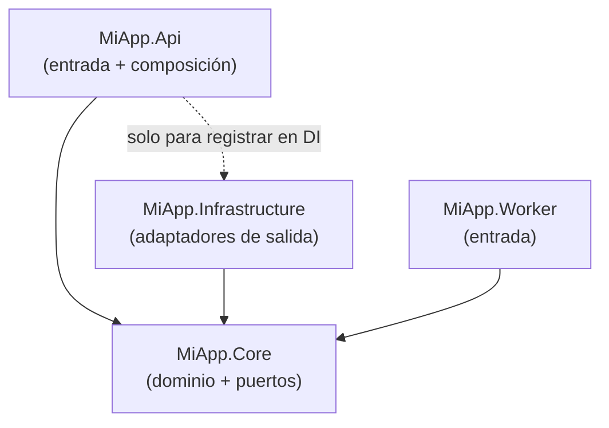
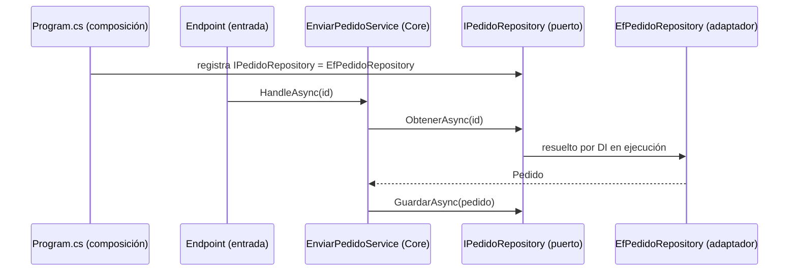

# Puertos y adaptadores en .NET

Guía de implementación del patrón descrito en [Arquitectura Hexagonal](../../../architecture/estilos-y-patrones/hexagonal-puertos-y-adaptadores.md). Microsoft lo presenta en su guía de aplicaciones web con ASP.NET Core bajo el nombre *Clean Architecture*, con el proyecto de referencia eShopOnWeb.

## Estructura de la solución

```text
MiApp.sln
├─ src/
│  ├─ MiApp.Core/                 Dominio y puertos. Sin paquetes de infraestructura.
│  ├─ MiApp.Infrastructure/       Adaptadores de salida (EF Core, SMTP, HTTP)
│  ├─ MiApp.Api/                  Adaptador de entrada y punto de composición
│  └─ MiApp.Worker/               Adaptador de entrada (colas, jobs), opcional
└─ tests/
   ├─ MiApp.Core.Tests/           Pruebas unitarias del núcleo
   ├─ MiApp.Infrastructure.Tests/ Pruebas de integración de adaptadores
   └─ MiApp.Architecture.Tests/   Reglas de dependencia
```

Referencias entre proyectos:

| Proyecto | Referencia a |
|---|---|
| `MiApp.Core` | Nada de la solución |
| `MiApp.Infrastructure` | `MiApp.Core` |
| `MiApp.Api` | `MiApp.Core` y `MiApp.Infrastructure` (solo para componer) |


La referencia de `Api` a `Infrastructure` existe únicamente para registrar los adaptadores al arrancar. El código de los controladores solo debe usar tipos de `Core`.

## Puertos en el núcleo

```csharp
// MiApp.Core/Puertos/IPedidoRepository.cs
public interface IPedidoRepository
{
    Task<Pedido?> ObtenerAsync(Guid id, CancellationToken ct);
    Task GuardarAsync(Pedido pedido, CancellationToken ct);
}
```

El núcleo no debe incluir paquetes como `Microsoft.EntityFrameworkCore` ni `System.Net.Http` en su `.csproj`. Revisar esta lista de paquetes es una comprobación rápida de que el aislamiento se mantiene.

## Adaptador de salida con EF Core

```csharp
// MiApp.Infrastructure/Persistencia/EfPedidoRepository.cs
public class EfPedidoRepository : IPedidoRepository
{
    private readonly AppDbContext _db;
    public EfPedidoRepository(AppDbContext db) => _db = db;

    public Task<Pedido?> ObtenerAsync(Guid id, CancellationToken ct)
        => _db.Pedidos.FirstOrDefaultAsync(p => p.Id == id, ct);

    public async Task GuardarAsync(Pedido pedido, CancellationToken ct)
    {
        _db.Pedidos.Update(pedido);
        await _db.SaveChangesAsync(ct);
    }
}
```

Aquí la entidad de dominio se usa directamente con EF Core, que es la opción más simple y la que usa el enfoque de Microsoft. Si el modelo de persistencia debe diferir del dominio, se añade un modelo propio en `Infrastructure` y un mapeo.

## Flujo en tiempo de ejecución


## Adaptador de entrada

```csharp
// MiApp.Api/Endpoints/PedidosEndpoints.cs
app.MapPost("/pedidos/{id:guid}/enviar",
    async (Guid id, EnviarPedidoService servicio, CancellationToken ct) =>
    {
        await servicio.HandleAsync(id, ct);
        return Results.NoContent();
    });
```

El endpoint solo traduce HTTP a una llamada al caso de uso. Las reglas de negocio permanecen en el núcleo.

## Composición con inyección de dependencias

```csharp
// MiApp.Infrastructure/DependencyInjection.cs
public static class DependencyInjection
{
    public static IServiceCollection AddInfrastructure(
        this IServiceCollection services, IConfiguration config)
    {
        services.AddDbContext<AppDbContext>(o =>
            o.UseSqlServer(config.GetConnectionString("Default")));

        services.AddScoped<IPedidoRepository, EfPedidoRepository>();
        services.AddScoped<INotificadorDeClientes, SmtpNotificadorDeClientes>();
        return services;
    }
}

// MiApp.Api/Program.cs
builder.Services.AddScoped<EnviarPedidoService>();
builder.Services.AddInfrastructure(builder.Configuration);
```

Cambiar de tecnología consiste en registrar otro adaptador en este punto. Los casos de uso no cambian.

## Pruebas

**Núcleo con adaptador en memoria:**

```csharp
public class PedidoRepositoryEnMemoria : IPedidoRepository
{
    private readonly Dictionary<Guid, Pedido> _datos = new();
    public Task<Pedido?> ObtenerAsync(Guid id, CancellationToken ct)
        => Task.FromResult(_datos.GetValueOrDefault(id));
    public Task GuardarAsync(Pedido p, CancellationToken ct)
    {
        _datos[p.Id] = p;
        return Task.CompletedTask;
    }
}
```

**Regla de dependencia con ArchUnitNET:** el repositorio ya documenta esta herramienta en [archunitnet](../calidad-y-pruebas/archunitnet.md). Un ejemplo de regla:

```csharp
[Fact]
public void Core_no_depende_de_Infrastructure()
{
    var core = Types().That().ResideInNamespace("MiApp.Core").As("Core");
    var infra = Types().That().ResideInNamespace("MiApp.Infrastructure").As("Infrastructure");

    core.Should().NotDependOnAny(infra).Check(Arquitectura);
}
```

`Arquitectura` es el objeto cargado con `new ArchLoader().LoadAssemblies(...)`. Ajustar la sintaxis a la versión de ArchUnitNET en uso.

**Adaptadores de salida:** pruebas de integración con la base de datos real o un contenedor (por ejemplo, Testcontainers).

## Decisiones de diseño en .NET

- **Entidades de EF Core como dominio.** Es lo más simple y suele bastar. Separar el modelo de persistencia aumenta el código de mapeo y conviene solo si los modelos divergen.
- **Puertos de entrada.** Se pueden omitir cuando el adaptador invoca directamente la clase del caso de uso. Se justifican si hay varios adaptadores de entrada o si se quiere sustituir el caso de uso en pruebas.
- **MediatR u otro mediador.** Es una forma de implementar casos de uso (comandos y consultas). No es requisito del patrón.
- **Repositorio genérico.** Evitarlo como puerto único. Definir métodos según lo que el caso de uso necesita.
- **Traducción de errores.** El adaptador debe convertir excepciones técnicas (`DbUpdateException`, `HttpRequestException`) en errores del núcleo.

## Relación con otros documentos

- [Pattern implement .net core](pattern.md)
- [Principios y patrones de diseño](../../../architecture/estilos-y-patrones/principios-y-patrones.md)
- [Arquitectura Hexagonal (concepto)](../../../architecture/estilos-y-patrones/hexagonal-puertos-y-adaptadores.md)

## Referencias

- Microsoft Learn, *Common web application architectures*: https://learn.microsoft.com/en-us/dotnet/architecture/modern-web-apps-azure/common-web-application-architectures
- Microsoft Learn, *Architect modern web applications with ASP.NET Core and Azure*: https://learn.microsoft.com/en-us/dotnet/architecture/modern-web-apps-azure/
- eShopOnWeb: https://github.com/dotnet-architecture/eShopOnWeb
- Plantilla Clean Architecture (Ardalis): https://github.com/ardalis/cleanarchitecture
