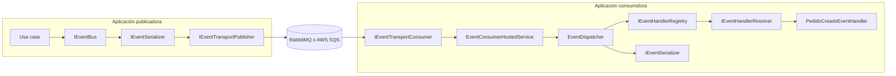
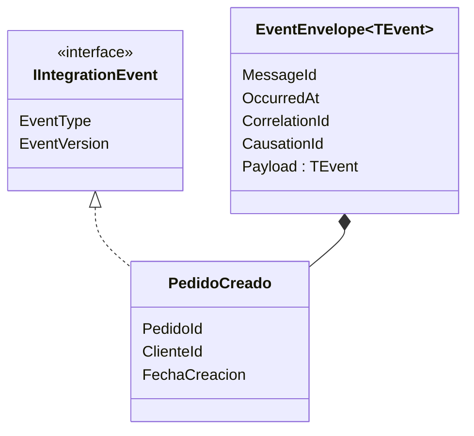
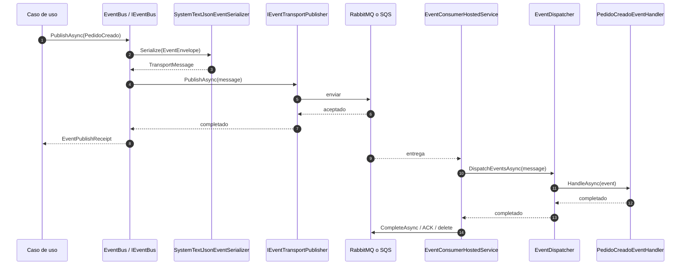

# Event bus propio en C# para .NET 8 y .NET 10

Este documento desarrolla en C# las piezas principales de un bus de eventos asíncrono propio. Es una guía de implementación dentro de Markdown; no contiene un proyecto completo ni depende de un framework de mensajería como MassTransit, Wolverine o NServiceBus.

Los fragmentos muestran las clases principales y se deben integrar en el proyecto anfitrión con los `using` y configuración correspondientes; no forman por sí solos un proyecto compilable.

La base conceptual es [Implementar un bus de eventos asíncrono](../../../../architecture/guias-conceptuales/bus-de-eventos-asincrono.md). Esa guía explica los roles, garantías y decisiones del diseño; este documento los concreta en interfaces, clases y composición para .NET. Para mantener esa separación, el núcleo no conoce RabbitMQ ni AWS SQS: cada uno se incorpora mediante un adaptador.

## Objetivo y límites

El bus propio coordina contratos tipados, serialización, despacho y el ciclo de recepción. El transporte externo aporta persistencia y entrega entre procesos. El código de negocio depende de `IEventBus` y de `IEventHandler<TEvent>`, no de las APIs del broker.

Este diseño busca una entrega **al menos una vez**: un evento puede procesarse de nuevo ante fallos o confirmaciones ambiguas. Por eso cada manejador debe tolerar duplicados. La guía muestra los puntos de extensión para reintentos y mensajes fallidos, pero las garantías concretas las define cada adaptador.

No reemplaza los eventos de dominio en memoria ni define un sistema universal de workflow. Cuando el evento se publica como consecuencia de una transacción de base de datos, considerar [Transactional Outbox](../../../../architecture/estilos-y-patrones/Event-Driven.md#outbox-pattern) para coordinar la persistencia local con el envío.

## Versiones de .NET

Los ejemplos usan sintaxis compatible con C# 12 y APIs disponibles en `net8.0`; el mismo código base se puede compilar para `net10.0`. .NET 8 alcanzó su fin de soporte el **10 de noviembre de 2026**; para un desarrollo nuevo, usar .NET 10. .NET 10 es LTS y su soporte está previsto hasta el **14 de noviembre de 2028**. Confirmar el ciclo de vida cuando se actualice esta guía.

| Destino | TFM | C# predeterminado | Uso recomendado |
|---|---|---|---|
| .NET 8 | `net8.0` | C# 12 | Solo para compatibilidad con sistemas existentes; fuera de soporte desde el 10-11-2026. |
| .NET 10 | `net10.0` | C# 14 | Destino recomendado para un desarrollo nuevo en la fecha de esta revisión. |

Se utiliza sintaxis compatible con C# 12 para que los fragmentos comunes no dependan de características recientes del compilador. `BackgroundService`, `IServiceScopeFactory` y el contenedor estándar de dependencias son infraestructura general de .NET, no un framework de mensajería.

## Arquitectura de las piezas



El diagrama separa el núcleo compartido de los puntos donde se conectan adaptadores. Un proceso que solo publica necesita `IEventTransportPublisher`; uno que solo consume necesita `IEventTransportConsumer`.

## 1. Contrato de evento y sobre

El evento expresa un hecho ya ocurrido y contiene solo el contrato público que necesitan sus consumidores. `EventEnvelope<TEvent>` agrega identidad y metadatos de correlación para el transporte.

```csharp
public interface IIntegrationEvent
{
    string EventType { get; }
    int EventVersion { get; }
}

public sealed record PedidoCreado(
    Guid PedidoId,
    Guid ClienteId,
    DateTimeOffset FechaCreacion) : IIntegrationEvent
{
    public string EventType => "ventas.pedido-creado";
    public int EventVersion => 1;
}

public sealed record EventEnvelope<TEvent>(
    Guid MessageId,
    DateTimeOffset OccurredAt,
    string? CorrelationId,
    string? CausationId,
    TEvent Payload)
    where TEvent : IIntegrationEvent;
```

El identificador estable (`EventType`) no depende del nombre CLR de la clase. Al evolucionar un evento, decidir explícitamente si el cambio es compatible o requiere otra versión.



## 2. Mensaje neutro al transporte y serializer

`TransportMessage` es la forma neutral que reciben los adaptadores. El `Receipt` de `ReceivedEventMessage` envuelve el identificador de entrega propio del broker; el núcleo no interpreta ese identificador.

```csharp
public sealed record TransportMessage(
    string EventType,
    int EventVersion,
    Guid MessageId,
    string ContentType,
    string? CorrelationId,
    string? CausationId,
    byte[] Body);

public interface ITransportReceipt
{
}

public sealed record ReceivedEventMessage(
    TransportMessage Message,
    ITransportReceipt Receipt,
    int DeliveryCount);

public interface IEventSerializer
{
    TransportMessage Serialize<TEvent>(EventEnvelope<TEvent> envelope)
        where TEvent : IIntegrationEvent;

    EventEnvelope<TEvent> Deserialize<TEvent>(TransportMessage message)
        where TEvent : IIntegrationEvent;
}
```

Una implementación JSON con `System.Text.Json` puede ser:

```csharp
using System.Text.Json;

public sealed class SystemTextJsonEventSerializer : IEventSerializer
{
    private readonly JsonSerializerOptions _options =
        new(JsonSerializerDefaults.Web);

    public TransportMessage Serialize<TEvent>(EventEnvelope<TEvent> envelope)
        where TEvent : IIntegrationEvent
    {
        var body = JsonSerializer.SerializeToUtf8Bytes(envelope, _options);

        return new TransportMessage(
            envelope.Payload.EventType,
            envelope.Payload.EventVersion,
            envelope.MessageId,
            "application/json",
            envelope.CorrelationId,
            envelope.CausationId,
            body);
    }

    public EventEnvelope<TEvent> Deserialize<TEvent>(TransportMessage message)
        where TEvent : IIntegrationEvent
    {
        var envelope = JsonSerializer.Deserialize<EventEnvelope<TEvent>>(
            message.Body,
            _options);

        if (envelope is null)
        {
            throw new InvalidDataException("El sobre del evento está vacío.");
        }

        if (envelope.Payload.EventType != message.EventType ||
            envelope.Payload.EventVersion != message.EventVersion ||
            envelope.MessageId != message.MessageId)
        {
            throw new InvalidDataException(
                "Los metadatos del mensaje no coinciden con el sobre serializado.");
        }

        return envelope;
    }
}
```

El tipo y la versión se resuelven mediante registros explícitos de manejadores; no se debe cargar un tipo CLR arbitrario usando un nombre recibido en el mensaje. Para contratos polimórficos, configurar una lista explícita de tipos permitidos y probar la compatibilidad entre versiones.

## 3. Contrato y clase `IEventBus`

`IEventBus` ofrece a los casos de uso una única operación de publicación. Su resultado confirma que el adaptador aceptó el mensaje; no confirma que los suscriptores terminaron de procesarlo.

```csharp
public sealed record EventPublishContext(
    string? CorrelationId = null,
    string? CausationId = null);

public sealed record EventPublishReceipt(Guid MessageId);

public interface IEventBus
{
    Task<EventPublishReceipt> PublishAsync<TEvent>(
        TEvent integrationEvent,
        EventPublishContext? context = null,
        CancellationToken cancellationToken = default)
        where TEvent : IIntegrationEvent;
}

public interface IEventTransportPublisher
{
    Task PublishAsync(
        TransportMessage message,
        CancellationToken cancellationToken = default);
}

public sealed class EventBus : IEventBus
{
    private readonly IEventSerializer _serializer;
    private readonly IEventTransportPublisher _transport;

    public EventBus(
        IEventSerializer serializer,
        IEventTransportPublisher transport)
    {
        _serializer = serializer;
        _transport = transport;
    }

    public async Task<EventPublishReceipt> PublishAsync<TEvent>(
        TEvent integrationEvent,
        EventPublishContext? context = null,
        CancellationToken cancellationToken = default)
        where TEvent : IIntegrationEvent
    {
        var envelope = new EventEnvelope<TEvent>(
            Guid.NewGuid(),
            DateTimeOffset.UtcNow,
            context?.CorrelationId,
            context?.CausationId,
            integrationEvent);

        var message = _serializer.Serialize(envelope);
        await _transport.PublishAsync(message, cancellationToken);

        return new EventPublishReceipt(envelope.MessageId);
    }
}
```

Si la llamada al broker falla o se cancela, el resultado puede ser ambiguo: el broker quizá aceptó el mensaje antes de perderse la respuesta. Evitar asumir que repetir la llamada es inocuo. Para eventos derivados de cambios de base de datos, usar Outbox y una clave de idempotencia apropiada.

En una variante con Outbox, generar y persistir `MessageId` junto con la transacción de negocio. El publicador de Outbox debe enviar ese mismo sobre en cada intento; no volver a generar el identificador llamando a `PublishAsync` como si fuera una publicación nueva.

## 4. Contrato de manejadores y resolución por ámbito

Cada manejador procesa un tipo de evento. La clase concreta sigue el patrón `<Nombre>EventHandler<TEvent>`, por ejemplo `PedidoCreadoEventHandler : IEventHandler<PedidoCreado>`.

```csharp
public sealed record EventHandlerContext(
    Guid MessageId,
    DateTimeOffset OccurredAt,
    string? CorrelationId,
    string? CausationId);

public interface IEventHandler<TEvent>
    where TEvent : IIntegrationEvent
{
    Task HandleAsync(
        TEvent integrationEvent,
        EventHandlerContext context,
        CancellationToken cancellationToken = default);
}

public sealed class PedidoCreadoEventHandler
    : IEventHandler<PedidoCreado>
{
    public Task HandleAsync(
        PedidoCreado integrationEvent,
        EventHandlerContext context,
        CancellationToken cancellationToken = default)
    {
        // Ejecutar aquí la reacción propia de esta aplicación consumidora.
        return Task.CompletedTask;
    }
}
```

El consumidor de larga duración es un servicio singleton. No debe guardar en un campo un manejador scoped ni resolverlo desde el proveedor raíz. `IEventHandlerResolver` recibe un proveedor scoped, y la clase de registro abre un ámbito por ejecución:

```csharp
public interface IEventHandlerResolver
{
    THandler Resolve<THandler>(IServiceProvider scopedServices)
        where THandler : notnull;
}

public sealed class ServiceProviderEventHandlerResolver
    : IEventHandlerResolver
{
    public THandler Resolve<THandler>(IServiceProvider scopedServices)
        where THandler : notnull
    {
        return scopedServices.GetRequiredService<THandler>();
    }
}
```

La resolución se muestra con el contenedor estándar de .NET. Si se reemplaza, conservar la regla: los manejadores y sus dependencias scoped se resuelven dentro de un ámbito de vida útil limitado al procesamiento.

## 5. Registro tipado y `EventDispatcher`

El registro une `EventType` y versión con una o más clases de manejador conocidas al iniciar la aplicación. Así el consumidor no busca ni instancia tipos arbitrarios por reflexión.

```csharp
public readonly record struct EventContractKey(
    string EventType,
    int EventVersion);

public interface IEventHandlerRegistration
{
    EventContractKey Key { get; }

    Task DispatchAsync(
        TransportMessage message,
        CancellationToken cancellationToken);
}

public sealed class EventHandlerRegistration<TEvent, THandler>
    : IEventHandlerRegistration
    where TEvent : IIntegrationEvent
    where THandler : class, IEventHandler<TEvent>
{
    private readonly IEventSerializer _serializer;
    private readonly IServiceScopeFactory _scopeFactory;
    private readonly IEventHandlerResolver _resolver;

    public EventHandlerRegistration(
        EventContractKey key,
        IEventSerializer serializer,
        IServiceScopeFactory scopeFactory,
        IEventHandlerResolver resolver)
    {
        Key = key;
        _serializer = serializer;
        _scopeFactory = scopeFactory;
        _resolver = resolver;
    }

    public EventContractKey Key { get; }

    public async Task DispatchAsync(
        TransportMessage message,
        CancellationToken cancellationToken)
    {
        if (message.EventType != Key.EventType ||
            message.EventVersion != Key.EventVersion)
        {
            throw new InvalidDataException(
                "El mensaje no coincide con el contrato registrado.");
        }

        var envelope = _serializer.Deserialize<TEvent>(message);

        await using var scope = _scopeFactory.CreateAsyncScope();
        var handler = _resolver.Resolve<THandler>(scope.ServiceProvider);
        var context = new EventHandlerContext(
            envelope.MessageId,
            envelope.OccurredAt,
            envelope.CorrelationId,
            envelope.CausationId);

        await handler.HandleAsync(
            envelope.Payload,
            context,
            cancellationToken);
    }
}

public interface IEventHandlerRegistry
{
    IReadOnlyList<IEventHandlerRegistration> GetHandlers(
        EventContractKey key);
}

public sealed class EventHandlerRegistry : IEventHandlerRegistry
{
    private readonly IReadOnlyDictionary<
        EventContractKey,
        IReadOnlyList<IEventHandlerRegistration>> _handlers;

    public EventHandlerRegistry(
        IEnumerable<IEventHandlerRegistration> registrations)
    {
        _handlers = registrations
            .GroupBy(registration => registration.Key)
            .ToDictionary(
                group => group.Key,
                group => (IReadOnlyList<IEventHandlerRegistration>)
                    group.ToArray());
    }

    public IReadOnlyList<IEventHandlerRegistration> GetHandlers(
        EventContractKey key)
    {
        return _handlers.TryGetValue(key, out var handlers)
            ? handlers
            : Array.Empty<IEventHandlerRegistration>();
    }
}

public interface IEventDispatcher
{
    Task DispatchEventsAsync(
        TransportMessage message,
        CancellationToken cancellationToken);
}

public sealed class EventDispatcher : IEventDispatcher
{
    private readonly IEventHandlerRegistry _registry;

    public EventDispatcher(IEventHandlerRegistry registry)
    {
        _registry = registry;
    }

    public async Task DispatchEventsAsync(
        TransportMessage message,
        CancellationToken cancellationToken)
    {
        var key = new EventContractKey(
            message.EventType,
            message.EventVersion);
        var handlers = _registry.GetHandlers(key);

        if (handlers.Count == 0)
        {
            throw new UnknownEventContractException(key);
        }

        foreach (var handler in handlers)
        {
            await handler.DispatchAsync(message, cancellationToken);
        }
    }
}

public sealed class UnknownEventContractException : Exception
{
    public UnknownEventContractException(EventContractKey key)
        : base($"No hay manejadores para {key.EventType} v{key.EventVersion}.")
    {
    }
}
```

Si se registran varios manejadores para una misma clave, se ejecutan secuencialmente y el mensaje solo se confirma al terminar todos. Si un manejador falla después de que otro ya aplicó efectos, la entrega repetida puede volver a ejecutar el primero. Para aislamiento y reintentos independientes, dar a cada consumidor lógico su propia suscripción/cola y grupo de manejadores.

## 6. Contrato de transporte

Separar interfaces de publicación y recepción permite ejecutar una aplicación publicadora sin código consumidor y viceversa. El adaptador convierte `TransportMessage` en el mensaje nativo del broker y mantiene opaco el recibo de entrega.

```csharp
public interface IEventTransportPublisher
{
    Task PublishAsync(
        TransportMessage message,
        CancellationToken cancellationToken = default);
}

public interface IEventTransportConsumer
{
    IAsyncEnumerable<ReceivedEventMessage> ReadAllAsync(
        CancellationToken cancellationToken);

    Task CompleteAsync(
        ITransportReceipt receipt,
        CancellationToken cancellationToken = default);

    Task RetryAsync(
        ITransportReceipt receipt,
        TimeSpan delay,
        CancellationToken cancellationToken = default);

    Task DeadLetterAsync(
        ITransportReceipt receipt,
        string reason,
        CancellationToken cancellationToken = default);
}
```

`CompleteAsync`, `RetryAsync` y `DeadLetterAsync` tienen mapeos diferentes según el broker. No modelar la confirmación como un simple `bool`: el adaptador debe conservar el recibo actual y aplicar las reglas del proveedor.

## 7. Política de errores y servicio de consumo

El servicio de fondo lee mensajes, los pasa a `EventDispatcher` y confirma únicamente después de completar el despacho. Un error transitorio puede reintentarse con demora y límite; un error permanente o agotado va a una cola de mensajes fallidos.

```csharp
public enum EventFailureAction
{
    Retry,
    DeadLetter
}

public sealed record EventFailureDecision(
    EventFailureAction Action,
    TimeSpan Delay,
    string Reason);

public interface IEventErrorPolicy
{
    EventFailureDecision Decide(
        Exception exception,
        int deliveryCount);
}

public sealed class RetryOrDeadLetterEventPolicy : IEventErrorPolicy
{
    private const int MaximumDeliveries = 5;

    public EventFailureDecision Decide(
        Exception exception,
        int deliveryCount)
    {
        if (exception is UnknownEventContractException ||
            deliveryCount >= MaximumDeliveries)
        {
            return new EventFailureDecision(
                EventFailureAction.DeadLetter,
                TimeSpan.Zero,
                exception.Message);
        }

        var exponent = Math.Clamp(deliveryCount - 1, 0, 6);
        var delay = TimeSpan.FromSeconds(Math.Pow(2, exponent));

        return new EventFailureDecision(
            EventFailureAction.Retry,
            delay,
            exception.Message);
    }
}

public sealed class EventConsumerHostedService : BackgroundService
{
    private readonly IEventTransportConsumer _consumer;
    private readonly IEventDispatcher _dispatcher;
    private readonly IEventErrorPolicy _errorPolicy;
    private readonly ILogger<EventConsumerHostedService> _logger;

    public EventConsumerHostedService(
        IEventTransportConsumer consumer,
        IEventDispatcher dispatcher,
        IEventErrorPolicy errorPolicy,
        ILogger<EventConsumerHostedService> logger)
    {
        _consumer = consumer;
        _dispatcher = dispatcher;
        _errorPolicy = errorPolicy;
        _logger = logger;
    }

    protected override async Task ExecuteAsync(
        CancellationToken stoppingToken)
    {
        await foreach (var delivery in _consumer.ReadAllAsync(stoppingToken))
        {
            try
            {
                await _dispatcher.DispatchEventsAsync(
                    delivery.Message,
                    stoppingToken);

                await _consumer.CompleteAsync(
                    delivery.Receipt,
                    stoppingToken);
            }
            catch (OperationCanceledException)
                when (stoppingToken.IsCancellationRequested)
            {
                throw;
            }
            catch (Exception exception)
            {
                _logger.LogError(
                    exception,
                    "Falló el evento {EventType}, mensaje {MessageId}.",
                    delivery.Message.EventType,
                    delivery.Message.MessageId);

                var decision = _errorPolicy.Decide(
                    exception,
                    delivery.DeliveryCount);

                if (decision.Action == EventFailureAction.Retry)
                {
                    await _consumer.RetryAsync(
                        delivery.Receipt,
                        decision.Delay,
                        stoppingToken);
                }
                else
                {
                    await _consumer.DeadLetterAsync(
                        delivery.Receipt,
                        decision.Reason,
                        stoppingToken);
                }
            }
        }
    }
}
```

El `EventConsumerHostedService` es de larga vida; por eso los ámbitos scoped se crean dentro de `EventHandlerRegistration<TEvent,THandler>` para cada despacho. Al detener la aplicación se propaga `stoppingToken`. El adaptador debe definir qué ocurre con un mensaje que está en curso: detener recepción, dejarlo sin confirmar y permitir que el broker lo entregue de nuevo.

En .NET 10 cambió el comportamiento de inicio de `BackgroundService`: no depender de trabajo síncrono antes del primer `await` para bloquear el arranque del host. Si una comprobación debe completarse antes de aceptar tráfico, ejecutarla como validación explícita del inicio, separada del ciclo de consumo.

Este consumidor de referencia procesa una entrega a la vez. Para añadir concurrencia, limitar explícitamente el número de mensajes en vuelo, usar un ámbito independiente por entrega y no confirmar hasta que esa entrega finalice.

Si falla `CompleteAsync` después de que el manejador ya terminó, el mensaje podría repetirse. También puede repetirse si el proceso termina después del efecto de negocio y antes de confirmar. La idempotencia debe proteger los efectos del consumidor, no solo el envío.

## 8. Composición de dependencias

Registrar el núcleo con el contenedor estándar de .NET y conectar las implementaciones de transporte en el borde de la aplicación:

```csharp
services.AddSingleton<IEventSerializer, SystemTextJsonEventSerializer>();
services.AddSingleton<IEventHandlerResolver, ServiceProviderEventHandlerResolver>();

services.AddScoped<PedidoCreadoEventHandler>();
services.AddSingleton<IEventHandlerRegistration>(serviceProvider =>
    new EventHandlerRegistration<PedidoCreado, PedidoCreadoEventHandler>(
        new EventContractKey("ventas.pedido-creado", 1),
        serviceProvider.GetRequiredService<IEventSerializer>(),
        serviceProvider.GetRequiredService<IServiceScopeFactory>(),
        serviceProvider.GetRequiredService<IEventHandlerResolver>()));

services.AddSingleton<IEventHandlerRegistry, EventHandlerRegistry>();
services.AddSingleton<IEventDispatcher, EventDispatcher>();
services.AddSingleton<IEventErrorPolicy, RetryOrDeadLetterEventPolicy>();
services.AddSingleton<IEventBus, EventBus>();

// Registrar una implementación propia del adaptador que corresponda:
// services.AddSingleton<RabbitMqTransportAdapter>();
// services.AddSingleton<IEventTransportPublisher>(sp =>
//     sp.GetRequiredService<RabbitMqTransportAdapter>());
// services.AddSingleton<IEventTransportConsumer>(sp =>
//     sp.GetRequiredService<RabbitMqTransportAdapter>());

services.AddHostedService<EventConsumerHostedService>();
```

`RetryOrDeadLetterEventPolicy` es una política propia de ejemplo. `RabbitMqTransportAdapter` representa la clase adaptadora que se implementará en la guía específica del transporte; no es una dependencia de un framework de mensajería. La aplicación publicadora puede omitir el registro del consumidor y del `IHostedService`; una aplicación que solo consume puede omitir `IEventBus` y el adaptador publicador si su despliegue no publica.

La política de ejemplo trata los errores como transitorios hasta alcanzar el máximo de entregas, excepto contratos desconocidos, que van directamente a DLQ. En una aplicación real, clasificar también errores permanentes del dominio, errores de esquema y fallos temporales del broker; configurar límites y demoras según el SLA y el transporte.

## 9. Mapeo conceptual de adaptadores

El núcleo no cambia al agregar una tecnología. Cada adaptador implementa los contratos `IEventTransportPublisher` y/o `IEventTransportConsumer`, además de traducir configuración y errores propios del proveedor.

| Adaptador de ejemplo | Mapeo conceptual | Decisión importante |
|---|---|---|
| `RabbitMqTransportAdapter` | `PublishAsync` publica al destino configurado; `ReadAllAsync` entrega mensajes recibidos; `CompleteAsync` confirma; `RetryAsync` o `DeadLetterAsync` aplican la política definida. | Definir exchanges, routing keys, queues y bindings por suscripción, además de durabilidad, confirmaciones y política de reintento. |
| `AwsSqsTransportAdapter` | `PublishAsync` envía el mensaje; `ReadAllAsync` lo recibe; `CompleteAsync` elimina usando el recibo actual; `RetryAsync` deja que venza o ajusta la visibilidad; `DeadLetterAsync` usa la política de DLQ configurada. | SQS funciona como cola de trabajo: la entrega estándar es al menos una vez y el mensaje debe eliminarse después de procesarlo. Para fan-out a suscriptores independientes, usar una cola por suscriptor y un mecanismo de publicación/fan-out como SNS cuando corresponda. FIFO agrega orden por grupo y deduplicación de productor, pero no elimina la necesidad de idempotencia extremo a extremo. |

Este documento define los contratos adaptadores; las llamadas específicas a los SDK quedan para documentos separados:

- [RabbitMQ](../../../../integracion/mensajeria/RabbitMQ.md)
- [Amazon SQS](../../../../cloud/amazon/AWS_SQS.md)
- [AWS SDK para .NET y SQS](../../../../cloud/amazon/AWS_SQS.md)

## Flujo de extremo a extremo



El publicador recibe la aceptación de transporte; el consumidor trabaja después y confirma por separado. La respuesta de `PublishAsync` no indica que `PedidoCreadoEventHandler` haya terminado.

## Verificaciones de diseño

Antes de implementar un adaptador real, definir cómo se comprobará:

- evento serializado y reconstruido con el mismo contrato y metadatos;
- publicación al destino y rechazo propagado si el broker no acepta;
- registro de manejador desconocido o versión no soportada enviado a DLQ;
- error transitorio reintentado con límite y demora;
- duplicado recibido sin repetir efectos de negocio;
- cierre durante procesamiento sin confirmar trabajo incompleto;
- incompatibilidad de esquema detectada sin activar tipos no registrados;
- confirmación del broker fallida después del efecto del manejador tratada como posible repetición.

## Referencias

- [Guía conceptual: bus de eventos asíncrono](../../../../architecture/guias-conceptuales/bus-de-eventos-asincrono.md)
- [.NET: versiones de C# predeterminadas por TFM](https://learn.microsoft.com/dotnet/csharp/language-reference/configure-language-version)
- [.NET: marcos de destino y TFMs](https://learn.microsoft.com/dotnet/standard/frameworks)
- [.NET: usar servicios scoped en un `BackgroundService`](https://learn.microsoft.com/dotnet/core/extensions/scoped-service)
- [.NET: tareas en segundo plano con `IHostedService`](https://learn.microsoft.com/dotnet/core/extensions/workers)
- [.NET 10: cambio de comportamiento de `BackgroundService`](https://learn.microsoft.com/dotnet/core/compatibility/extensions/10.0/backgroundservice-executeasync-task)
- [System.Text.Json: serializar y deserializar](https://learn.microsoft.com/dotnet/standard/serialization/system-text-json/how-to)
- [.NET: ciclo de vida de soporte](https://dotnet.microsoft.com/platform/support/policy/dotnet-core)
- [Amazon SQS: recibir y eliminar mensajes](https://docs.aws.amazon.com/AWSSimpleQueueService/latest/SQSDeveloperGuide/step-receive-delete-message.html)
- [Amazon SNS con colas SQS para fan-out](https://docs.aws.amazon.com/sns/latest/dg/sns-sqs-as-subscriber.html)
