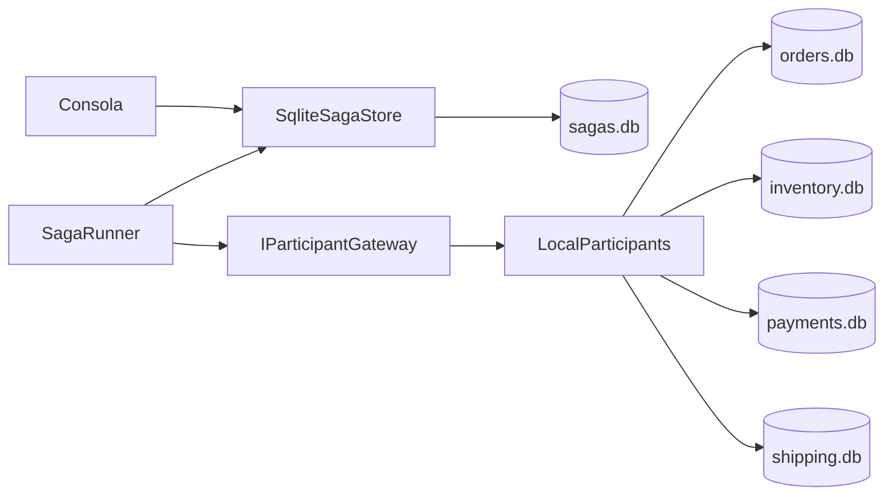

# Implementar una Saga orquestada propia en .NET

Esta guía concreta en C# el diseño de [Implementar una Saga para coordinar transacciones distribuidas](../../../../architecture/guias-conceptuales/saga.md). La guía conceptual explica las decisiones y garantías; este documento implementa el coordinador, almacenamiento, participantes, reintentos y compensaciones.

No utiliza MassTransit, NServiceBus, Wolverine ni otra biblioteca que implemente Sagas. La única dependencia NuGet del ejemplo es **Microsoft.Data.Sqlite**, un proveedor de acceso a datos. La coordinación y la máquina de estados son código propio.

## Alcance de la implementación

El ejemplo ejecutable usa .NET 10 y una aplicación de consola. Procesa una compra con cinco pasos: crear pedido pendiente, reservar inventario, cobrar, solicitar envío y confirmar pedido. Si un participante rechaza una acción, compensa los pasos confirmados en orden inverso.

Cada participante usa un archivo SQLite distinto y transacciones locales. Pagos y Envíos son **simuladores locales**, no integraciones con un proveedor de cobro o logística. Las llamadas entre componentes se realizan mediante una interfaz en el mismo proceso. El ejemplo permite observar las fronteras transaccionales y la recuperación sin requerir broker ni servicios remotos.

| Incluido | Límite explícito |
|---|---|
| Estado durable y siguiente acción derivada del estado | Una sola versión del flujo, secuencial |
| Idempotencia de inicio y de cada operación | El identificador de solicitud lo entrega el llamador |
| Efecto local y resultado en una misma transacción | No hace atómico un efecto en un proveedor externo |
| Recuperación repitiendo la operación pendiente | No implementa entrega de mensajes mediante broker |
| Reintentos programados y estado de intervención | No incluye consola administrativa ni alertas externas |
| Versión optimista en el almacén | Un solo ejecutor por directorio, protegido por un bloqueo de archivo |

No ejecutar varias réplicas con copias independientes del directorio. El bloqueo local no equivale a un lease distribuido. La sección final explica los cambios necesarios para distribuir esta implementación.

## Arquitectura



La acción pendiente está representada por el estado persistido: `NextStep` mientras avanza o `UndoStep` mientras compensa. El runner la calcula y la invoca. Si el proceso cae después del efecto y antes de guardar el avance, vuelve a solicitar **la misma operación**; el participante devuelve el resultado registrado sin repetir el efecto.

No hay una transacción global entre estos archivos. El almacén de Saga nunca modifica los datos de los participantes.

## Preparar el proyecto

Crear una aplicación de consola y agregar el proveedor SQLite. Los comandos siguientes usan PowerShell:

```powershell
dotnet new console --framework net10.0 --name OwnSaga
Set-Location OwnSaga
dotnet add package Microsoft.Data.Sqlite --version "10.0.*"
```

La versión flotante selecciona un parche de la rama 10.0 al restaurar. Para un proyecto real, fijar después la versión resuelta y conservar su archivo de bloqueo de dependencias según la política del proyecto.

Crear los seis archivos siguientes en el proyecto, reemplazando el `Program.cs` generado. Los bloques C# son archivos completos, usan el namespace `OwnSaga` y no necesitan código de otros documentos.

## 1. Contratos y estado — `Contracts.cs`

Los identificadores de operación se derivan de la instancia, el paso y su dirección. Cambiar de intento no cambia la identidad del efecto de negocio.

```csharp
namespace OwnSaga;

public enum Step { CreateOrder, ReserveInventory, Charge, RequestShipment, ConfirmOrder }
public enum SagaStatus { Running, Compensating, Completed, Compensated, Rejected, NeedsIntervention }

public sealed record Purchase(
    string OrderId, int Quantity, long AmountCents, string Currency,
    bool RejectCharge = false, bool RejectShipment = false);

public sealed record Operation(
    string SagaId, Step Step, bool Undo, Purchase Purchase)
{
    public string Id => $"{SagaId}:{Step}:{(Undo ? "undo" : "do")}";
}

public sealed record OperationResult(bool Accepted, string? Reason = null);

public sealed record SagaState
{
    public required string Id { get; init; }
    public required Purchase Purchase { get; init; }
    public int DefinitionVersion { get; init; } = 1;
    public SagaStatus Status { get; init; } = SagaStatus.Running;
    public int NextStep { get; init; }
    public int UndoStep { get; init; } = -1;
    public int Attempts { get; init; }
    public long DueAt { get; init; }
    public long Version { get; init; }
    public string? LastError { get; init; }
    public string? FailureReason { get; init; }
}

public interface IParticipantGateway
{
    Task<OperationResult> ExecuteAsync(Operation operation, CancellationToken ct);
}
```

El importe usa unidades menores enteras para evitar conversiones ambiguas. La moneda y su escala deben acordarse en el dominio; el ejemplo admite USD con dos decimales. Los indicadores de rechazo son exclusivamente mecanismos de demostración, no campos de un contrato público de compra.

## 2. Acceso SQL — `Db.cs`

Las transacciones se abren y cierran por componente. Todos los valores variables usan parámetros. Se emplean operaciones SQLite síncronas: el proveedor no ofrece E/S realmente asíncrona para sus métodos ADO.NET, según sus [limitaciones documentadas](https://learn.microsoft.com/en-us/dotnet/standard/data/sqlite/async).

```csharp
using Microsoft.Data.Sqlite;

namespace OwnSaga;

public static class Db
{
    public static SqliteConnection Open(string path)
    {
        var connection = new SqliteConnection(new SqliteConnectionStringBuilder
        {
            DataSource = path,
            DefaultTimeout = 5
        }.ToString());
        connection.Open();
        return connection;
    }

    public static SqliteCommand Command(
        SqliteConnection connection, SqliteTransaction? transaction,
        string sql, params (string Name, object Value)[] parameters)
    {
        var command = connection.CreateCommand();
        command.Transaction = transaction;
        command.CommandText = sql;
        foreach (var parameter in parameters)
            command.Parameters.AddWithValue(parameter.Name, parameter.Value);
        return command;
    }

    public static int Execute(
        SqliteConnection connection, SqliteTransaction? transaction,
        string sql, params (string Name, object Value)[] parameters)
    {
        using var command = Command(connection, transaction, sql, parameters);
        return command.ExecuteNonQuery();
    }
}
```

## 3. Almacén durable — `SqliteSagaStore.cs`

El llamador proporciona una clave única de solicitud, usada como `SagaId`. Repetir esa clave con el mismo contenido devuelve la misma instancia; reutilizarla con otro contenido es un error. Para este ejemplo, una compra debe mantener la misma clave al repetir su solicitud inicial.

```csharp
using System.Text.Json;

namespace OwnSaga;

public sealed class SqliteSagaStore
{
    private readonly string path;

    public SqliteSagaStore(string directory)
    {
        Directory.CreateDirectory(directory);
        path = Path.Combine(directory, "sagas.db");
        using var connection = Db.Open(path);
        Db.Execute(connection, null, """
            CREATE TABLE IF NOT EXISTS Sagas (
                Id TEXT PRIMARY KEY,
                Version INTEGER NOT NULL,
                Body TEXT NOT NULL
            );
            """);
    }

    public SagaState Start(string requestId, Purchase purchase)
    {
        if (string.IsNullOrWhiteSpace(requestId) ||
            string.IsNullOrWhiteSpace(purchase.OrderId) ||
            purchase.Quantity <= 0 || purchase.AmountCents <= 0 ||
            purchase.Currency != "USD")
            throw new ArgumentException("Solicitud inválida: validar identidad, cantidad, importe y moneda.");

        var state = new SagaState { Id = requestId, Purchase = purchase };
        using var connection = Db.Open(path);
        Db.Execute(connection, null, """
            INSERT INTO Sagas (Id, Version, Body) VALUES ($id, 0, $body)
            ON CONFLICT(Id) DO NOTHING;
            """, ("$id", requestId), ("$body", JsonSerializer.Serialize(state)));
        var existing = Load(requestId);
        if (existing.Purchase != purchase)
            throw new InvalidOperationException("La clave de solicitud ya pertenece a otra compra.");
        return existing;
    }

    public SagaState Load(string id)
    {
        using var connection = Db.Open(path);
        using var command = Db.Command(connection, null,
            "SELECT Body FROM Sagas WHERE Id = $id;", ("$id", id));
        var body = command.ExecuteScalar() as string
            ?? throw new KeyNotFoundException(id);
        return JsonSerializer.Deserialize<SagaState>(body)!;
    }

    public SagaState Save(SagaState next)
    {
        var updated = next with { Version = next.Version + 1 };
        using var connection = Db.Open(path);
        var count = Db.Execute(connection, null, """
            UPDATE Sagas SET Version = $newVersion, Body = $body
            WHERE Id = $id AND Version = $expected;
            """, ("$newVersion", updated.Version),
            ("$body", JsonSerializer.Serialize(updated)),
            ("$id", next.Id), ("$expected", next.Version));
        if (count != 1)
            throw new InvalidOperationException("Conflicto de concurrencia: recargar la instancia.");
        return updated;
    }

    public IReadOnlyList<string> ActiveIds()
    {
        using var connection = Db.Open(path);
        using var command = Db.Command(connection, null, "SELECT Body FROM Sagas;");
        using var reader = command.ExecuteReader();
        var ids = new List<string>();
        while (reader.Read())
        {
            var state = JsonSerializer.Deserialize<SagaState>(reader.GetString(0))!;
            if (state.Status is SagaStatus.Running or SagaStatus.Compensating)
                ids.Add(state.Id);
        }
        return ids;
    }
}
```

La actualización de un único registro es atómica. El JSON contiene tanto el avance como la información para derivar la siguiente operación. No existe aquí una publicación separada que deba confirmarse en esa misma escritura. Para volúmenes altos, usar columnas indexadas para estado y vencimiento, en lugar de recorrer todos los documentos.

## 4. Participantes idempotentes — `LocalParticipants.cs`

Cada participante conserva sus recursos y un registro de operaciones en la misma base local. La transacción confirma conjuntamente el cambio y el resultado. La clave del recurso es el pedido; la de la operación es la instancia, paso y dirección.

La tabla `Stock` representa un único producto con 100 unidades iniciales. Las tablas de recursos representan reservas, cobros y solicitudes; no sustituyen modelos completos de esos dominios.

```csharp
using System.Text.Json;
using Microsoft.Data.Sqlite;

namespace OwnSaga;

public sealed class LocalParticipants : IParticipantGateway
{
    private readonly string directory;

    public LocalParticipants(string directory)
    {
        this.directory = directory;
        Directory.CreateDirectory(directory);
        foreach (var name in new[] { "orders", "inventory", "payments", "shipping" })
        {
            using var connection = Db.Open(Path.Combine(directory, name + ".db"));
            Db.Execute(connection, null, """
                CREATE TABLE IF NOT EXISTS Operations (
                    Id TEXT PRIMARY KEY, Request TEXT NOT NULL, Result TEXT NOT NULL
                );
                CREATE TABLE IF NOT EXISTS Resources (
                    OrderId TEXT PRIMARY KEY, State TEXT NOT NULL, Value INTEGER NOT NULL
                );
                CREATE TABLE IF NOT EXISTS Stock (
                    Id INTEGER PRIMARY KEY CHECK (Id = 1), Units INTEGER NOT NULL CHECK (Units >= 0)
                );
                INSERT INTO Stock (Id, Units) VALUES (1, 100) ON CONFLICT(Id) DO NOTHING;
                """);
        }
    }

    private string Database(Step step) => Path.Combine(directory, (step switch
    {
        Step.CreateOrder or Step.ConfirmOrder => "orders",
        Step.ReserveInventory => "inventory",
        Step.Charge => "payments",
        Step.RequestShipment => "shipping",
        _ => throw new ArgumentOutOfRangeException(nameof(step))
    }) + ".db");

    public Task<OperationResult> ExecuteAsync(Operation operation, CancellationToken ct)
    {
        ct.ThrowIfCancellationRequested();
        using var connection = Db.Open(Database(operation.Step));
        using var transaction = connection.BeginTransaction();
        var request = JsonSerializer.Serialize(operation);
        using (var lookup = Db.Command(connection, transaction,
            "SELECT Request, Result FROM Operations WHERE Id = $id;", ("$id", operation.Id)))
        using (var reader = lookup.ExecuteReader())
        {
            if (reader.Read())
            {
                if (reader.GetString(0) != request)
                    throw new InvalidOperationException("OperationId reutilizado con otro contenido.");
                var previous = JsonSerializer.Deserialize<OperationResult>(reader.GetString(1))!;
                return Task.FromResult(previous);
            }
        }

        var result = Apply(connection, transaction, operation);
        Db.Execute(connection, transaction, """
            INSERT INTO Operations (Id, Request, Result) VALUES ($id, $request, $result);
            """, ("$id", operation.Id), ("$request", request),
            ("$result", JsonSerializer.Serialize(result)));
        transaction.Commit();
        return Task.FromResult(result);
    }

    private static OperationResult Apply(
        SqliteConnection connection, SqliteTransaction transaction, Operation operation)
    {
        var purchase = operation.Purchase;
        if (!operation.Undo &&
            ((operation.Step == Step.Charge && purchase.RejectCharge) ||
             (operation.Step == Step.RequestShipment && purchase.RejectShipment)))
            return new(false, "Rechazo de negocio simulado, sin efecto aplicado.");

        int Execute(string sql, params (string Name, object Value)[] values) =>
            Db.Execute(connection, transaction, sql, values);

        void Insert(string state, long value)
        {
            Execute("INSERT INTO Resources (OrderId, State, Value) VALUES ($id, $state, $value);",
                ("$id", purchase.OrderId), ("$state", state), ("$value", value));
        }

        void Change(string expected, string target)
        {
            var count = Execute("""
                UPDATE Resources SET State = $target WHERE OrderId = $id AND State = $expected;
                """, ("$target", target), ("$id", purchase.OrderId), ("$expected", expected));
            if (count != 1)
                throw new InvalidOperationException("Estado del participante incompatible con la operación.");
        }

        if (operation.Undo)
        {
            switch (operation.Step)
            {
                case Step.CreateOrder: Change("pending", "cancelled"); break;
                case Step.ReserveInventory:
                    Change("reserved", "released");
                    Execute("UPDATE Stock SET Units = Units + $quantity WHERE Id = 1;",
                        ("$quantity", purchase.Quantity));
                    break;
                case Step.Charge: Change("charged", "refunded"); break;
                case Step.RequestShipment: Change("accepted", "cancelled"); break;
                default: throw new InvalidOperationException("Este paso no admite compensación.");
            }
        }
        else
        {
            switch (operation.Step)
            {
                case Step.CreateOrder: Insert("pending", 0); break;
                case Step.ReserveInventory:
                    var changed = Execute("""
                        UPDATE Stock SET Units = Units - $quantity
                        WHERE Id = 1 AND Units >= $quantity;
                        """, ("$quantity", purchase.Quantity));
                    if (changed != 1) return new(false, "Inventario insuficiente.");
                    Insert("reserved", purchase.Quantity);
                    break;
                case Step.Charge: Insert("charged", purchase.AmountCents); break;
                case Step.RequestShipment: Insert("accepted", 0); break;
                case Step.ConfirmOrder: Change("pending", "confirmed"); break;
                default: throw new ArgumentOutOfRangeException(nameof(operation));
            }
        }
        return new(true);
    }
}
```

Un resultado `Accepted = false` es definitivo y garantiza, en este contrato, que esa operación no dejó efectos. Una excepción técnica no ofrece esa garantía. Si se usan servicios remotos, el servidor debe mantener el mismo contrato de idempotencia y comprobar que una clave repetida conserve el contenido original.

Al devolver una operación ya registrada no se confirma una transacción nueva: no hay cambios pendientes, y la disposición libera la transacción de lectura. La primera ejecución sí confirma tanto efecto como resultado.

## 5. Coordinador y reintentos — `SagaRunner.cs`

El runner nunca mantiene una transacción de Saga abierta mientras ejecuta un participante. Si el resultado es incierto, conserva el paso y su identidad; no inicia una compensación suponiendo que nada ocurrió.

```csharp
using Microsoft.Data.Sqlite;

namespace OwnSaga;

public sealed class SagaRunner(SqliteSagaStore store, IParticipantGateway gateway)
{
    private static readonly Step[] Steps =
    [Step.CreateOrder, Step.ReserveInventory, Step.Charge, Step.RequestShipment, Step.ConfirmOrder];

    public async Task<SagaState> TickAsync(string id, CancellationToken ct = default)
    {
        var state = store.Load(id);
        if (state.Status is not (SagaStatus.Running or SagaStatus.Compensating)) return state;
        if (state.DueAt > DateTimeOffset.UtcNow.ToUnixTimeMilliseconds()) return state;
        if (state.DefinitionVersion != 1)
            throw new InvalidOperationException("Versión del flujo no admitida.");

        bool undo = state.Status == SagaStatus.Compensating;
        int index = undo ? state.UndoStep : state.NextStep;
        var operation = new Operation(state.Id, Steps[index], undo, state.Purchase);
        OperationResult result;
        try
        {
            result = await gateway.ExecuteAsync(operation, ct);
        }
        catch (OperationCanceledException) when (ct.IsCancellationRequested)
        {
            // No avanzar: al reanudar se resolverá la misma OperationId.
            throw;
        }
        catch (Exception error) when (error is TimeoutException or HttpRequestException ||
                                     error is SqliteException { SqliteErrorCode: 5 or 6 })
        {
            var attempts = state.Attempts + 1;
            var delay = Math.Min(30_000, 250 * (1 << Math.Min(attempts, 6)))
                + Random.Shared.Next(250);
            return store.Save(state with
            {
                Attempts = attempts,
                Status = attempts >= 5 ? SagaStatus.NeedsIntervention : state.Status,
                DueAt = DateTimeOffset.UtcNow.ToUnixTimeMilliseconds() + delay,
                LastError = $"Resultado no confirmado: {error.Message}"
            });
        }
        catch (Exception error)
        {
            // Error de contrato, almacenamiento u otro fallo no clasificado:
            // conservar el paso y requerir investigación; no compensar a ciegas.
            return store.Save(state with
            {
                Status = SagaStatus.NeedsIntervention,
                LastError = error.Message
            });
        }

        var next = state with { Attempts = 0, DueAt = 0, LastError = null };
        if (undo)
        {
            next = result.Accepted
                ? next with
                {
                    UndoStep = index - 1,
                    Status = index == 0 ? SagaStatus.Compensated : SagaStatus.Compensating
                }
                : next with
                {
                    Status = SagaStatus.NeedsIntervention,
                    LastError = $"Compensación rechazada: {result.Reason}"
                };
        }
        else if (result.Accepted)
        {
            next = next with
            {
                NextStep = index + 1,
                Status = index == Steps.Length - 1 ? SagaStatus.Completed : SagaStatus.Running
            };
        }
        else
        {
            next = next with
            {
                UndoStep = index - 1,
                Status = index == 0 ? SagaStatus.Rejected : SagaStatus.Compensating,
                FailureReason = result.Reason
            };
        }
        // Fuera del try: un fallo al guardar no cambia la clasificación del resultado.
        // Al reiniciar se repetirá la operación con su identidad original.
        return store.Save(next);
    }
}
```

`NextStep` conserva el paso que falló cuando la instancia entra en intervención; `UndoStep` identifica una compensación pendiente si su valor es no negativo. Para reanudar después de investigar, restaurar `Compensating` si `UndoStep >= 0`, o `Running` en otro caso, y restablecer intentos y vencimiento mediante una acción administrativa auditada. No avanzar los índices manualmente sin verificar el efecto real.

Los cinco intentos son una política didáctica por operación. En una integración real, clasificar códigos y excepciones del proveedor, usar plazos de negocio y registrar cada intento. Un error de autenticación, contrato o saldo insuficiente no debe tratarse como una indisponibilidad temporal genérica.

## 6. Entrada y recuperación — `Program.cs`

El comando `run` procesa todas las instancias activas, incluidas las iniciadas antes de un reinicio. El archivo `runner.lock` permanece abierto durante todo el comando y evita dos ejecutores sobre el mismo directorio local. Su existencia por sí sola no significa que haya un ejecutor activo: el bloqueo es el archivo abierto con acceso exclusivo.

```csharp
using System.Text.Json;
using OwnSaga;

var directory = Path.GetFullPath("saga-data");
Directory.CreateDirectory(directory);
var store = new SqliteSagaStore(directory);
var gateway = new LocalParticipants(directory);
var runner = new SagaRunner(store, gateway);

if (args.Length == 0)
{
    Console.WriteLine("start <requestId> <orderId> [success|reject-charge|reject-shipment] | run | status <requestId>");
    return;
}

switch (args[0])
{
    case "start" when args.Length is 3 or 4:
        var scenario = args.Length == 4 ? args[3] : "success";
        if (scenario is not ("success" or "reject-charge" or "reject-shipment"))
            throw new ArgumentException("Escenario no reconocido.");
        var purchase = new Purchase(args[2], 2, 2500, "USD",
            scenario == "reject-charge", scenario == "reject-shipment");
        Console.WriteLine(JsonSerializer.Serialize(store.Start(args[1], purchase)));
        break;

    case "status" when args.Length == 2:
        var state = store.Load(args[1]);
        Console.WriteLine($"{state.Id}: {state.Status}, paso={state.NextStep}, " +
            $"compensación={state.UndoStep}, error={state.LastError ?? state.FailureReason}");
        break;

    case "run" when args.Length == 1:
        using (var runnerLock = new FileStream(Path.Combine(directory, "runner.lock"),
            FileMode.OpenOrCreate, FileAccess.ReadWrite, FileShare.None))
        using (var stop = new CancellationTokenSource())
        {
            Console.CancelKeyPress += (_, e) => { e.Cancel = true; stop.Cancel(); };
            try
            {
                while (!stop.IsCancellationRequested)
                {
                    var ids = store.ActiveIds();
                    if (ids.Count == 0) break;
                    foreach (var id in ids)
                    {
                        var current = await runner.TickAsync(id, stop.Token);
                        Console.WriteLine($"{id}: {current.Status}, versión={current.Version}");
                    }
                    await Task.Delay(250, stop.Token);
                }
            }
            catch (OperationCanceledException) when (stop.IsCancellationRequested) { }
        }
        break;

    default: throw new ArgumentException("Comando o argumentos inválidos.");
}
```

Las instancias en `NeedsIntervention` no aparecen en `ActiveIds`: requieren resolución explícita. Que el runner termine no significa que todas las compras hayan concluido exitosamente; consultar los estados y, en producción, alertar sobre las instancias bloqueadas.

## Ejecutar los escenarios

Usar una clave de solicitud y un pedido distintos para cada compra nueva. Repetir el primer comando con los mismos argumentos verifica la idempotencia de inicio.

```powershell
dotnet run -- start request-001 order-001 success
dotnet run -- run
dotnet run -- status request-001

dotnet run -- start request-002 order-002 reject-shipment
dotnet run -- run
dotnet run -- status request-002

dotnet run -- start request-003 order-003 reject-charge
dotnet run -- run
dotnet run -- status request-003
```

| Escenario | Estado final | Efectos esperados |
|---|---|---|
| `success` | `Completed` | Pedido confirmado, dos unidades reservadas, cobro registrado y envío aceptado |
| `reject-shipment` | `Compensated` | Pedido cancelado, reserva liberada, cobro reembolsado y ningún envío creado |
| `reject-charge` | `Compensated` | Pedido cancelado, reserva liberada y ningún cobro o envío creado |

Con estos tres escenarios en una base nueva, el inventario termina en **98 unidades**: solo la compra exitosa conserva su reserva. El recurso permanece `reserved` porque este flujo termina en aceptación del envío; consumo definitivo de stock y entrega física quedan fuera del ejemplo.

## Qué sucede al interrumpir el proceso

| Frontera de caída | Recuperación |
|---|---|
| Antes de confirmar el participante | La transacción local revierte; se repite la operación pendiente |
| Después de confirmar el participante, antes de guardar la Saga | El registro de operaciones devuelve el resultado anterior sin repetir el efecto |
| Después de guardar la Saga | Se deriva el siguiente paso del estado durable |
| Durante una compensación | Se repite la compensación pendiente con su misma identidad |
| Durante una espera de reintento | `DueAt` persiste; el siguiente runner respeta el vencimiento |

Para probar de forma controlada una respuesta perdida, decorar `IParticipantGateway`: ejecutar primero el participante real y lanzar una `TimeoutException` una sola vez después de obtener el resultado, antes de devolverlo. El runner debe conservar el paso; al reintentar, la cantidad de cobros y reservas no debe aumentar. También comprobar la recuperación reconstruyendo `SqliteSagaStore`, `LocalParticipants` y `SagaRunner` sobre el mismo directorio.

Si el proceso queda sin acceso al disco, el almacenamiento puede fallar y detener el runner. No convertir ese fallo en un rechazo de negocio ni borrar la instancia: restaurar el almacenamiento y reanudar sobre los archivos conservados.

## Pasar de participantes locales a servicios remotos

1. Implementar otro `IParticipantGateway` que envíe comandos con `Operation.Id`, `SagaId`, tipo/versión y datos mínimos. La misma operación debe conservar identidad y contenido en todos sus intentos.
2. Mantener la deduplicación **en el servicio dueño del efecto**, con su cambio y resultado en una transacción local. Un caché del cliente no protege contra una respuesta perdida.
3. Si la comunicación es por solicitud/respuesta, definir consulta por identificador de operación y tiempos límite. Un timeout conserva el resultado como incierto hasta reconciliarlo.
4. Si se usa broker, persistir estado de Saga y comando Outbox en una transacción; en el participante, persistir efecto, Inbox y resultado Outbox. La recepción de resultados actualiza la Saga antes de confirmar el mensaje. El [event bus propio](../event-bus/implementacion-base.md) es un punto de integración, pero no agrega estas garantías automáticamente.
5. Añadir identidades de mensaje, correlación, validación de contratos y reglas para resultados tardíos. Un cobro tardío durante una cancelación necesita reconciliación y, si corresponde, reembolso.
6. Sustituir el bloqueo de archivo por coordinación entre réplicas: claims o leases con vencimiento y fencing, más control de versión al persistir. La idempotencia del participante sigue siendo necesaria si dos trabajadores llegan a solicitar el mismo efecto.
7. Incorporar límites de negocio, expiración de reservas, autorización de operaciones, métricas, historial de intentos y recuperación manual auditada.

Para un proveedor externo de pagos, el registro local de operaciones no basta: enviar su clave de idempotencia, guardar la referencia de cobro y reconciliar una respuesta ambigua mediante el proveedor. Un reembolso solicitado no se considera confirmado hasta que el proveedor lo confirme.

## Verificación antes de adoptar la implementación

- Compilar los seis archivos juntos y ejecutar los tres escenarios.
- Comprobar datos de participantes, además del estado final de la Saga.
- Repetir solicitudes y operaciones sin duplicar efectos; rechazar identidades reutilizadas con otro contenido.
- Simular una respuesta perdida tras confirmar el efecto y reiniciar antes de guardar el avance.
- Comprobar stock insuficiente sin valores negativos y conflictos sobre un mismo pedido.
- Simular fallos de compensación: la instancia debe permanecer visible en intervención.
- Intentar iniciar dos runners sobre el mismo directorio: el segundo debe fallar al obtener el bloqueo.
- Revisar plazos, moneda, datos sensibles y efectos irreversibles antes de sustituir los simuladores.

## Validación realizada

Los seis bloques C# se extrajeron a un proyecto temporal y compilaron con .NET 10 sin advertencias ni errores. Se ejecutaron los tres escenarios de consola y 19 comprobaciones adicionales sobre efectos persistidos, respuesta perdida, reconstrucción de componentes, idempotencia, rollback local, concurrencia, compensación bloqueada, agotamiento de reintentos y bloqueo del ejecutor. Esta verificación no cubre proveedores externos ni comunicación por red.

## Referencias

- [Guía conceptual de Saga](../../../../architecture/guias-conceptuales/saga.md): diseño y decisiones de negocio.
- [Microsoft.Data.Sqlite — Transacciones](https://learn.microsoft.com/en-us/dotnet/standard/data/sqlite/transactions): transacciones locales y concurrencia.
- [Microsoft.Data.Sqlite — Parámetros](https://learn.microsoft.com/en-us/dotnet/standard/data/sqlite/parameters): parametrización SQL.
- [Microsoft.Data.Sqlite — Limitaciones asíncronas](https://learn.microsoft.com/en-us/dotnet/standard/data/sqlite/async): comportamiento de E/S del proveedor.

Documentación consultada el 2026-11-17. El código es una implementación didáctica de referencia con participantes simulados; los límites y adaptaciones operativas anteriores forman parte de su alcance.
