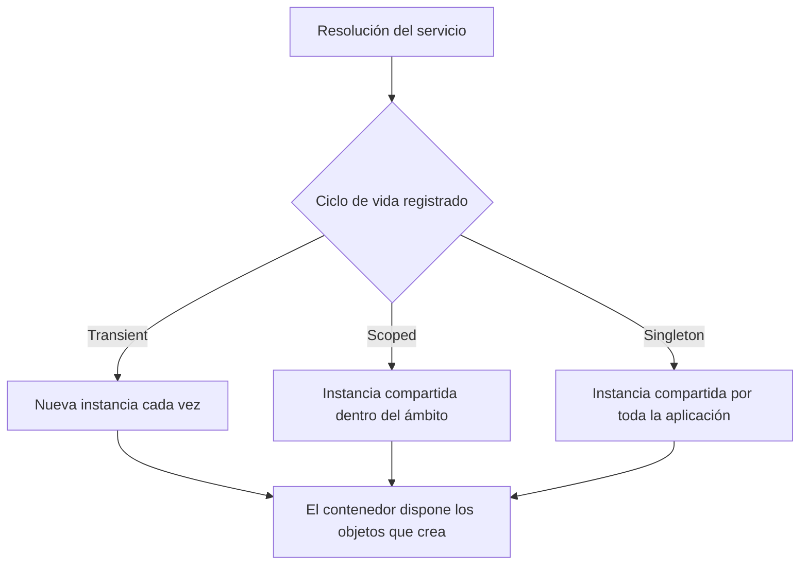
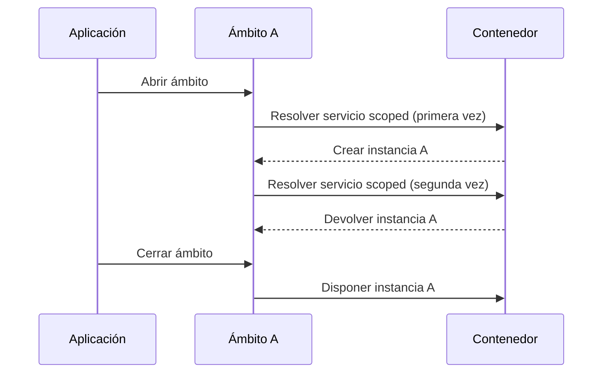
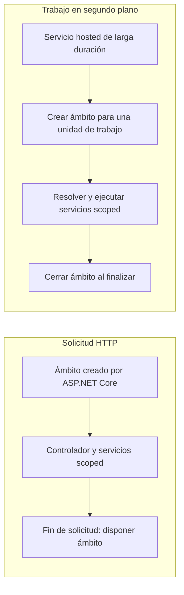
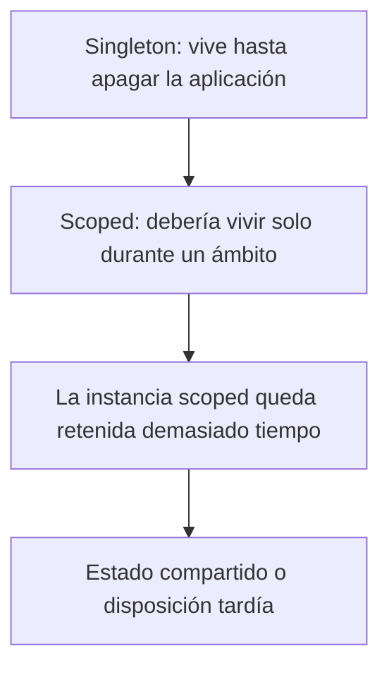

# Inyección de dependencias en .NET

La inyección de dependencias (DI) permite que una clase reciba los objetos que necesita en vez de construirlos directamente. En .NET, el contenedor estándar registra implementaciones y las crea cuando una aplicación las solicita. Las decisiones principales son qué servicio proporcionar y cuánto tiempo debe vivir cada instancia.

## Conceptos

### Servicio, registro y resolución

- **Servicio:** contrato o clase que realiza una tarea, por ejemplo `IClock`.
- **Implementación:** clase concreta que cumple ese contrato, por ejemplo `SystemClock`.
- **Registro:** regla que relaciona el contrato con la implementación y define su ciclo de vida.
- **Resolución:** obtención de una instancia desde el contenedor, normalmente mediante inyección por constructor.
- **Contenedor:** componente que crea el grafo de dependencias y dispone los objetos que administra.

El contenedor de .NET se configura durante el arranque. En aplicaciones modernas, `builder.Services` es la colección de registros y `builder.Build()` crea la aplicación que los consume.

### Ciclo de vida de una instancia

El ciclo de vida describe cuándo se crea una instancia, qué resoluciones la comparten y cuándo se libera. No es lo mismo que el alcance léxico de una variable de C#: una variable puede salir de ámbito mientras el objeto al que apunta sigue vivo, y el contenedor administra la duración de los servicios registrados.

Los tres ciclos de vida del contenedor integrado son:

| Ciclo de vida | Creación y reutilización | Uso típico |
| --- | --- | --- |
| `Transient` | Una instancia nueva en cada resolución del servicio. | Servicios pequeños sin estado propio que deba compartirse. |
| `Scoped` | Una instancia por ámbito. Las resoluciones dentro del mismo ámbito comparten la instancia. | Trabajo asociado a una unidad de operación; en ASP.NET Core, normalmente una solicitud HTTP. |
| `Singleton` | Una instancia por contenedor raíz, compartida durante la vida de la aplicación. | Servicios compartidos y seguros para uso concurrente, como una configuración o un coordinador sin estado mutable por solicitud. |



La duración de un ámbito determina cuándo termina un servicio `Scoped`. Por ejemplo, si se resuelve dos veces dentro del mismo ámbito, ambas resoluciones obtienen la misma instancia; en un ámbito nuevo, se obtiene otra.



### Ámbitos implícitos y explícitos

ASP.NET Core crea un ámbito para cada solicitud HTTP y lo cierra al completar la solicitud. Los servicios `Scoped` resueltos durante esa solicitud comparten su instancia, incluidos servicios como `DbContext`, que `AddDbContext` registra como scoped de forma predeterminada.

Fuera de una solicitud web no aparece automáticamente un ámbito de solicitud. Un `BackgroundService`, por ejemplo, tiene vida larga; si necesita servicios scoped, debe crear un ámbito explícito para cada unidad de trabajo y cerrarlo al terminar.



## Implementación en C#

### Registrar servicios

Los métodos de `IServiceCollection` registran servicios. El tipo genérico distingue el contrato (`IClock`) de la clase concreta (`SystemClock`).

```csharp
var builder = WebApplication.CreateBuilder(args);

builder.Services.AddTransient<IClock, SystemClock>();
builder.Services.AddScoped<IOrderService, OrderService>();
builder.Services.AddSingleton<IApplicationInfo, ApplicationInfo>();

var app = builder.Build();
```

También se puede registrar una clase sin interfaz con `AddScoped<OrderService>()`, o una instancia creada por el código con `AddSingleton(new ApplicationInfo("Ventas"))`. Una instancia registrada de esta última forma no la construye el contenedor y su disposición debe administrarse teniendo en cuenta quién la creó.

### Inyectar por constructor

La forma habitual de consumir dependencias es declararlas en el constructor. El contenedor construye `OrderController` y le proporciona un `IOrderService` registrado.

```csharp
public sealed class OrderController(IOrderService orders) : ControllerBase
{
    [HttpGet("{id}")]
    public async Task<ActionResult<OrderDto>> Get(
        int id,
        CancellationToken cancellationToken)
    {
        var order = await orders.FindAsync(id, cancellationToken);
        return order is null ? NotFound() : Ok(order);
    }
}
```

La inyección por constructor hace explícitas las dependencias requeridas y permite usar implementaciones alternativas en pruebas. Evita usar `IServiceProvider` como localizador de servicios en las clases de negocio; las dependencias deberían aparecer en el constructor.

### Comparar instancias dentro de un ámbito

Este ejemplo muestra la semántica de reutilización. El `Guid` se genera al construir cada instancia:

```csharp
public sealed class OperationId
{
    public Guid Value { get; } = Guid.NewGuid();
}

var services = new ServiceCollection();
services.AddScoped<OperationId>();

using var provider = services.BuildServiceProvider();

using (var firstScope = provider.CreateScope())
{
    var first = firstScope.ServiceProvider.GetRequiredService<OperationId>();
    var again = firstScope.ServiceProvider.GetRequiredService<OperationId>();
    Console.WriteLine(first.Value == again.Value); // True: mismo ámbito
}

using (var secondScope = provider.CreateScope())
{
    var nextOperation = secondScope.ServiceProvider.GetRequiredService<OperationId>();
    Console.WriteLine(nextOperation.Value); // Identificador de otra instancia
}
```

En una aplicación ASP.NET Core, normalmente no se construye un proveedor manualmente: el host ya configura y administra el contenedor. El ejemplo independiente sirve para observar los ámbitos y no debe copiarse como patrón de configuración dentro de una aplicación web.

### `CreateScope()` y `CreateAsyncScope()`

Ambos métodos abren un ámbito hijo del proveedor raíz. El ámbito tiene su propio `IServiceProvider`; los servicios scoped resueltos desde ese proveedor se comparten entre sí y se disponen cuando se cierra el ámbito. No se crea un contenedor independiente: los singletons siguen siendo los mismos del contenedor raíz.

| Método | Resultado y cierre | Cuándo elegirlo |
| --- | --- | --- |
| `serviceProvider.CreateScope()` | Devuelve un `IServiceScope`; se cierra con `using` y dispone sincrónicamente los servicios del ámbito. | Código síncrono, cuando el trabajo y los servicios scoped se pueden cerrar de forma síncrona. |
| `serviceProvider.CreateAsyncScope()` | Devuelve un `AsyncServiceScope`; se cierra con `await using` y permite esperar la disposición asíncrona. | Código asíncrono, especialmente cuando el ámbito puede contener servicios `IAsyncDisposable` o el cierre forma parte de una operación async. |

Los dos son métodos de extensión disponibles para un `IServiceProvider` (por ejemplo, `app.Services` o el proveedor de otro ámbito). También existe `IServiceScopeFactory.CreateScope()` y `CreateAsyncScope()`; la fábrica es la dependencia recomendada para crear ámbitos dentro de servicios de larga duración, como un `BackgroundService`.

```csharp
// Unidad de trabajo síncrona
using (var scope = serviceProvider.CreateScope())
{
    var handler = scope.ServiceProvider.GetRequiredService<LegacyHandler>();
    handler.Process();
} // Dispone el ámbito y sus servicios scoped.

// Unidad de trabajo asíncrona
await using (var scope = serviceProvider.CreateAsyncScope())
{
    var handler = scope.ServiceProvider.GetRequiredService<AsyncHandler>();
    await handler.ProcessAsync(cancellationToken);
} // Espera la disposición del ámbito y de sus servicios async-disposable.
```

`CreateAsyncScope()` no resuelve los servicios de forma asíncrona: la resolución y construcción siguen siendo síncronas. El beneficio está al cerrar el ámbito. Los constructores de servicios no deben hacer trabajo async; expón un método async para esa operación y espéralo dentro del ámbito.

#### Casos de uso habituales

- **Procesar un mensaje o trabajo de cola:** crear un ámbito por mensaje, resolver el manejador y sus dependencias scoped, procesar y cerrar el ámbito antes de pasar al siguiente mensaje.
- **Procesar lotes en un `BackgroundService`:** abrir un ámbito por lote o unidad de trabajo, no uno para toda la vida del worker.
- **Operaciones con recursos asíncronos:** usar `CreateAsyncScope()` cuando servicios del ámbito liberan recursos mediante `IAsyncDisposable`, como parte de un cierre que puede requerir `await`.
- **Código síncrono de consola o composición manual:** usar `CreateScope()` si no hay trabajo asíncrono y todos los recursos pueden cerrarse sincrónicamente.

En una solicitud HTTP de ASP.NET Core no hace falta crear otro ámbito manual para el trabajo normal del controlador: el framework ya administra el ámbito de la solicitud. Un ámbito adicional se reserva para una unidad de trabajo con límites de vida distintos y claramente definidos.

#### Errores frecuentes

1. **Resolver un scoped desde el proveedor raíz.** `serviceProvider.GetRequiredService<MyDbContext>()` sobre el proveedor raíz hace que el servicio se comporte como si viviera hasta el cierre de la aplicación o falla si está activa la validación de ámbitos. Crea un ámbito y resuelve desde `scope.ServiceProvider`.
2. **Abrir un ámbito y no disponerlo.** Si no se usa `using` o `await using`, los servicios scoped que mantienen conexiones u otros recursos pueden permanecer vivos más de lo esperado. El ámbito debe cubrir solo la unidad de trabajo y cerrarse también cuando haya una excepción.
3. **Mantener un único ámbito en un servicio singleton o worker durante toda su vida.** Sus servicios scoped quedarían compartidos entre operaciones y no se liberarían hasta detener el proceso. Crea un ámbito dentro del bucle, alrededor de cada unidad de trabajo.
4. **Elegir `CreateScope()` y cerrar sincrónicamente un servicio solo async-disposable.** No se puede esperar correctamente `DisposeAsync` en ese cierre; usa `CreateAsyncScope()` con `await using` para que el cierre asíncrono se propague.
5. **Devolver una dependencia scoped fuera del bloque.** Por ejemplo, retornar un repositorio desde un método que acaba de cerrar el ámbito deja una referencia a un objeto ya dispuesto. Devuelve datos/materializados o completa toda la operación antes del cierre.
6. **Usar el proveedor de ámbito después de cerrar el ámbito.** El proveedor y los servicios que resolvió pertenecen a ese ámbito; no los guardes en campos de larga duración ni los captures en tareas que continuarán tras el bloque.
7. **Crear ámbitos anidados por costumbre.** Un ámbito anidado no convierte en nuevos los singletons y puede ocultar responsabilidades difusas. Normalmente basta con un ámbito por operación; delimita otro solo si de verdad necesitas que un grupo de servicios scoped se libere antes que el ámbito exterior.
8. **Pensar que `CreateAsyncScope()` hace async la creación del servicio.** La resolución sigue siendo inmediata y sincrónica. No bloquees dentro del constructor ni intentes esperar un constructor; mueve el trabajo asíncrono a un método explícito.

### Crear un ámbito en un servicio en segundo plano

Un `BackgroundService` se registra como servicio de larga duración. Inyecta `IServiceScopeFactory`, crea un ámbito para cada iteración y resuelve ahí los servicios scoped:

```csharp
public sealed class OrderWorker(IServiceScopeFactory scopeFactory)
    : BackgroundService
{
    protected override async Task ExecuteAsync(CancellationToken stoppingToken)
    {
        while (!stoppingToken.IsCancellationRequested)
        {
            await using var scope = scopeFactory.CreateAsyncScope();
            var processor = scope.ServiceProvider
                .GetRequiredService<IOrderBatchProcessor>();

            await processor.ProcessNextBatchAsync(stoppingToken);
        }
    }
}
```

`CreateAsyncScope` y `await using` permiten disponer al final del bloque los servicios que implementan disposición asíncrona. Para servicios únicamente síncronos también existe `CreateScope` con `using`. El token de cancelación deja que la operación termine al detener el host.

```csharp
builder.Services.AddScoped<IOrderBatchProcessor, OrderBatchProcessor>();
builder.Services.AddHostedService<OrderWorker>();
```

### Evitar dependencias cautivas

Una dependencia cautiva aparece cuando un servicio de vida larga conserva una dependencia de vida más corta. Por ejemplo, un singleton que captura un servicio scoped en su constructor mantendrá esa misma instancia fuera de los límites de los ámbitos esperados. Esto puede mezclar estado entre operaciones y retrasar la disposición del servicio.



Regla práctica: un servicio scoped puede depender de otro scoped o singleton; un transient puede depender de servicios de cualquiera de esos ciclos de vida, con cuidado si termina reteniendo alguno; un singleton no debe capturar un scoped. Si un singleton necesita realizar trabajo scoped, crea un ámbito explícito por operación usando `IServiceScopeFactory`.

En desarrollo, la validación de ámbitos del contenedor ayuda a detectar la resolución de scoped desde el proveedor raíz y dependencias cautivas. No resuelvas un servicio scoped directamente desde el proveedor raíz.

### Disposición y propiedad

El contenedor dispone las instancias `IDisposable` o `IAsyncDisposable` que crea cuando termina su ámbito o cuando se apaga el contenedor raíz. Por eso, el código de aplicación no debería disponer manualmente un servicio obtenido por DI mientras su ámbito sigue activo: el contenedor sigue siendo responsable de su ciclo de vida.

Mantén los ámbitos cortos y alineados con una unidad de trabajo. No guardes un `IServiceScope`, un proveedor de ámbito ni un servicio scoped en estado global o en un singleton.

## Referencias

- [Ciclo de vida de servicios en .NET](https://learn.microsoft.com/dotnet/core/extensions/dependency-injection/service-lifetimes)
- [Usar servicios scoped en un `BackgroundService`](https://learn.microsoft.com/dotnet/core/extensions/scoped-service)
- [Resumen de la inyección de dependencias en .NET](https://learn.microsoft.com/dotnet/core/extensions/dependency-injection/overview)
- [Inyección de dependencias en ASP.NET Core](https://learn.microsoft.com/aspnet/core/fundamentals/dependency-injection)
