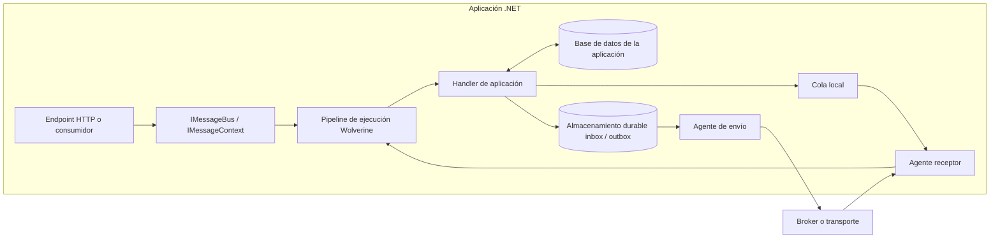
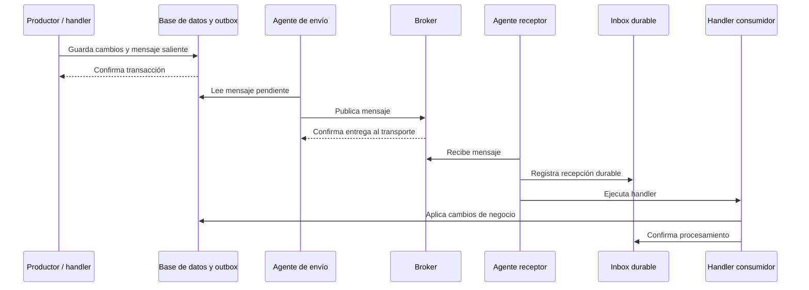

# Wolverine

Wolverine es un framework de mensajería y ejecución de comandos para aplicaciones .NET. Permite despachar comandos dentro del mismo proceso, procesar mensajes en colas locales y conectar aplicaciones mediante transportes externos. También ofrece integración con ASP.NET Core y mecanismos de persistencia para implementar inbox y outbox durables.

La biblioteca no reemplaza al broker ni a la base de datos de la aplicación: coordina el despacho, el enrutamiento, la ejecución de handlers y, cuando se configura persistencia, la recuperación de mensajes ante fallos.

- [Sitio y documentación oficial](https://wolverinefx.net/)
- [Repositorio oficial](https://github.com/JasperFx/wolverine)

## Características

- **Mediator en proceso:** permite invocar un comando y ejecutar su handler dentro de la aplicación, sin broker externo.
- **Bus local y asíncrono:** permite encolar trabajo dentro de la misma aplicación, con colas locales que pueden configurarse como durables.
- **Mensajería entre aplicaciones:** conecta productores y consumidores mediante transportes soportados por Wolverine, como RabbitMQ, Azure Service Bus, Amazon SQS, Kafka y SQL Server. Las opciones dependen del paquete de integración y de la versión usada.
- **Handlers por convención:** descubre métodos `Handle` o `Consume` cuyo primer argumento es el mensaje. Las dependencias adicionales se resuelven desde la inyección de dependencias.
- **Enrutamiento de mensajes:** configura destinos para mensajes o tipos concretos, tanto locales como externos.
- **Inbox y outbox durables:** guarda mensajes entrantes o salientes en almacenamiento persistente para recuperarlos y coordinar su procesamiento con transacciones compatibles.
- **Errores y reintentos:** permite definir políticas para reintentar, demorar, enviar a una cola de error o descartar mensajes según el tipo de fallo.
- **Mensajes programados:** admite enviar mensajes después de un intervalo, sujeto a las capacidades del transporte y a la configuración de persistencia.
- **Integración HTTP:** `Wolverine.Http` permite definir endpoints HTTP con la infraestructura de ejecución de Wolverine. También se puede invocar un handler desde un endpoint ASP.NET Core convencional mediante `IMessageBus`.

## Arquitectura

Wolverine conecta el código de aplicación con handlers y destinos de mensajería. Para una invocación en proceso, no se necesita un broker. Para comunicación asíncrona entre procesos, un agente de envío entrega el sobre del mensaje al transporte y un agente receptor lo entrega al pipeline del handler. La persistencia durable es una capacidad adicional que debe configurarse.



El diagrama muestra componentes posibles, no una instalación obligatoria única: el almacenamiento durable, los agentes de transporte y las colas externas dependen del escenario. En una llamada sincrónica local, el flujo puede limitarse al endpoint, `IMessageBus`, pipeline y handler.

### Flujo de procesamiento durable

El inbox y el outbox reducen la posibilidad de perder trabajo cuando se interrumpe el proceso o falla una dependencia. La garantía concreta depende de la configuración, el proveedor de persistencia y el transporte. Los consumidores deben diseñarse para tolerar entregas repetidas.



## Casos de uso

1. **Separar el endpoint HTTP de la lógica de aplicación.** El endpoint recibe un comando y usa `IMessageBus.InvokeAsync` para ejecutarlo en el handler correspondiente.
2. **Procesar trabajo de manera asíncrona.** Una aplicación publica un evento o comando y un worker conectado a un transporte lo procesa sin mantener abierta la solicitud HTTP original.
3. **Evitar la inconsistencia entre base de datos y publicación.** Una operación guarda cambios y el mensaje de salida mediante el patrón outbox, para que el mensaje no se publique si la transacción de negocio falla.
4. **Reintentar fallos transitorios.** Un consumidor puede volver a intentar errores de conectividad o concurrencia y derivar fallos persistentes a una cola de error para su inspección.
5. **Ejecutar procesos diferidos.** Un handler programa una notificación, vencimiento o recordatorio para una fecha posterior.
6. **Comunicar módulos de un monolito modular.** Los módulos pueden intercambiar mensajes y mantener límites explícitos sin desplegar un broker para cada flujo local.

## Ejemplos

### Handler local

Los handlers pueden ser clases ordinarias descubiertas por convención; el primer argumento de `Handle` es el mensaje y los argumentos restantes pueden ser dependencias registradas en DI.

```csharp
public sealed record CrearPedido(Guid ClienteId, decimal Total);
public sealed record PedidoCreado(Guid PedidoId);

public class CrearPedidoHandler
{
    public PedidoCreado Handle(CrearPedido comando, PedidosDbContext db)
    {
        var pedido = new Pedido(comando.ClienteId, comando.Total);
        db.Pedidos.Add(pedido);

        // El mensaje retornado se trata como un mensaje derivado.
        return new PedidoCreado(pedido.Id);
    }
}
```

Desde un endpoint Minimal API, una invocación local puede verse así:

```csharp
app.MapPost("/pedidos", (CrearPedido comando, IMessageBus bus) =>
    bus.InvokeAsync(comando));
```

### Cambio de base de datos y evento con outbox

Cuando el handler modifica datos y produce un mensaje que debe salir solo si la operación tiene éxito, configura la integración transaccional con el proveedor de persistencia y la biblioteca de base de datos utilizada. El atributo `[Transactional]` del ejemplo requiere que el middleware de transacciones correspondiente esté configurado.

```csharp
public class CrearPedidoHandler
{
    [Transactional]
    public static PedidoCreado Handle(CrearPedido comando, PedidosDbContext db)
    {
        var pedido = new Pedido(comando.ClienteId, comando.Total);
        db.Pedidos.Add(pedido);
        return new PedidoCreado(pedido.Id);
    }
}
```

El mensaje retornado se convierte en un mensaje derivado. Para usar este patrón de forma durable, configura el message store y la integración transaccional apropiados; no basta con añadir el atributo.

### Mensaje con demora

Un handler puede solicitar un envío diferido con `IMessageContext`. La durabilidad y el soporte efectivo dependen de la configuración y del transporte.

```csharp
public static Task ProgramarAviso(IMessageContext context, Guid pedidoId)
{
    var aviso = new AvisarPedidoPendiente(pedidoId);
    return context.ScheduleAsync(aviso, 3.Days());
}
```

### Política de reintentos

Define políticas de reintento según la causa. El siguiente ejemplo es ilustrativo; ajusta los tiempos y el destino de mensajes fallidos a la capacidad operativa del sistema.

```csharp
builder.Host.UseWolverine(opts =>
{
    opts.Policies.OnException<TimeoutException>()
        .RetryTimes(3);

    opts.Policies.OnException<IOException>()
        .RetryWithCooldown(
            50.Milliseconds(),
            100.Milliseconds(),
            250.Milliseconds());
});
```

## Limitaciones y compromisos

- **No garantiza por sí solo procesamiento exactamente una vez.** Una caída entre la ejecución del handler y la confirmación puede provocar una nueva entrega. Diseña handlers idempotentes y evita efectos secundarios irreversibles sin deduplicación.
- **Durabilidad requiere configuración e infraestructura.** El almacenamiento de mensajes, la transacción de negocio, el transporte y la retención deben configurarse y operarse. Sin inbox/outbox durable, el comportamiento ante reinicios es distinto.
- **Las garantías varían según el transporte.** Orden, confirmaciones, demoras, tamaño de mensajes, concurrencia, reintentos y semántica de entrega dependen del broker y del proveedor de Wolverine.
- **Los reintentos pueden amplificar problemas.** Reintentar errores permanentes o con intervalos cortos puede saturar servicios y retrasar otros mensajes. Los fallos no recuperables necesitan una política de descarte o cola de error y un proceso de revisión.
- **La mensajería asíncrona añade complejidad operativa.** Se deben supervisar colas, mensajes pendientes, edad del mensaje más antiguo, fallos, almacenamiento y conectividad con los brokers.
- **Los contratos de mensajes evolucionan.** Productores y consumidores desplegados en momentos distintos requieren compatibilidad hacia atrás o una estrategia explícita de versionado.
- **El mediator en proceso y el bus distribuido tienen semánticas distintas.** Una invocación local espera el resultado del handler; publicar en un transporte suele ser asíncrono y no equivale a recibir una respuesta de negocio.
- **La observabilidad no sustituye el diseño operativo.** Correlación, trazas, métricas, logs y alertas deben integrarse con la plataforma de observabilidad de la organización.

## Recomendaciones

1. Usa `InvokeAsync` para comandos locales que necesitan una respuesta inmediata; reserva la publicación asíncrona para trabajo que pueda completarse fuera de la solicitud actual.
2. Modela mensajes con contratos pequeños, serializables y estables. Evita enviar entidades de ORM o grandes objetos internos como contratos entre servicios.
3. Haz idempotentes los handlers que consumen mensajes externos; usa una clave de negocio o identificador de mensaje para detectar duplicados cuando sea necesario.
4. Configura inbox/outbox durable al requerir recuperación tras reinicios o consistencia entre escrituras de negocio y mensajes; valida que base de datos, middleware y transporte formen el flujo transaccional esperado.
5. Reintenta solo errores que puedan resolverse con el tiempo. Usa esperas progresivas, límites de reintento y una cola de error o mecanismo equivalente para mensajes agotados.
6. Define explícitamente los destinos y la topología de colas; limita el uso de publicación amplia a escenarios en los que la difusión a múltiples consumidores sea intencional.
7. Controla concurrencia y tamaño de lotes según la capacidad de la base de datos y de los servicios dependientes. Evita bloquear handlers durante operaciones de larga duración.
8. Trata la cola de error como parte del producto operativo: asigna responsables, alertas, diagnóstico y procedimiento de reenvío seguro.
9. Versiona los contratos y prueba la compatibilidad entre productor y consumidor, además de probar reintentos, duplicados, reinicio y fallos del broker.
10. Fija versiones compatibles de Wolverine y sus paquetes de transporte; consulta la documentación del paquete concreto antes de depender de una característica específica.

## Fuentes

- [Documentación oficial de Wolverine](https://wolverinefx.net/)
- [Conceptos básicos y terminología](https://wolverinefx.net/guide/basics)
- [Handlers](https://wolverinefx.net/guide/handlers/)
- [Message bus](https://wolverinefx.net/guide/messaging/message-bus)
- [Durabilidad, inbox y outbox](https://wolverinefx.net/guide/durability/)
- [Manejo de errores al enviar mensajes](https://wolverinefx.net/guide/messaging/sending-error-handling)
- [Tutorial de mediator](https://wolverinefx.net/tutorials/mediator)
