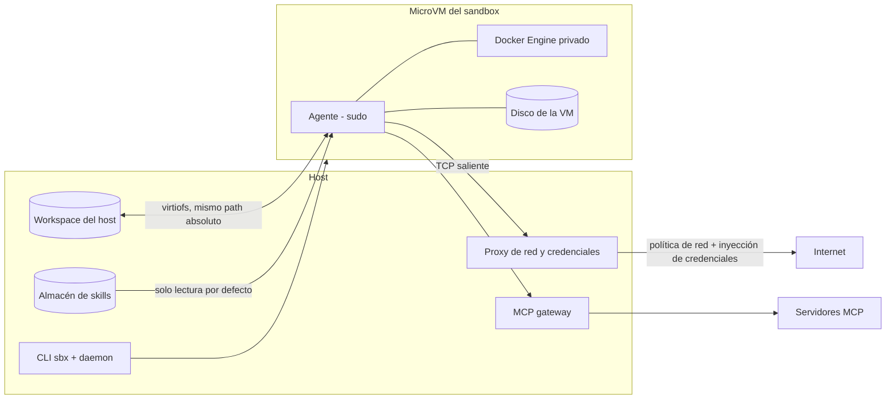

# Docker Sandboxes

> Fecha de revisión documental: **2026-11-20**. Investigación documental sobre la documentación oficial de Docker; no se realizó una instalación de prueba. Las capacidades dependen de la versión de `sbx` (el producto cambia con frecuencia), la plataforma y el plan.

## Descripción

Docker Sandboxes ejecuta agentes de código con IA (Claude Code, Codex, Kiro, etc.) dentro de **microVMs aisladas**, en la máquina del desarrollador (sandbox local) o en infraestructura administrada por Docker (sandbox cloud). Se gestiona con la CLI `sbx`, que **no requiere Docker Desktop ni Docker Engine**. [Documentación oficial](https://docs.docker.com/ai/sandboxes/).

La idea central: el sandbox es el límite de seguridad. Por eso los agentes se ejecutan sin solicitar aprobación por cada acción; el aislamiento sustituye a los mensajes de confirmación.

| Aspecto | Detalle |
|---|---|
| Qué es | Entorno aislado (microVM) para ejecutar agentes de código con IA |
| Interfaz | CLI `sbx`, panel interactivo en terminal (`sbx`), API/SDK para cloud |
| Licencia y costo | CLI y cómputo local gratuitos, incluido uso comercial. Cómputo cloud: pago por uso. Gobierno organizacional: suscripción de pago aparte. Los costos del proveedor del modelo son independientes |
| Identidad | Requiere iniciar sesión con cuenta Docker (`sbx login`) |
| Errores y mejoras | [github.com/docker/sbx-releases/issues](https://github.com/docker/sbx-releases/issues) |

## Características

| Capacidad | Descripción |
|---|---|
| Aislamiento por hipervisor | Cada sandbox tiene su propio kernel, sin memoria ni procesos compartidos con el host |
| Docker Engine privado | El agente puede construir imágenes y ejecutar contenedores sin acceso al daemon del host |
| Agentes soportados | Claude Code, Codex, Copilot, Cursor, Devin, Docker Agent, Droid, Kiro, OpenCode y `shell` (sin agente, para configuración manual) |
| Modos de workspace | Montaje directo (lectura/escritura), `--clone` (clon privado dentro del sandbox, repo del host en solo lectura), mountless (sin montaje) y workspaces adicionales con `:ro` |
| Política de red | Todo TCP saliente bloqueado por defecto; reglas con `sbx policy allow/ls`; UDP experimental; ICMP siempre bloqueado |
| Aislamiento de credenciales | Un proxy en el host inyecta las claves en las cabeceras HTTP; el agente solo ve un valor centinela |
| MCP gateway | Un único endpoint en el host que intermedia el acceso a servidores MCP registrados |
| Kits | Paquetes reutilizables de herramientas y configuración (instalación como root dentro del sandbox) |
| Plantillas | `sbx template save/load` para guardar el sistema de archivos del sandbox y reutilizarlo |
| Skills compartidas | Almacén en el host montado por defecto en solo lectura en los sandboxes de agentes soportados |
| Integraciones | Conexión por SSH desde VS Code, Cursor y similares; reenvío del agente SSH (firma de commits) |
| Hardware | GPU, USB, pantalla y virtualización anidada en sandboxes locales (según plataforma) |
| Puertos | `sbx port publish` expone puertos del sandbox en el host (en cloud, mediante URL HTTPS pública) |
| Gobierno | Políticas de red, filesystem y MCP administradas centralmente, enforcement de login y auditoría (suscripción aparte) |

### Comandos básicos

```console
$ sbx login                        # autenticación con Docker
$ sbx run claude                   # inicia el agente en el directorio actual
$ sbx run --clone claude .         # el agente trabaja en un clon privado
$ sbx create --name scratch claude # sandbox sin montaje del host
$ sbx ls                           # estado de los sandboxes
$ sbx exec -it <nombre> bash       # shell dentro del sandbox
$ sbx policy ls                    # reglas de red activas
$ sbx secret set ...               # guarda credenciales fuera del sandbox
$ sbx stop <nombre> && sbx rm <nombre>
```

## Arquitectura

Diagrama conceptual basado en la documentación; no representa la topología interna completa.



### Almacenamiento y persistencia

- **Montaje directo:** el directorio del host se comparte mediante virtiofs, con los mismos cambios en ambos sentidos y sin sincronización. Por defecto aparece en la misma ruta absoluta que en el host. El caché virtiofs está activo por defecto.
- **Clon (`--clone`):** el repo del host se monta en solo lectura en `/run/sandbox/source` y el agente trabaja en un clon dentro de la VM.
- **Mountless:** sin montaje; el directorio de trabajo es `/home/agent/workspace` en las plantillas de Docker.
- Paquetes, imágenes Docker, historial y archivos dentro de la VM **persisten hasta `sbx rm`**. Cada sandbox tiene su propio daemon y caché de imágenes; no se comparten capas entre sandboxes.
- Tamaños por defecto: disco raíz 20 GB (`DOCKER_SANDBOXES_ROOT_SIZE`) y disco de datos Docker 10 GB (`DOCKER_SANDBOXES_DOCKER_SIZE`); solo aplican al crear el sandbox.

### Red y credenciales

Todo TCP saliente pasa por un proxy en el host. HTTP/HTTPS usa proxy de reenvío (forward) y el resto de TCP se reenvía de forma transparente; ambos aplican la política. El proxy respeta el proxy del sistema operativo y puede encadenarse a un proxy upstream (función experimental, solo HTTP/HTTPS).

Flujo de una petición autenticada:

1. El agente ve un valor centinela en lugar de la clave real.
2. La petición sale de la microVM por el proxy del host.
3. La política de red comprueba el destino.
4. El proxy resuelve la credencial real sin copiarla a la VM.
5. El proxy reemplaza el centinela en la cabecera.
6. La respuesta vuelve al agente; la credencial nunca entra en la VM.

### Ciclo de vida

`sbx run` crea la VM e inicia el agente. Detener el agente no elimina la VM; los sandboxes persisten hasta `sbx rm`. `sbx prune` elimina los sandboxes detenidos y `--rm` crea una sesión desechable.

### Comparación con alternativas

| Enfoque | Aislamiento | Acceso a Docker | Uso |
|---|---|---|---|
| Sandboxes (microVM) | Completo (hipervisor) | Daemon aislado | Agentes autónomos |
| Contenedor con socket montado | Parcial (namespaces) | Daemon compartido del host | Herramientas de confianza |
| Docker-in-Docker | Parcial (privilegiado) | Daemon anidado | Pipelines CI/CD |
| Ejecución en el host | Ninguno | Daemon del host | Desarrollo manual |

El sandbox cambia mayor consumo de recursos (VM y daemon propios) por aislamiento completo.

### Local frente a cloud

| Capacidad | Local | Cloud |
|---|---|---|
| Cómputo | Recursos del host | Infraestructura de Docker |
| Workspace | Montaje del host o clon | Sin acceso a rutas del host; se transfieren archivos o se clona dentro |
| Hardware | GPU, USB, pantalla | No disponible |
| Puertos | Enlazados al host | URL HTTPS pública |
| Secretos y política de red | Almacén y política locales | Almacén (`sbx --cloud`) y política de solo red, separados |
| Filtrado L7 (método/ruta HTTP) | Soportado | No soportado |
| Duración | Hasta `sbx rm` | Expira según TTL |
| Costo | Sin cargo de cómputo | Pago por uso |

Los recursos de ambos backends son independientes (`sbx ls` frente a `sbx --cloud ls`). `sbx move` copia una instantánea del sistema de archivos entre ambos, pero no transfiere procesos, memoria, montajes del host ni secretos administrados.

## Seguridad

La frontera de confianza es la microVM: dentro, el agente tiene control total (sudo); hacia fuera, solo accede a lo compartido explícitamente.

| Capa | Función |
|---|---|
| Hipervisor | Kernel separado por sandbox |
| Red | Proxy en el host con política deny-by-default |
| Docker Engine | Daemon propio, sin ruta al del host |
| Workspace | Mountless, clon o montaje directo según el riesgo aceptado |
| Credenciales | Inyección en cabeceras HTTP desde el host |

Bloqueado siempre: acceso al filesystem del host fuera de los montajes, daemon Docker del host, comunicación directa entre sandboxes e ICMP externo.

## Casos de uso

| Caso | Configuración sugerida |
|---|---|
| Ejecutar un agente en modo autónomo (sin aprobaciones) con riesgo contenido | `sbx run <agente>` con política de red mínima |
| Trabajar sobre un repositorio sin exponer el árbol de trabajo | `--clone`; recuperar cambios con `git fetch` o push desde el sandbox |
| Varios agentes en paralelo sobre el mismo proyecto | Sandboxes con `--name` distinto, cada uno en clon o rama propia |
| Probar código o dependencias no confiables | Sandbox mountless y desechable (`sbx run --rm`) |
| Dar a un agente capacidad Docker completa (build, Compose, tests de integración) | Docker Engine privado del sandbox |
| Estandarizar el entorno del equipo | Kits y plantillas versionados |
| Control corporativo de agentes | Gobierno organizacional: políticas, enforcement de login y auditoría |
| Ejecución sin hardware local o desde CI | Sandboxes cloud y API/SDK |
| Experimentos con GPU | Sandbox local con passthrough de GPU |

## Limitaciones

- **Requisitos de plataforma:** macOS 14+ con Apple silicon; Windows 11 x64 con Windows Hypervisor Platform; Ubuntu 24.04+ con KVM y usuario en el grupo `kvm`. Las derivadas de Ubuntu no están soportadas. En máquinas virtuales se requiere virtualización anidada.
- **Sesión Docker obligatoria:** no se puede usar sin iniciar sesión.
- **Montaje directo:** el agente puede modificar archivos que se ejecutan de forma implícita (hooks de Git, `package.json`, `Makefile`, configuración de CI/IDE). Los hooks de `.git/` no aparecen en `git diff`.
- **Rendimiento:** no se recomienda montar unidades de red, SMB/NFS o carpetas sincronizadas en la nube. `git status` en repos grandes puede ser lento en modo directo.
- **Configuración fija al crear:** el modo de workspace, `--clone` y los tamaños de disco no se cambian después; hay que recrear el sandbox.
- **Configuración de usuario del agente:** no se importa `~/.claude` ni equivalentes del host. Las skills se gestionan con `sbx skills`. Los symlinks hacia el host no se resuelven.
- **Firma de commits:** solo SSH mediante el agente reenviado; GPG y S/MIME no están disponibles.
- **Red:** no se alcanza `127.0.0.1` del host desde el sandbox. SSH y otros TCP requieren reglas explícitas, UDP es experimental e ICMP está bloqueado. Los proxies con inspección TLS exigen instalar la CA corporativa en el sandbox y en las imágenes que construya.
- **Credenciales fuera del proxy:** las variables de entorno son legibles por procesos del sandbox, y las claves escritas en archivos viajan en plantillas y en `sbx move`. Las peticiones por la ruta `transparent` no reciben inyección de credenciales.
- **MCP:** los servidores stdio locales se ejecutan en el host con los permisos del host, fuera del aislamiento del sandbox.
- **Kits:** instalan comandos como root; el origen permitido por defecto es solo Docker Hub (`kit.allowedSources`).
- **Plantillas:** `sbx template save` no es una copia de seguridad (excluye montajes y `/var/lib/docker`); los archivos de configuración del agente se recrean al crear el sandbox.
- **Agentes dentro del sandbox:** no se actualizan al actualizar `sbx`; se actualizan dentro de cada sandbox.
- **Cloud:** sin acceso a hardware ni a rutas del host, filtrado L7 no disponible, expiración por TTL y secretos y políticas separados de los locales. Limitación conocida con `docker exec` y healthchecks.
- **Gobierno centralizado:** requiere suscripción de pago; con él activo, las reglas de permiso locales (`sbx policy allow`) dejan de evaluarse y solo valen las de la organización (las de denegación locales siguen aplicando).
- **Madurez:** el producto evoluciona rápido (por ejemplo, Kiro, Copilot y Droid pasaron de agentes integrados a kits en v0.42 y volvieron a resolverse por nombre desde v0.43); algunas funciones (UDP, proxy upstream, secretos personalizados) son experimentales.
- **Telemetría:** la CLI envía uso básico (comando, resultado, duración, usuario); no incluye prompts ni código. Se desactiva con `sbx settings set telemetry.disabled true`.

## Recomendaciones

1. **Preferir `--clone` o mountless** para código no confiable o agentes autónomos; usar montaje directo solo con revisión posterior de cambios (incluidos `.git/hooks`).
2. **Revisar y recortar la política de red** con `sbx policy ls`. Los dominios permitidos por defecto incluyen comodines amplios, como `*.googleapis.com`.
3. **Guardar credenciales con `sbx secret set`**, no en variables de entorno ni en archivos del sandbox. No guardar plantillas con secretos incrustados.
4. **No montar unidades de red** ni carpetas sincronizadas como workspace.
5. **Un sandbox por tarea o rama** con `--name`; limpiar con `sbx prune --dry-run` y `sbx df` para controlar el disco.
6. **Versionar la configuración del proyecto** (instrucciones del agente, skills del proyecto) en el repositorio y empaquetar el entorno repetible como kit.
7. **Limitar `kit.allowedSources`** a editores de confianza.
8. **Tratar los servidores MCP locales como integraciones del host** y registrar solo los necesarios.
9. **Dimensionar discos al crear** el sandbox si se construirán imágenes grandes.
10. **En entornos corporativos:** evaluar la suscripción de gobierno para política centralizada y auditoría, y añadir los dominios de Docker (login, Hub, registry, telemetría) a la lista de permitidos del firewall.
11. **Diagnóstico:** `sbx diagnose` primero; `sbx daemon restart` antes de `sbx reset`, que borra todos los sandboxes.
12. **Verificar la versión** de `sbx` antes de aplicar esta guía y volver a revisar la documentación oficial.

## Referencias

- [Docker Sandboxes](https://docs.docker.com/ai/sandboxes/)
- [Arquitectura](https://docs.docker.com/ai/sandboxes/architecture/)
- [Modelo de seguridad](https://docs.docker.com/ai/sandboxes/security/) y [postura por defecto](https://docs.docker.com/ai/sandboxes/security/defaults/)
- [Local frente a cloud](https://docs.docker.com/ai/sandboxes/cloud/local-vs-cloud/)
- [Instalación](https://docs.docker.com/ai/sandboxes/install/) · [Uso](https://docs.docker.com/ai/sandboxes/usage/) · [FAQ](https://docs.docker.com/ai/sandboxes/faq/) · [Solución de problemas](https://docs.docker.com/ai/sandboxes/troubleshooting/)
- En esta base: [Docker](../../container/docker.md) · [Kiro](kiro.md) · [Codex](codex.md) · [OpenCode](opencode-v2.md)
