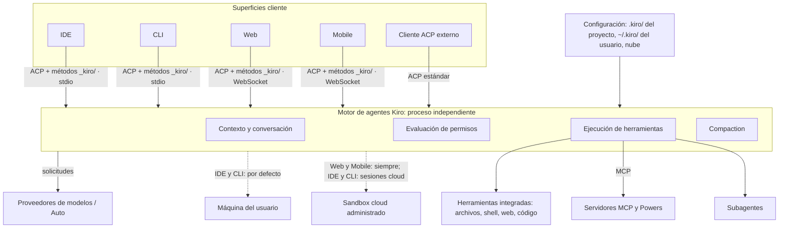
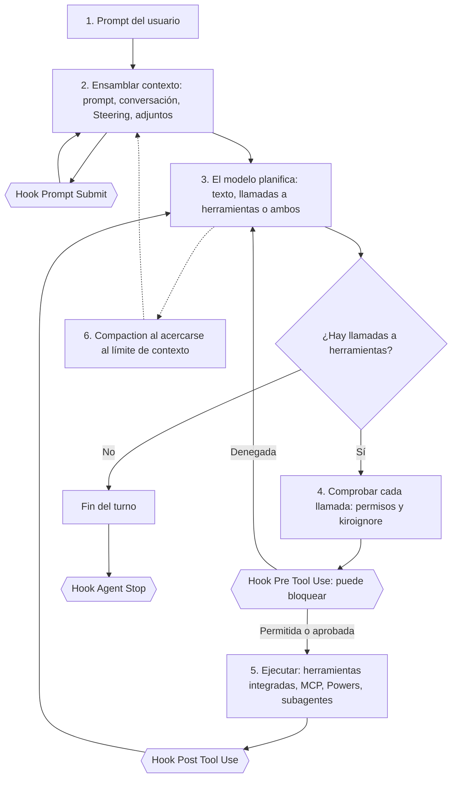
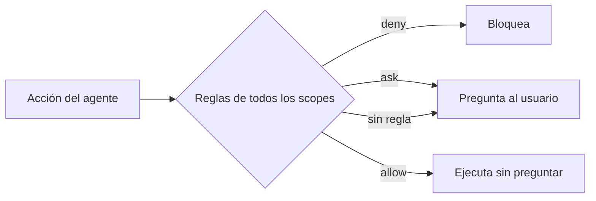

# Kiro

> Fecha de revisión documental, licencias y precios: **2026-11-18**. Importes en USD. Las capacidades dependen de versión, plataforma, región y plan. Investigación documental; no se realizó una instalación de prueba.

## Descripción

Kiro es el entorno de desarrollo con IA de AWS para pasar de una idea a código mediante conversación y especificaciones. Ofrece IDE, CLI y superficies Web y Mobile; estas comparten un motor de agentes, aunque la disponibilidad de cada función debe comprobarse por interfaz. [Documentación oficial](https://kiro.dev/docs/).

## Características

| Capacidad | Aplicación |
|---|---|
| Specs | Organizar requisitos, diseño y tareas verificables antes de implementar. |
| Chat | Explorar código y construir iterativamente. |
| Steering | Aportar convenciones e instrucciones del proyecto. |
| Hooks | Automatizar acciones ante eventos del agente. |
| Agentes personalizados y Skills | Reutilizar instrucciones y conocimiento especializado. |
| Powers y MCP | Incorporar herramientas, conocimiento e integraciones externas. |
| Subagentes | Delegar trabajo acotado en agentes especializados. |
| Checkpoints y compaction | Recuperar cambios y gestionar conversaciones extensas. |

Estas capacidades se describen en el [catálogo oficial de funciones](https://kiro.dev/docs/). Su uso requiere revisar permisos y compatibilidad de la superficie elegida.

### Desarrollo mediante especificaciones

Una especificación utiliza `requirements.md` —o `bugfix.md` para correcciones—, `design.md` y `tasks.md`. El flujo conecta criterios de aceptación, decisiones técnicas y ejecución. Puede ejecutar tareas independientes por grupos, respetando dependencias; algunas funciones avanzadas tienen distinta disponibilidad según la interfaz. [Specs](https://kiro.dev/docs/specs/).

## Arquitectura y funcionamiento

Kiro es un único agente disponible en varias superficies (IDE, CLI, Web y Mobile). Todas son clientes del mismo **motor de agentes** (*agent harness*), por lo que una regla de Steering, un agente personalizado o un servidor MCP configuran a Kiro y no a una aplicación concreta. Las capacidades se documentan una vez a nivel de Kiro, y cada superficie añade solo su propia experiencia. Fuente: [Cómo funciona Kiro](https://kiro.dev/docs/how-kiro-works/).

### Visión general

Diagrama conceptual reconstruido a partir del texto de la documentación; no reproduce la imagen oficial ni la topología interna completa de AWS.



### Motor de agentes

- Es un **proceso independiente**, no una biblioteca incluida en cada aplicación. Se ejecuta junto al código y es dueño de todo lo que ocurre del lado del agente: orquestar la conversación, ejecutar herramientas, gestionar el contexto, evaluar permisos y comunicarse con los proveedores de modelos. El cliente es dueño de cómo el usuario interactúa con él.
- Por ser un proceso aparte, puede iniciarse en el equipo del usuario o en un sandbox cloud y se comporta igual en ambos.
- Una capacidad funciona igual donde esté disponible: una regla de permisos deniega las mismas operaciones en CLI e IDE, y un archivo de Steering condiciona al agente igual en todas las superficies. Cada página de funciones indica en una tabla de disponibilidad dónde está implementada.
- En el CLI el motor se llama **V3**; también puede ejecutarse el anterior **V2**. Conviene verificar cuál inicia la versión instalada ([elección de motor](https://kiro.dev/docs/how-kiro-works/)).
- Una mejora del motor que no cambia el protocolo con el cliente llega a todas las superficies sin actualizar las aplicaciones.

### Comunicación cliente-motor (ACP)

Los clientes hablan con el motor mediante el [Agent Client Protocol](../protocolos/agent_client_protocol.md). Esto incluye las superficies propias de Kiro, que usan ACP **extendido con métodos propios** bajo el espacio de nombres `_kiro/` para funciones como Steering en vivo, flujos de specs, avisos de permisos enriquecidos y seguimiento del uso de contexto.

| Cliente | Transporte | Dónde corre el motor |
|---|---|---|
| IDE y CLI | stdio | Equipo del usuario (también pueden adjuntarse a sesiones cloud) |
| Web y Mobile | WebSocket | Sandbox cloud administrado |

El binario, las herramientas y el comportamiento son los mismos con cualquiera de los dos transportes. Un cliente ACP de terceros no necesariamente presenta las extensiones `_kiro/`. Para el protocolo en sí, véase el [documento de ACP](../protocolos/agent_client_protocol.md).

**ACP** conecta clientes con el agente; **MCP** conecta el agente con herramientas y datos externos.

### Ciclo de una solicitud

Al enviar un prompt desde cualquier superficie, el motor ejecuta el mismo ciclo:



1. **Se ensambla el contexto:** prompt, conversación previa, archivos de Steering y adjuntos. Los hooks *Prompt Submit* pueden inyectar contexto.
2. **El modelo planifica:** la solicitud va al modelo elegido, o *Auto* la enruta al más adecuado, y vuelve con texto, llamadas a herramientas o ambos.
3. **Se comprueba cada llamada:** se evalúan las reglas de permisos (`deny` prevalece sobre `ask`, y `ask` sobre `allow`) y los patrones de `kiroignore` donde estén activados. Los hooks *Pre Tool Use* pueden condicionar o bloquear la llamada.
4. **Se ejecutan las herramientas:** las integradas leen y editan archivos, ejecutan comandos y buscan en la web. MCP y Powers amplían el conjunto y los subagentes asumen trabajo delegado. Los hooks *Post Tool Use* reaccionan al resultado.
5. **Los resultados vuelven al modelo** y el ciclo se repite hasta terminar la tarea. Al completar el turno se activan los hooks *Agent Stop*.
6. **Se gestiona el contexto:** al acercarse al límite del modelo, la *compaction* resume el historial antiguo para que la sesión continúe.

Cada capacidad corresponde a una etapa del ciclo: una regla de permisos controla el paso 3 en todas partes y un archivo de Steering condiciona el paso 1 en todas partes.

### Dónde se ejecuta

| Superficie | Ejecución | Entrega de resultados |
|---|---|---|
| IDE y CLI | Por defecto en la máquina del usuario: sistema de archivos, shell, toolchain y credenciales locales. Opcionalmente, un [sandbox local de comandos](https://kiro.dev/docs/sandbox.md) limita su acceso a red. También pueden crear y adjuntarse a sesiones cloud. | Cambios en el árbol de trabajo local |
| Web y Mobile | Mismo motor en un sandbox cloud administrado: Kiro clona el repositorio conectado, trabaja en un entorno aislado y la sesión sigue activa al cerrar el equipo. | Pull requests o merge requests; nada se ejecuta en la máquina del usuario |

Una **sesión cloud** pertenece a la cuenta y no a una aplicación: puede iniciarse en una superficie y retomarse en otra.

Las superficies no son envoltorios finos. Un cliente puede aportar herramientas propias en lugar de las integradas: el IDE usa las API del editor para operar archivos y añade análisis de código nativo y diagnósticos del editor mediante el contexto `#Problems`.

| Superficie | Aporta |
|---|---|
| IDE | Diffs en línea, interfaz de checkpoints, paneles de specs, chat acoplable |
| CLI | TUI, modo headless para scripts y CI, autocompletado, gestión de sesiones |
| Web | Agente sin instalación, ejecución en sandbox, conexión a repositorios, entrega por pull request, tareas programadas |
| Mobile | Iniciar y dirigir sesiones desde el teléfono |

### Ámbitos de configuración

| Ámbito | Ubicación | Viaja con |
|---|---|---|
| Proyecto | `.kiro/` en el repositorio | El repositorio: Steering, specs, agentes, hooks y servidores MCP para todo el equipo y toda superficie que lo abra |
| Usuario | `~/.kiro/` | El usuario: agentes, skills, Steering y ajustes personales |
| Cloud | `~/.kiro/` sincronizado con la cuenta | El usuario, en cada sesión cloud |
| Confianza del workspace | `~/.kiro/workspace-roots/<hash>/` | Solo la máquina: permisos por proyecto fuera del repositorio, por lo que un repositorio clonado no puede concederse confianza |

Por esto Web y Mobile usan los agentes y el Steering del proyecto sin configuración adicional: leen el mismo `.kiro/` que IDE y CLI. Referencia completa: [ámbitos de configuración](https://kiro.dev/docs/how-kiro-works/).

### Consecuencias prácticas

- Un `permissions.yaml` escrito para el CLI es el mismo que consulta el IDE.
- Versionar `.kiro/` da el mismo comportamiento de agente a todo el equipo, sea cual sea la superficie.
- Las mejoras del motor llegan a todas las superficies a la vez.
## Permisos

Los permisos definen qué puede hacer el agente sin pedir confirmación. Esta sección describe el modelo de Kiro CLI V3 e IDE; Web usa un sandbox en la nube en lugar de `permissions.yaml`. Fuente: [Permisos](https://kiro.dev/docs/permissions.md) y [migración de permisos a V3](https://kiro.dev/docs/cli/v3/permissions.md).

### Visión conceptual

Un permiso es una regla que combina una **capacidad** (qué tipo de operación), un **patrón** (sobre qué) y un **efecto** (qué hacer). Las reglas se aplican a toda herramienta que realice esa operación, no a una herramienta concreta.



Principios del modelo:

- **Denegar prevalece.** Si alguna regla de cualquier scope deniega la acción, ningún `allow` la habilita.
- **Por defecto se pregunta.** Lo que ninguna regla resuelve pide aprobación.
- **Se separa lo que el agente ve de lo que puede hacer.** `tools` define las herramientas disponibles; `permissions` define qué operaciones se aprueban.
- **La confianza la fija el usuario.** Las reglas de proyecto se guardan fuera del repositorio, de modo que un repositorio clonado no puede concederse permisos a sí mismo.

### Cómo los gestiona Kiro

**Capacidades:** `fs_read`, `fs_write`, `shell`, `web_fetch`, `web_search`, `mcp`, `subagent`, `skill`, `power`, `context`, `diagnostics` y `sandbox_network`. Existen atajos: `all` (todas salvo `sandbox_network`), `builtin` y `filesystem` (`fs_read` + `fs_write`).

**Efectos:** `deny` (bloquea), `ask` (pregunta), `allow` (ejecuta) y `evaluate` (Kiro juzga la acción; es el más débil y solo aplica con *approve for me*).

**Scopes y ubicación**

| Scope | Ubicación | Efectos permitidos |
|---|---|---|
| Kiro | Reglas fijas del producto, no configurables | deny, ask |
| Administración | Políticas empresariales (`managed-settings.json`) | deny, ask |
| Usuario (máquina) | `~/.kiro/settings/permissions.yaml` | todos |
| Workspace (proyecto) | `~/.kiro/workspace-roots/<hash>/permissions.yaml` | todos |
| Agente | Campo `permissions` del perfil del agente | todos |
| Sesión | Memoria; decisiones tomadas durante la sesión | todos |

No hay precedencia entre scopes: gana el efecto más restrictivo (`deny` > `ask` > `allow` > `evaluate`).

**Comportamiento por defecto (sin `permissions.yaml`)**

- Permite leer archivos del workspace (`./**`), comandos de git de solo lectura (`git status`, `git log`, `git diff`) y de información del sistema (`pwd`, `whoami`).
- Todo lo demás, incluida la escritura de archivos, pide aprobación.
- Crear un `permissions.yaml` añade reglas a estos valores; no los reemplaza.

**Rutas protegidas por Kiro (ninguna regla `allow` las cambia)**

- Siempre denegadas: `~/.kiro/settings/`, `.kiro/settings/`, `~/.kiro/workspace-roots/` y `.kiroignore`.
- Siempre piden confirmación: `.git/**`, `.vscode/**`, `**/*.code-workspace` y los directorios `agents`, `hooks`, `workflows` y `powers` de `.kiro`.

**Confianza del workspace.** Mientras no se confíe en una carpeta, Kiro no carga sus agentes, Steering, MCP ni Skills, y pregunta antes de cada comando de shell y de cada llamada MCP, aunque exista un `allow`. Un `deny` sigue aplicando.

**Sintaxis de patrones**

- Archivos (`fs_read`, `fs_write`): `*` dentro de un directorio, `**` entre directorios, llaves y `[abc]`.
- Shell, web y MCP: solo `*`. No se admiten `**`, `?` ni expresiones regulares.
- `exclude` permite "todo excepto": por ejemplo, `npm *` salvo `npm publish*`.
- Los comandos compuestos (`;`, `&&`, `||`, `|`) se dividen y cada parte se evalúa por separado.

**Presets** (conjuntos de reglas `allow` reutilizables)

| Preset | Qué concede |
|---|---|
| `read-workspace` | Leer `./**` |
| `edit-workspace` | Leer y escribir `./**` |
| `read-all` | Leer en cualquier ruta, `web_fetch` y `web_search` |
| `read-only-shell` | Comandos de consulta de git, npm, docker, kubectl y similares |
| `dev-shell` | Lo anterior, escrituras de git, herramientas de build y operaciones básicas de archivos |
| `allow-all` | Todas las capacidades salvo `sandbox_network` |
| `approve-for-me` | `edit-workspace` y `read-only-shell`, más juicio automático del resto; requiere el clasificador de confianza |

### Características

- Las reglas aplican igual en IDE y CLI. Web no usa `permissions.yaml`.
- Las reglas de proyecto residen fuera del repositorio y por usuario.
- Un agente puede incluir sus propias reglas en el campo `permissions`.
- Un subagente solo ejecuta sin preguntar lo que también permite la política de la sesión padre; el resultado más estricto prevalece.
- En ejecución sin interfaz (headless), todo `ask` se trata como `deny`. Solo se ejecuta lo permitido de forma explícita.
- `toolsSettings` y `allowedTools` pertenecen a CLI 2.x y V3 no los lee. `/upgrade-agent` convierte las reglas compatibles e informa de lo que requiere revisión manual.

### Recomendaciones

1. Partir de los valores por defecto y añadir `allow` solo para operaciones repetitivas y conocidas.
2. Usar presets en vez de reglas manuales cuando coincidan con la tarea: `read-workspace` para revisión, `edit-workspace` más `dev-shell` para ciclos de construcción y prueba.
3. Definir `deny` para secretos (`**/.env`, `**/*.pem`, `secrets/**`) y comandos destructivos (`rm -rf *`, `sudo *`). Como ningún `allow` los supera, mantenerlos acotados.
4. Evitar `capability: all` con `allow` en la máquina del desarrollador. Reservarlo para entornos desechables, como un contenedor de CI.
5. Preferir reglas de proyecto para accesos que solo tienen sentido en un repositorio y reglas globales para los que aplican a todos.
6. No usar `--trust-all-tools` como política permanente: vale solo para la sesión y no sustituye a las reglas.
7. En CI, ejecutar sin interfaz con reglas `allow` explícitas y un `deny` para lo que el pipeline nunca debe tocar.
8. Confiar en un workspace solo después de revisar su contenido `.kiro`.
9. Si se usa *approve for me*, mantener las reglas `deny` y considerar el [sandbox local de comandos](https://kiro.dev/docs/sandbox.md).

### Configuración por nivel

**Global (máquina).** Crear `~/.kiro/settings/permissions.yaml`. En Windows es `%USERPROFILE%\.kiro\settings\permissions.yaml`.

```yaml
# ~/.kiro/settings/permissions.yaml  (aplica a todos los proyectos)
rules:
  # Leer y escribir solo dentro del directorio de trabajo
  - capability: fs_read
    match: ["./**"]
    effect: allow
  - capability: fs_write
    match: ["./**"]
    effect: allow

  # Comandos habituales de desarrollo
  - capability: shell
    match: ["git *", "npm *"]
    exclude: ["npm publish*", "git push*"]
    effect: allow

  # Bloqueos que ningún allow puede anular
  - capability: fs_read
    match: ["**/.env", "**/.env.*", "**/*.pem", "secrets/**"]
    effect: deny
  - capability: shell
    match: ["rm -rf *", "sudo *"]
    effect: deny
```

```powershell
# Windows (PowerShell): crear el archivo global si no existe
New-Item -ItemType Directory -Force "$env:USERPROFILE\.kiro\settings" | Out-Null
notepad "$env:USERPROFILE\.kiro\settings\permissions.yaml"
```

```bash
# Linux / macOS
mkdir -p ~/.kiro/settings && ${EDITOR:-nano} ~/.kiro/settings/permissions.yaml
```

**Por proyecto (carpeta de trabajo).** El archivo es `~/.kiro/workspace-roots/<hash>/permissions.yaml`, donde `<hash>` se calcula a partir de la ruta raíz del workspace. La documentación consultada no detalla el algoritmo del hash, por lo que conviene que Kiro cree el archivo, por ejemplo con `/permissions` → **Policies** dentro de la carpeta del proyecto, y luego editarlo. Funciona igual en una carpeta con git o sin git.

```yaml
# ~/.kiro/workspace-roots/<hash>/permissions.yaml  (solo este proyecto)
policies:
  - edit-workspace      # leer y escribir ./**
  - read-only-shell     # consultas de git, npm, docker, etc.

rules:
  - capability: fs_write
    match: ["*.env", "*.pem", "*.key"]
    effect: deny
```

```text
# Dentro de una sesión de Kiro CLI iniciada en la carpeta del proyecto
/permissions        # ver reglas y abrir la página Policies
```

**Por agente.** Las reglas viajan con el perfil y se versionan con el proyecto (`.kiro/agents/`), pero Kiro las carga solo si el workspace es de confianza.

```json
{
  "name": "workspace-only",
  "tools": ["read", "write"],
  "permissions": {
    "rules": [
      { "capability": "fs_read",  "match": ["./**"], "effect": "allow" },
      { "capability": "fs_write", "match": ["./**"], "effect": "allow" }
    ]
  }
}
```

**Por sesión (temporal).** No dejan archivos; vencen al cerrar la sesión.

```bash
# Confiar en todas las herramientas durante esta sesión (usar con cuidado)
kiro-cli chat --v3 --trust-all-tools

# Sin interfaz: aprobar solo herramientas concretas
kiro-cli chat --v3 --no-interactive --trust-tools=read_file,grep_search "Revisa este repositorio"

# Ya dentro de una sesión interactiva
/tools trust-all
```

Un cliente ACP puede pedir presets al abrir la sesión mediante `_meta.kiro.policyPreset`; las reglas quedan en memoria y el cliente debe pedirlas de nuevo si la sesión se reinicia por completo:

```json
{ "_meta": { "kiro": { "policyPreset": ["edit-workspace", "dev-shell"] } } }
```

**CI sin interfaz (solo en entornos desechables):**

```yaml
# ~/.kiro/settings/permissions.yaml (entorno de CI)
rules:
  - capability: all
    effect: allow
```

## Casos de uso

Los siguientes son escenarios recomendados a partir de las capacidades documentadas:

- **Nueva funcionalidad:** convertir una necesidad en criterios de aceptación, diseño y tareas; revisar la propuesta y validar cada entrega.
- **Corrección de defectos:** documentar comportamiento actual, esperado y aquello que debe mantenerse; implementar y ejecutar pruebas de regresión.
- **Incorporación a un proyecto:** explicar módulos y registrar convenciones mediante Steering.
- **Mantenimiento repetitivo:** utilizar Hooks y herramientas para comprobaciones o actualización de documentación, con permisos delimitados.
- **Trabajo desde terminal o editor existente:** elegir CLI o un cliente ACP compatible según el flujo del equipo.

## Limitaciones

- La salida del agente requiere revisión: una especificación generada puede contener supuestos incorrectos y las pruebas generadas pueden omitir casos relevantes.
- Las tablas de disponibilidad distinguen capacidades de IDE, CLI, Web y Mobile; compartir motor no garantiza una interfaz idéntica. [Specs](https://kiro.dev/docs/specs/).
- Los modelos, herramientas y tareas consumen créditos; una solicitud compleja no equivale a un solo crédito. [Precios](https://kiro.dev/pricing/).
- Ejecutar herramientas localmente no implica inferencia completamente local ni funcionamiento sin conexión.
- Kiro puede conservar prompts, respuestas, código y metadatos. Las cuentas individuales, incluidas las de pago, tienen condiciones de mejora del servicio sujetas a exclusión voluntaria; las empresariales tienen tratamiento distinto. La región de almacenamiento puede diferir de la de inferencia. [Protección de datos](https://kiro.dev/docs/privacy-and-security/data-protection/).

## Recomendaciones

1. Empezar con una funcionalidad pequeña, criterios observables y pruebas existentes.
2. Versionar las especificaciones y convenciones útiles del proyecto; revisar sus cambios junto con el código.
3. Mantener revisión humana para decisiones de arquitectura, cambios de datos y publicación.
4. Conceder a terminal y MCP solo los accesos necesarios. Revisar qué contenido se envía al servicio y configurar privacidad según la cuenta.
5. Medir consumo y tiempo ahorrado durante un piloto antes de elegir plan. Seleccionar modelos según dificultad y costo, verificando el catálogo vigente.
6. Comprobar versión del motor y compatibilidad de extensiones antes de adoptar un cliente ACP.

Estas son recomendaciones de adopción de esta base de conocimiento, no garantías del proveedor.

## Licencias

Kiro IDE y Kiro CLI son **software propietario**: se licencian como AWS Content bajo el acuerdo aplicable con AWS y la AWS Intellectual Property License. Sus componentes abiertos conservan sus licencias y atribuciones; ello no convierte al producto completo en código abierto. El nivel Free describe una modalidad de uso, no una licencia libre. [Licencia oficial](https://kiro.dev/license/).

La licencia de **Kiro Crew es diferente**; consultar el [documento de Crew](../multi-agente/kiro-crew.md#licencias).

## Precios

**Revisión: 2026-11-18.** Tarifas comerciales publicadas, sin impuestos. [Fuente oficial de precios](https://kiro.dev/pricing/).

| Plan individual | USD por usuario/mes | Créditos mensuales |
|---|---:|---:|
| Free | 0 | 50 |
| Pro | 20 | 1.000 |
| Pro+ | 40 | 2.000 |
| Pro Max | 100 | 5.000 |
| Power | 200 | 10.000 |

Los planes individuales de pago permiten comprar créditos adicionales a **USD 0,04/crédito**. Un crédito mide trabajo y varía por modelo y complejidad; no representa un mensaje ni una cantidad fija de tokens.

La modalidad de **créditos compartidos para equipos**, desde dos puestos, publica **USD 20/puesto/mes**, **500 créditos por puesto/mes** y **USD 0,04 por crédito adicional**. Es una oferta diferente de Pro individual. Los requisitos empresariales deben confirmarse con AWS.

Evitar presupuestar promociones como ahorro permanente. Para estimar gasto: cuota del plan + créditos adicionales adquiridos + impuestos + servicios externos. El CLI está incluido en la tarifa estándar de Kiro. [CLI y facturación](https://kiro.dev/cli/).

## Kiro Crew

[Kiro Crew](../multi-agente/kiro-crew.md) agrega un espacio persistente con memoria, programación de trabajos y coordinación de agentes sobre infraestructura propia. Conviene evaluarlo cuando el trabajo deba continuar entre conversaciones o ejecutarse periódicamente.

## Fuentes y mantenimiento

- [Documentación general](https://kiro.dev/docs/).
- [Arquitectura del agente](https://kiro.dev/docs/how-kiro-works/).
- [Specs](https://kiro.dev/docs/specs/) y [ACP](https://kiro.dev/docs/acp/).
- [Permisos](https://kiro.dev/docs/permissions.md) y [migración de permisos a V3](https://kiro.dev/docs/cli/v3/permissions.md).
- [Protección de datos](https://kiro.dev/docs/privacy-and-security/data-protection/).
- [Licencia](https://kiro.dev/license/) y [precios](https://kiro.dev/pricing/).

Revisar precios, licencias, privacidad y compatibilidad antes de contratar o actualizar una instalación. Registrar la nueva fecha de revisión al modificar estos datos.
