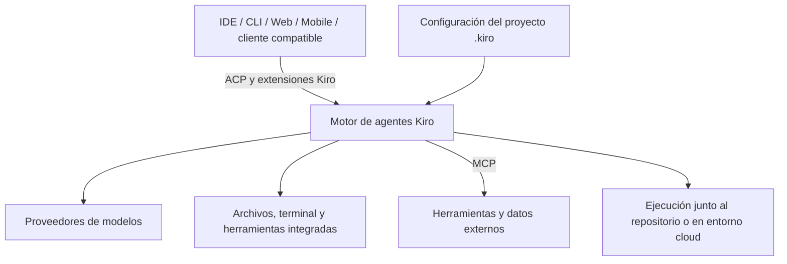

# Kiro

> Fecha de revisión documental, licencias y precios: **2026-11-18**. Importes en USD. Las capacidades dependen de versión, plataforma, región y plan. Investigación documental; no se realizó una instalación de prueba.

## Descripción

Kiro es el entorno de desarrollo con IA de AWS para pasar de una idea a código mediante conversación y especificaciones. Ofrece IDE, CLI y superficies Web y Mobile; estas comparten un motor de agentes, aunque la disponibilidad de cada función debe comprobarse por interfaz. [Documentación oficial](https://kiro.dev/docs/).

## Características

| Capacidad | Aplicación |
|---|---|
| Specs | Organizar requisitos, diseño y tareas verificables antes de implementar. |
| Chat | Explorar código y construir iterativamente. |
| Steering | Aportar convenciones e instrucciones del proyecto. |
| Hooks | Automatizar acciones ante eventos del agente. |
| Agentes personalizados y Skills | Reutilizar instrucciones y conocimiento especializado. |
| Powers y MCP | Incorporar herramientas, conocimiento e integraciones externas. |
| Subagentes | Delegar trabajo acotado en agentes especializados. |
| Checkpoints y compaction | Recuperar cambios y gestionar conversaciones extensas. |

Estas capacidades se describen en el [catálogo oficial de funciones](https://kiro.dev/docs/). Su uso requiere revisar permisos y compatibilidad de la superficie elegida.

### Desarrollo mediante especificaciones

Una especificación utiliza `requirements.md` —o `bugfix.md` para correcciones—, `design.md` y `tasks.md`. El flujo conecta criterios de aceptación, decisiones técnicas y ejecución. Puede ejecutar tareas independientes por grupos, respetando dependencias; algunas funciones avanzadas tienen distinta disponibilidad según la interfaz. [Specs](https://kiro.dev/docs/specs/).

## Arquitectura

Diagrama conceptual basado en la documentación; no representa la topología interna completa de AWS.

El motor es un proceso separado que administra conversación, contexto, herramientas, permisos y comunicación con modelos. Puede ejecutarse junto al código local o en un entorno cloud administrado. La documentación identifica el motor actual del CLI como V3 y mantiene una opción V2 anterior: conviene verificar cuál inicia la versión instalada. [Cómo funciona Kiro](https://kiro.dev/docs/how-kiro-works/).

**ACP** conecta clientes con el agente; **MCP** conecta el agente con herramientas y datos. Un cliente externo no necesariamente presenta todas las extensiones de Kiro. [Integraciones ACP](https://kiro.dev/docs/acp/) · [ACP en esta base](../protocolos/agent_client_protocol.md).

## Casos de uso

Los siguientes son escenarios recomendados a partir de las capacidades documentadas:

- **Nueva funcionalidad:** convertir una necesidad en criterios de aceptación, diseño y tareas; revisar la propuesta y validar cada entrega.
- **Corrección de defectos:** documentar comportamiento actual, esperado y aquello que debe mantenerse; implementar y ejecutar pruebas de regresión.
- **Incorporación a un proyecto:** explicar módulos y registrar convenciones mediante Steering.
- **Mantenimiento repetitivo:** utilizar Hooks y herramientas para comprobaciones o actualización de documentación, con permisos delimitados.
- **Trabajo desde terminal o editor existente:** elegir CLI o un cliente ACP compatible según el flujo del equipo.

## Limitaciones

- La salida del agente requiere revisión: una especificación generada puede contener supuestos incorrectos y las pruebas generadas pueden omitir casos relevantes.
- Las tablas de disponibilidad distinguen capacidades de IDE, CLI, Web y Mobile; compartir motor no garantiza una interfaz idéntica. [Specs](https://kiro.dev/docs/specs/).
- Los modelos, herramientas y tareas consumen créditos; una solicitud compleja no equivale a un solo crédito. [Precios](https://kiro.dev/pricing/).
- Ejecutar herramientas localmente no implica inferencia completamente local ni funcionamiento sin conexión.
- Kiro puede conservar prompts, respuestas, código y metadatos. Las cuentas individuales, incluidas las de pago, tienen condiciones de mejora del servicio sujetas a exclusión voluntaria; las empresariales tienen tratamiento distinto. La región de almacenamiento puede diferir de la de inferencia. [Protección de datos](https://kiro.dev/docs/privacy-and-security/data-protection/).

## Recomendaciones

1. Empezar con una funcionalidad pequeña, criterios observables y pruebas existentes.
2. Versionar las especificaciones y convenciones útiles del proyecto; revisar sus cambios junto con el código.
3. Mantener revisión humana para decisiones de arquitectura, cambios de datos y publicación.
4. Conceder a terminal y MCP solo los accesos necesarios. Revisar qué contenido se envía al servicio y configurar privacidad según la cuenta.
5. Medir consumo y tiempo ahorrado durante un piloto antes de elegir plan. Seleccionar modelos según dificultad y costo, verificando el catálogo vigente.
6. Comprobar versión del motor y compatibilidad de extensiones antes de adoptar un cliente ACP.

Estas son recomendaciones de adopción de esta base de conocimiento, no garantías del proveedor.

## Licencias

Kiro IDE y Kiro CLI son **software propietario**: se licencian como AWS Content bajo el acuerdo aplicable con AWS y la AWS Intellectual Property License. Sus componentes abiertos conservan sus licencias y atribuciones; ello no convierte al producto completo en código abierto. El nivel Free describe una modalidad de uso, no una licencia libre. [Licencia oficial](https://kiro.dev/license/).

La licencia de **Kiro Crew es diferente**; consultar el [documento de Crew](../multi-agente/kiro-crew.md#licencias).

## Precios

**Revisión: 2026-11-18.** Tarifas comerciales publicadas, sin impuestos. [Fuente oficial de precios](https://kiro.dev/pricing/).

| Plan individual | USD por usuario/mes | Créditos mensuales |
|---|---:|---:|
| Free | 0 | 50 |
| Pro | 20 | 1.000 |
| Pro+ | 40 | 2.000 |
| Pro Max | 100 | 5.000 |
| Power | 200 | 10.000 |

Los planes individuales de pago permiten comprar créditos adicionales a **USD 0,04/crédito**. Un crédito mide trabajo y varía por modelo y complejidad; no representa un mensaje ni una cantidad fija de tokens.

La modalidad de **créditos compartidos para equipos**, desde dos puestos, publica **USD 20/puesto/mes**, **500 créditos por puesto/mes** y **USD 0,04 por crédito adicional**. Es una oferta diferente de Pro individual. Los requisitos empresariales deben confirmarse con AWS.

Evitar presupuestar promociones como ahorro permanente. Para estimar gasto: cuota del plan + créditos adicionales adquiridos + impuestos + servicios externos. El CLI está incluido en la tarifa estándar de Kiro. [CLI y facturación](https://kiro.dev/cli/).

## Kiro Crew

[Kiro Crew](../multi-agente/kiro-crew.md) agrega un espacio persistente con memoria, programación de trabajos y coordinación de agentes sobre infraestructura propia. Conviene evaluarlo cuando el trabajo deba continuar entre conversaciones o ejecutarse periódicamente.

## Fuentes y mantenimiento

- [Documentación general](https://kiro.dev/docs/).
- [Arquitectura del agente](https://kiro.dev/docs/how-kiro-works/).
- [Specs](https://kiro.dev/docs/specs/) y [ACP](https://kiro.dev/docs/acp/).
- [Protección de datos](https://kiro.dev/docs/privacy-and-security/data-protection/).
- [Licencia](https://kiro.dev/license/) y [precios](https://kiro.dev/pricing/).

Revisar precios, licencias, privacidad y compatibilidad antes de contratar o actualizar una instalación. Registrar la nueva fecha de revisión al modificar estos datos.
