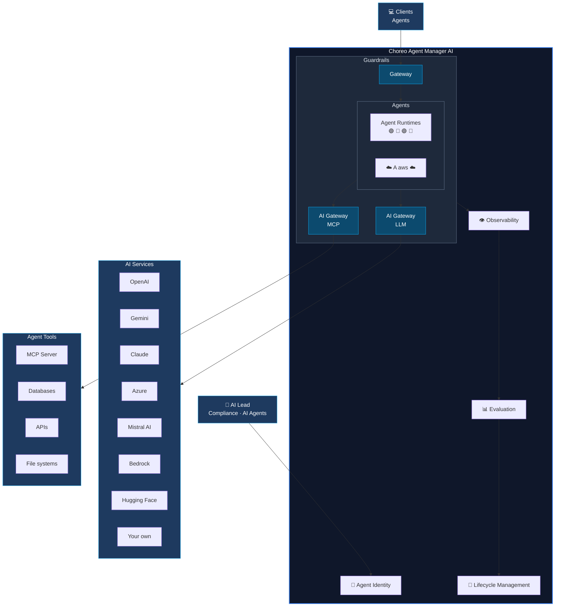
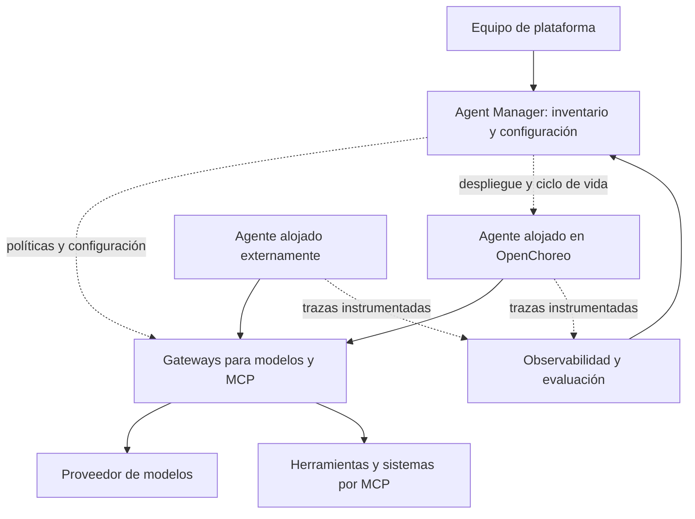

# Choreo Agent Manager (antes WSO2 Agent Manager)

Investigación documental consultada el **18 de noviembre de 2026**. Producto: [Choreo Agent Manager](https://choreolabs.com/agent-manager/). Empresa: **Choreo Labs**, anteriormente WSO2.

## Resumen

Choreo Agent Manager es un plano de control para registrar, desplegar, observar, evaluar y gobernar agentes de inteligencia artificial. Combina inventario, identidad, políticas y seguimiento de actividad con un runtime opcional para alojar agentes.

Está orientado a organizaciones que utilizan distintos frameworks y proveedores de modelos y quieren controles comunes. La página comercial menciona LangChain, CrewAI, AWS Strands y Microsoft Agent Framework, además de despliegues propios y cloud. La compatibilidad debe comprobarse por versión, lenguaje y mecanismo de instrumentación. [Página del producto](https://choreolabs.com/agent-manager/).

La distinción central es operativa: puede administrar todo el ciclo de vida de agentes alojados en la plataforma; para agentes externos necesita integración explícita y no controla su proceso de ejecución. [Tipos de agentes](https://choreolabs.com/agent-platform/docs/v2026.11.0/concepts/internal-and-external-agent/).

## Cambio de WSO2 a Choreo Labs

El cambio de nombre de la empresa entró en vigor el **17 de noviembre de 2026**. Según la FAQ oficial, no corresponde a una adquisición ni fusión: continúan la empresa, los equipos, los contratos y las licencias existentes. La denominación oficial se escribe **Choreo Labs**, en dos palabras; Choreo designa la plataforma.

Los repositorios, paquetes, imágenes y enlaces no cambiaron todos el día del anuncio. Esto explica que las fuentes técnicas todavía utilicen WSO2, nombres `wso2-*` y dominios anteriores. [FAQ del cambio de marca](https://choreolabs.com/blogs/wso2-is-now-choreo-labs-faqs/).

El anuncio corporativo identifica expresamente **Choreo Agent Manager como el antiguo WSO2 Agent Manager**, junto con Choreo AI Gateway y Choreo Agent ID. No son dos generaciones independientes del producto. [Anuncio corporativo](https://choreolabs.com/news/wso2-is-now-choreo-labs/).

## Disponibilidad y versiones

- El comunicado de disponibilidad general está fechado el **15 de septiembre de 2026** y anuncia despliegue autogestionado y SaaS. [Comunicado de disponibilidad general](https://wso2.com/about/news/wso2-agent-manager-sovereign-ai-governance/).
- Las descargas distinguen **v1.0.0 LTS** y **2026.11.0 STS**, con distintas ventanas de soporte y distribución. [Descargas](https://wso2.com/products/downloads/?package=local&product=wso2agentmanager).
- La publicación **2026.11.0 STS** en GitHub indica distribución para clientes con suscripción y acceso a charts e imágenes mediante credenciales. [Releases oficiales](https://github.com/wso2/agent-manager/releases).

La historia pública tiene una discrepancia: el anuncio del 5 de mayo describe el lanzamiento beta, mientras el comunicado de septiembre lo sitúa en junio. El índice de noticias también muestra una fecha de septiembre distinta de la del cuerpo del comunicado de disponibilidad general. Para esta investigación se adopta la fecha explícita del cuerpo del anuncio de GA y se conserva la discrepancia. [Anuncio beta](https://wso2.com/about/news/wso2-launches-agent-manager/), [índice de noticias](https://choreolabs.com/news), [anuncio GA](https://wso2.com/about/news/wso2-agent-manager-sovereign-ai-governance/).

## Características

| Capacidad | Aplicación práctica |
|---|---|
| Inventario federado | Reunir agentes alojados y registrados desde otros entornos. |
| Identidad | Atribuir el acceso a una identidad propia del agente. |
| Gobierno de tráfico | Aplicar controles sobre llamadas a modelos y herramientas MCP. |
| Observabilidad | Revisar trazas de ejecuciones y llamadas a herramientas. |
| Evaluación | Medir calidad, uso de herramientas y eficiencia. |
| Ciclo de vida | Versionar y promover agentes alojados entre entornos. |
| Aislamiento | Seleccionar niveles de aislamiento para cargas alojadas. |

La página comercial publica más de 40 guardrails y 24 evaluadores, además de suspensión desde la consola. Estas cifras describen la oferta anunciada: no implican que todas las políticas estén activadas o que todas las acciones sean aplicables a un agente externo. [Capacidades anunciadas](https://choreolabs.com/agent-manager/).

## Arquitectura

El proyecto utiliza **OpenChoreo para los despliegues internos** y **OpenTelemetry para instrumentación**. El repositorio incluye consola, servicio de control, componentes de observabilidad, evaluación e instrumentación, además de charts Helm para Kubernetes. [Repositorio oficial](https://github.com/wso2/agent-manager).

### Vista funcional reconstruida del video del producto

Diagrama aportado por el usuario, reconstruido a partir de una representación del video de la [página oficial de Choreo Agent Manager](https://choreolabs.com/agent-manager/). Incorporado el **18 de noviembre de 2026**. Se conserva como representación funcional; no se verificó el fotograma ni se dispone de una marca de tiempo del video.

#### Cómo interpretar esta vista

- **Entrada:** el responsable de IA y cumplimiento administra la identidad; clientes y otros agentes acceden por el gateway de entrada.
- **Ejecución y salida:** los runtimes se conectan con servicios de modelos mediante AI Gateway LLM y con herramientas mediante AI Gateway MCP.
- **Funciones transversales:** identidad, guardrails, observabilidad, evaluación y gestión del ciclo de vida acompañan la operación. Las flechas entre estas últimas funciones expresan una relación conceptual; no establecen una secuencia obligatoria para cada solicitud.
- **Herramientas:** las bases de datos, APIs y sistemas de archivos representan recursos accesibles mediante herramientas o servidores MCP adaptados para ello; el dibujo no demuestra conectividad directa del gateway con cada recurso.
- **Alcance:** los nombres de proveedores e iconos se conservan de la representación aportada y no constituyen una matriz de compatibilidad ni una identificación verificable de cada logotipo. Alojar agentes externos dentro del contenedor visual indica alcance de gestión, no alojamiento físico ni control automático de su ejecución.

### Vista de responsabilidades y rutas de integración

El siguiente esquema complementa la vista funcional y resume responsabilidades; no representa una topología obligatoria:

El plano de control distribuye configuración y recibe telemetría; las políticas de tráfico se ejecutan en los gateways. La lógica de planificación y colaboración entre agentes continúa en el framework o código de la aplicación. Registrar un agente externo no redirige sus llamadas. [Explicación arquitectónica del fabricante](https://wso2.com/api-platform/learn/agent-platform-architecture/).

Interpretación para diseño: conviene separar cuatro preguntas: dónde corre el agente, qué identidad utiliza, por dónde pasan sus llamadas y dónde se guarda la evidencia. Una única consola no elimina estas dependencias.

## Agentes alojados frente a externos

| Aspecto | Alojado en la plataforma | Alojado externamente |
|---|---|---|
| Construcción y despliegue | Los gestiona Agent Manager. | Los conserva el operador externo. |
| Promoción y suspensión del proceso | Gestionadas por la plataforma. | No gestionadas por Agent Manager. |
| Credenciales y endpoints | Inyección en la carga alojada. | Configuración por el operador. |
| Trazas | Instrumentación disponible para cargas compatibles. | Requiere conectar instrumentación y exportación. |

La elección del tipo se realiza al crear el agente y no puede cambiarse después según la documentación STS consultada. Los agentes externos con soporte A2A pueden registrar una Agent Card por entorno y utilizar rutas de gateway compatibles. [Diferencias operativas](https://choreolabs.com/agent-platform/docs/v2026.11.0/concepts/internal-and-external-agent/).

## Seguridad

### Identidad y autorización

AgentID proporciona una identidad OAuth 2.0 propia por agente y entorno, mediante `client_credentials`. Cada entorno tiene su instancia ThunderID, de modo que una promoción no equivale a reutilizar una única identidad global. [Concepto AgentID](https://wso2.com/agent-platform/docs/v2026.11.0/concepts/agentid/).

La autorización administrativa utiliza scopes comunes en consola, API REST y servidores MCP. Por ejemplo, construir, suspender y acceder a producción son capacidades diferenciadas. Esto permite separar funciones del equipo sin depender únicamente de restricciones visuales de la consola. [Modelo de autorización](https://wso2.com/agent-platform/docs/v2026.11.0/reference/authorization/).

### Guardrails y gobierno de herramientas

Las políticas se ejecutan en las fases de solicitud o respuesta del gateway. Se compilan en su imagen; la consola selecciona cuáles aplicar y con qué parámetros. Algunas requieren servicios externos y parámetros globales adicionales.

Hay una limitación útil para evaluar extensibilidad: el selector MCP intersecta las políticas reportadas por el gateway con el catálogo público; las políticas MCP personalizadas no aparecen si no están publicadas allí. Una política visible o asignada tampoco demuestra que sus dependencias estén configuradas correctamente. [Funcionamiento de políticas](https://choreolabs.com/agent-platform/docs/v2026.11.0/concepts/guardrails-and-policies/).

Conclusión de integración: las llamadas que el agente realice directamente a un proveedor o herramienta, evitando los gateways gobernados, quedan fuera de esos controles de tráfico. Este punto debe probarse expresamente antes de considerar completa la cobertura. [Arquitectura y rutas de tráfico](https://wso2.com/api-platform/learn/agent-platform-architecture/).

## Observabilidad y evaluación

Para agentes Python externos, `amp-instrumentation` aporta instrumentación basada en OpenTelemetry y Traceloop. Existe una ruta manual con `init_otel()` para emitir spans propios. Cada versión del paquete fija una versión de Traceloop, por lo que se debe verificar la combinación compatible. [Instrumentación](https://wso2.com/agent-platform/docs/v2026.11.0/guides/amp-instrumentation/).

La evaluación analiza trazas después de ejecutar el agente. Incluye **24 evaluadores: 9 basados en reglas y 15 basados en un modelo evaluador**. Comprueban aspectos como latencia, tokens, secuencia de herramientas, precisión y fundamentación. Los evaluadores con modelos requieren credenciales y generan consumo del proveedor.

Esto exige distinguir prevención y evaluación: una puntuación posterior puede detectar una falla, pero no impide por sí misma una acción que ya ocurrió. Tampoco una evaluación con un modelo constituye una certificación de exactitud. [Evaluadores y niveles de evaluación](https://choreolabs.com/agent-platform/docs/v2026.11.0/concepts/evaluation/).

Los monitores permiten evaluar trazas históricas o futuras de forma periódica. Así se puede comparar una versión nueva con ejecuciones anteriores sin repetir todas las solicitudes. [Monitores](https://wso2.com/agent-platform/docs/v2026.11.0/guides/evaluation-monitors/).

## Aislamiento y despliegue

El aislamiento del runtime se aplica a agentes alojados. La documentación describe niveles basados en runc, gVisor y Kata Containers, configurados por entorno mediante Kubernetes RuntimeClass. Los niveles más fuertes requieren nodos dedicados y condiciones específicas del sistema. [Agent Sandboxing](https://wso2.com/agent-platform/docs/v2026.11.0/concepts/agent-sandboxing/).

Para la instalación STS en un entorno propio, la guía indica Kubernetes 1.32 o superior y tres nodos de 4 CPU y 8 GB de RAM cada uno. También requiere balanceadores, almacenamiento persistente y configuración de dominios, TLS, secretos y bases de datos. Es una referencia de instalación; no constituye dimensionamiento validado para una carga concreta. [Instalación en infraestructura propia](https://choreolabs.com/agent-platform/docs/v2026.11.0/guides/on-your-environment/).

La guía rápida de evaluación solicita Docker y al menos 4 CPU y 8 GB de RAM. Es una ruta distinta de una instalación de producción. [Quick Start](https://wso2.com/agent-platform/docs/latest/get-started/quick-start/).

Interpretación sobre soberanía: alojar el plano de control y los agentes en infraestructura propia permite controlar dónde se almacenan y ejecutan esos componentes. Si el agente o un evaluador envía contenido a un modelo externo, existe salida de datos; debe examinarse la ruta completa antes de afirmar que ningún dato abandona el perímetro.

## Precios y licenciamiento (*)

**(*) Fecha de consulta de precios: 18 de noviembre de 2026.** No se verificó una tarifa pública específica del producto en las fuentes consultadas; las condiciones comerciales requieren cotización.

El código del proyecto está bajo **Apache 2.0**. Esto no debe confundirse con las condiciones de las distribuciones comerciales, las actualizaciones y el soporte. [Repositorio y licencia](https://github.com/wso2/agent-manager).

La página de descargas identifica distribuciones bajo EULA y separa LTS de STS. Las notas de 2026.11.0 describen una distribución para suscriptores; la guía de instalación también contempla credenciales de evaluación. Hay que confirmar la ruta elegida y sus términos, sin asumir que toda imagen distribuida tiene las mismas condiciones que el código fuente. [Descargas](https://wso2.com/products/downloads/?package=local&product=wso2agentmanager), [releases](https://github.com/wso2/agent-manager/releases), [instalación STS](https://choreolabs.com/agent-platform/docs/v2026.11.0/guides/on-your-environment/).

**No se verificó una tarifa pública específica de Agent Manager en las fuentes consultadas.** Para presupuestar se deben separar:

- Infraestructura de ejecución, almacenamiento y retención de trazas.
- Uso de modelos por los agentes y por los evaluadores.
- Suscripción, actualizaciones y soporte, si corresponden.
- Integración, operación y mantenimiento por el equipo.

## Comparación con Microsoft Agent 365

| Criterio | Choreo Agent Manager | Microsoft Agent 365 |
|---|---|---|
| Centro de la propuesta | Operación y gobierno de agentes heterogéneos. | Gobierno y seguridad conectados con Microsoft 365. |
| Ejecución propia | Incluye runtime para agentes alojados. | La capa de gobierno no sustituye al runtime del agente. |
| Identidad | AgentID y ThunderID en la arquitectura documentada. | Integración con Microsoft Entra. |
| Seguridad y evidencia | Gateways, políticas, trazas y evaluaciones. | Integración con Entra, Purview y Defender. |
| Despliegue del producto | Código abierto y opciones autogestionadas y SaaS. | Servicio del ecosistema Microsoft 365. |

La comparación es de enfoque, no una equivalencia funcional probada. Microsoft también admite agentes externos; Choreo requiere integración efectiva para observar y gobernar los suyos. [Arquitectura Choreo/WSO2](https://wso2.com/api-platform/learn/agent-platform-architecture/), [Agent 365](https://learn.microsoft.com/en-us/microsoft-agent-365/overview), [Microsoft Agent 365 SDK y responsabilidades](https://learn.microsoft.com/en-us/microsoft-agent-365/developer/agent-365-sdk).

Interpretación para selección: Choreo merece evaluación cuando se busca operar agentes propios sobre Kubernetes y conservar opciones de infraestructura. Agent 365 merece evaluación cuando la prioridad es extender la administración y protección ya utilizadas en Microsoft 365. La decisión depende de los sistemas y agentes reales de la empresa.

## Casos de uso

Los siguientes escenarios son propuestas de aplicación, no instalaciones verificadas en Campusoft:

| Caso | Aplicación |
|---|---|
| Flota de agentes de distintos equipos | Centralizar registro, responsables, identidad y seguimiento de actividad. |
| Agente de soporte interno | Supervisar consultas y uso de herramientas, con permisos por entorno. |
| Agente documental | Evaluar fundamentación de respuestas y aplicar controles en las rutas gobernadas. |
| Plataforma interna sobre Kubernetes | Construir, promover y suspender agentes alojados desde una plataforma común. |
| Agentes existentes en otras infraestructuras | Añadir telemetría y gobierno de llamadas manteniendo el alojamiento externo. |

## Limitaciones

- Registrar un agente externo no permite construirlo, desplegarlo, promoverlo ni suspender su proceso.
- La observabilidad requiere instrumentación; el gobierno del tráfico requiere rutas por los gateways configurados.
- El aislamiento del runtime se aplica a cargas alojadas en la plataforma.
- Las políticas disponibles dependen de la imagen del gateway y de sus servicios de respaldo.
- Las evaluaciones posteriores no previenen por sí mismas acciones ya ejecutadas y pueden generar consumo de modelos.
- Las funciones documentadas para STS 2026.11.0 no deben darse por disponibles en LTS 1.0.0.
- El código Apache 2.0 y las distribuciones comerciales tienen condiciones diferentes.

Estas condiciones se desarrollan y documentan con fuentes en los apartados técnicos y comerciales de este documento.

## Recomendaciones

Esta propuesta no presupone que Campusoft ya utilice el producto:

1. Elegir un agente interno de consulta documental y ejecutarlo con datos de prueba.
2. Mantenerlo externo inicialmente para medir el esfuerzo real de integración.
3. Registrar identidad y conectar trazas; comprobar una llamada al modelo y otra a una herramienta.
4. Dirigir ambas rutas por gateways y probar una operación permitida y otra bloqueada.
5. Medir la diferencia entre bloquear acceso gobernado y detener el proceso externo.
6. Ejecutar una evaluación de reglas y otra con modelo; revisar resultados y costos.
7. Si interesa el alojamiento propio, repetir el caso como agente alojado y probar promoción y suspensión.

Criterios de aceptación sugeridos: identidad atribuible, trazas recuperables, bloqueo demostrado en la ruta gobernada, límites del agente externo documentados y costo total estimado. Ninguna de estas pruebas se ejecutó durante esta investigación.

## Hallazgos y límites de la investigación

- El cambio de marca está confirmado por fuentes oficiales del 17 de noviembre de 2026.
- El enlace de documentación de la página comercial hacia `wso2.github.io/.../v1.0.0/...` devolvió 404 durante la consulta. Se utilizaron también las páginas versionadas del sitio corporativo y el repositorio oficial.
- Se consultó Context7 con el nombre actual y con WSO2 Agent Manager; no devolvió una colección pertinente del producto. Se descartaron los resultados ajenos y se investigó directamente en fuentes oficiales.
- Se priorizó documentación **2026.11.0 STS** para explicar comportamiento técnico; no se atribuyen automáticamente todas sus funciones a v1.0.0 LTS.
- No se verificaron rendimiento, protección efectiva, compatibilidad de todos los frameworks ni condiciones contractuales mediante una instalación o contrato.

## Documentación relacionada en esta base

- [Microsoft Agent 365](microsoft-agent-365.md).
- [AI Gateway](../../../ai-gateway/README.md).
- [Model Context Protocol](../../../MCP.md).
- [WSO2 API Manager](../../../../server/API_Gateways/wso2_api_manager.md).
- [WSO2 Identity Server](../../../../server/Identity_IAM/WSO2-Identity-Server.md).

- [Índice de Agent Control Planes](README.md).
