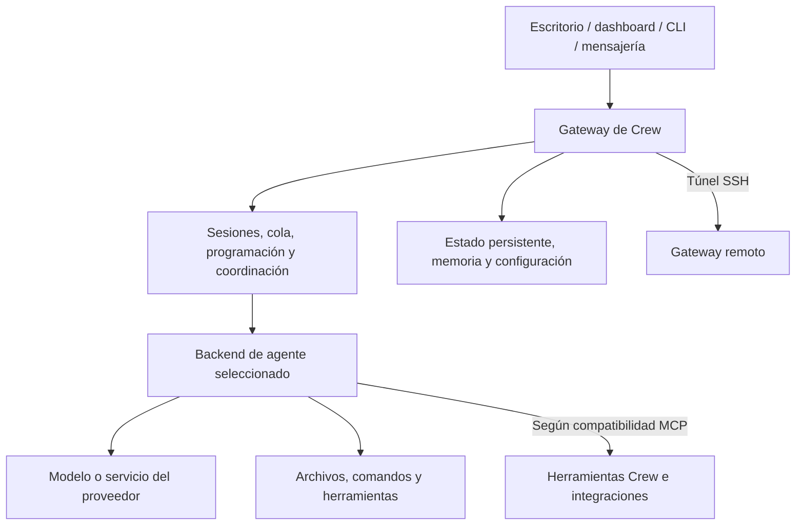

# Kiro Crew

> Fecha de revisión documental, licencias y precios: **2026-11-18**. Importes en USD. Investigación de documentación y repositorio oficiales; no se probó una instalación. Las funciones experimentales y la rama principal pueden diferir de una versión estable instalada.

## Descripción

Kiro Crew es un espacio de trabajo de agentes de IA persistente y de código abierto, ejecutable en hardware propio local o remoto. Permite continuar trabajo entre conversaciones y acceder desde aplicación de escritorio, dashboard, CLI y canales de mensajería. Forma parte del ecosistema [Kiro](../agentes-codigo/kiro.md). [Inicio oficial](https://kiro.dev/docs/crew/).

## Características

| Capacidad | Utilidad |
|---|---|
| Sesiones y memoria persistentes | Conservar contexto útil entre trabajos. |
| Subagentes | Distribuir investigaciones y tareas independientes. |
| Programación y monitoreo reactivo | Ejecutar trabajos periódicos o reaccionar a condiciones. |
| Task Runner | Planificar, ejecutar, validar y registrar avances de una especificación. |
| Workflows | Coordinar agentes en secuencias, trabajo paralelo y etapas de verificación. |
| Knowledge y artefactos | Aportar documentos de referencia y conservar resultados. |
| Navegador y Computer Use | Operar interfaces; Computer Use está desactivado de forma predeterminada. |
| Varias instancias | Administrar entornos remotos; algunas capacidades están en Preview. |

Fuente: [funciones de Crew](https://kiro.dev/docs/crew/features/). La documentación describe memoria y adaptación del espacio de trabajo; esto no debe interpretarse como reentrenamiento de los pesos del modelo.

## Arquitectura

Diagrama conceptual de responsabilidades; los detalles dependen del backend y de la versión.

El **Gateway** es el servicio que sostiene el espacio de trabajo. El dashboard utiliza normalmente `http://localhost:5476`. La aplicación de escritorio puede iniciar un Gateway incluido o conectarse a uno remoto mediante SSH. Hay distribuciones para Windows, macOS y Linux. [Inicio y distribución](https://kiro.dev/docs/crew/).

El estado y la configuración residen normalmente bajo `~/.kiro/crew`; `KIROCREW_HOME` permite cambiar el directorio de datos. La configuración principal utiliza `config.json` y puede incorporar `config.local.json`; ciertos cambios exigen reiniciar. [Configuración](https://kiro.dev/docs/crew/configuration/) · [Repositorio](https://github.com/kirodotdev/KiroCrew).

La cola durable permite recuperar trabajo aceptado tras reinicios del Gateway. La admisión de nuevos trabajos y la concurrencia dependen de memoria y CPU disponibles; esto no garantiza que cada proceso interrumpido continúe exactamente donde estaba. [Sistema y almacenamiento](https://kiro.dev/docs/crew/system/).

### Backends de agentes

Kiro CLI es el backend predeterminado y de integración más completa. La documentación de Crew 0.10.0 o posterior enumera además Kiro Agent, Claude Code, Codex, OpenCode, Pi, goose y DeepSeek Harness. Los distintos de Kiro CLI se marcan como **experimentales**. Cada sesión conserva el backend con el que fue iniciada.

No existe paridad total: Pi no recibe las herramientas MCP de Crew; OpenCode puede excluir un servidor completo al deshabilitar alguna de sus herramientas; Codex exige el aislamiento de Crew. La tarjeta de capacidades de la instalación es la referencia operativa. [Backends oficiales](https://kiro.dev/docs/crew/features/agent-backends/).

ACP facilita integrar motores de agentes; MCP expone herramientas y datos cuando el backend lo admite. Consultar [Agent Client Protocol](../protocolos/agent_client_protocol.md).

## Casos de uso

Escenarios propuestos para adopción:

| Escenario | Flujo sugerido | Resultado a revisar |
|---|---|---|
| Mantenimiento periódico | Programar análisis de cambios y documentación | Informe con hallazgos y propuestas. |
| Funcionalidad extensa | Entregar una especificación al Task Runner | Cambios, evidencia de pruebas y checkpoints. |
| Investigación paralela | Asignar temas independientes a subagentes | Síntesis contrastada con fuentes. |
| Asistente de proyecto | Incorporar documentos a Knowledge y conservar memoria útil | Respuestas contextualizadas y referencias. |
| Trabajo continuo remoto | Ejecutar el Gateway en un servidor propio | Progreso accesible sin mantener abierta la aplicación local. |

La autonomía debe acotarse con criterios de salida, tiempo, presupuesto y permisos. Ejecutar un Gateway propio no implica hospedar localmente el modelo.

## Limitaciones

- **Operación continua:** el host y Gateway deben estar disponibles para nuevos trabajos. Suspensión, conectividad y fallas del proveedor afectan la ejecución.
- **Capacidad finita:** la concurrencia compite por CPU, memoria y disco. Algunos límites agregados del sistema solo se aplican en Linux. [Sistema y almacenamiento](https://kiro.dev/docs/crew/system/).
- **Integraciones heterogéneas:** cada backend puede exigir binarios, adaptadores, autenticación y capacidades particulares. [Backends](https://kiro.dev/docs/crew/features/agent-backends/).
- **Seguridad dependiente de plataforma y backend:** hay diferencias en aislamiento y aprobaciones. Herramientas preaprobadas en Claude Code pueden eludir el flujo y la auditoría de Crew; ciertas listas MCP de aprobación automática también cambian la cobertura. [Seguridad](https://kiro.dev/docs/crew/security/).
- **Persistencia sensible:** respaldos e historiales pueden contener información pegada por el usuario. Deben tratarse como datos privados. [Configuración e importación](https://kiro.dev/docs/crew/configuration/).
- **Calidad y costo:** memoria, reintentos y subagentes no garantizan respuestas correctas; pueden aumentar consumo y acumular supuestos erróneos.

## Recomendaciones

1. Iniciar con el backend predeterminado, una tarea revisable y una versión estable. Anotar la versión instalada junto a la configuración operativa.
2. Mantener el Gateway en acceso local o mediante un túnel autenticado; evitar publicar directamente el dashboard en Internet.
3. Usar un usuario dedicado y repositorios de trabajo separados para tareas concurrentes; definir quién integra los resultados.
4. Mantener aislamiento y aprobación acordes al trabajo. Revisar excepciones del backend y de MCP antes de autorizar operaciones desatendidas.
5. Limitar duración, frecuencia y concurrencia. Medir créditos por ejecución antes de habilitar tareas recurrentes.
6. Respaldar estado y configuración, proteger los archivos exportados y comprobar recuperación antes de depender del servicio.
7. Exigir revisión humana de cambios antes de integrar, desplegar o modificar datos relevantes.
8. Validar compatibilidad después de cada actualización; una capacidad disponible en el repositorio principal puede no estar en la versión instalada.

Estas recomendaciones son criterios de adopción de esta base de conocimiento.

## Licencias

El código de **Kiro Crew se publica bajo Apache License 2.0**. El repositorio incluye licencia, avisos y atribuciones de terceros. Permite uso y modificación, incluso comercial, cumpliendo sus condiciones; al redistribuir deben conservarse los avisos aplicables e identificarse modificaciones. [Repositorio y licencia](https://github.com/kirodotdev/KiroCrew) · [Contribuciones y licenciamiento](https://github.com/kirodotdev/KiroCrew/blob/main/CONTRIBUTING.md).

Esta licencia no concede acceso gratuito a modelos, servicios ni suscripciones. **Kiro IDE y CLI tienen licencia propietaria de AWS**; los demás backends y dependencias tienen términos propios. [Licencia de Kiro](https://kiro.dev/license/).

## Precios y costo total

**Revisión: 2026-11-18.** La licencia Apache 2.0 del código de Crew no tiene una cuota de licencia por usuario. No se identificó una tarifa independiente de Crew en la página de precios de Kiro; el uso del servicio Kiro se vincula a su plan y créditos. Ver [precios oficiales](https://kiro.dev/pricing/) y la [tabla de planes de Kiro](../agentes-codigo/kiro.md#precios).

| Componente | Tratamiento del costo |
|---|---|
| Código de Crew | Sin cuota de licencia Apache 2.0. |
| Backend Kiro | Plan y consumo de créditos de Kiro; Free tiene límites. |
| Backend alternativo | Suscripción, API y condiciones de su proveedor; no asumir cobertura por Kiro. |
| Infraestructura propia | Equipo o servidor, almacenamiento, respaldo, red y operación. |
| Herramientas externas | Posibles cargos por APIs, navegador remoto, mensajería u otros servicios. |

Como referencia, los planes individuales de Kiro van de **USD 0 a USD 200 por usuario/mes**; los de pago permiten créditos adicionales a **USD 0,04/crédito**, sin impuestos. Estos importes no son una tarifa plana de ejecución ilimitada de Crew. [Fuente de precios](https://kiro.dev/pricing/).

Para presupuestar, sumar plan del backend + capacidad adicional + infraestructura + servicios externos + impuestos. Ejemplo de planificación, no tarifa garantizada: 30 trabajos de 5 créditos cada uno representan 150 créditos; reintentos y subagentes pueden elevar ese total. Revisar el consumo real y las condiciones de automatización del proveedor antes de ampliar el uso.

## Fuentes y mantenimiento

- [Inicio de Crew](https://kiro.dev/docs/crew/) y [repositorio oficial](https://github.com/kirodotdev/KiroCrew).
- [Funciones](https://kiro.dev/docs/crew/features/) y [backends](https://kiro.dev/docs/crew/features/agent-backends/).
- [Configuración](https://kiro.dev/docs/crew/configuration/), [seguridad](https://kiro.dev/docs/crew/security/) y [sistema](https://kiro.dev/docs/crew/system/).
- [Licenciamiento de contribuciones](https://github.com/kirodotdev/KiroCrew/blob/main/CONTRIBUTING.md), [licencia de Kiro](https://kiro.dev/license/) y [precios](https://kiro.dev/pricing/).

Actualizar fecha, compatibilidad, licencias y precios al revisar el documento. Antes de adoptar un backend experimental, comprobar su tarjeta de capacidades y límites en la versión instalada.
