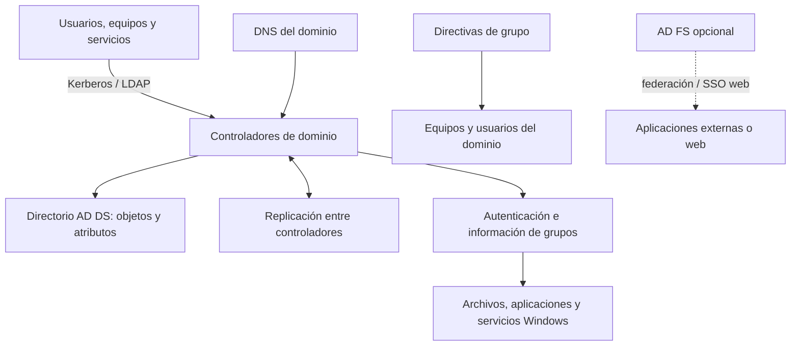

# Microsoft Active Directory Domain Services (AD DS)

## Descripción

**Active Directory Domain Services (AD DS)** es el servicio de directorio de Microsoft para redes locales basadas en Windows Server. Almacena información de usuarios, equipos, grupos y otros recursos, autentica identidades de dominio y permite administrar el acceso y la configuración de equipos de forma centralizada.

AD DS es una parte importante de una arquitectura IAM on-premise, especialmente en organizaciones que administran estaciones Windows, servidores, recursos compartidos y aplicaciones integradas con el dominio. No cubre por sí solo todos los procesos modernos de IAM, como gobierno integral del ciclo de vida, acceso de clientes, MFA adaptativo para todas las aplicaciones o gestión completa de privilegios. Esas capacidades pueden requerir servicios y controles complementarios.

## Arquitectura y componentes

### Bosque y dominios

El **bosque** es el límite lógico superior. Sus dominios comparten esquema, configuración y catálogo global; dentro de un bosque existen relaciones de confianza transitivas entre dominios. Un **dominio** agrupa objetos y proporciona identidades de red, autenticación, administración y replicación. El diseño de bosques y dominios afecta los límites de administración, seguridad y replicación.

### Controladores de dominio

Los controladores de dominio alojan copias del directorio y proporcionan autenticación y servicios de directorio. Los cambios se replican entre controladores según la topología. La redundancia requiere planificar su ubicación, disponibilidad, respaldos, monitoreo y recuperación.

### Unidades organizativas (OU), usuarios, grupos y equipos

Las **OU** organizan objetos dentro de un dominio para delegar administración y aplicar directivas. Los **usuarios**, **grupos**, **equipos** y **cuentas de servicio** representan identidades o conjuntos de acceso. Los grupos permiten asignar permisos a roles funcionales en vez de conceder derechos usuario por usuario.

### LDAP y Kerberos

**LDAP** permite consultar y administrar objetos del directorio. **Kerberos** es el protocolo de autenticación de dominio utilizado para comprobar identidades y habilitar inicio de sesión integrado en servicios compatibles. Aplicaciones y sistemas pueden integrarse mediante estos protocolos o interfaces propias de Windows.

### DNS y sitios

AD DS depende de DNS para localizar controladores y servicios del dominio. Los **sitios** representan la topología de red física y ayudan a determinar la selección de controladores y la replicación entre ubicaciones.

### Directivas de grupo (GPO)

Las GPO aplican configuraciones a usuarios y equipos según su pertenencia a sitios, dominios y OU. Se usan para administrar políticas del sistema, controles de seguridad, configuraciones y restricciones en entornos Windows.

### Seguridad y permisos

Los objetos del directorio y recursos utilizan identificadores de seguridad (SID), grupos y listas de control de acceso (ACL). La pertenencia a grupos puede informar decisiones de autorización en recursos compatibles. La delegación permite distribuir tareas administrativas con alcance definido.

## Características

- Directorio jerárquico y consultable de identidades y recursos de red.
- Autenticación centralizada de usuarios y equipos unidos al dominio.
- Grupos, SID, ACL y delegación para controlar acceso y administración.
- Replicación de datos entre controladores de dominio.
- GPO para configuración centralizada de usuarios y equipos Windows.
- Integración con DNS, LDAP, Kerberos y aplicaciones de ecosistema Windows.
- Confianzas entre dominios y bosques para escenarios de acceso entre organizaciones o dominios.
- Catálogo global para búsqueda de objetos a través de dominios del bosque.
- Cuentas de servicio administradas, incluidas gMSA en escenarios compatibles, para reducir el uso de contraseñas estáticas en servicios.

## Casos de uso

- Administrar cuentas y grupos de empleados en una red Windows local.
- Permitir inicio de sesión de dominio en equipos y servidores.
- Aplicar políticas de seguridad y configuración de forma centralizada con GPO.
- Controlar el acceso a carpetas, impresoras, servidores y aplicaciones integradas con AD DS.
- Delegar la administración de usuarios, equipos u OU a responsables de distintas áreas.
- Mantener identidades y servicios durante una transición hacia una arquitectura híbrida.
- Proporcionar identidades de origen para servicios de federación o sincronización, cuando sea requerido.

## Ventajas

- Amplia integración con Windows Server, Windows cliente y numerosos sistemas empresariales.
- Administración central de identidades, equipos, grupos y políticas locales.
- Protocolos conocidos y soporte extendido en aplicaciones empresariales.
- Replicación y relaciones de confianza para organizaciones con múltiples sedes o dominios.
- Permite mantener control directo sobre infraestructura, datos y políticas del directorio.

## Alcance y límites

- AD DS es un directorio y servicio de identidad de red; no equivale a una plataforma completa de gobierno IGA o PAM.
- La autenticación de dominio no proporciona automáticamente SSO moderno, MFA adaptativo o acceso condicional para cada aplicación web.
- El acceso de usuarios externos y clientes requiere una solución de federación o CIAM apropiada.
- La alta disponibilidad y recuperación dependen de la arquitectura, replicación, DNS, respaldos y operación correctos.
- Una configuración incorrecta de privilegios, GPO, cuentas de servicio, trusts o controladores puede elevar el impacto de un compromiso.
- La integración con servicios cloud puede requerir sincronización o federación; las características y requisitos dependen de la solución híbrida elegida.

## Recomendaciones

1. Diseñar cuidadosamente el bosque, dominios, DNS, sitios y OU; evitar complejidad innecesaria.
2. Mantener al menos dos controladores de dominio por dominio cuando los requisitos de disponibilidad lo justifiquen y distribuirlos según la topología.
3. Proteger controladores de dominio y cuentas administrativas con segmentación, acceso restringido, estaciones administrativas y monitoreo.
4. Separar cuentas diarias de las cuentas privilegiadas y aplicar mínimo privilegio y delegación acotada.
5. Mantener Windows Server y AD DS actualizados, revisar configuraciones de seguridad y retirar protocolos o configuraciones obsoletas según compatibilidad.
6. Usar grupos para asignar permisos y documentar propietarios, propósito y miembros; revisar accesos de forma periódica.
7. Preferir cuentas de servicio administradas cuando las aplicaciones sean compatibles; evitar contraseñas estáticas compartidas.
8. Probar respaldos y restauración del directorio, incluida recuperación ante pérdida de controladores o corrupción.
9. Supervisar autenticaciones, cambios de grupos privilegiados, modificaciones de GPO, replicación, DNS y salud de los controladores.
10. Para nuevas necesidades de federación web, comparar alternativas actuales; Microsoft recomienda migrar AD FS a Microsoft Entra ID en lugar de actualizar AD FS para nuevos escenarios.

## Integración con otros componentes de Microsoft

- **AD FS:** ofrece federación y SSO basado en tokens para aplicaciones compatibles; suele usar AD DS como almacén de identidades. Microsoft recomienda evaluar la migración a Microsoft Entra ID para nuevos escenarios. Ver el [documento existente de AD FS](../ADFS.md).
- **Microsoft Entra ID:** servicio cloud de identidad. Puede integrarse con identidades locales en arquitecturas híbridas, pero no es un producto on-premise. Verificar los métodos y requisitos vigentes de sincronización e identidad híbrida.
- **Microsoft Entra Domain Services:** servicio administrado en Azure que ofrece ciertas funciones de dominio; no es un despliegue local de AD DS y no sustituye en todos los escenarios a controladores de dominio autogestionados.

## Documentación oficial

- [Active Directory Domain Services overview](https://learn.microsoft.com/en-us/windows-server/identity/ad-ds/get-started/virtual-dc/active-directory-domain-services-overview)
- [Modelo lógico de Active Directory](https://learn.microsoft.com/en-us/windows-server/identity/ad-ds/plan/understanding-the-active-directory-logical-model)
- [Descripción general de Group Policy](https://learn.microsoft.com/en-us/windows-server/identity/ad-ds/manage/group-policy/group-policy-overview)
- [Documentación de identidad y acceso de Windows Server](https://learn.microsoft.com/en-us/windows-server/identity/identity-and-access)
- [AD FS: descripción general](https://learn.microsoft.com/en-us/windows-server/identity/ad-fs/ad-fs-overview)

## Relación con IAM

- [Identity and Access Management](Identity_Access_Management.md)
- [Active Directory Federation Services (AD FS)](../ADFS.md)
