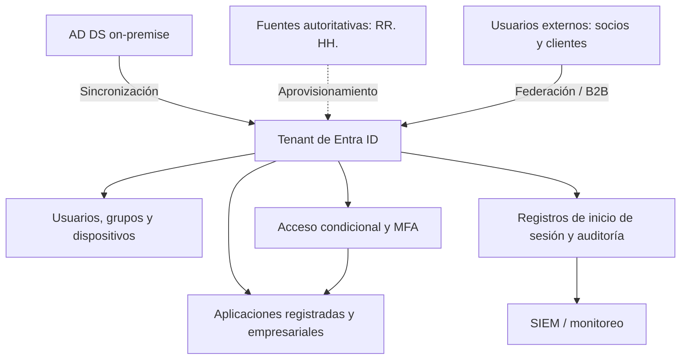

# Microsoft Entra ID

## Descripción

**Microsoft Entra ID** es el servicio cloud de identidad y acceso de Microsoft. Proporciona autenticación, aplicación de políticas de acceso y protección para usuarios, dispositivos, aplicaciones y recursos. Es el producto base de la familia Microsoft Entra. Cada tenant de Microsoft 365, Azure o Dynamics CRM Online es también un tenant de Entra ID.

No es un producto on-premise ni una versión en la nube de AD DS. Es un servicio administrado por Microsoft con un modelo de identidad distinto: usa protocolos web (OpenID Connect, OAuth 2.0, SAML 2.0) y no Kerberos/LDAP de dominio. En organizaciones con AD DS suele operar en un modelo híbrido, donde las identidades locales se sincronizan con el tenant.

## Evolución histórica

El diagrama resume la evolución desde el directorio local hasta la familia Microsoft Entra. Los datos fueron contrastados con Microsoft Learn; las fechas marcadas con "aprox." no se verificaron en una fuente oficial.

```mermaid
flowchart TD
    classDef legacy fill:#f9f,stroke:#333,stroke-width:2px
    classDef transition fill:#ff9,stroke:#333,stroke-width:2px
    classDef modern fill:#9f9,stroke:#333,stroke-width:2px
    classDef retired fill:#fcc,stroke:#933,stroke-width:2px,stroke-dasharray:3 3
    classDef note fill:#eee,stroke:#999,stroke-width:1px,stroke-dasharray:5 5

    Start("COMIENZO: El mundo local") --> AD_DS("Windows 2000 Server (aprox. 2000):<br/>Active Directory Domain Services (AD DS)<br/>Vigente, sin cambio de nombre")
    AD_DS --- AD_LDS("AD Lightweight Directory Services")
    AD_DS --- AD_FS("Active Directory Federation Services (AD FS)<br/>Nuevos escenarios: evaluar Entra ID")

    AD_DS --> FIM("Forefront Identity Manager (FIM) 2010")
    FIM --> MIM("Microsoft Identity Manager (MIM) 2016<br/>SP3: soporte hasta 9-ene-2029<br/>Complementa a Entra con aprovisionamiento hacia AD")

    AD_DS -. Sincronizacion .-> Sync_Old("DirSync / Azure AD Sync<br/>Sin soporte, ya no funcionan")
    Sync_Old --> Connect_V1("Azure AD Connect V1<br/>Retirado el 31-ago-2022")
    Connect_V1 --> Connect_V2("Microsoft Entra Connect V2<br/>(version actual)")
    Connect_V1 --> Cloud_Sync("Microsoft Entra Cloud Sync<br/>Cliente de sincronizacion desde la nube<br/>Recomendado por Microsoft cuando aplica")

    AD_DS -. Identidad hibrida .-> AzureAD("Azure Active Directory (Azure AD)<br/>Aprox. 2013-2023<br/>IdP cloud de Microsoft 365 y Azure")
    AzureAD --- B2C("Azure AD B2C<br/>Sin venta a nuevos clientes desde 1-may-2025<br/>Soporte al menos hasta may-2030")
    AzureAD --- B2B("Azure AD B2B Collaboration")

    AzureAD ==> Rename("Jul-2023 anuncio / 15-ago-2023 inicio / 1-oct-2023 SKUs:<br/>Azure AD pasa a llamarse Microsoft Entra ID<br/>Sin cambios de servicio, licencias ni APIs")

    Rename --> Entra_Family("Familia Microsoft Entra<br/>Identidad y acceso a la red")

    Entra_Family --> EntraID("Microsoft Entra ID<br/>Producto base. Free, P1 y P2")
    Entra_Family --> Domain_Services("Microsoft Entra Domain Services<br/>Dominio administrado: LDAP, Kerberos/NTLM, GPO")
    Entra_Family --> ID_Governance("Microsoft Entra ID Governance")
    Entra_Family --> ID_Protection("Microsoft Entra ID Protection")
    Entra_Family --> Verified_ID("Microsoft Entra Verified ID")
    Entra_Family --> External_ID("Microsoft Entra External ID<br/>Siguiente generacion para B2B y CIAM")
    Entra_Family --> Workload_ID("Microsoft Entra Workload ID")
    Entra_Family --> Agent_ID("Microsoft Entra Agent ID<br/>Identidad para agentes de IA")
    Entra_Family --> Private_Access("Microsoft Entra Private Access<br/>Acceso a apps privadas sin VPN")
    Entra_Family --> Internet_Access("Microsoft Entra Internet Access<br/>Acceso seguro a Internet y SaaS")
    Entra_Family -.-> Permissions("Microsoft Entra Permissions Management (CloudKnox)<br/>Sin venta desde 1-abr-2025<br/>Retirado el 1-nov-2025")

    B2C -. Evolucion .-> External_ID
    B2B -. Evolucion .-> External_ID
    Connect_V2 -. Sincroniza hacia .-> EntraID
    Cloud_Sync -. Sincroniza hacia .-> EntraID
    MIM -. Prepara datos en AD para .-> EntraID

    NoteAD("Directorio y politica en red propia / on-premise") --- AD_DS
    NoteAzure("Primeros pasos como IdP en la nube /<br/>Foco en Microsoft 365") --- AzureAD
    NoteRename("El cambio de nombre refleja una identidad multicloud<br/>y evita confusion con Active Directory") --- Rename

    class AD_DS,AD_LDS,AD_FS legacy
    class FIM,MIM,Sync_Old,Connect_V1,AzureAD transition
    class Connect_V2,Cloud_Sync,B2B,Rename,Entra_Family,EntraID,Domain_Services,ID_Governance,ID_Protection,Verified_ID,External_ID,Workload_ID,Agent_ID,Private_Access,Internet_Access modern
    class B2C,Permissions retired
    class NoteAD,NoteAzure,NoteRename note
```

Notas sobre el diagrama:

- Entra Permissions Management (CloudKnox) dejó de venderse el 1 de abril de 2025 y se retiró el 1 de noviembre de 2025.
- Azure AD B2C sigue operativo para clientes existentes. Microsoft indica que seguirá dando soporte al menos hasta mayo de 2030 y dirige a los clientes nuevos a External ID.
- Azure AD Connect V1 se retiró el 31 de agosto de 2022. DirSync y Azure AD Sync ya no funcionan.
- AD DS y AD FS no cambiaron de nombre con la marca Entra.
- Entra Agent ID, Private Access, Internet Access y ID Protection forman parte de la familia actual según la página oficial.
## Capacidades

- Inicio de sesión único (SSO) en aplicaciones cloud, SaaS y aplicaciones propias.
- Autenticación multifactor (MFA) y métodos de autenticación modernos, incluidos los resistentes a phishing.
- Acceso condicional: decisiones de acceso según usuario, dispositivo, ubicación y riesgo.
- Gestión de usuarios, grupos, roles administrativos y dispositivos.
- Registro de aplicaciones y aplicaciones empresariales para integrar apps mediante OIDC, OAuth 2.0 y SAML.
- Identidad híbrida con sincronización desde AD DS.
- Identidades externas para colaboración con socios y acceso de clientes.
- Gobierno de identidades y acceso privilegiado, según la licencia contratada.
- Administración mediante portal, Microsoft Graph API y PowerShell.
- Registros de inicio de sesión y auditoría exportables a herramientas de monitoreo y SIEM.

## Arquitectura y componentes

- **Tenant:** instancia dedicada de Entra ID de una organización. Contiene sus usuarios, grupos, aplicaciones y políticas. Tiene un dominio inicial `*.onmicrosoft.com` y admite dominios personalizados.
- **Usuarios y grupos:** identidades de empleados, invitados y cuentas de servicio. Los grupos pueden asignar licencias, roles y acceso a aplicaciones.
- **Dispositivos:** pueden estar registrados, unidos a Entra ID o unidos de forma híbrida, y se usan como condición de acceso.
- **Registro de aplicaciones y aplicaciones empresariales:** el registro define la identidad de la aplicación; la aplicación empresarial representa su uso en el tenant, con asignaciones y SSO.
- **Roles administrativos:** permisos delegados para administrar el tenant con alcance limitado.

## Identidad híbrida

La identidad híbrida da una identidad común para autenticarse tanto en recursos locales como en la nube. Se logra mediante aprovisionamiento y sincronización de usuarios y grupos desde AD DS hacia Entra ID.

- **Sincronización:** Microsoft Entra Connect y Microsoft Entra Cloud Sync son las herramientas de sincronización. Verificar en la documentación vigente cuál aplica y sus diferencias de alcance.
- **Métodos de autenticación:** sincronización de hash de contraseña, autenticación pass-through o federación (por ejemplo, AD FS). Cada método cambia dónde se valida la contraseña y qué se necesita para mantener la disponibilidad.
- **Dependencia local:** con federación o pass-through, la disponibilidad del inicio de sesión depende de la infraestructura local. Planificar la continuidad.

## Licenciamiento y ediciones

Las funciones dependen de la licencia. Las opciones principales son:

| Edición | Contenido general |
|---|---|
| Entra ID Free | Incluida con suscripciones cloud de Microsoft (Azure, Microsoft 365). Funciones básicas de identidad y SSO. |
| Entra ID P1 | Añade, entre otras, acceso condicional y más funciones de gestión híbrida. Se incluye en varios planes de Microsoft 365. |
| Entra ID P2 | Añade protección basada en riesgo y acceso privilegiado (PIM), entre otras funciones. |
| Entra ID Governance | Complemento para gobierno del ciclo de vida, gestión de derechos y revisiones de acceso. |

Esta tabla es una orientación general. Los planes y su contenido cambian; confirmar en la [página oficial de licenciamiento](https://learn.microsoft.com/en-us/entra/fundamentals/licensing) y en la de precios antes de decidir.

## Gobierno y acceso privilegiado

- **Privileged Identity Management (PIM):** acceso privilegiado just-in-time, con aprobación y límite de tiempo.
- **Revisiones de acceso:** recertificación periódica de grupos, aplicaciones y roles.
- **Gestión de derechos:** paquetes de acceso con flujos de solicitud y aprobación.
- **Protección de identidades (Identity Protection):** detección de riesgo de usuario e inicio de sesión, con respuesta automática mediante acceso condicional.

## Identidades externas

- **Colaboración B2B:** invitar a usuarios de otras organizaciones para que accedan a recursos del tenant con su propia identidad.
- **Acceso de clientes (CIAM):** Microsoft ofrece Entra External ID para escenarios de clientes. El nombre y el modelo de producto han cambiado con el tiempo; verificar el estado vigente.

## Identidades no humanas

- **Identidades administradas:** credenciales gestionadas por Azure para que un recurso acceda a otros servicios sin secretos en el código.
- **Entidades de servicio:** identidad de una aplicación dentro del tenant.
- **Identidades de carga de trabajo:** acceso de cargas externas (por ejemplo, CI/CD) mediante federación, sin secretos estáticos.

## Casos de uso

- Proporcionar SSO y MFA a usuarios de Microsoft 365 y aplicaciones SaaS.
- Aplicar acceso condicional según dispositivo, ubicación y riesgo.
- Extender las identidades de AD DS a la nube en un modelo híbrido.
- Migrar la federación web de AD FS a un servicio administrado.
- Dar acceso a socios y proveedores mediante colaboración B2B.
- Proteger cuentas administrativas con PIM y revisiones de acceso.
- Autenticar aplicaciones y servicios en Azure sin credenciales estáticas.

## Ventajas

- Servicio administrado: Microsoft opera la infraestructura, la disponibilidad y las actualizaciones del servicio.
- Integración nativa con Microsoft 365, Azure y un amplio catálogo de aplicaciones SaaS.
- Políticas de acceso basadas en contexto y riesgo.
- Protocolos web estándar para integrar aplicaciones.
- Se activa de forma gradual y se combina con AD DS existente.

## Alcance y límites

- Es un servicio cloud y depende de un proveedor externo; no permite control directo de la infraestructura.
- No reemplaza Kerberos, LDAP, GPO ni la unión a dominio clásica de AD DS. Para aplicaciones heredadas en la nube, Microsoft ofrece Microsoft Entra Domain Services, un dominio administrado con LDAP, Kerberos/NTLM y directivas de grupo.
- Varias funciones requieren licencias de pago.
- Las aplicaciones que no soportan protocolos modernos pueden necesitar proxy de aplicación u otras soluciones.
- Una mala configuración de roles, acceso condicional o cuentas de emergencia puede bloquear el acceso administrativo o ampliar el impacto de un compromiso.

## Consideraciones de operación

- Crear al menos dos cuentas de emergencia (break-glass) excluidas de las políticas de acceso condicional que puedan bloquearlas. Almacenar sus credenciales de forma segura y monitorear su uso.
- Exigir MFA a todos los administradores y a los accesos sensibles.
- Probar las políticas de acceso condicional en modo solo informe antes de activarlas.
- Aplicar mínimo privilegio en roles administrativos; preferir acceso just-in-time frente a asignaciones permanentes.
- Exportar registros de inicio de sesión y auditoría a un SIEM y definir su retención.
- En identidad híbrida, proteger el servidor de sincronización y sus cuentas, y planificar su recuperación.
- Revisar con regularidad aplicaciones registradas, secretos y certificados próximos a vencer, y permisos concedidos.
- Seguir los cambios de producto y nombres en la documentación de Microsoft.

## Recomendaciones

1. Definir qué sistema es la fuente autoritativa de cada atributo en un entorno híbrido.
2. Empezar con MFA y acceso condicional básico para administradores y usuarios.
3. Preferir métodos de autenticación resistentes a phishing para cuentas privilegiadas.
4. Preferir la sincronización de hash de contraseña como opción de respaldo, según el análisis de riesgo de la organización.
5. Reemplazar secretos de aplicaciones por identidades administradas o identidades de carga de trabajo cuando sea posible.
6. Programar revisiones de acceso para roles privilegiados, grupos e invitados.
7. Para nuevas necesidades de federación web, evaluar Entra ID antes de ampliar AD FS.
8. Documentar la integración con AD DS, los dominios verificados y los procedimientos de emergencia.

## Comparación con AD DS y AD FS

| Aspecto | AD DS | AD FS | Entra ID |
|---|---|---|---|
| Ubicación | On-premise | On-premise | Cloud (servicio administrado) |
| Función principal | Directorio y autenticación de dominio | Federación y SSO web | Identidad, acceso y SSO cloud |
| Protocolos principales | Kerberos, LDAP, NTLM | SAML, WS-Federation, OIDC | OIDC, OAuth 2.0, SAML |
| Administración de equipos | GPO y unión a dominio | No aplica | Unión a Entra ID y administración de dispositivos |
| Operación de infraestructura | La organización | La organización | Microsoft |
| Estado recomendado por Microsoft | Vigente | Migrar a Entra ID en nuevos escenarios | Producto estratégico |

## Documentación oficial

- [¿Qué es Microsoft Entra?](https://learn.microsoft.com/en-us/entra/fundamentals/what-is-entra)
- [Licenciamiento de Microsoft Entra](https://learn.microsoft.com/en-us/entra/fundamentals/licensing)
- [Identidad híbrida con Microsoft Entra ID](https://learn.microsoft.com/en-us/entra/identity/hybrid/whatis-hybrid-identity)
- [Acceso condicional](https://learn.microsoft.com/en-us/entra/identity/conditional-access/overview)
- [Microsoft Entra Domain Services](https://learn.microsoft.com/en-us/entra/identity/domain-services/overview)

## Relación con IAM

- [Identity and Access Management](Identity_Access_Management.md)
- [Microsoft Active Directory Domain Services (AD DS)](Microsoft-Active-Directory.md)
- [Active Directory Federation Services (AD FS)](../ADFS.md)
