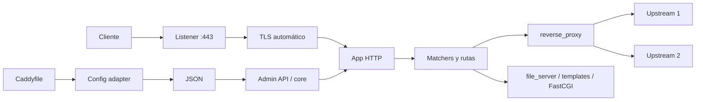

# Caddy

Caddy es un servidor web y proxy inverso escrito en Go, distribuido como binario único y sin dependencias de ejecución. Su propuesta central es la simplicidad operativa: HTTPS automático por defecto, configuración legible y recargas atómicas sin interrumpir el servicio.

| Dato | Valor |
|---|---|
| Tipo | Servidor web, proxy inverso y balanceador |
| Licencia | Apache 2.0 |
| Implementación | Go, binario estático único |
| Versión de referencia | 2.11.x (noviembre de 2026) |
| Configuración | Caddyfile o JSON nativo, con recarga en caliente |
| Protocolos | HTTP/1.1, HTTP/2, HTTP/3, WebSocket, gRPC (HTTP/2), FastCGI |

## Características

- **HTTPS automático:** obtiene y renueva certificados ACME por defecto (Let's Encrypt y ZeroSSL con failover), redirige HTTP a HTTPS y gestiona OCSP stapling.
- **CA local para entornos internos:** emite certificados para `localhost`, IPs y nombres internos mediante su propia autoridad, sin depender de una CA pública.
- **On-demand TLS:** obtiene certificados durante el primer handshake para dominios que no se conocen al arrancar; exige un endpoint de autorización para evitar abusos.
- **Encrypted ClientHello (ECH):** genera, publica y rota configuraciones ECH cuando se usa un módulo DNS compatible.
- **Configuración dual:** Caddyfile, formato conciso y legible, y JSON nativo para automatización; los adaptadores convierten el Caddyfile a JSON.
- **API de administración:** permite consultar y modificar la configuración en caliente; por defecto escucha en `localhost:2019`.
- **Recargas atómicas:** valida y aprovisiona la nueva configuración antes de retirar la anterior, sin cortar conexiones activas.
- **Proxy inverso:** balanceo round robin, least connections, weighted, IP hash, URI hash, header y cookie; health checks activos y pasivos; reintentos y streaming.
- **Servidor de contenido:** archivos estáticos, listado de directorios, templates, compresión gzip/zstd y FastCGI/PHP.
- **Seguridad de aplicación:** basic auth, forward auth, matchers por host/path/header/método, límites de cuerpo y cabeceras de seguridad.
- **Observabilidad:** logs estructurados, métricas Prometheus en el endpoint de administración y trazas mediante módulo de OpenTelemetry.
- **Extensible por módulos:** se compilan con `xcaddy`; existen módulos para rate limiting, DNS, tracing y otras integraciones.

## Casos de uso

- **Publicar sitios en un VPS o servidor propio:** un Caddyfile breve sirve estáticos, hace proxy a una aplicación y resuelve HTTPS sin herramientas adicionales.
- **Frontal de aplicaciones contenedorizadas:** actuar como reverse proxy hacia servicios de Docker o Kubernetes con configuración versionada.
- **Entornos de desarrollo y pruebas:** certificados locales confiables para `localhost` y dominios internos sin configurar una CA propia.
- **Plataformas multi-tenant con dominios dinámicos:** on-demand TLS con autorización por tenant o cliente.
- **Sustitución simplificada de Nginx/Apache:** cuando se busca reducir configuración y automatizar TLS, sin necesidad de módulos avanzados.
- **Protección perimetral ligera:** autenticación básica, forward auth, límites de petición y cabeceras de seguridad.

No es la mejor elección cuando se requiere control avanzado de tráfico L7 (fault injection, mirroring complejo, políticas por clúster), un service mesh completo o un ecosistema de módulos tan amplio como el de Nginx. Tampoco si la organización exige un producto con soporte comercial tradicional: Caddy se apoya en la comunidad y en el patrocinio del proyecto.

## Arquitectura

### Componentes

- **Command:** interfaz de línea de comandos (`caddy run`, `caddy reload`, `caddy validate`, `caddy fmt`). Solo arranca el core y procesa la configuración inicial.
- **Core:** carga, valida y aplica configuraciones; gestiona la API de administración y los logs.
- **Apps y módulos:** el core trata el contenido de `apps` como opaco y llama a `Start()`/`Stop()` en cada app. El app `http` carga servidores, rutas, matchers y handlers; el app `tls` gestiona certificados; `pki` administra la CA local.
- **Módulos host y guest:** los host cargan módulos hijos; todos siguen el ciclo cargar → aprovisionar/validar → usar → limpiar.
- **Config adapters:** traducen Caddyfile u otros formatos a JSON. El JSON es la configuración canónica.

### Flujo de una petición

1. Un listener acepta la conexión y, si corresponde, completa el handshake TLS con el certificado gestionado.
2. El app HTTP evalúa los matchers de cada ruta en orden.
3. El handler seleccionado procesa la petición: proxy, archivos, templates, FastCGI o respuesta directa.
4. En `reverse_proxy`, se elige un upstream según la política de balanceo y se aplican health checks, reintentos y cabeceras.
5. La respuesta se registra y se devuelve al cliente.

### Modelo de configuración

- **Caddyfile:** pensado para personas; se adapta a JSON antes de cargarse.
- **JSON:** interfaz completa y estable para automatización, GitOps y llamadas a la API.
- **API de administración:** permite cambios granulares; cada cambio genera una nueva configuración completa que se aprovisiona y aplica de forma atómica.
- **Recarga:** durante un breve intervalo conviven la configuración nueva y la anterior; si el aprovisionamiento falla, se conserva la vigente.

### Modos de despliegue

- **Servicio del sistema:** systemd en Linux, servicio de Windows o contenedor oficial.
- **Contenedor:** requiere volumen persistente para certificados y configuración, y publicar los puertos 80/443.
- **Kubernetes:** como `Deployment`/`DaemonSet` o ingress controller; el certificado puede gestionarse dentro de Caddy o delegarse a un controlador externo.
- **Bare metal:** binario único, sin runtime ni dependencias del sistema.

## Recomendaciones

### TLS y certificados

- Configurar los registros DNS del dominio antes de arrancar Caddy y asegurar que los puertos 80 y 443 sean accesibles, o usar DNS-01 si no lo son.
- Persistir el directorio de datos (`XDG_DATA_HOME` o `$HOME/.local/share/caddy`) en un volumen; allí viven certificados, claves y la CA local. Sin persistencia se pierden en cada reinicio.
- Usar el endpoint de staging de Let's Encrypt durante pruebas para evitar límites de emisión.
- Habilitar on-demand TLS solo cuando el caso lo justifique (dominios de clientes) y siempre con un endpoint `ask` que autorice cada dominio.
- Para wildcard o ECH, compilar con el módulo DNS del proveedor y proteger sus credenciales.
- Monitorizar errores de emisión/renovación y la fecha de expiración; Caddy reintenta con backoff, pero una mala configuración de DNS o firewall puede pasar desapercibida.
- No confiar en la instalación automática de la CA local en contenedores: instalar el certificado raíz manualmente donde corresponda.

### Seguridad

- Mantener la API de administración en `localhost` o restringirla por red y autenticación; nunca exponer el puerto 2019 a Internet.
- Ejecutar como usuario sin privilegios y otorgar solo `CAP_NET_BIND_SERVICE` para los puertos 80/443.
- Validar la configuración antes de aplicar cambios (`caddy validate`) y usar `caddy fmt` para evitar errores de formato.
- Definir límites de tamaño de cuerpo, timeouts de lectura/escritura e idle timeouts para mitigar conexiones lentas y agotamiento de recursos.
- Usar `basic_auth` con hashes generados por `caddy hash-password`, o delegar autenticación a `forward_auth` con un proveedor de identidad.
- Añadir cabeceras de seguridad (HSTS, `X-Content-Type-Options`, CSP según el sitio) y restringir métodos cuando no se necesiten.
- Mantener actualizado Caddy y los módulos; las versiones 2.11.x incluyen correcciones de seguridad relevantes para FastCGI y manejo de hosts.

### Rendimiento y disponibilidad

- Habilitar HTTP/3 (QUIC) cuando los clientes y la red lo soporten; Caddy lo sirve junto a HTTP/1.1 y HTTP/2.
- Usar `encode zstd gzip` para texto y evitar comprimir imágenes, video o contenido ya comprimido.
- Ajustar `flush_interval` para SSE/streaming y buffers de request/response según el tamaño típico de las cargas.
- Configurar health checks y varios upstreams; preferir `least_conn` o `weighted_round_robin` cuando los backends no son homogéneos.
- Mantener keepalive hacia upstreams y dimensionar timeouts de transporte; revisar el impacto de conexiones largas.
- Ejecutar más de una instancia detrás de un balanceador externo si se requiere alta disponibilidad, compartiendo almacenamiento de certificados o usando DNS-01.
- Evitar acumular módulos innecesarios: cada plugin compilado aumenta el binario y la superficie de mantenimiento.

### Observabilidad y operación

- Activar logs estructurados (JSON) y enviarlos a la plataforma central; incluir `request_id` para correlación.
- Exponer métricas Prometheus y alertar por 5xx, latencia, conexiones activas y fallos de certificado.
- Instrumentar trazas con el módulo de OpenTelemetry cuando la arquitectura ya use trazas distribuidas.
- Versionar el Caddyfile/JSON en Git y aplicar cambios con `caddy reload`; evitar ediciones manuales no registradas.
- Fijar la versión de la imagen y de los módulos; reconstruir con `xcaddy` de forma reproducible.
- Proteger el servicio con las directivas de hardening del sistema operativo (`NoNewPrivileges`, `ProtectSystem`, `PrivateTmp`).
- Definir un plan de respaldo para el directorio de datos y probar la restauración de certificados.

### Checklist de producción

- [ ] Dominios con DNS correcto y puertos 80/443 accesibles (o DNS-01 configurado).
- [ ] Almacenamiento de certificados persistente y respaldado.
- [ ] Redirección HTTP → HTTPS y HSTS activos.
- [ ] API de administración restringida a localhost o red interna.
- [ ] Límites de cuerpo y timeouts definidos.
- [ ] Logs y métricas recolectados con alertas.
- [ ] Configuración versionada y validada antes de recargar.
- [ ] Versión fijada y proceso de actualización probado.
- [ ] Al menos dos instancias si se requiere alta disponibilidad.

## Referencias

- [Documentación oficial de Caddy](https://caddyserver.com/docs/)
- [Arquitectura de Caddy](https://caddyserver.com/docs/architecture)
- [HTTPS automático](https://caddyserver.com/docs/automatic-https)
- [Caddyfile](https://caddyserver.com/docs/caddyfile)
- [Configuración JSON](https://caddyserver.com/docs/json)
- [Proxy inverso (`reverse_proxy`)](https://caddyserver.com/docs/caddyfile/directives/reverse_proxy)
- [Módulos disponibles](https://caddyserver.com/docs/modules)
- [Métricas y monitorización](https://caddyserver.com/docs/metrics)
- [Repositorio y releases](https://github.com/caddyserver/caddy/releases)
