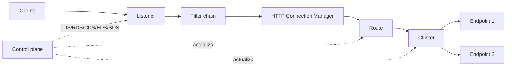

# Envoy

Envoy es un proxy de borde y de servicios open source, diseñado para aplicaciones cloud-native. Funciona como proxy L4/L7 y ofrece soporte de primera clase para HTTP/2 y gRPC tanto en conexiones entrantes como salientes; también actúa como proxy transparente de HTTP/1.1 a HTTP/2.

| Dato | Valor |
|---|---|
| Tipo | Proxy L4/L7, service proxy y data plane de service mesh |
| Licencia | Apache 2.0 |
| Implementación | C++, proceso único multi-hilo |
| Versión de referencia | 1.40.x (octubre de 2026) |
| Configuración | Bootstrap estático + configuración dinámica vía xDS |
| Protocolos | HTTP/1.1, HTTP/2, HTTP/3, gRPC, WebSocket, TCP y UDP |

## Características

- **Proxy L4/L7:** TCP, UDP, HTTP/1.1, HTTP/2, HTTP/3, gRPC y WebSocket, con inspección y modificación de tráfico.
- **Configuración dinámica (xDS):** listeners (LDS), rutas (RDS), clústeres (CDS), endpoints (EDS) y secretos (SDS) se actualizan sin reiniciar.
- **Balanceo avanzado:** round robin, least request, ring hash, maglev, random, weighted y políticas con conciencia de zona/localidad.
- **Resiliencia:** health checks activos, outlier detection pasivo, circuit breakers, retries, timeouts, presupuestos de reintentos y rate limiting local o externo.
- **Gestión de tráfico:** mirroring, traffic splitting, fault injection, header manipulation, reescritura de rutas y filtros por ruta.
- **Seguridad:** terminación TLS, mTLS, validación de SAN, SDS para rotación de secretos, `ext_authz`, RBAC y filtros Wasm/dinámicos.
- **Observabilidad:** estadísticas internas, exportación a Prometheus/StatsD/OpenTelemetry, access logs y trazas distribuidas.
- **Extensibilidad:** filtros HTTP/network, Wasm, dynamic modules y APIs xDS para control planes propios.
- **Ecosistema:** data plane de Istio, Consul, Kuma y otros; base de Envoy Gateway, Contour y Emissary Ingress.

## Casos de uso

- **Service mesh:** data plane de Istio, Consul Connect o Kuma, con mTLS, políticas y telemetría entre servicios.
- **API gateway / edge proxy:** punto de entrada con enrutamiento, autenticación, rate limiting y observabilidad.
- **Ingress en Kubernetes:** mediante Envoy Gateway, Contour o Emissary, con CRDs estándar.
- **Proxy gRPC/HTTP2:** exponer servicios gRPC y traducir HTTP/1.1 a HTTP/2.
- **Migraciones y canary:** traffic splitting, mirroring y fault injection para validar versiones nuevas.
- **Multi-clúster y multi-nube:** enrutamiento con conciencia de localidad y failover entre zonas.
- **Proxy TCP/UDP:** servicios no HTTP que requieren balanceo y políticas L4.

Envoy no es la opción más simple para un servidor único con configuración estática: su modelo xDS y su vocabulario (listeners, clusters, filter chains) requieren un control plane o una inversión de aprendizaje mayor. Para sitios pequeños suelen bastar Nginx o Caddy; para plataformas dinámicas y service mesh, Envoy es una base sólida.

## Arquitectura

### Procesos e hilos

- **Proceso único multi-hilo:** un hilo principal coordina configuración, estadísticas y administración.
- **Worker threads:** cada worker atiende conexiones con un event loop no bloqueante y mantiene su propio estado de conexión.
- **Thread-local storage:** los filtros y clústeres mantienen copias por worker para evitar bloqueos en el camino caliente.
- **Admin interface:** endpoint local para inspeccionar configuración, clústeres, estadísticas, logs y readiness.

### Componentes de configuración

- **Listener:** dirección y puerto donde Envoy acepta conexiones. Puede incluir múltiples filter chains por SNI, ALPN o destino.
- **Filter chain:** secuencia de filtros de red; el más común es el HTTP Connection Manager (HCM).
- **HTTP Connection Manager:** traduce bytes a peticiones HTTP, aplica filtros HTTP y selecciona una ruta.
- **Route:** reglas por host, path, headers, método o query que deciden el clúster destino y las políticas aplicables.
- **Cluster:** grupo lógico de endpoints con política de balanceo, health checks, TLS y circuit breakers.
- **Endpoint:** instancia concreta de backend dentro de un clúster.
- **Secret:** certificados y claves gestionados por SDS para mTLS y TLS de upstream.

### xDS y control plane

Envoy no descubre servicios por sí solo: recibe configuración de un control plane mediante las APIs xDS. El archivo de bootstrap define el nodo, el listener inicial, el clúster del control plane y los recursos estáticos mínimos.

1. El listener acepta la conexión y selecciona la filter chain según SNI/ALPN.
2. El HCM decodifica la petición HTTP y ejecuta los filtros configurados.
3. La ruta elegida determina el clúster y las políticas de reintento, timeout o mirroring.
4. El balanceador selecciona un endpoint sano.
5. Envoy reenvía la petición, recopila estadísticas y devuelve la respuesta.

### Modos de despliegue

- **Sidecar:** un Envoy por pod o instancia, gestionado por el control plane del mesh.
- **Gateway/edge:** Envoy dedicado como ingress o API gateway, con configuración xDS o estática.
- **Kubernetes:** Envoy Gateway, Contour o Emissary para abstraer xDS con CRDs.
- **Bare metal/contenedor:** bootstrap estático y recargas controladas; útil para laboratorios o proxies dedicados.

## Recomendaciones

### Configuración y operación

- Usar un control plane (Istio, Envoy Gateway, Consul, etc.) en lugar de mantener xDS a mano.
- Versionar el bootstrap y la configuración estática; mantener el archivo mínimo y delegar el resto a xDS.
- Validar la configuración antes de aplicar (`envoy --mode validate -c config.yaml`) y probar en un entorno equivalente.
- Restringir la admin interface a localhost o a una red de administración; no exponerla a Internet.
- Fijar versiones y seguir la política de soporte (N y N-1); revisar los avisos de seguridad y las notas de release.
- Definir `--concurrency`, límites de memoria y CPU, y `--cpuset-threads` cuando se despliegue en contenedores con CPU limitada.
- Configurar drenaje (`--drain-time-s`, `--drain-strategy`) y un `preStop` adecuado para no cortar conexiones en despliegues.

### Seguridad

- Usar TLS moderno (mínimo 1.2, preferible 1.3) y validar SANs de los certificados de upstream.
- Gestionar certificados con SDS y rotarlos automáticamente; evitar claves embebidas en la configuración.
- Aplicar `ext_authz`, RBAC o JWT según el caso, y rate limiting en el borde.
- Ejecutar como usuario sin privilegios y con imagen mínima (distroless) cuando sea posible.
- Revisar y limitar las capacidades de filtros Wasm y dynamic modules; tratarlos como código de producción.
- Mantener actualizado Envoy: las versiones 1.40.x incluyen correcciones de seguridad relevantes.

### Rendimiento y disponibilidad

- Configurar health checks activos y outlier detection para retirar endpoints enfermos.
- Definir circuit breakers (`max_connections`, `max_pending_requests`, `max_requests`) y timeouts por ruta.
- Evitar reintentos sin límite: usar presupuestos de reintentos y backoff.
- Ajustar el balanceo según la carga: least request para backends heterogéneos, ring hash/maglev para afinidad.
- Controlar el tamaño de buffers, el número máximo de conexiones y las colas por worker.
- Usar HTTP/2 o HTTP/3 en upstreams cuando el backend lo soporte; habilitar keepalive y limitar conexiones por host.
- Escalar horizontalmente los gateways y distribuir zonas con políticas de localidad.

### Observabilidad

- Exportar estadísticas a Prometheus/OpenTelemetry y alertar por 5xx, latencia, conexiones pendientes, overflows y health check failures.
- Activar access logs con request ID, latencia, upstream y código de respuesta; centralizarlos.
- Instrumentar trazas distribuidas y propagar contexto entre servicios.
- Vigilar la memoria y el número de workers: los picos de configuración o de conexiones pueden afectar a todo el proceso.
- Usar el endpoint de readiness para el orquestador y el de stats para diagnóstico bajo demanda.

### Checklist de producción

- [ ] Bootstrap versiónado y validado.
- [ ] Control plane o xDS con permisos y TLS.
- [ ] Admin interface restringida.
- [ ] mTLS/TLS de upstream con rotación automática.
- [ ] Health checks, outlier detection y circuit breakers configurados.
- [ ] Timeouts y reintentos acotados.
- [ ] Access logs, métricas y trazas recolectados con alertas.
- [ ] Drenaje y `preStop` probados en despliegues.
- [ ] Versión fijada y plan de actualización documentado.

## Referencias

- [Documentación oficial de Envoy](https://www.envoyproxy.io/docs/envoy/latest/)
- [Introducción a la arquitectura](https://www.envoyproxy.io/docs/envoy/latest/intro/arch_overview/arch_overview)
- [APIs xDS](https://www.envoyproxy.io/docs/envoy/latest/api-docs/xds_protocol)
- [Configuración de listeners](https://www.envoyproxy.io/docs/envoy/latest/configuration/listeners/listeners)
- [Balanceo de carga](https://www.envoyproxy.io/docs/envoy/latest/intro/arch_overview/upstream/load_balancing/load_balancing)
- [Observabilidad y estadísticas](https://www.envoyproxy.io/docs/envoy/latest/intro/arch_overview/observability/observability)
- [Envoy Gateway](https://gateway.envoyproxy.io/)
- [Repositorio y releases](https://github.com/envoyproxy/envoy/releases)
