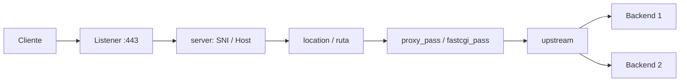

# Nginx

nginx ("engine x") es un servidor HTTP, proxy inverso, caché de contenido, balanceador de carga y proxy TCP/UDP. Está escrito en C, se distribuye bajo licencia BSD de 2 cláusulas y es conocido por su rendimiento y bajo consumo de recursos.

| Dato | Valor |
|---|---|
| Tipo | Servidor web, proxy inverso, caché y balanceador L4/L7 |
| Licencia | BSD de 2 cláusulas (nginx open source) |
| Implementación | C, procesos master/worker |
| Versión de referencia | Línea estable/mainline vigente; consultar [nginx.org](https://nginx.org/en/) |
| Configuración | Archivos declarativos con recarga graceful |
| Protocolos | HTTP/1.1, HTTP/2, HTTP/3, WebSocket, gRPC, TCP y UDP |

## Características

- **Servidor web:** archivos estáticos, indexación, compresión gzip, rangos, caché de descriptores y `sendfile`.
- **Proxy inverso:** HTTP, FastCGI, uWSGI, SCGI y memcached, con buffering, timeouts y reescritura de cabeceras.
- **Balanceo de carga:** round robin, `least_conn`, `ip_hash`, `hash` y `random`, con pesos, `backup` y failover pasivo.
- **Caché de contenido:** almacenamiento en disco, claves configurables, revalidación y purga mediante módulos de terceros.
- **TLS:** terminación TLS/SNI, HTTP/2 y HTTP/3, OCSP stapling y configuración de protocolos y cifrados.
- **Control de tráfico:** `limit_req` y `limit_conn`, control de acceso por IP, basic auth, `auth_request`, mirroring y A/B testing con `split_clients`.
- **Proxy TCP/UDP y correo:** bloques `stream` y `mail` para servicios no HTTP.
- **Extensibilidad:** módulos nativos, `njs` (JavaScript) y Perl embebido; módulos de terceros como ModSecurity.
- **Observabilidad:** access logs con tiempos de upstream, error log, `stub_status` y exportadores Prometheus.
- **Ediciones:** la versión open source cubre la mayoría de casos; NGINX Plus añade health checks activos, API, JWT, clustering y soporte comercial.

## Casos de uso

- **Servir aplicaciones web y contenido estático:** frontend de sitios, SPAs y assets con compresión y caché.
- **Reverse proxy de aplicaciones:** publicar APIs o aplicaciones detrás de un único punto de entrada con TLS.
- **Balanceo de varias instancias:** distribuir tráfico entre réplicas y retirar nodos enfermos.
- **Caché de respuestas:** reducir carga en backends y latencia para contenido cacheable.
- **Ingress en Kubernetes:** mediante ingress-nginx, uno de los controladores más extendidos.
- **Proxy de servicios no HTTP:** bases de datos, brokers o servicios TCP/UDP a través del bloque `stream`.
- **Migración o convivencia con otros proxies:** mantener Nginx detrás de Traefik, Envoy o Caddy para servir estáticos o aplicaciones concretas.

Es una elección sólida para infraestructura tradicional, servidores únicos y entornos donde se requiere control fino de caché y configuración. En plataformas muy dinámicas, su modelo declarativo exige automatización adicional (plantillas, recargas controladas) en comparación con proxies que descubren servicios por sí mismos.

## Arquitectura

### Procesos

- **Master:** se ejecuta con privilegios para leer la configuración, abrir puertos y gestionar a los workers. No procesa peticiones.
- **Workers:** ejecutan el ciclo de vida de las conexiones con un modelo dirigido por eventos y sin bloqueo (epoll en Linux, kqueue en BSD, etc.). Corren bajo un usuario sin privilegios.
- **Recarga graceful:** `nginx -s reload` inicia workers nuevos con la configuración validada y retira los antiguos cuando terminan sus conexiones. `nginx -s quit` cierra ordenadamente; `nginx -s stop` termina de inmediato.
- **Escalado:** normalmente un worker por CPU (`worker_processes auto`). Cada worker maneja miles de conexiones con poca memoria gracias al modelo event-driven.

### Jerarquía de configuración

```text
main
├── events          # conexiones y modelo de eventos
├── http            # servidores HTTP, upstreams, caché, límites
│   ├── upstream    # grupo de backends
│   └── server      # host/puerto, TLS
│       └── location # rutas y handlers
├── stream          # proxy TCP/UDP
└── mail            # proxy de correo
```

La configuración se valida con `nginx -t` antes de recargar. Un error de sintaxis impide aplicar la nueva versión y mantiene la anterior.

### Flujo de una petición



1. El listener acepta la conexión y realiza el handshake TLS si corresponde.
2. Nginx selecciona el bloque `server` por dirección, puerto y SNI/Host.
3. Se elige el `location` más específico y se aplican sus directivas.
4. `proxy_pass` u otro handler reenvía la petición al upstream.
5. La respuesta se bufferiza, se registra y se devuelve al cliente.

### Variables de Nginx

`$host` sigue este orden de precedencia: nombre de host de la línea de petición, nombre de host de la cabecera `Host`, o el nombre de servidor que coincide con la petición.

Listado completo de variables: [nginx.org/en/docs/varindex.html](http://nginx.org/en/docs/varindex.html).

### sites-available y sites-enabled

En distribuciones Debian/Ubuntu la configuración de sitios suele separarse en dos carpetas:

- `sites-available`: almacena los archivos de configuración de cada sitio (la bodega).
- `sites-enabled`: contiene enlaces simbólicos a los sitios que Nginx debe activar (la vitrina).

El `nginx.conf` incluye `sites-enabled/*`. Para habilitar un sitio se crea un enlace desde `sites-available`; para deshabilitarlo se elimina el enlace o se usa `a2ensite`/`a2dissite` en Debian/Ubuntu. En contenedores y otras distribuciones esta separación puede no existir: la configuración se organiza en `conf.d/*.conf` o se monta directamente.

## Recomendaciones

### TLS y certificados

- Usar `ssl_protocols TLSv1.2 TLSv1.3`, cifrados modernos y preferencias del servidor; deshabilitar protocolos obsoletos.
- Configurar OCSP stapling, sesiones TLS y HSTS cuando el sitio sea solo HTTPS.
- Automatizar emisión y renovación (certbot, ACME u otra herramienta) y recargar Nginx solo si el certificado cambió.
- Mantener una cadena de certificados completa y verificar la configuración con herramientas externas.
- Separar la terminación TLS del backend cuando sea posible; si se reenvía TLS, usar `proxy_ssl_*` correctamente.

### Seguridad

- Deshabilitar la versión en respuestas (`server_tokens off`) y minimizar cabeceras informativas.
- Definir `client_max_body_size` según la aplicación y timeouts de cabecera/cuerpo para reducir slowloris.
- Aplicar `limit_req` y `limit_conn` con `burst` y `nodelay` según el perfil de tráfico.
- Restringir `stub_status` y el panel de estado a redes internas.
- Evitar `if` dentro de `location`; preferir `try_files`, `map` y directivas específicas.
- Validar la configuración con `nginx -t` antes de cada recarga y mantener permisos mínimos sobre los archivos de configuración y claves.
- Mantener actualizado Nginx y los módulos; revisar los avisos de seguridad de nginx.org.

### Rendimiento y disponibilidad

- Usar `worker_processes auto` y dimensionar `worker_connections` según las conexiones concurrentes esperadas.
- Habilitar keepalive hacia upstreams (`keepalive`, `proxy_http_version 1.1`, limpiar `Connection`) para reducir handshakes.
- Ajustar buffers y timeouts (`proxy_connect_timeout`, `proxy_read_timeout`, `proxy_send_timeout`) al comportamiento real de las aplicaciones.
- Activar `proxy_buffering` para respuestas cacheables y desactivarlo para streaming/SSE cuando sea necesario.
- Configurar `proxy_cache_path` y claves de caché; definir qué se cachea, por cuánto tiempo y cómo se invalida.
- Usar `upstream` con varios backends, `max_fails`/`fail_timeout`, `backup` y health checks activos si se dispone de NGINX Plus.
- Evitar recargas innecesarias; agrupar cambios y automatizar despliegues.
- Si se sirve contenido estático, usar `sendfile`, `tcp_nopush`, `open_file_cache` y compresión selectiva.

### Observabilidad y operación

- Definir un formato de access log con latencia, upstream, bytes y `request_id`; centralizar los logs.
- Monitorizar `stub_status` o un exportador Prometheus: conexiones activas, lectura/escritura, requests por segundo y respuestas 4xx/5xx.
- Alertar por errores de upstream, saturación de workers, uso de disco de caché y certificados próximos a vencer.
- Versionar la configuración y aplicar cambios mediante CI/CD; evitar ediciones manuales no registradas.
- Probar recargas y actualizaciones de binario en un entorno equivalente antes de producción.
- Fijar la versión de la imagen o paquete y revisar las notas de seguridad antes de actualizar.

### Checklist de producción

- [ ] `nginx -t` ejecutado y configuración versionada.
- [ ] TLS moderno, redirección a HTTPS y renovación automática.
- [ ] `client_max_body_size` y timeouts definidos.
- [ ] Rate limiting y control de acceso donde corresponda.
- [ ] Upstreams con failover y timeouts verificados.
- [ ] Caché dimensionada y con invalidación documentada.
- [ ] Access/error logs centralizados y métricas con alertas.
- [ ] `stub_status` restringido.
- [ ] Proceso de recarga y plan de actualización probados.

## Referencias

- [Documentación oficial de nginx](https://nginx.org/en/docs/)
- [Índice de variables](http://nginx.org/en/docs/varindex.html)
- [Módulo upstream y balanceo](https://nginx.org/en/docs/http/ngx_http_upstream_module.html)
- [Módulo proxy](https://nginx.org/en/docs/http/ngx_http_proxy_module.html)
- [Módulo SSL](https://nginx.org/en/docs/http/ngx_http_ssl_module.html)
- [Control de procesos y recarga](https://nginx.org/en/docs/control.html)
- [¿Cómo configurar un proxy inverso? (Kinsta)](https://kinsta.com/es/blog/proxy-inverso/): conceptos de proxy inverso con ilustraciones.
