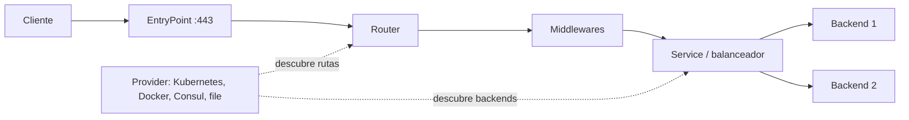

# Traefik

Traefik Proxy es un proxy de aplicaciones y balanceador de carga open source, escrito en Go y distribuido como binario único. Su rasgo distintivo es el descubrimiento automático de servicios: consulta las APIs del orquestador o del registro de servicios y genera las rutas en tiempo real, sin reiniciar el proceso ni cortar conexiones.

| Dato | Valor |
|---|---|
| Tipo | Proxy inverso, balanceador L4/L7 e ingress |
| Licencia | MIT (Traefik Proxy) |
| Implementación | Go, binario único y contenedor oficial |
| Versión de referencia | 3.7.x (octubre de 2026) |
| Configuración | Estática al arrancar + dinámica descubierta de providers |
| Protocolos | HTTP/1.1, HTTP/2, HTTP/3, WebSocket, gRPC, TCP y UDP |

## Características

- **Descubrimiento de servicios:** obtiene rutas y backends desde Kubernetes (Gateway API, CRD, Ingress), Docker, Swarm, Nomad, Consul Catalog, almacenes clave-valor (Redis, Consul, etcd, ZooKeeper), ECS, archivos o un endpoint HTTP.
- **Actualización en caliente:** aplica cambios de configuración dinámica sin reiniciar ni interrumpir conexiones.
- **Enrutamiento avanzado:** reglas por host, path, headers, método, query, IP o SNI, con prioridad configurable.
- **Middlewares:** rate limit, circuit breaker, retry, compresión, headers, IP allow list, forward auth, basic/digest auth, redirecciones, reescritura de path, buffering, in-flight requests y cadenas de middlewares.
- **Balanceo de carga:** round robin ponderado y dinámico, health checks activos y pasivos, sesiones persistentes por cookie y despliegues canary mediante pesos.
- **TLS integrado:** certificate resolvers ACME (HTTP-01, TLS-ALPN-01, DNS-01), certificados de Tailscale, SPIFFE, OCSP stapling y opciones TLS por router.
- **Observabilidad:** access logs, métricas (Prometheus, OpenTelemetry, Datadog, InfluxDB, StatsD), trazas (OpenTelemetry, Jaeger, Zipkin) y endpoint de health check.
- **Dashboard y API:** interfaz de solo lectura y API para inspeccionar rutas, servicios y middlewares; deben protegerse en producción.
- **Plugins:** soporte experimental para plugins Go y WASM. Las capacidades empresariales (JWT, OIDC, WAF, rate limit distribuido, caché) pertenecen a Traefik Hub, no a Traefik Proxy OSS.
- **GitOps-friendly:** la configuración dinámica se declara con CRDs, labels o archivos versionados.

## Casos de uso

- **Ingress en Kubernetes:** exponer servicios con CRDs `IngressRoute` o Gateway API, con TLS automático y middlewares por namespace.
- **Reverse proxy para Docker Compose o Swarm:** publicar contenedores usando labels, sin mantener archivos de rutas por servicio.
- **Plataformas con despliegues frecuentes:** añadir o retirar servicios sin recargar el proxy, aprovechando el descubrimiento automático.
- **Terminación TLS centralizada:** emitir y renovar certificados con Let's Encrypt u otra CA ACME para múltiples dominios.
- **API gateway ligero:** aplicar autenticación básica, rate limiting, cabeceras de seguridad, CORS y reescritura de rutas.
- **Migración desde ingress-nginx:** Traefik ofrece un provider compatible con anotaciones de Ingress NGINX para facilitar la transición.
- **Balanceo TCP/UDP:** publicar bases de datos, brokers o servicios no HTTP mediante routers TCP/UDP.

No es la mejor opción cuando se necesita un control de tráfico muy fino (mirroring avanzado, fault injection, políticas L7 complejas) o un service mesh completo; en esos casos Envoy o una plataforma basada en Envoy suele encajar mejor. Tampoco aporta ventajas frente a Nginx o Caddy en un servidor único con configuración estática y pocos cambios.

## Arquitectura

### Configuración estática y dinámica

Traefik separa dos planos:

- **Configuración estática:** se define al arrancar mediante flags, variables de entorno o archivo (`traefik.yml`/`traefik.toml`). Incluye entrypoints, providers, certificate resolvers, API/dashboard, logs, métricas y trazas. Cambiarla requiere reiniciar el proceso.
- **Configuración dinámica:** la forman routers, middlewares, servicios y opciones TLS. Proviene de los providers y se recarga en caliente.

### Componentes

- **EntryPoints:** puertos y protocolos de entrada (por ejemplo `web:80` y `websecure:443`). Definen timeouts, TLS y redirecciones.
- **Routers:** analizan cada petición y deciden si coincide con una regla; conectan la petición con un servicio y pueden aplicar middlewares.
- **Middlewares:** transforman la petición o la respuesta antes de llegar al backend (autenticación, headers, límites, reintentos, compresión).
- **Services:** describen cómo alcanzar los backends, con balanceo, health checks y sesiones persistentes.
- **Providers:** fuentes de configuración dinámica. Traefik consulta su API y reacciona a los cambios.

### Flujo de una petición

1. La petición entra por un entrypoint y se termina TLS si corresponde.
2. El router con la regla de mayor prioridad que coincida la selecciona.
3. Los middlewares asociados se ejecutan en orden.
4. El servicio elige un backend según el balanceador y el health check.
5. Traefik reenvía la petición, registra la traza y devuelve la respuesta al cliente.

### Modos de despliegue

- **Docker/Compose:** el provider Docker lee labels de los contenedores. Requiere acceso al socket de Docker; en producción conviene un proxy de solo lectura.
- **Kubernetes:** desplegar como `Deployment`/`DaemonSet` o con el Helm chart oficial. Usar CRDs, Gateway API o Ingress según el estándar del clúster.
- **Bare metal:** binario o contenedor con provider `file` y configuración dinámica versionada.
- **Alta disponibilidad:** varias réplicas detrás de un balanceador externo o un Service de Kubernetes; compartir el almacenamiento ACME o usar DNS-01.

## Recomendaciones

### TLS y certificados

- Usar DNS-01 para certificados wildcard y para entornos sin puertos 80/443 accesibles desde Internet.
- Probar primero contra la CA de staging de Let's Encrypt para evitar límites de emisión.
- Persistir y respaldar el archivo `acme.json`; otorgarle permisos `600`. Sin ese archivo se pierden los certificados y las cuentas ACME.
- Configurar TLS mínimo 1.2 (preferible 1.3), HSTS en el middleware de headers y redirección permanente de HTTP a HTTPS.
- Renovar con antelación y alertar por certificados próximos a vencer, aunque la renovación sea automática.

### Seguridad

- No exponer el dashboard ni la API en Internet. Si se necesitan, restringir por IP y autenticación, o deshabilitarlos en producción.
- No montar el socket de Docker con permisos de escritura; usar un proxy restringido como `docker-socket-proxy` o RBAC mínimo en Kubernetes.
- Confiar en cabeceras `X-Forwarded-*` solo cuando provengan de proxies conocidos; de lo contrario un cliente podría falsificar su IP o esquema.
- Aplicar rate limiting, límites de tamaño de cuerpo y timeouts para reducir abuso y agotamiento de recursos.
- Preferir ForwardAuth o un proveedor de identidad externo; las funciones JWT/OIDC/WAF integradas requieren Traefik Hub.
- Mantener actualizada la versión: las notas de release incluyen correcciones de seguridad y guías de migración.

### Rendimiento y disponibilidad

- Habilitar HTTP/2 y HTTP/3 cuando el tráfico y la red lo permitan.
- Ajustar timeouts de lectura, escritura e idle según el tipo de aplicación; evitar valores infinitos.
- Usar health checks y varios backends por servicio; configurar sesiones persistentes solo cuando la aplicación lo requiera.
- Comprimir respuestas de texto cuando aporte valor; no comprimir contenido ya comprimido ni respuestas pequeñas.
- Ejecutar al menos dos réplicas con anti-affinity y `PodDisruptionBudget` en Kubernetes.
- Evitar cadenas largas de middlewares en rutas de alto tráfico; medir el impacto antes de añadir capas.

### Observabilidad y operación

- Activar access logs en formato JSON y centralizarlos; incluir request ID y latencia.
- Exportar métricas a Prometheus y alertar por tasa de 5xx, latencia p95/p99, errores de certificado y saturación.
- Instrumentar trazas con OpenTelemetry si la arquitectura ya usa trazas distribuidas.
- Versionar la configuración estática y la dinámica (CRDs, labels o archivos) en Git; aplicar cambios mediante CI/CD.
- Fijar la imagen a una versión menor (`traefik:v3.7`) en lugar de `latest`, y leer la guía de migración antes de actualizar.
- Monitorear el endpoint de ping/health desde el orquestador y definir una estrategia de drenaje de conexiones.

### Checklist de producción

- [ ] Entrypoints HTTP y HTTPS definidos, con redirección a HTTPS.
- [ ] Certificados automáticos probados y almacenamiento ACME persistente.
- [ ] Dashboard/API deshabilitados o protegidos.
- [ ] Socket de Docker o credenciales de Kubernetes con permisos mínimos.
- [ ] Rate limiting, límites de cuerpo y timeouts configurados.
- [ ] Access logs y métricas recolectados con alertas.
- [ ] Al menos dos réplicas y pruebas de caída de un nodo.
- [ ] Configuración versionada y proceso de actualización documentado.

## Referencias

- [Documentación oficial de Traefik Proxy](https://doc.traefik.io/traefik/)
- [Conceptos principales](https://doc.traefik.io/traefik/)
- [Providers disponibles](https://doc.traefik.io/traefik/reference/install-configuration/providers/overview/)
- [Middlewares HTTP](https://doc.traefik.io/traefik/reference/routing-configuration/http/middlewares/overview/)
- [Certificate resolvers ACME](https://doc.traefik.io/traefik/reference/install-configuration/tls/certificate-resolvers/acme/)
- [Observabilidad: métricas, trazas y logs](https://doc.traefik.io/traefik/observe/overview/)
- [Comparación de productos Traefik](https://doc.traefik.io/traefik/features/)
- [Repositorio y releases](https://github.com/traefik/traefik/releases)
